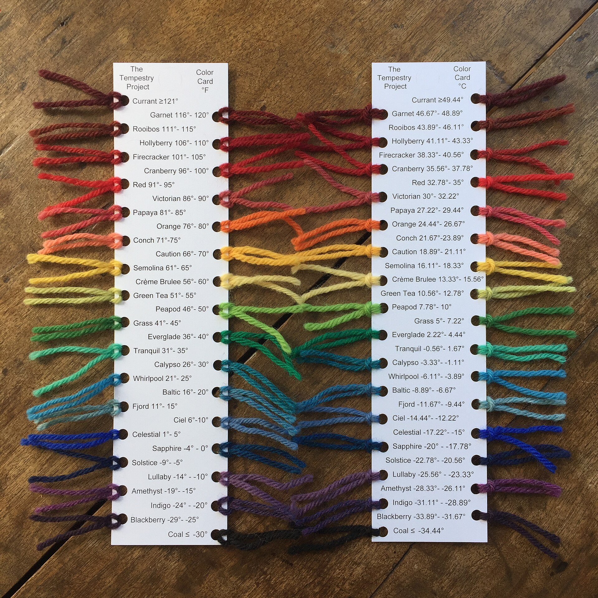
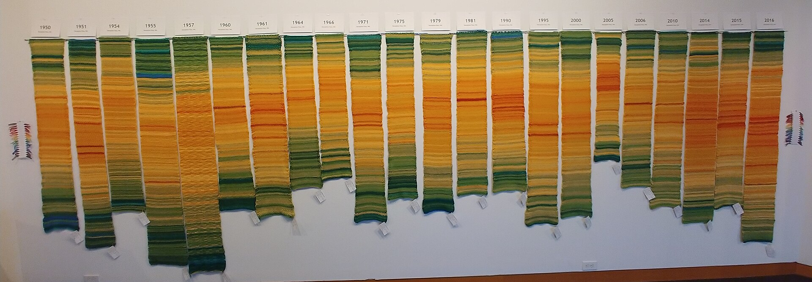
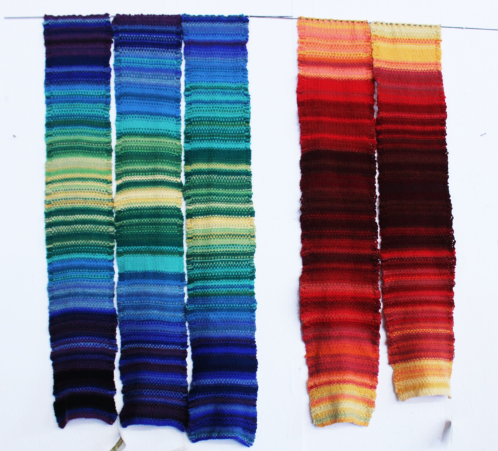

+++
author = "Yuichi Yazaki"
title = "A 32-Color Legend Shared by Everyone, One Strip per Year Hung Side by Side: The Tempestry Project"
slug = "tempestry-project"
date = "2026-11-05"
description = "The Tempestry Project fixed daily high temperatures to 32 colors in 5°F steps and had everyone use the same yarn, so that one strip per place and year could be lined up and compared."
categories = [
    "consume"
]
tags = [
    "data physicalization",
    "color"
]
image = "images/deception-pass-1950-2016.jpg"
+++

The Tempestry Project fixed everything from −30°F and below to 121°F and above to 32 colors in 5°F steps, and had everyone use the same yarn. One tapestry represents the daily high temperatures of one place for one year. One day is one row: January 1 is at the bottom and December 31 at the top. At exhibitions, tapestries of the same place in different years, or of different places, were hung side by side so that they could be compared.

The project began in Anacortes, Washington, in 2017. What follows draws on the knitting instructions and color cards (PDF) the project distributed, an interview with a co-founder, and records of exhibitions. As a sequel to [temperature scarves and blankets](/en/temperature-scarf/), where each maker sets the color steps to suit their own climate, this article reads a case in which everyone shares the same legend.

<!--more-->

## 2017: Knitting before the data disappears

The name is a coinage from temperature and tapestry. The trigger was the 2016 US presidential election: climate data might be removed from government sites such as NOAA (the US National Oceanic and Atmospheric Administration). Reading the situation that way is how it began, according to an article from Barnard College. Co-founder Emily McNeil says:

> "We were joking about using knitting to create wall hangings [that would record] this data for posterity … Because unlike online data storage, tapestries can last for centuries or even millennia."

In other words: they joked about knitting wall hangings to preserve the data, because tapestries last for hundreds of years.

The founders' names differ depending on the source.

| Source | Founders listed |
|---|---|
| Barnard College (2020) | Two: McNeil and her partner Justin Connelly |
| English Wikipedia, Hindustan Times (2019), Irish Examiner (2025) | Three: Emily McNeil, Marissa Connelly, and Justin Connelly |
| Exhibition text, Berman Museum (Ursinus College, 2021) | Three: Asy Connelly, Marissa Connelly, and Emily McNeil |

I could not confirm whether Justin Connelly and Asy Connelly are the same person.

The project sold kits containing yarn, instructions, and a table of daily temperatures for the buyer's location. As of April 2020, Barnard reports that participation had spread to 49 states and more than 30 countries.

## One 32-color legend, shared by everyone

The instructions explain why they assign yarn colors to temperature ranges:

> "The idea is to have everyone use the same colors in order to facilitate comparisons from year to year and place to place."

That is, if everyone uses the same colors, it becomes easier to compare across years and across places. The knitting and crochet versions of the instructions contain the same sentence.

The instructions map data to the fabric as follows.

| Data | How it appears in the fabric | Specific values |
|---|---|---|
| Date (one day) | Position along the length | One day = one row. Cast on with the color of January 1 and bind off with the color of December 31 |
| One year | One piece | "January at the bottom and December at the top" |
| That day's high temperature | Color of the row | 32 colors in 5°F steps |
| Place | One weather station per piece | The station's name is written on a card and enclosed |
| Precipitation (optional) | Beads on the right edge | Clear = 0.1 inch, light blue = 1 inch, sapphire = 5 inches |
| Anniversaries (optional) | Beads across the full width of a row | ― |
| ― | Width and length (no data) | About 8–12 inches wide, about 4–5 feet long. "gauge is not important" |

The temperatures come from NOAA data, and gaps are filled from sources such as Weather Underground.

The color card lists all 32 classes. The color names are those of KnitPicks' Wool of the Andes yarn, which the project used at first.

Source: Justin Connelly / [Wikimedia Commons](https://commons.wikimedia.org/wiki/File:Color_Card_F_and_C.jpg) (CC BY-SA 4.0)

The 30 classes other than the two end classes are all 5°F wide. The boundaries are whole numbers in Fahrenheit, and the Celsius values are converted, fractions included. This suggests Fahrenheit is the primary unit. 0°C falls inside Tranquil (31–35°F), so the freezing point is not a color boundary. The 2022 color chart changed the yarn and the color names, but the temperature breaks are the same.

How the ends of each range are written differs between sources. The instructions say "Less than −30°F," which leaves the treatment of exactly −30°F unstated. The color card says "≤ −30°." Barnard writes "less than −30°F to more than 121°F," and the Berman Museum writes "less than −31°F."

Kristen Cooper's card in the [temperature scarf](/en/temperature-scarf/) article had 14 classes in 5°C steps, adapted to her own climate. Tempestry has 32 classes in 5°F steps, from −30°F and below to 121°F and above. It can be read as taking a range wide enough to hold the daily highs of any place. **It can be read as a legend that decided on a common axis for comparison before it decided on legibility for each locale.**

## Not one strip, but side by side

The instructions say:

> "Multiple Tempestries for one location create a striking historical display of shifting temperatures over time."

That is, several strips of the same place make a historical display of changing temperatures. A 2018 Yale Climate Connections article states in its own narration that "the goal of the project is not to look at each piece individually," and says the point is to view different years of the same place side by side. McNeil's own words:

> "If you see a lot of them together, it's a very visually striking representation of changing temperature over time."

In other words, when many are shown together, the change in temperature becomes clearly visible.

The exhibition records show two ways of arranging them.

| Year | Venue | What was hung | Source |
|---|---|---|---|
| 2018 | FutureFest (Anacortes) | Utqiagvik, Alaska: 1925, 2010, 2016; Death Valley, California: 1950, 2016 | Photo caption on Wikimedia Commons |
| Fall 2018 | Museum of Northwest Art, "Surge" exhibition | 22 strips for Deception Pass, Washington; older years at the left | Photo caption on Wikimedia Commons |
| 2019 | Pacific Northwest Quilt & Fiber Arts Museum | One Orcas Island station, the past 100 years at 4-year intervals; the count disagrees: 29 (Islands' Sounder) vs. 27 (Wikipedia) | Islands' Sounder, Wikipedia |
| 2019 | National Parks project | Two strips per park; mostly 2016, the National Park Service centennial, plus an earlier year | Adobe Express project page |

Source: Justin Connelly / [Wikimedia Commons](https://commons.wikimedia.org/wiki/File:Deception_Pass_Collection_Surge_2018_(cropped).jpg) (CC BY-SA 4.0)

One way is to hang the years of a single place in a row. The Commons caption gives the Deception Pass range as 1950–2017, but the tags in the photo run from 1950 to 2016. Color-reference yarn hangs at both sides.

Source: Justin Connelly / [Wikimedia Commons](https://commons.wikimedia.org/wiki/File:Tempestries_for_Utqiagvik,_AK_and_Death_Valley,_CA.jpg) (CC BY-SA 4.0)

The other way is to hang different places, each in chronological order. According to the Commons caption, the three on the left are Utqiagvik and the two on the right are Death Valley. In the photo, the two use different parts of the 32-color range. Both ways of hanging can be read as working only because everyone uses the same 32 colors.

In the National Parks project, many examples put the older year on the left, but Glacier Bay and Death Valley have 2016 on the left, and Grand Canyon is arranged top and bottom. This suggests that while the legend was shared, the direction of arrangement was not fixed.

## Hung alongside the Knitting Map

In 2021, the Berman Museum of Art at Ursinus College opened "Mapping Climate Change: The Knitting Map and The Tempestry Project." It was the first exhibition to show Jools Gilson and Richard Povall's Knitting Map next to Tempestry. It later toured, reaching Cork in 2025.

The Knitting Map was a project of Cork 2005, European Capital of Culture. Over the course of 2005, more than 2,500 people knitted a single cloth. According to the Berman Museum's exhibition text and the Irish Examiner (2021), the stitches encode how crowded the city was, measured by surveillance cameras, and color encodes temperature, precipitation, and wind speed. Early reports (Irish Times, 2004; RTÉ) described the source of the stitches as "satellite images."

The Berman Museum's exhibition text called the Knitting Map "a conceptual and artistic progenitor, of sorts" of Tempestry. In 2025, Gilson also described Tempestry as "this later project it helped inspire." However, the claim that the Knitting Map was a source of inspiration comes only from the people who organized the exhibition and from the Knitting Map's creators. English Wikipedia gives temperature blankets as the source of inspiration. The materials from the Tempestry side that I was able to read (the instructions and the Barnard article) do not mention the Knitting Map. I have not been able to read the About page of the official site.

The Knitting Map is one cloth for one city and one year; it has two data streams, and its colors are, in Gilson's word, "muted." Tempestry gathers many strips, one per place and year; it has one data stream, and its legend is a public 32 colors. The difference can be read as that between a work read within a single cloth and a work compared across many strips.

## How outsiders saw the project

The assessments each address a different point. The first is skepticism about the project's role in preserving data. The Hindustan Times (2019) quotes Sagnik Dey, an associate professor at IIT Delhi:

> "... Individual efforts are okay, but in climate science everything should be in network mode and government funded."

His opinion is that individual efforts are fine, but climate science should be done in network mode with government funding. It can be read as a rebuttal to McNeil's motivation that tapestries last for centuries.

The second is museum curation. The Berman Museum's exhibition text says that the data is interpreted through the knitter's "personal calligraphy."

> "The process of handknitting and the resultant textiles thus map the motions of makers' hands, as much as they transmit data relating to climate and locale."

The view is that hand-knitted cloth records the movements of the knitter's hands as much as it conveys data.

The third is the researcher's positioning. In a 2020 essay in electronic book review, Anastasia Salter cited a Tempestry scarf as an example of the fusion of craft and computation. She places it within "data-driven craftivism" spreading on social media.

## Takeaways

There are five judgments to carry back into visualization work.

First, if you want people to compare, fix the legend outside the makers' hands, in advance. Tempestry decided the range, the steps, the colors, and even the yarn brand, and distributed them to everyone. It can be read that not letting each maker decide the legend was the precondition for side-by-side comparison.

Second, a shared range has a cost. Covering −30°F to 121°F means that one place in one year uses only part of the 32 colors. This can be read as a choice that put differences between places and between years ahead of the seasons within a place.

Third, separate what is compared from what is not. The instructions say "gauge is not important," and width and length vary by knitter. Only color is compared, not size; that can be read as the design.

Fourth, decide the arrangement too. Within one strip, "January at the bottom" is fixed, but the left-to-right order of strips was not consistent. If you line up small figures, it is better to decide the direction of arrangement as well, just as you decide the legend. That is how I read it.

Fifth, attach the legend and the source to the work. The kit includes a card with the station's name, and the color correspondence is published on the color card. At Barnard, McNeil says that 30 strips for one place would become a record of climate change. What makes those 30 strips readable is the 32-color legend that everyone shared.

## References

**Primary sources**

- Tempestry Project™ Instructions (PDF, uploaded September 2018). [PDF](https://www.tempestryproject.com/wp-content/uploads/2018/09/Tempestry-Instructions.pdf)
- Tempestry Crochet Instructions (PDF, uploaded April 2019). [PDF](https://www.tempestryproject.com/wp-content/uploads/2019/04/Tempestry-Crochet-Instructions.docx.pdf)
- The Tempestry Project Color Card Template v1 (PDF). [PDF](https://tempestryproject.com/wp-content/uploads/2018/09/Color-Card-Template-v1.pdf)
- Tempestry Yarn Color Temperature Beads DMC Thread Chart (PDF, March 2022). [PDF](https://www.tempestryproject.com/wp-content/uploads/2022/03/Tempestry-Yarn-Color-Temperature-Beads-DMC-Thread-Chart.pdf)
- Veronica Suchodolski ’19, “Way Back Wednesday | Environmental Activist Emily McNeil ’98,” Barnard College, 2020-04-22. [Article](https://barnard.edu/news/way-back-wednesday-emily-mcneil-98)
- Ariel Hansen, “Knitters turn climate data into tapestries,” *Yale Climate Connections*, 2018-11-09. [Article](https://yaleclimateconnections.org/2018/11/whats-a-tempestry-knitters-turn-climate-data-into-tapestries/)
- National Parks Tempestry Project (edited by Erika Zambello), Adobe Express. [Project page](https://express.adobe.com/page/SynDUSs9izWdc/)
- Wikimedia Commons (photos and captions by Justin Connelly, CC BY-SA 4.0). [Color card](https://commons.wikimedia.org/wiki/File:Color_Card_F_and_C.jpg) / [22 strips for Deception Pass](https://commons.wikimedia.org/wiki/File:Deception_Pass_Collection_Surge_2018_(cropped).jpg) / [Utqiagvik and Death Valley](https://commons.wikimedia.org/wiki/File:Tempestries_for_Utqiagvik,_AK_and_Death_Valley,_CA.jpg)
- “Island artists’ textile work on display in La Conner,” *Islands’ Sounder*, 2019-05-15. [Article](https://www.islandssounder.com/life/island-artists-textile-work-on-display-in-la-conner/)
- Berman Museum of Art, Ursinus College, “Mapping Climate Change: The Knitting Map and The Tempestry Project,” 2021-06-11 to 11-30. [Exhibition page](https://ursinus-archive.livewhale.net/live/profiles/4975-mapping-climate-change)
- Lawrence University, Wriston Art Galleries, Past Exhibitions (Mapping Climate Change, Fall 2023). [Exhibition page](https://www.lawrence.edu/academics/galleries-art/wriston-art-galleries/exhibitions/past-exhibitions/interdisciplinary)
- Marc O’Sullivan Vallig, “Cork In 50 Artworks, No 33: The Knitting Map for European Capital of Culture, 2005,” *Irish Examiner*, 2021-12-13. [Article](https://www.irishexaminer.com/lifestyle/artsandculture/arid-40762944.html)
- Marc O’Sullivan Vallig, “‘I do feel really humbled’: Cork's Knitting Map gets tangled up in debate on American values,” *Irish Examiner*, 2024-11-04. [Article](https://www.irishexaminer.com/lifestyle/artsandculture/arid-41508134.html)
- Marc O’Sullivan Vallig, “Jools Gilson of UCC: Mapping Climate Change at Cork's newest art venue,” *Irish Examiner*, 2025-11-10. [Article](https://www.irishexaminer.com/lifestyle/artsandculture/arid-41740035.html)
- “Knitting together a new stitch pattern of Cork,” *Irish Times*, 2004-10-30. [Article](https://www.irishtimes.com/news/knitting-together-a-new-stitch-pattern-of-cork-1.1164222)
- “Cork knitters make giant textile record,” RTÉ Archives (broadcast 2005-08-24). [Archive](https://www.rte.ie/archives/2015/0824/723181-cork-knitters-make-giant-textile-record)
- English Wikipedia, “The Tempestry Project” (version of 2026-04-16 consulted). [Wikipedia](https://en.wikipedia.org/wiki/The_Tempestry_Project)

**Secondary sources**

- “A knitting movement of weather data to document climate change,” *Hindustan Times*, 2019-01-06. [Article](https://www.hindustantimes.com/india-news/a-knitting-movement-of-weather-data-to-document-climate-change/story-cHzHw0KuVLEAAaIt1PphjM.html)
- Berman Museum of Art exhibition text. [Exhibition page](https://ursinus-archive.livewhale.net/live/profiles/4975-mapping-climate-change)
- Anastasia Salter, “Re:traced Threads: Generating Feminist Textile Art with Tracery,” *electronic book review*, 2020-05-03. [doi:10.7273/dped-gd56](https://doi.org/10.7273/dped-gd56)
