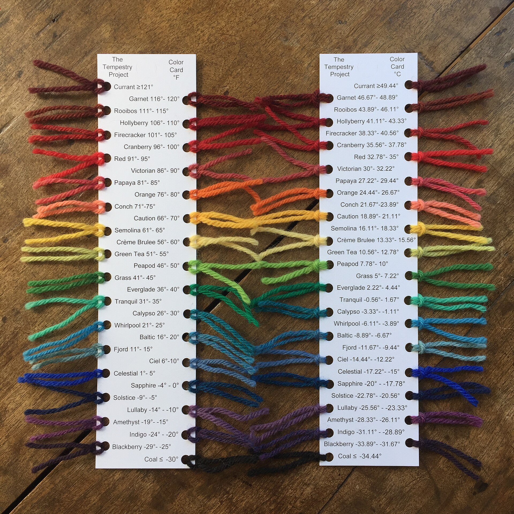
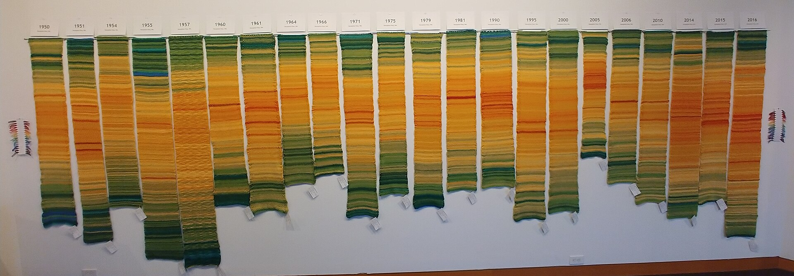
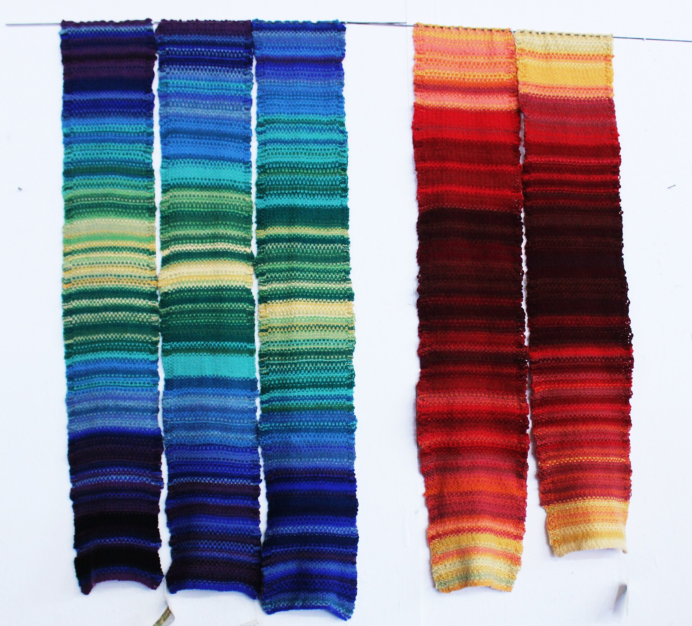

+++
author = "矢崎裕一"
title = "32色の凡例を全員で共有し、1年1本を並べて比べる──The Tempestry Project"
slug = "tempestry-project"
date = "2026-11-05"
description = "The Tempestry Project は、日最高気温を5°F刻みの32色に固定して全員に同じ毛糸を使わせ、1地点・1年の1本を並べて比べられるようにしました。"
categories = [
    "consume"
]
tags = [
    "データ物質化",
    "色"
]
image = "images/deception-pass-1950-2016.jpg"
series = ["data-physicalization"]
series_weight = 99
seriesByline = "Emily McNeil ほか"
seriesTitle = "全員が同じ32色で編む──The Tempestry Project"
+++

The Tempestry Project（テンペストリー・プロジェクト）は、−30°F 以下から 121°F 以上までを 5°F 刻みの32色に固定して、全員に同じ毛糸を使わせました。1本のタペストリーが、1地点・1年の日最高気温を表します。1日が1段で、1月1日が下、12月31日が上です。展示では、同じ地点の別の年や、別の地点の作品を横に並べて、比べられるようにしました。

プロジェクトは2017年、ワシントン州 Anacortes で始まりました。以下は、プロジェクトが配布した編み方の説明書と色見本カード（PDF）、共同創設者へのインタビュー記事、展示の記録に沿います。土地ごとに色の刻みを決める[気温スカーフとブランケット](/temperature-scarf/)の続きとして、ここでは全員で同じ凡例を共有した例を読みます。

<!--more-->

## 2017年、データが消える前に編む

名前は temperature（気温）と tapestry（タペストリー）を合わせた造語です。きっかけは2016年の米大統領選でした。NOAA（米国海洋大気庁）などの政府サイトから、気候データが消されるかもしれない。そう読んだことが始まりだ、と Barnard College の記事は書いています。共同創設者の Emily McNeil（エミリー・マクニール）は、こう話しています。

> "We were joking about using knitting to create wall hangings [that would record] this data for posterity … Because unlike online data storage, tapestries can last for centuries or even millennia."

データを残す壁掛けを編もうと冗談を言っていた、タペストリーは何百年ももつ、という話です。

創設者の名前は、資料によって違います。

| 資料 | 創設者の表記 |
|---|---|
| Barnard College（2020） | McNeil と、パートナーの Justin Connelly（ジャスティン・コネリー）の2人 |
| 英語版 Wikipedia、Hindustan Times（2019）、Irish Examiner（2025） | Emily McNeil、Marissa Connelly（マリッサ・コネリー）、Justin Connelly の3人 |
| Berman Museum（Ursinus College、2021）の展示解説 | Asy Connelly、Marissa Connelly、Emily McNeil の3人 |

Justin Connelly と Asy Connelly が同じ人かどうかは、確かめられませんでした。

プロジェクトは、毛糸と説明書、その土地の日ごとの気温表を入れたキットを売りました。Barnard は2020年4月の時点で、参加は49州と30か国以上に広がったと書いています。

## 32色の凡例を、全員で共有する

説明書は、毛糸の色を気温の範囲に割り当てた理由を、こう書いています。

> "The idea is to have everyone use the same colors in order to facilitate comparisons from year to year and place to place."

全員が同じ色を使えば、年どうし、場所どうしを比べやすくなる、という説明です。棒針版とかぎ針版の説明書で、同じ文です。

データと編み地の対応は、説明書では次のとおりです。

| データ | 編み地での表し方 | 具体的な値 |
|---|---|---|
| 日付（1日） | 長さ方向の位置 | 1日＝1段。1月1日の色で作り目、12月31日の色で止める |
| 1年 | 1本の作品 | 「January at the bottom and December at the top」 |
| その日の最高気温 | 段の色 | 5°F 刻みの32色 |
| 地点 | 1本ごとに1つの観測所 | 観測所の名前をカードに書いて同封 |
| 降水量（任意） | 右端のビーズ | 透明＝0.1インチ、水色＝1インチ、サファイア＝5インチ |
| 記念日（任意） | 段の全幅のビーズ | ― |
| ― | 幅・長さ（データなし） | 幅約8〜12インチ、長さ約4〜5フィート。「gauge is not important」 |

気温は NOAA のデータで、欠けたところは Weather Underground などで補います。

32の階級は、色見本カードに全部が載っています。色名は、当初使った KnitPicks の毛糸 Wool of the Andes のものです。

Justin Connelly／[Wikimedia Commons](https://commons.wikimedia.org/wiki/File:Color_Card_F_and_C.jpg) より引用（CC BY-SA 4.0）

両端を除く30階級は、すべて幅5°F です。境界は華氏の整数で、摂氏は換算した端数です。主の単位は華氏だと読めます。0℃は Tranquil（31〜35°F）の中にあり、氷点は色の境目になっていません。2022年の色表では毛糸と色名が替わりましたが、温度の区切りは同じです。

なお、範囲の端の書き方は資料で違います。説明書は「Less than −30°F」で、−30°F ちょうどの扱いが抜けています。色見本カードは「≤ −30°」です。Barnard は「less than −30°F to more than 121°F」、Berman Museum は「less than −31°F」と書いています。

[気温スカーフ](/temperature-scarf/)の Kristen Cooper のカードは、自分の土地に合わせた5℃刻みの14階級でした。Tempestry は、どの土地の日最高気温も載る範囲を、最初から32階級で取っています。**土地ごとの見やすさより、比べるための共通の軸を先に決めた凡例**と読めます。

## 1本ではなく、並べて見る

説明書は、こう書いています。

> "Multiple Tempestries for one location create a striking historical display of shifting temperatures over time."

同じ地点の何本もが、気温の移り変わりの歴史的な展示になる、という意味です。Yale Climate Connections の2018年の記事は、地の文で「the goal of the project is not to look at each piece individually」と書き、同じ場所の別の年を横に並べて見ることだとしています。McNeil 自身の言葉はこうです。

> "If you see a lot of them together, it's a very visually striking representation of changing temperature over time."

たくさん並べると、気温の変化がはっきり見える、という話です。

展示の記録では、並べ方に二つの型が見られます。

| 年 | 場所 | 並べたもの | 出典 |
|---|---|---|---|
| 2018 | FutureFest（Anacortes） | Utqiagvik（アラスカ）の1925・2010・2016年と、Death Valley（カリフォルニア）の1950・2016年 | Wikimedia Commons の写真説明 |
| 2018年秋 | Museum of Northwest Art「Surge」展 | Deception Pass（ワシントン州）の22本。左が古い年 | Wikimedia Commons の写真説明 |
| 2019 | Pacific Northwest Quilt & Fiber Arts Museum | Orcas 島の観測所の、過去100年を4年おき。本数は29本（Islands' Sounder）と27本（Wikipedia）で食い違う | Islands' Sounder、Wikipedia |
| 2019 | 国立公園のプロジェクト | 1公園に2本。多くは国立公園局100周年の2016年と、早い年 | Adobe Express のプロジェクトページ |

Justin Connelly／[Wikimedia Commons](https://commons.wikimedia.org/wiki/File:Deception_Pass_Collection_Surge_2018_(cropped).jpg) より引用（CC BY-SA 4.0）

一つは、同じ地点の年を横一列に並べる型です。Deception Pass の範囲は、Commons の説明文では1950〜2017年ですが、写真の札は1950年から2016年までです。両脇には、色見本の毛糸が下げてあります。

Justin Connelly／[Wikimedia Commons](https://commons.wikimedia.org/wiki/File:Tempestries_for_Utqiagvik,_AK_and_Death_Valley,_CA.jpg) より引用（CC BY-SA 4.0）

もう一つは、別の地点をそれぞれ年代順に並べる型です。Commons の説明文では、左の3本が Utqiagvik、右の2本が Death Valley です。写真では、両者は32色のうち別の範囲を使っています。どちらの型も、全員が同じ32色を使うから成り立つ並べ方だと読めます。

国立公園のプロジェクトでは、古い年を左に置く例が多い一方、Glacier Bay や Death Valley は2016年が左で、Grand Canyon は上下です。凡例は共有しても、並べる向きまでは決めていなかったと読めます。

## Knitting Map と並べられる

2021年、Ursinus College の Berman Museum of Art は「Mapping Climate Change: The Knitting Map and The Tempestry Project」を開きました。Jools Gilson（ジュールズ・ギルソン）と Richard Povall（リチャード・ポヴォール）の Knitting Map を、初めて Tempestry と並べた展示です。その後、2025年のコークまで巡回しました。

Knitting Map は、欧州文化首都コーク2005の事業です。2005年の1年間、2,500人以上が1枚の布を編みました。監視カメラで測った街の混み具合を編み目に、気温・降水・風速を色に変えています。

キュレーターの Deborah Barkun は、Knitting Map を Tempestry の「a conceptual and artistic progenitor, of sorts」と呼びました。Gilson も2025年に、Tempestry を「this later project it helped inspire」と言っています。ただし、Knitting Map を着想源とする言葉は、展示を企画した側と Knitting Map の作者の側にしかありません。Tempestry の作者側の資料は、着想源を気温ブランケットとしていて、Knitting Map には触れていません。

Knitting Map は1都市・1年の1枚で、データは2系統、配色は Gilson が「muted」と言う抑えたものです。Tempestry は1地点・1年の1本を多数集め、データは1系統、凡例は公開の32色です。1枚の中を読む作品と、何本もを見比べる作品の違いと読めます。

## 第三者はこのプロジェクトをどう見たか

評価は、それぞれ別の点に向いています。一つ目は、データ保存の役割への懐疑です。Hindustan Times（2019年）は、IIT Delhi の Sagnik Dey（サグニク・デイ）准教授の言葉を載せています。

> "... Individual efforts are okay, but in climate science everything should be in network mode and government funded."

個人の取り組みはよいが、気候科学は政府の資金で、ネットワークで行うべきだ、という意見です。タペストリーは何百年ももつ、という McNeil の動機への反論と読めます。

二つ目は、美術館のキュレーションです。Berman Museum の展示解説は、データは編み手の「personal calligraphy」を通して解釈される、と書きます。

> "The process of handknitting and the resultant textiles thus map the motions of makers' hands, as much as they transmit data relating to climate and locale."

手編みの布は、データを伝えるのと同じくらい、編み手の手の動きを写している、という見方です。

三つ目は、研究者の位置づけです。Anastasia Salter（アナスタシア・ソルター）は2020年、electronic book review の論考で、Tempestry のスカーフを手芸と計算の融合の例に挙げました。SNS で広がる「data-driven craftivism」として位置づけています。

## 使い道

可視化の仕事に持ち帰れる判断は、五つあります。

一つ目は、比べさせたいなら、凡例を作り手の外で先に固定することです。Tempestry は、範囲・刻み・色・毛糸の銘柄まで決めて、全員に配りました。凡例を作り手ごとに決めさせないことが、並べて比べるための前提になっていると読めます。

二つ目は、共通の範囲の代償です。−30°F から 121°F までを覆うと、一つの地点の1年は32色の一部しか使いません。土地の中の季節より、土地どうし・年どうしの違いを優先した選択と読めます。

三つ目は、比べるものと比べないものを分けることです。説明書は「gauge is not important」と書き、幅と長さは編み手ごとに変わります。比べるのは色だけで、大きさは比べない設計だと読めます。

四つ目は、並べ方まで決めることです。1本の中は「1月が下」と決まっていても、本の左右の順はそろっていませんでした。小さな図を並べるなら、並べる向きも凡例と同じように決めておくとよい、と読めます。

五つ目は、凡例と出典を作品に添えることです。キットには観測所の名前のカードが入り、色の対応は色見本カードで公開されています。McNeil は Barnard で、1地点の30本は気候変動の記録になる、と話しています。その30本を読めるものにしているのは、全員が共有した32色の凡例です。

## 参考・出典

**一次情報**

- Tempestry Project™ Instructions（PDF、2018年9月アップロード）. [PDF](https://www.tempestryproject.com/wp-content/uploads/2018/09/Tempestry-Instructions.pdf)
- Tempestry Crochet Instructions（PDF、2019年4月アップロード）. [PDF](https://www.tempestryproject.com/wp-content/uploads/2019/04/Tempestry-Crochet-Instructions.docx.pdf)
- The Tempestry Project Color Card Template v1（PDF）. [PDF](https://tempestryproject.com/wp-content/uploads/2018/09/Color-Card-Template-v1.pdf)
- Tempestry Yarn Color Temperature Beads DMC Thread Chart（PDF、2022年3月）. [PDF](https://www.tempestryproject.com/wp-content/uploads/2022/03/Tempestry-Yarn-Color-Temperature-Beads-DMC-Thread-Chart.pdf)
- Veronica Suchodolski ’19, “Way Back Wednesday | Environmental Activist Emily McNeil ’98,” Barnard College, 2020-04-22. [記事](https://barnard.edu/news/way-back-wednesday-emily-mcneil-98)
- Ariel Hansen, “Knitters turn climate data into tapestries,” *Yale Climate Connections*, 2018-11-09. [記事](https://yaleclimateconnections.org/2018/11/whats-a-tempestry-knitters-turn-climate-data-into-tapestries/)
- National Parks Tempestry Project（Erika Zambello 編）, Adobe Express. [プロジェクトページ](https://express.adobe.com/page/SynDUSs9izWdc/)
- Wikimedia Commons（Justin Connelly 撮影・説明文、CC BY-SA 4.0）. [色見本カード](https://commons.wikimedia.org/wiki/File:Color_Card_F_and_C.jpg) / [Deception Pass の22本](https://commons.wikimedia.org/wiki/File:Deception_Pass_Collection_Surge_2018_(cropped).jpg) / [Utqiagvik と Death Valley](https://commons.wikimedia.org/wiki/File:Tempestries_for_Utqiagvik,_AK_and_Death_Valley,_CA.jpg)
- “Island artists’ textile work on display in La Conner,” *Islands’ Sounder*, 2019-05-15. [記事](https://www.islandssounder.com/life/island-artists-textile-work-on-display-in-la-conner/)
- Berman Museum of Art, Ursinus College, “Mapping Climate Change: The Knitting Map and The Tempestry Project,” 2021-06-11〜11-30. [展示ページ](https://ursinus-archive.livewhale.net/live/profiles/4975-mapping-climate-change)
- Lawrence University, Wriston Art Galleries, Past Exhibitions（Mapping Climate Change, Fall 2023）. [展示ページ](https://www.lawrence.edu/academics/galleries-art/wriston-art-galleries/exhibitions/past-exhibitions/interdisciplinary)
- Marc O’Sullivan Vallig, “Cork In 50 Artworks, No 33: The Knitting Map for European Capital of Culture, 2005,” *Irish Examiner*, 2021-12-13. [記事](https://www.irishexaminer.com/lifestyle/artsandculture/arid-40762944.html)
- Marc O’Sullivan Vallig, “‘I do feel really humbled’: Cork's Knitting Map gets tangled up in debate on American values,” *Irish Examiner*, 2024-11-04. [記事](https://www.irishexaminer.com/lifestyle/artsandculture/arid-41508134.html)
- Marc O’Sullivan Vallig, “Jools Gilson of UCC: Mapping Climate Change at Cork's newest art venue,” *Irish Examiner*, 2025-11-10. [記事](https://www.irishexaminer.com/lifestyle/artsandculture/arid-41740035.html)
- 英語版 Wikipedia「The Tempestry Project」（2026-04-16 版を参照）. [Wikipedia](https://en.wikipedia.org/wiki/The_Tempestry_Project)

**第三者評価**

- “A knitting movement of weather data to document climate change,” *Hindustan Times*, 2019-01-06. [記事](https://www.hindustantimes.com/india-news/a-knitting-movement-of-weather-data-to-document-climate-change/story-cHzHw0KuVLEAAaIt1PphjM.html)
- Berman Museum of Art（キュレーター Deborah Barkun）の展示解説. [展示ページ](https://ursinus-archive.livewhale.net/live/profiles/4975-mapping-climate-change)
- Anastasia Salter, “Re:traced Threads: Generating Feminist Textile Art with Tracery,” *electronic book review*, 2020-05-03. [doi:10.7273/dped-gd56](https://doi.org/10.7273/dped-gd56)
