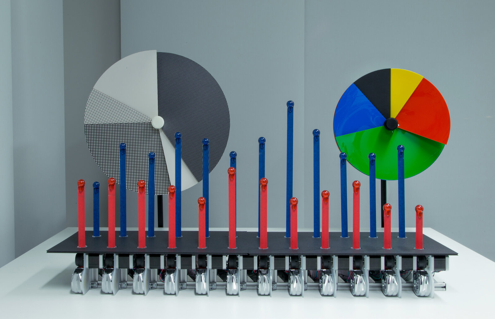
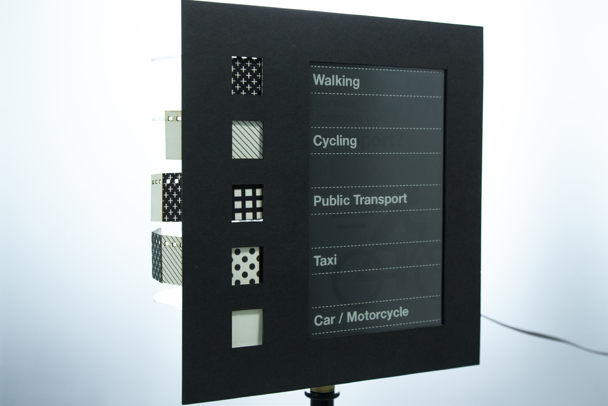
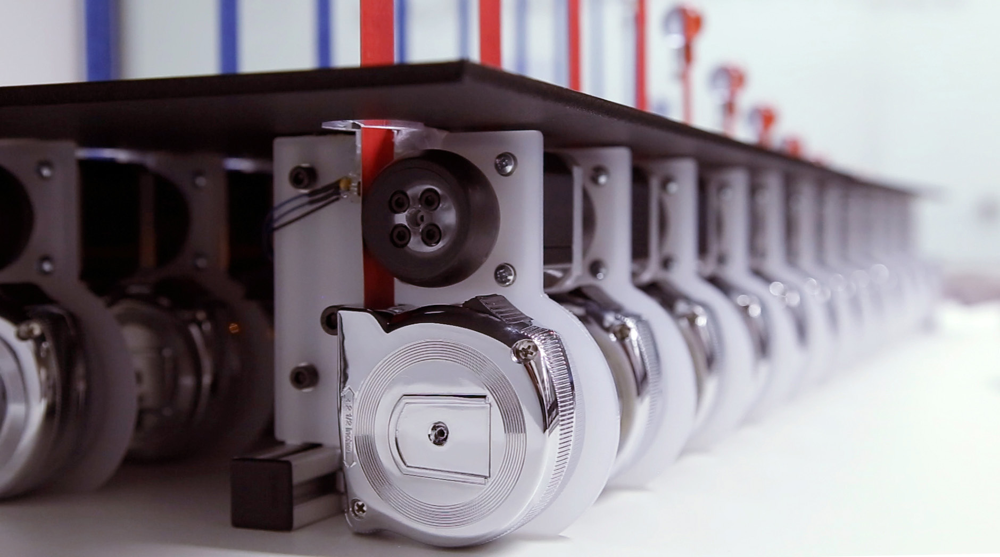
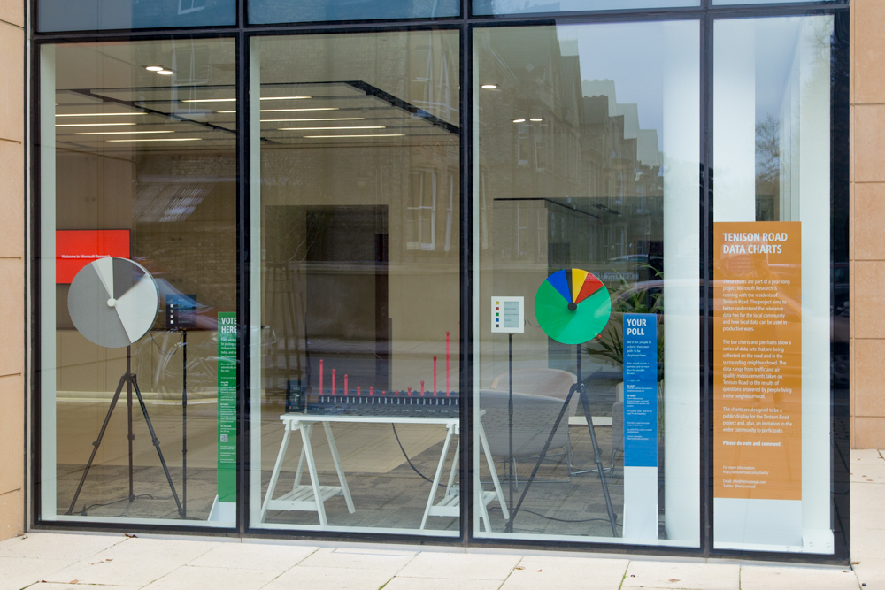

+++
author = "Yuichi Yazaki"
title = "Moving a Familiar Pie Chart in a Street-Facing Window: Physical Charts on Tenison Road"
slug = "tenison-road-charts"
date = "2026-11-01"
description = "Physical Charts is a work that moves pie charts and bar graphs everyone knows by machine. Placed in the street-facing window of a lab in Cambridge, UK, it showed locally collected car traffic and residents' votes."
categories = [
    "consume"
]
tags = [
    "data physicalization",
    "pie chart",
    "bar chart"
]
image = "images/cover.jpg"
series = ["data-physicalization"]
series_weight = 29
seriesByline = "David Sweeney et al. (Microsoft Research)"
seriesTitle = "Pie and Bar Charts Moving in a Window: Physical Charts"
+++

Physical Charts is a work that moves the pie charts and bar graphs everyone knows by machine. David Sweeney and colleagues at Microsoft Research Cambridge made it in 2014. They placed it in the lab's window facing Tenison Road in Cambridge, UK, and used it to show locally collected car traffic and the results of votes that residents answered.

The work is part of the "Tenison Road project," in which residents and researchers handle local data together. It is listed on dataphys.org under the name "Dynamic Physical Charts Display Community Data." What follows reads it alongside the authors' papers "A Pixel is Not a Pixel" (RTD 2015) and "Designing Engaging Data in Communities" (CHI EA 2015), and a CSCW 2017 paper that reports on the deployment in the window.

<!--more-->

## 2013: Collecting Street Data with Residents

Tenison Road is a street of about half a mile that runs from Cambridge station toward Anglia Ruskin University. The Microsoft Research lab faces this street. In October 2013, the lab's Human Experience & Design group started a project with residents. They handed out flyers to about 80 homes and held a launch meeting, and since then have met almost monthly with 20 to 30 residents.

The data collected falls into three main kinds.

| Data | How it is collected |
|---|---|
| Car traffic (volume, speed, direction) | A thermal camera on the lab's roof counts passing cars. 7,314 counts in a single day, February 25, 2014 |
| Air quality | Readings from Air Quality Egg sensors placed in residents' homes are aggregated |
| Local votes | The web vote BallotShare, the push-button voting poster PosterVote, and the home voting device Bullfrog |

Before building the charts, in 2014, the authors wrote down the idea in a paper in *Big Data & Society*.

> we are envisioning the data driving remotely controlled, mechanical pie-charts and graphs, creating a spectacle for bystanders on the road to view the 'data' they are themselves producing, as well as ways for them to engage in and comment on it.

In short: use the data to drive mechanical pie charts and graphs, make a spectacle through which people on the street can see the "data" they themselves produce, and also give them a way to engage with it and comment on it.

## Putting Physical Charts in a Window Full of Screens

On where to show the work, the abstract of RTD 2015 says this.

> We chose to use our highly visible window-frontage, visible from Tenison Road itself. As a technology company, our street facing window is full of screens, which could easily have been used for our purposes. Instead we have designed and built physical visualizations of a pie chart and a line graph.

The location is the lab's window, which is easy to see from the street. A technology company's window has plenty of screens that could have been used, but the authors instead built a pie chart and a line graph (in the finished work, a bar graph) as physical objects.

The same paper says that simple charts are so common that they fail to catch the eye. The way out was to keep the simplicity while presenting the data physically rather than on a screen or on paper. The paper is also explicit about its reaction against the pursuit of novelty.

> In response to the increasing sophistication of data visualisations and the seemingly unquestioning quest for novelty, the charts make playful use of long established and highly familiar representations like pie charts and bar graphs. Rather than estrange viewers, the objective is to enable them to, at a glance, engage with and comprehend data.

In short: visualizations are becoming more elaborate, and novelty is pursued without question. In response, the charts make playful use of familiar pie charts and bar graphs, so that viewers can understand the data at a glance. Sweeney's portfolio also lists not using glowing screens or LEDs as one of the design conditions.

In the author's view, physicalization is a technique often used to add a new dimension, such as volume or touch. Here, by contrast, it can be read as **a means of keeping intact the way 2D pie charts and bar graphs are read**.

## The Length of a Tape Measure, the Angle of a Disc

The finished work consists of two pie charts and one bar graph. The pie chart comes in a card version and an acrylic version.

Source: David Sweeney, Tim Regan, Alex Taylor, Siân Lindley / RTD 2015 "A Pixel is Not a Pixel" (CC BY 4.0)

The pie chart can show up to five categories. Motors and gears turn five discs one at a time to make the size of each sector. Each sector emerges from behind the front plate along a 3D-printed spiral guide. The legend sits on a separate stand: category names appear on e-paper, with swatches of the same material as the pie chart placed beside them.

Source: David Sweeney, Tim Regan, Alex Taylor, Siân Lindley / RTD 2015 "A Pixel is Not a Pixel" (CC BY 4.0)

The bar graph has 2 rows of 12 bars, and the bars are commercially available DIY tape measures. Each is wrapped in colored masking tape and fed out one by one by a motor and a 3D-printed rubber wheel. A pair of bars, one above the other, shares a single e-paper label.

Source: David Sweeney, Tim Regan, Alex Taylor, Siân Lindley / RTD 2015 "A Pixel is Not a Pixel" (CC BY 4.0)

The correspondence between data and appearance, as summarized from the paper's description, is as follows.

| Data | Chart | Appearance / material |
|---|---|---|
| Proportions (vote results, share of speeding cars, etc.) | Pie chart | Angle of the sector |
| Telling categories apart | Pie chart | Color and material of the sector (card, acrylic) |
| Category names | Pie chart legend | Material swatches and e-paper text |
| Quantities (traffic, speed, rainfall, number of votes, etc.) | Bar graph | Length of the extended tape measure |
| Two datasets | Bar graph | Upper and lower rows |
| Time periods / categories | Bar graph labels | E-paper text |
| Switching between datasets | Both | Motion |

The design policy is stated in RTD 2015 as follows.

> To ensure maximum clarity of the displayed data, the charts have been designed to be as visually similar to their 2D versions from which they were inspired. This requires that all the mechanics and control systems are hidden when viewing from the front.

In short: to show the data as clearly as possible, the charts were made to look as similar as possible to the 2D charts they are based on, and for that reason the mechanics and control systems are hidden from the front. The paper also says paper, card, and tape measures were chosen to add warmth and a tactile quality to the data. The charts use power only when a value changes.

The cues the charts use stay within the basic ones: length, angle, and color. Hiding the mechanics from the front can also be read as a way of not breaking the familiar form.

## From a Street Party to Five Weeks in the Window

The first public showing was at a street party in the summer of 2014, which about 150 people attended. The dates disagree: the project blog says July 27, while the CHI 2015 paper says "August 2014." In September the work was exhibited at the V&A's Digital Design Weekend in London, where about 13,000 visitors came over the weekend.

On November 20, 2014, the charts were placed in the lab's ground-floor window. According to the announcement, the exhibit ran "until Christmas."

Source: Tenison Road project (Microsoft Research) / tenisonroad.com "VOTE NOW!"

According to the CSCW 2017 paper, the window display ran at the same time as a five-week study in which Bullfrog and PosterVote were distributed. The pie charts showed, in real time, the results of BallotShare's "question of the day." The bar graph showed the weekly question about the neighborhood, combining votes from PosterVote and BallotShare.

CHI EA 2015 lists three findings from the showings at the street party and the V&A. After reporting that people enjoyed seeing their votes appear in the graph straight away, it describes the cost of simplicity.

> However, their simplicity also losses something of the fluid and emergent qualities of data, how data comes to mean different things to different people, at different times. The comments, stories and criticisms get lost in pairing down the results.

In short: simplicity loses the fact that data means different things to different people at different times. In paring the results down, comments, stories, and criticisms are lost.

The results after the charts went into the window are in CSCW 2017.

> the potential to find Special Cards at the posters, or view results displayed on the Physical Charts, was acted upon by only a minority of Bullfrog participants. Most participants simply did not encounter the posters when taking their usual routes through the area, and seemed reluctant to change their habits to accommodate them.

In short: only a minority of Bullfrog participants looked for the Special Cards at the posters or viewed the results on the charts in the window. Most did not come across the posters on their usual routes, and did not seem willing to change their habits.

## How Third Parties Saw the Work

Physical Charts was shortlisted in the "Data visualization" category of the Information is Beautiful Awards 2014. There is no record of a win, and no jury comments could be found. So a physical version of the familiar pie chart and bar graph remained among the finalists of a visualization award.

In the research literature, it is cited as an example of dynamic bar charts and pie charts. Taher, Jansen, and colleagues write the following in their IEEE TVCG (2017) paper.

> For example, Microsoft's Physical Charts [26] demonstrates dynamic bars and pie charts

That is, Physical Charts is placed as an example of shape-changing technology that shows moving bars and pie charts. It does not mention the community or participation context.

The authors themselves report the doubt about the effort involved. The conclusion of RTD 2015 says that viewers were certainly pleased but the effect is hard to state, and quotes the visualization designer Moritz Stefaner.

> As Moritz Stefaner said "that is a lot of work for a pie chart".

In short: that is a lot of work for one pie chart. This is hearsay quoted in the authors' paper, and the author of this article has not been able to confirm when or where Stefaner said it.

## Takeaways

The first thing to take from this work is the option of using physicalization not for novelty but to keep a form people are used to reading. It can be read as a design that makes a chart readable without instruction stand out away from screens.

The second is to build the legend out of materials. The legend swatches are the same material as the pie chart, so it can be read as making it easy to check by eye how they correspond to the chart itself.

The third is that choosing a location does not let you choose people's routes. The authors chose a window visible from the street. Even so, only a minority of Bullfrog participants reached the results, and most did not come across the posters on their usual routes. The same can be said of the charts in the window, as far as one can read. For visualizations placed in public spaces, it is worth finding out even who walks past them.

The fourth is to prepare a place to receive the voices that dropped out because of the simplification. The authors write that residents need a light-weight way to add explanations and questions to the data. It can be read as: the easier a pie chart is to read, the more a mechanism to pick up voices outside it is needed.

## References

**Primary sources**

- Sweeney, D., Regan, T., Taylor, A., Lindley, S. (2015). "A Pixel is Not a Pixel: Simple Data Charting Made Physical." Proc. RTD 2015, Article 24. doi:10.6084/m9.figshare.1327998 (CC BY 4.0): https://figshare.com/articles/journal_contribution/RTD2015_24_A_Pixel_is_Not_a_Pixel_Simple_Data_Charting_Made_Physical/1327998 / https://ast.io/archive/download/2228/pixel-not-pixel-2015.pdf
- Regan, T., Sweeney, D., Helmes, J., Vlachokyriakos, V., Lindley, S., Taylor, A. (2015). "Designing Engaging Data in Communities." CHI EA '15, pp. 271–274. doi:10.1145/2702613.2725432: https://ast.io/archive/download/2226/designing-engaging-data-2015.pdf
- Taylor, A. S., Lindley, S., Regan, T., Sweeney, D. (2014). "Data and life on the street." *Big Data & Society* 1(2). doi:10.1177/2053951714539278: https://ast.io/archive/download/2231/data-life-street-2014.pdf
- Taylor, A. S., Lindley, S., Regan, T., Sweeney, D., Vlachokyriakos, V., Grainger, L., Lingel, J. (2015). "Data-in-Place: Thinking through the Relations Between Data and Community." CHI '15, pp. 2863–2872. doi:10.1145/2702123.2702558: https://ast.io/archive/download/2070/data-in-place-2015.pdf
- Lindley, S. E., Thieme, A., Taylor, A., Vlachokyriakos, V., Regan, T., Sweeney, D. (2017). "Surfacing Small Worlds through Data-In-Place." *Computer Supported Cooperative Work* 26(1-2), 135–163. doi:10.1007/s10606-017-9263-3: https://openaccess.city.ac.uk/id/eprint/18505/1/surfacing-small-worlds-2017.pdf
- Regan, T., Sweeney, D. "Reclaiming Charts: of Physicality and Small Data." (contribution to V&A Digital Design Weekend 2014): https://digitransglasgow.github.io/OpenCollaborativeMaking/contributions/01.html
- David Sweeney, "Visualisation Machines" (portfolio): https://davidasweeney.myportfolio.com/visualisation-machines
- Tenison Road project (site restored from the Wayback Machine): https://tenisonroad.com/ / https://tenisonroad.com/project.html
- Alex Taylor, "Announcing Tenison Road launch" (2013-09-27): https://ast.io/archive/tenison-road/
- Microsoft Research HXD Design, "Physical pie charts" / "Physical bar charts" / "Physical Charts workings" (Vimeo, 2014-09-13): https://vimeo.com/106053695 / https://vimeo.com/106053696 / https://vimeo.com/106053697
- dataphys.org, "Dynamic Physical Charts Display Community Data" (contributed by David Sweeney): https://dataphys.org/list/dynamic-physical-charts-to-communicate-community-data/

**Secondary sources**

- Information is Beautiful Awards 2014, "Physical Charts" (longlist and shortlist in the Data visualization category): https://www.informationisbeautifulawards.com/showcase/504-physical-charts
- Taher, F., Jansen, Y., Woodruff, J., Hardy, J., Hornbæk, K., Alexander, J. (2017). "Investigating the Use of a Dynamic Physical Bar Chart for Data Exploration and Presentation." *IEEE TVCG* 23(1), 451–460. doi:10.1109/TVCG.2016.2598498: https://purehost.bath.ac.uk/ws/files/211082383/VIS16_PhysicalBarChart.pdf (In this public version, the reference number [26] in the quoted passage points to a different work, so confirmation in the published version is needed.)
- Moritz Stefaner's remark "that is a lot of work for a pie chart" (hearsay quoted by the authors in the conclusion of RTD 2015): https://ast.io/archive/download/2228/pixel-not-pixel-2015.pdf
