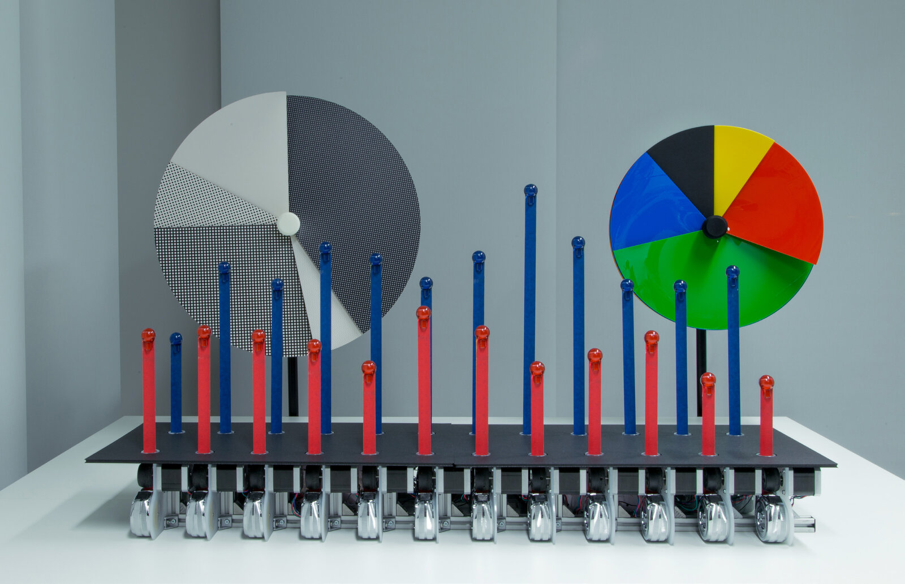
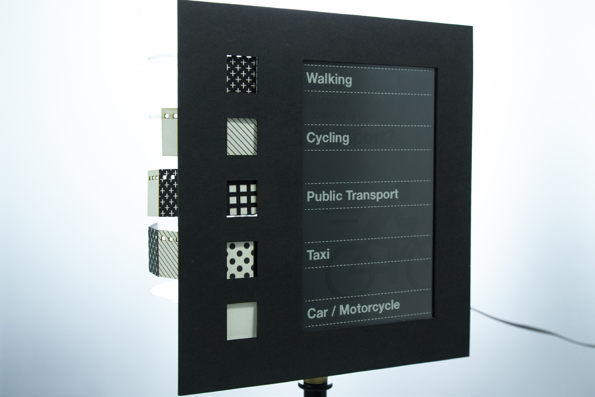
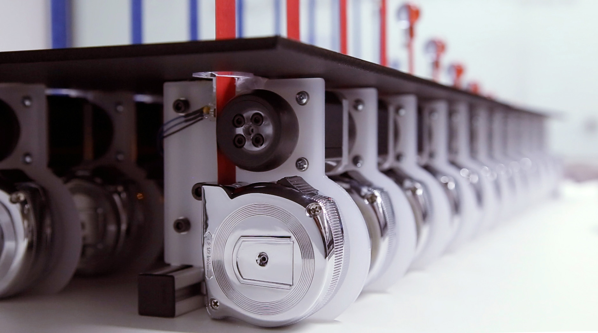
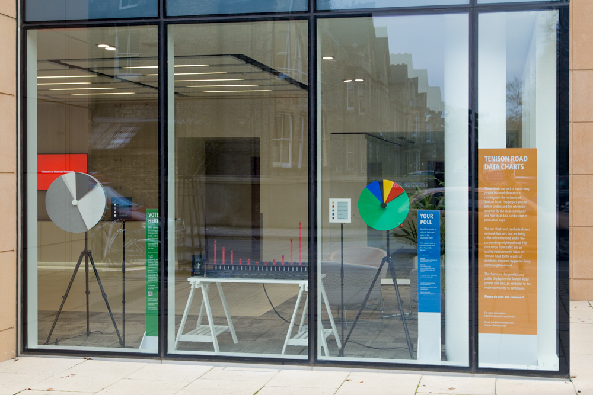

+++
author = "矢崎裕一"
title = "見慣れた円グラフを、通りの窓で動かす──Tenison Road の Physical Charts"
slug = "tenison-road-charts"
date = "2026-11-01"
description = "誰もが知っている円グラフと棒グラフを機械で動かす作品です。英ケンブリッジの通りに面したラボの窓に置き、地域で集めた車の通行量や投票結果を見せました。"
categories = [
    "consume"
]
tags = [
    "データ物質化",
    "円グラフ",
    "棒グラフ"
]
image = "images/cover.jpg"
series = ["data-physicalization"]
series_weight = 29
seriesByline = "David Sweeney ほか（Microsoft Research）"
seriesTitle = "円グラフと棒グラフを窓で動かす──Physical Charts"
+++

Physical Charts は、誰もが知っている円グラフと棒グラフを、機械で動かす作品です。Microsoft Research ケンブリッジの David Sweeney（デイヴィッド・スウィーニー）らが2014年に作りました。英ケンブリッジの Tenison Road（テニソン・ロード）に面したラボの窓に置き、地域で集めた車の通行量や、住民が答えた投票の結果を見せました。

作品は、住民と研究者が地域のデータを一緒に扱う「Tenison Road project」の一部です。dataphys.org には「Dynamic Physical Charts Display Community Data」の名で載っています。以下は、作者らの論文 "A Pixel is Not a Pixel"（RTD 2015）と "Designing Engaging Data in Communities"（CHI EA 2015）、窓での配備を報告した CSCW 2017 の論文に沿って読みます。

<!--more-->

## 2013年、通りのデータを住民と集める

テニソン・ロードは、ケンブリッジ駅から Anglia Ruskin University の方へ延びる、約半マイルの通りです。Microsoft Research のラボは、この通りに面しています。2013年10月、ラボの Human Experience & Design グループが、住民とのプロジェクトを始めました。約80戸にチラシを配って立ち上げの会を開き、その後はほぼ毎月、20〜30人の住民と会合を重ねています。

集めたデータは、おもに三つです。

| データ | 取り方 |
|---|---|
| 車の通行（交通量、速度、方向） | ラボの屋上のサーマルカメラで、通過する車を数える。2014年2月25日の1日で7,314件 |
| 大気の質 | 住民宅に置いたセンサー Air Quality Egg の値を集計する |
| 地域の投票 | ウェブ投票 BallotShare、押しボタン式の投票ポスター PosterVote、家庭用の投票端末 Bullfrog |

グラフを作る前の2014年、作者らは *Big Data & Society* の論文に構想を書いています。

> we are envisioning the data driving remotely controlled, mechanical pie-charts and graphs, creating a spectacle for bystanders on the road to view the 'data' they are themselves producing, as well as ways for them to engage in and comment on it.

データで機械式の円グラフやグラフを動かし、通りの人が、自分たちの生み出した「データ」を見られる見せ物にする。関わったりコメントしたりする手段にもする、という構想です。

## 画面の並ぶ窓に、物理のグラフを置く

どこで見せるかについて、RTD 2015 の要旨はこう書いています。

> We chose to use our highly visible window-frontage, visible from Tenison Road itself. As a technology company, our street facing window is full of screens, which could easily have been used for our purposes. Instead we have designed and built physical visualizations of a pie chart and a line graph.

場所は、通りからよく見えるラボの窓です。テクノロジー企業の窓には画面がいくらでもあり、それを使うこともできた。代わりに、円グラフと線グラフ（作品では棒グラフ）を物理的に作った、という説明です。

同じ論文は、単純なグラフはありふれすぎて目に留まらない、と書きます。打開策は、単純さを保ったまま、画面や紙ではなく物理的に表すことでした。新奇さを追う流れへの反発も、はっきり書かれています。

> In response to the increasing sophistication of data visualisations and the seemingly unquestioning quest for novelty, the charts make playful use of long established and highly familiar representations like pie charts and bar graphs. Rather than estrange viewers, the objective is to enable them to, at a glance, engage with and comprehend data.

可視化が凝ったものになり、新しさが疑われずに追われている。それに対して、見慣れた円グラフと棒グラフを遊び心をもって使い、見る人がひと目でデータを理解できるようにする、という狙いです。Sweeney のポートフォリオは、発光する画面や LED を使わないことも、設計の条件に挙げています。

筆者の見るところ、物理化は、立体や手触りという新しい次元を足すために使われることが多い手法です。この作品では逆に、**2D の円グラフと棒グラフの読み方を、そのまま保つために使われている**と読めます。

## 巻尺の長さと、円盤の角度

完成したのは、円グラフ2基と棒グラフ1基です。円グラフには、カードの版とアクリルの版があります。

David Sweeney, Tim Regan, Alex Taylor, Siân Lindley／RTD 2015 "A Pixel is Not a Pixel" より引用（CC BY 4.0）

円グラフは、最大5つの区分を表せます。モーターとギアで5枚の円盤を1枚ずつ回し、扇形の大きさを作ります。各扇形は、3Dプリントのらせん状のガイドに沿って、前面の板の裏からせり出します。凡例は別の台にあり、区分名を電子ペーパーに出し、横に円グラフと同じ素材の見本を並べます。

David Sweeney, Tim Regan, Alex Taylor, Siân Lindley／RTD 2015 "A Pixel is Not a Pixel" より引用（CC BY 4.0）

棒グラフは2段×12本で、棒は市販の DIY 用の巻尺です。色付きのマスキングテープで包み、1本ずつモーターと3Dプリントのゴム車輪で送り出します。上下1組の棒が、1枚の電子ペーパーのラベルを共有します。

David Sweeney, Tim Regan, Alex Taylor, Siân Lindley／RTD 2015 "A Pixel is Not a Pixel" より引用（CC BY 4.0）

データと見た目の対応を、論文の記述からまとめます。

| データ | グラフ | 見た目・素材 |
|---|---|---|
| 比率（投票結果、速度超過の車の割合など） | 円グラフ | 扇形の角度 |
| 区分の見分け | 円グラフ | 扇形の色と素材（カード、アクリル） |
| 区分名 | 円グラフの凡例 | 素材見本と電子ペーパーの文字 |
| 量（交通量、速度、降雨量、投票数など） | 棒グラフ | 巻尺を伸ばした長さ |
| 二つのデータセット | 棒グラフ | 上下の段 |
| 時間帯・カテゴリ | 棒グラフのラベル | 電子ペーパーの文字 |
| データセットの切り替え | 両方 | 動き |

設計の方針は、RTD 2015 にこう書かれています。

> To ensure maximum clarity of the displayed data, the charts have been designed to be as visually similar to their 2D versions from which they were inspired. This requires that all the mechanics and control systems are hidden when viewing from the front.

データを明快に見せるため、元の2Dのグラフと見た目をできるだけ同じにした。そのために機構と制御系は、前から見えないように隠した、という説明です。紙やカード、巻尺を選んだのは、データに温かみと手触りを加えるためだとも書かれています。グラフは値が変わるときだけ電力を使います。

使っている手がかりは、長さ、角度、色という基本的なものにとどまると読めます。機構を前から隠したのも、見慣れた形を崩さないためでした。

## 通りのパーティーから、窓の5週間へ

最初の公開は、2014年夏の通りのストリートパーティーで、約150人が集まりました。日付は、プロジェクトのブログが7月27日、CHI 2015 の論文が「August 2014」で、食い違います。9月にはロンドンの V&A の Digital Design Weekend に出展し、週末の来場者は約13,000人でした。

2014年11月20日、グラフはラボの1階の窓に置かれました。告知では、展示は「クリスマスまで」です。

Tenison Road project（Microsoft Research）／tenisonroad.com「VOTE NOW!」より引用

CSCW 2017 の論文によると、窓の展示は、Bullfrog と PosterVote を配った5週間の調査と同時に行われました。円グラフは、BallotShare の「その日の質問」の結果をリアルタイムで見せました。棒グラフは、近所についての週の質問を、PosterVote と BallotShare の票を合わせて見せました。

ストリートパーティーと V&A での公開から分かったことを、CHI EA 2015 は三つ挙げています。投票がすぐグラフに表れることを人々が喜んだ、という報告のあとに、単純さの代償が書かれています。

> However, their simplicity also losses something of the fluid and emergent qualities of data, how data comes to mean different things to different people, at different times. The comments, stories and criticisms get lost in pairing down the results.

単純さは、データが人や時によって違う意味を持つことを落とす。結果を切り詰める中で、コメントや物語、批判が失われる、という振り返りです。

窓に置いたあとの結果は、CSCW 2017 にあります。

> the potential to find Special Cards at the posters, or view results displayed on the Physical Charts, was acted upon by only a minority of Bullfrog participants. Most participants simply did not encounter the posters when taking their usual routes through the area, and seemed reluctant to change their habits to accommodate them.

ポスターで特別なカードを探したり、窓のグラフで結果を見たりしたのは、Bullfrog の参加者のうち少数だった。多くはいつもの道順でポスターに出会わず、そのために習慣を変えようともしなかった、という報告です。

## 第三者はこの作品をどう見たか

Physical Charts は、Information is Beautiful Awards 2014 の「Data visualization」部門で、ショートリストに入りました。受賞の記載はなく、審査の講評も見つかりません。見慣れた円グラフと棒グラフの物理版が、可視化の賞の最終候補に残ったことになります。

研究の文脈では、動く棒グラフと円グラフの例として挙げられています。Taher、Jansen らは IEEE TVCG（2017）の論文で、こう書いています。

> For example, Microsoft's Physical Charts [26] demonstrates dynamic bars and pie charts

形の変わる技術の例として、Physical Charts は動く棒と円グラフを示した、という位置づけです。地域や参加の文脈には触れていません。

手間への疑問は、作者ら自身が紹介しています。RTD 2015 の結論は、見た人を喜ばせたのは確かだが、効果は言いにくいと書き、可視化デザイナーの Moritz Stefaner（モーリッツ・ステファナー）の言葉を引きます。

> As Moritz Stefaner said "that is a lot of work for a pie chart".

円グラフ1枚にしては、ずいぶんな手間だ、という言葉です。これは作者らの論文に引かれた伝聞で、Stefaner がいつ、どこで言ったのかを、筆者は確かめられていません。

## 使い道

この作品から持ち帰れるのは、まず、物理化を新しさのためでなく、読み慣れた形を保つために使う選択肢です。読み方を教えなくても読めるグラフを、画面の外で目立たせる設計と読めます。

二つ目は、凡例を素材で作ることです。凡例の見本は円グラフと同じ素材なので、本体との対応を目で確かめやすいと読めます。

三つ目は、置き場所を選んでも、道順までは選べないことです。作者らは通りから見える窓を選びました。それでも、結果までたどり着いた Bullfrog の参加者は少数で、多くはいつもの道順の途中でポスターに出会いませんでした。窓のグラフにも同じことが言える、と読めます。公共の場に置く可視化では、誰がその前を通るかまで調べる価値があります。

四つ目は、単純にした分だけ、落ちた声を受け止める場所を用意することです。作者らは、住民がデータに解説や問いを重ねられる軽い手段が要る、と書いています。円グラフを読みやすくするほど、その外側に声を拾う仕組みが要る、と読めます。

## 参考・出典

**一次情報**

- Sweeney, D., Regan, T., Taylor, A., Lindley, S. (2015). "A Pixel is Not a Pixel: Simple Data Charting Made Physical." Proc. RTD 2015, Article 24. doi:10.6084/m9.figshare.1327998（CC BY 4.0）：https://figshare.com/articles/journal_contribution/RTD2015_24_A_Pixel_is_Not_a_Pixel_Simple_Data_Charting_Made_Physical/1327998 ／ https://ast.io/archive/download/2228/pixel-not-pixel-2015.pdf
- Regan, T., Sweeney, D., Helmes, J., Vlachokyriakos, V., Lindley, S., Taylor, A. (2015). "Designing Engaging Data in Communities." CHI EA '15, pp. 271–274. doi:10.1145/2702613.2725432：https://ast.io/archive/download/2226/designing-engaging-data-2015.pdf
- Taylor, A. S., Lindley, S., Regan, T., Sweeney, D. (2014). "Data and life on the street." *Big Data & Society* 1(2). doi:10.1177/2053951714539278：https://ast.io/archive/download/2231/data-life-street-2014.pdf
- Taylor, A. S., Lindley, S., Regan, T., Sweeney, D., Vlachokyriakos, V., Grainger, L., Lingel, J. (2015). "Data-in-Place: Thinking through the Relations Between Data and Community." CHI '15, pp. 2863–2872. doi:10.1145/2702123.2702558：https://ast.io/archive/download/2070/data-in-place-2015.pdf
- Lindley, S. E., Thieme, A., Taylor, A., Vlachokyriakos, V., Regan, T., Sweeney, D. (2017). "Surfacing Small Worlds through Data-In-Place." *Computer Supported Cooperative Work* 26(1-2), 135–163. doi:10.1007/s10606-017-9263-3：https://openaccess.city.ac.uk/id/eprint/18505/1/surfacing-small-worlds-2017.pdf
- Regan, T., Sweeney, D. "Reclaiming Charts: of Physicality and Small Data."（V&A Digital Design Weekend 2014 の寄稿）：https://digitransglasgow.github.io/OpenCollaborativeMaking/contributions/01.html
- David Sweeney, "Visualisation Machines"（ポートフォリオ）：https://davidasweeney.myportfolio.com/visualisation-machines
- Tenison Road project（Wayback Machine から復元したサイト）：https://tenisonroad.com/ ／ https://tenisonroad.com/project.html
- Alex Taylor, "Announcing Tenison Road launch"（2013-09-27）：https://ast.io/archive/tenison-road/
- Microsoft Research HXD Design, "Physical pie charts" / "Physical bar charts" / "Physical Charts workings"（Vimeo、2014-09-13）：https://vimeo.com/106053695 ／ https://vimeo.com/106053696 ／ https://vimeo.com/106053697
- dataphys.org, "Dynamic Physical Charts Display Community Data"（David Sweeney が提供）：https://dataphys.org/list/dynamic-physical-charts-to-communicate-community-data/

**第三者評価**

- Information is Beautiful Awards 2014, "Physical Charts"（Data visualization 部門のロングリストとショートリスト）：https://www.informationisbeautifulawards.com/showcase/504-physical-charts
- Taher, F., Jansen, Y., Woodruff, J., Hardy, J., Hornbæk, K., Alexander, J. (2017). "Investigating the Use of a Dynamic Physical Bar Chart for Data Exploration and Presentation." *IEEE TVCG* 23(1), 451–460. doi:10.1109/TVCG.2016.2598498：https://purehost.bath.ac.uk/ws/files/211082383/VIS16_PhysicalBarChart.pdf （この公開版では、引用文中の参照番号 [26] が別の文献を指しており、出版版での確認が要ります）
- Moritz Stefaner の発言 "that is a lot of work for a pie chart"（作者らが RTD 2015 の結論に引いた伝聞）：https://ast.io/archive/download/2228/pixel-not-pixel-2015.pdf
