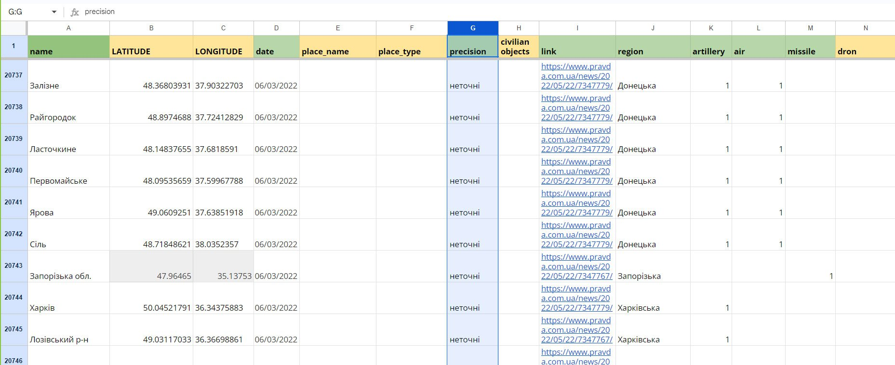
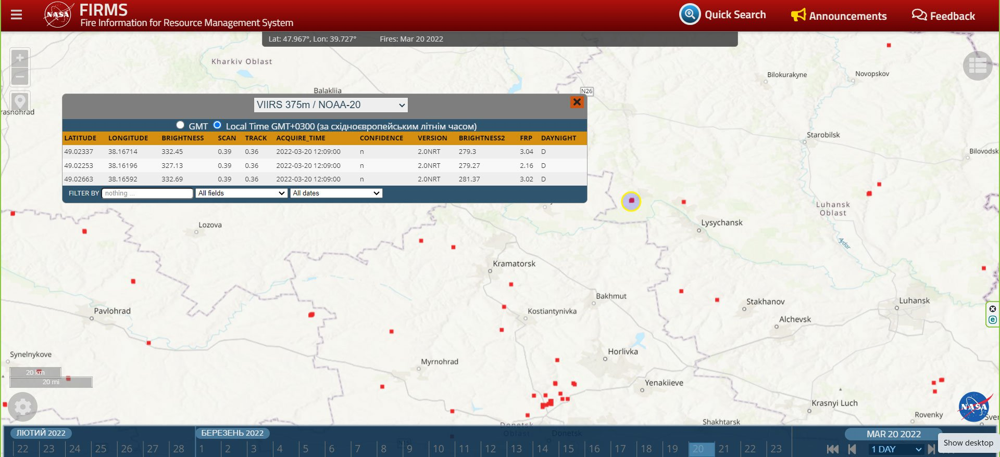
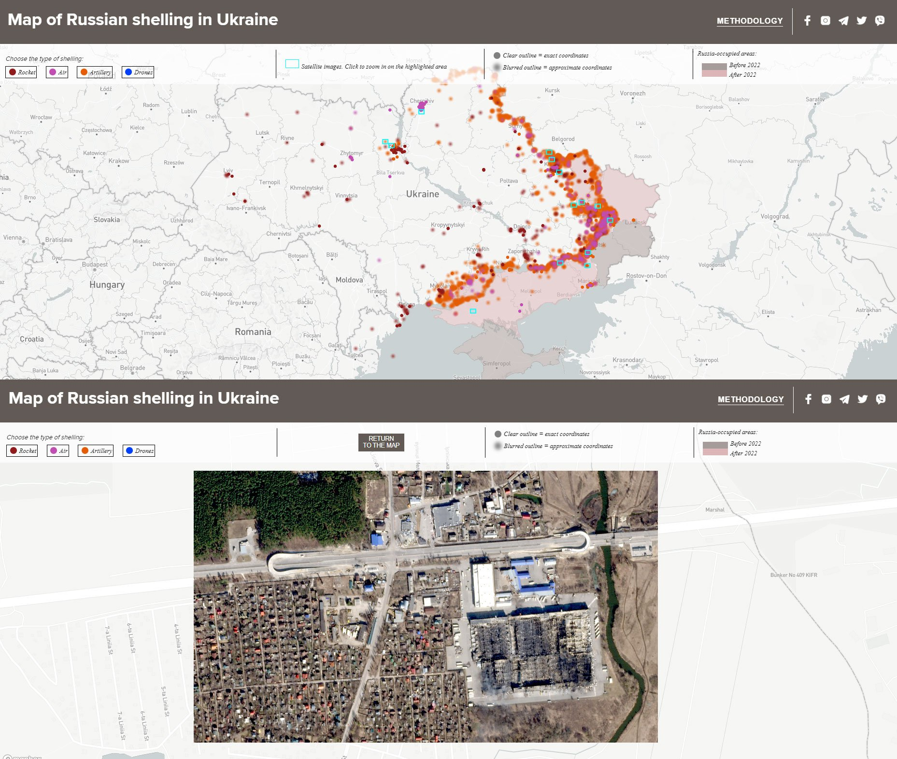
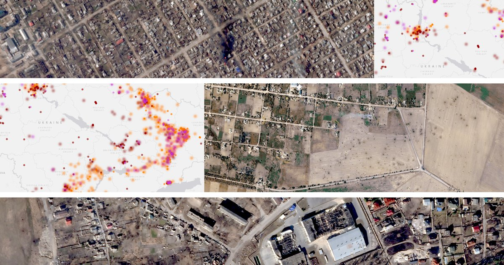

+++
author = "Yuichi Yazaki"
title = "Drawing Shelling Locations in Two Ways by Certainty: TEXTY's \"Under attack\""
slug = "texty-under-attack"
date = "2026-11-04"
description = "TEXTY drew the shelling locations it gathered from news reports in two ways. Locations backed by fire detections or eyewitness reports are small, sharp dots; locations approximated by a settlement's coordinates are large, blurred dots."
categories = [
    "consume"
]
tags = [
    "data journalism",
    "Sigma Awards",
    "uncertainty visualization",
    "maps"
]
image = "images/cover.jpg"
+++

TEXTY drew the locations of Russian shelling, gathered from news reports, in two ways. Locations backed by NASA fire detections or by confirmed eyewitness reports are small, sharp dots. Locations where the report named only a settlement, so the settlement's coordinates stand in, are large, blurred dots. In the drawing code, the former have a radius of 4 and a blur of 0; the latter have a radius of 8 and a blur of 1.5.

The work is "Under attack. What and when Russia shelled in Ukraine" by TEXTY.org.ua, an independent media outlet in Kyiv. The Ukrainian version came out on August 18, 2022, and the English version on September 1. It was shortlisted for the Sigma Awards 2023. What follows draws on the work's text and its METHODOLOGY section, the drawing code written into the page, and the author's conference talk.

<!--more-->

## February 24, 2022: It Starts with a Small Spreadsheet

The work was made by three people: Petro Bodnar, Yevhenia Drozdova, and Nadja Kelm. In 2023, Kelm presented this map at "Visualizing Knowledge," a conference hosted by Aalto University. TEXTY published a transcript of the talk on June 27, 2023. According to the transcript, the theme of that year's conference was "Visualizing Uncertainty."

In the talk, Kelm describes the beginning like this.

> "On February 24, 2022, we ran a quick search for news about the first missile strike. That information was transformed into a map, and that was the final goal. However, the strikes continued on the next day and the day after that. The small spreadsheet started to grow."

On the first day of the invasion, they searched for news of the first missile strike and put it on a map. That was supposed to be the end of it. But the attacks continued the next day and the day after, and the small spreadsheet began to grow.

As the spreadsheet grew, so did its columns: one for the type of attack, and one for the certainty of the coordinates.

> "I added extra columns to record various types of strikes (missiles, artillery, air, and, beginning autumn 2022, drones). Besides I have to identify the precision of coordinates since reports often mention only the name of a town or even of a region."

She added columns for the types of strikes (missiles, artillery, air strikes, and, from autumn 2022, drones). She also had to identify how precise the coordinates were, because reports often give only the name of a town or even of a region.

Source: Nadja Kelm / TEXTY.org.ua, "Data visualisation during wartime." TEXTY.org.ua, CC BY 4.0 (as stated on the site)

Kelm says she collected this data by hand every day for half a year. In the summer of 2022, Planet.com let the team use its database of high-resolution satellite imagery. Combining the spreadsheet with images of destroyed towns into an interactive map produced this work.

## Checking Place Names in Reports Against a Fire Map

The basis for splitting the dots in two is written in the work's METHODOLOGY section. In the first few weeks of collection, the team watched several news sites. There were many duplicates, so afterward they watched only the news feed of Ukrainska Pravda (www.pravda.com.ua/news).

Locations picked up from reports are checked in the following steps.

1. Write out the names of all the settlements that were shelled.
2. Compare them with the fire map for that date.
3. If a fire is found, record the fire's coordinates in the spreadsheet and mark the entry "accurate."
4. If there is no fire and the report gives no detailed description of the location, use the settlement's coordinates from Google Maps and mark the entry "inaccurate."

> "If we saw a fire that day, we indicated its coordinates in the table and marked the entry as accurate. In most instances, fires recorded on NASA satellite maps corresponded with the locations of shelling."

In short: if a fire was visible that day, they recorded its coordinates and marked the entry "accurate," and in most cases the fires on NASA's satellite maps matched the locations of shelling.

Information from confirmed eyewitnesses (friends and relatives) was also treated as "accurate" in most cases, even when it had no source link. In the talk, Kelm reveals that the fire map is NASA's FIRMS (Fire Information for Resource Management System). She also says that long-burning fires, such as those at large factories, have to be excluded.

Source: Nadja Kelm / TEXTY.org.ua, "Data visualisation during wartime" (the screen is NASA FIRMS)

The work's text is also clear about its limits. Shelling that did not appear in the news is not included. The daily list of settlements published by the General Staff of Ukraine has not been included since the first day of the invasion. The work states that the map and charts do not reflect reality 100%.

## Small Sharp Dots, Large Blurred Dots

This "accurate / inaccurate" distinction becomes the way the dots are drawn on the map. The work is built with Mapbox GL JS, and the drawing code is written directly into the page. The values below are read from that code. I did not operate the map in a browser to check the rendering.

| Data / variable | Appearance (visual variable) | Specific value (from the code) |
|---|---|---|
| Position of one shelling | Position of a dot on the map | Mapbox circle layer. Shown only below zoom 11 |
| Type of attack (4 types) | Color of the dot | Shelling `#E45C04` (orange), air strike `#C14DB2` (magenta), rocket `#901B1B` (dark red), drone `#003FFC` (blue) |
| Certainty of coordinates | Blur and size of the dot | Accurate: radius 4, blur 0. Approximate: radius 8, blur 1.5 |
| Date | Time slider below the map | Start fixed at February 24, 2022. Shows the cumulative total up to the selected date |
| Occupied territory | Color of the area | Before 2022 `#A69B99`, from 2022 `#DCB5B6`. The latter changes with the slider's date |
| Places with satellite imagery | Light-blue rectangle, then polygon, then satellite image | Rectangles at zoom 4.5 to 6.9, polygons of the imaged area at 7 to 11, Planet imagery at 11 and above |
| Details of one incident | Popup opened by clicking | Place name, date, exact / approximate, source link |

What determines certainty is the spreadsheet column "координати." If the value is "неточні" (inexact), the dot is drawn with a radius of 8 and a blur of 1.5. Otherwise, it is drawn with a radius of 4 and a blur of 0. Color is set by type and is independent of certainty. Orange shelling dots, for example, appear both as sharp dots and as blurred dots.

The legend explains this distinction only in terms of blur.

> "Clear outline = exact coordinates / Blurred outline = approximate coordinates"

A clear outline means exact coordinates, and a blurred outline means approximate coordinates. The legend's sample is a gray circle with a CSS blur applied. **The legend does not say that the dot's radius doubles.**

Source: Nadja Kelm / TEXTY.org.ua, "Data visualisation during wartime." Satellite imagery from Planet.com (via TEXTY; whether it falls under CC BY is unknown)

The presentation also changes with the zoom level. While viewing the whole country, places with satellite imagery are shown as light-blue rectangles. As you move closer, they become polygons of the imaged area, and past zoom 11 the shelling dots disappear and the Planet imagery itself is overlaid. In the talk, Kelm describes this design as letting you zoom "from the level of abstract points to the level of specific consequences."

> "On the map you can choose the type of shelling, move along the timeline and zoom from the level of abstract points to the level of specific consequences."

Source: Petro Bodnar, Yevhenia Drozdova, Nadja Kelm / TEXTY.org.ua, "Under attack." Satellite imagery from Planet.com (via TEXTY; whether it falls under CC BY is unknown)

## Blurred Dots Make Up Most of the Map

So how many blurred dots are there? I tallied the public Google spreadsheet that the map loads. The counts here are from the public version retrieved on November 4, 2026. They differ from the data at the time of the Sigma Awards judging (early 2023).

| Point in time | Rows with a place name | Approximate coordinates | Share |
|---|---:|---:|---:|
| Through August 31, 2022 (around the English version's release) | 9,588 | 7,183 | about 75% |
| Through December 31, 2022 (around the Sigma entry) | 16,474 | 13,911 | about 84% |
| Whole dataset retrieved November 4, 2026 | 48,623 | 44,908 | about 92% |

In the public version, over 90% of the dots have "approximate coordinates." The code suggests that when you open the map, most dots are drawn large and blurred. The share of approximate coordinates rises over time. Neither the work nor the talk gives a reason for this.

Let us set this beside research on visualizing uncertainty. An experiment by MacEachren, Roth, and colleagues, published in IEEE TVCG in 2012, compared ways of expressing uncertainty with map symbols.

> "Fuzziness and location work particularly well; value and arrangement are also rated highly and both size and transparency are potentially usable."

The conclusion: fuzziness and location work particularly well, value and arrangement are also rated highly, and size and transparency are potentially usable. The same paper reports which directions read intuitively. For fuzziness, the blurrier, the more uncertain; for size, the smaller, the more uncertain.

TEXTY's design agrees with this finding in the direction of blur. The direction of size is reversed: uncertain dots are drawn larger. I read TEXTY as using size to mean the breadth of the possible area. This is the same idea as a GPS error circle, showing "somewhere in this settlement" as a spread of the dot. Read that way, it makes sense, but it departs from the experimental finding. And because the legend does not mention size, I suspect readers may take a large dot to mean "heavy damage."

## How Did Third Parties See This Map?

The work was shortlisted for the Sigma Awards 2023. The entry form describes the map's limits in the same words as the work's text.

> "This project gives a general overview and does not aim to show absolute accuracy since some instances of shelling were not mentioned in the news we processed."

It gives an overall picture and does not aim at absolute accuracy, because some shelling did not appear in the news they processed.

On the maps blog Google Maps Mania, Keir Clarke covered the work on August 19, 2022, the day after the Ukrainian version was published. After describing the color-coded dots, the links to news reports, and the zoom into Planet satellite imagery, he writes about the time slider like this.

> "You can adjust the end-date on this timeline to view the cumulative amount of shelling from the beginning of the Russian invasion until the selected date."

Moving the end date shows the cumulative shelling from the start of the invasion up to the selected date. The work's text says "choose a specific time range," but in the code the start date is also fixed. Clarke's wording, it can be read, is the one that matches the implementation.

On the personal blog ix5.org, "Useful Ukraine databases and maps" lists "Attack map by Texty.org.ua" alongside the GeoConfirmed and DefMon3 maps. There is no evaluative sentence, only the link. This suggests the work is treated not only as journalism but as a practical tool for understanding the situation.

## Uses

What we can take away from this work is that, at the data-collection stage, certainty was recorded as a column. In the talk, Kelm describes the purpose of data visualization as "bringing at least a little order to chaos."

> "We aren't trying to restore a sense of security, but rather try to restore the ability to navigate the situation."

The words mean: the aim is not to restore a sense of security, but to restore the ability to find one's way through the situation.

To show uncertainty, you first need a procedure for measuring it. TEXTY recorded in a spreadsheet column whether a location was backed up (a matching fire, a confirmed eyewitness report). Because that column has only two values, accurate and inaccurate, the map's distinction is also binary. That is how I read it.

On the other hand, if you layer two variables to tell the dots apart, it is safer to describe both in the legend. TEXTY changes blur and size at the same time but explains only blur in the legend. Together with the fact that the direction of size is opposite to the experimental finding, I suspect that either distinguishing the dots by blur alone, or matching the legend's samples in size as well, would reduce misreading.

## References

**Primary sources**

- Petro Bodnar, Yevhenia Drozdova, Nadja Kelm, "Under attack. What and when Russia shelled in Ukraine," TEXTY.org.ua, 2022-09-01 (English version; main text, METHODOLOGY section, legend, drawing code). https://texty.org.ua/projects/107577/under-attack-what-and-when-russia-shelled-ukraine/
- "Під ударом. Що й коли обстрілювала Росія," TEXTY.org.ua, 2022-08-18 (Ukrainian version, the original). https://texty.org.ua/projects/107440/pid-udarom-sho-i-koly-obstrilyuvala-rosiya/
- Public data loaded by the map (Google Sheets CSV, retrieved 2026-11-04). https://docs.google.com/spreadsheets/d/e/2PACX-1vSyFuA7nxANnn7BwXn7az5D5L-V7yKnETgTybfKSIGmoYz2qVkc6FWSH7f0l-1Gt_dML1VpywPUzXwp/pub?gid=1376631421&single=true&output=csv
- Location data for satellite imagery. https://texty.org.ua/documents/313/tif_shapes_rects.geojson / https://texty.org.ua/documents/315/tif_shapes_new_AW4Mn67.geojson
- List of GeoJSON files for occupied territory. https://thallium.texty.org.ua/maps/shelling_map/json_list.csv
- "Data visualisation during wartime. Nadja Kelm`s speech at the data-journalisn conference in Finland," TEXTY.org.ua, 2023-06-27. https://texty.org.ua/articles/110009/data-visualisation-during-wartime-nadja-kelms-speech-data-journalisn-conference-finland/
- Sigma Awards 2023 entry page, "What and when Russia shelled in Ukraine" (shortlisted; data courtesy of The Sigma Awards / GIJN, CC BY-NC-SA 4.0). https://sigma-awards.data-visualization.jp/entries/2023-s-0017/

**Secondary sources**

- Keir Clarke, "Ukraine Under Attack," Google Maps Mania, 2022-08-19. https://googlemapsmania.blogspot.com/2022/08/ukraine-under-attack.html
- "Ukraine War – Useful Ukraine databases and maps," ix5.org. https://ix5.org/thoughts/2022/ukraine-war-useful-tools-guides/
- GIJN, "Data Journalism Top 10" (said to be the issue that covered TEXTY's 2022 work; the text could not be read because of a bot check, so this is unconfirmed). https://gijn.org/stories/data-journalism-top-10-a-year-of-war-in-ukraine-russian-casualties-trans-identities-unexpected-nba-performances/
- (Related research) Alan M. MacEachren, Robert E. Roth, James O'Brien, Bonan Li, Derek Swingley, Mark Gahegan, "Visual Semiotics & Uncertainty Visualization: An Empirical Study," *IEEE Transactions on Visualization and Computer Graphics*, 18(12), 2012. https://geography.wisc.edu/cartography/projects/publications/MacEachrenEtAl_2012_TVCG.pdf
