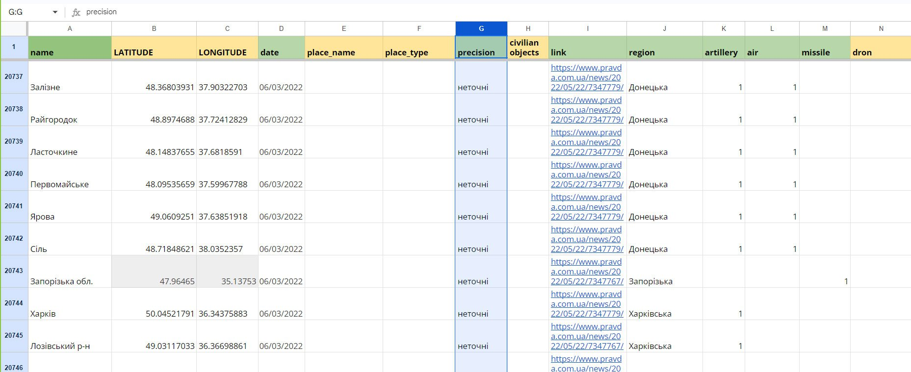
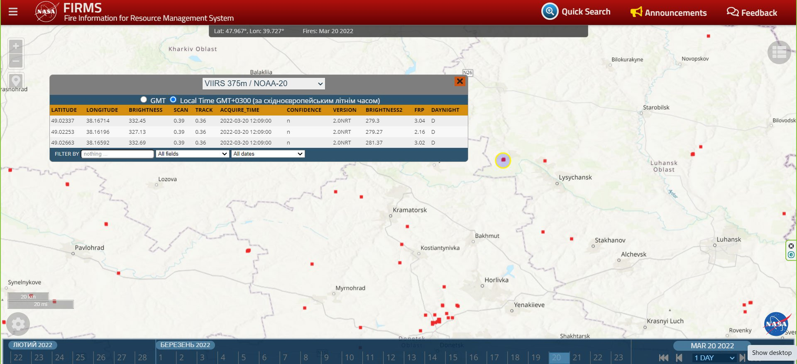
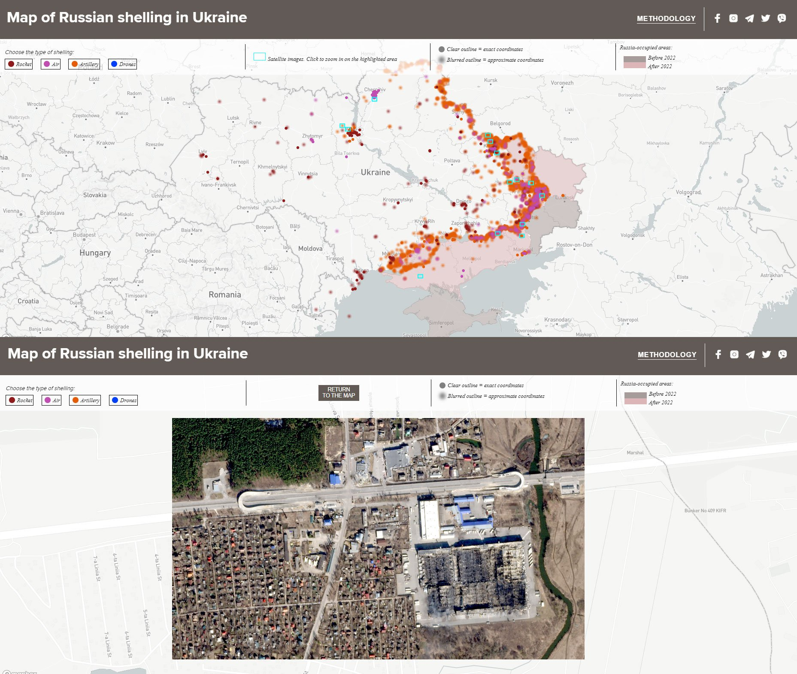
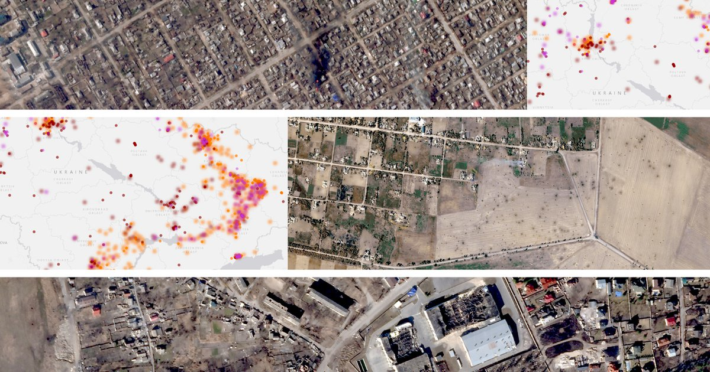

+++
author = "矢崎裕一"
title = "砲撃の地点を、確かさで2通りに描き分ける──TEXTY「Under attack」"
slug = "texty-under-attack"
date = "2026-11-04"
description = "TEXTY は、報道から拾った砲撃地点を2通りに描き分けました。火災検知や目撃情報で裏付けた地点はくっきりした小さな点、集落の座標で代用した地点はぼやけた大きな点です。"
categories = [
    "consume"
]
tags = [
    "データジャーナリズム",
    "Sigma Awards",
    "不確かさの可視化",
    "地図"
]
image = "images/cover.jpg"
series = ["dataviz-journalism"]
series_weight = 3
seriesByline = "TEXTY.org.ua（Nadja Kelm ほか）"
seriesTitle = "確かな点はくっきり、不確かな点はぼかす──Under attack"
+++

TEXTY は、報道から拾ったロシア軍の砲撃地点を、2通りに描き分けました。NASA の火災検知や、確認の取れた目撃情報で裏付けた地点は、くっきりした小さな点です。報道に集落名しかなく、その集落の座標で代用した地点は、ぼやけた大きな点です。描画コードでは、前者が半径4・ぼかし0、後者が半径8・ぼかし1.5です。

作品は、キーウの独立メディア TEXTY.org.ua の「Under attack. What and when Russia shelled in Ukraine」です。ウクライナ語版が2022年8月18日、英語版が9月1日に出ました。Sigma Awards 2023 のショートリストに入っています。以下は、作品の本文と METHODOLOGY 節、ページに書かれた描画コード、作者の講演録に沿います。

<!--more-->

## 2022年2月24日、小さな表から始まる

制作は Petro Bodnar（ペトロ・ボドナル）、Yevhenia Drozdova（イェウヘニア・ドロズドワ）、Nadja Kelm（ナジャ・ケルム）の3人です。Kelm は2023年、Aalto 大学が主催する会議「Visualizing Knowledge」でこの地図を紹介しました。TEXTY は2023年6月27日にその講演録を載せています。講演録によれば、その年の会議のテーマは「Visualizing Uncertainty」でした。

講演で Kelm は、始まりをこう話しています。

> "On February 24, 2022, we ran a quick search for news about the first missile strike. That information was transformed into a map, and that was the final goal. However, the strikes continued on the next day and the day after that. The small spreadsheet started to grow."

侵攻初日、最初のミサイル攻撃のニュースを探して地図にした。それで終わるはずだった。ところが攻撃は翌日も、その次の日も続き、小さな表が育ち始めた、という話です。

表が育つにつれ、列が増えます。攻撃の種類の列と、座標の確かさの列です。

> "I added extra columns to record various types of strikes (missiles, artillery, air, and, beginning autumn 2022, drones). Besides I have to identify the precision of coordinates since reports often mention only the name of a town or even of a region."

種類の列（ミサイル、砲撃、空爆、2022年秋からはドローン）を足した。報道は町の名前や州の名前しか書かないことが多いので、座標の確かさも見分ける必要があった、という説明です。

Nadja Kelm／TEXTY.org.ua「Data visualisation during wartime」より引用。TEXTY.org.ua、CC BY 4.0（サイト表示）

Kelm は、半年のあいだ毎日、手作業でこのデータを集めたと話しています。2022年夏、Planet.com が高解像度の衛星画像のデータベースを使わせてくれました。表と、破壊された町の画像を合わせ、対話型の地図にしたのが、この作品です。

## 火災の地図で、報道の地名を確かめる

点を2通りに分ける根拠は、作品の METHODOLOGY 節に書かれています。収集の最初の数週間は、複数の報道サイトを見ていました。重複が多かったので、その後は Ukrainska Pravda のニュース欄（www.pravda.com.ua/news）だけを見るようにしました。

報道から拾った地点は、次の手順で確かめています。

1. 砲撃された集落の名前を、すべて書き出す。
2. その日付の火災地図と照らし合わせる。
3. 火災が見つかれば、火災の座標を表に記録し、「accurate」とする。
4. 火災がなく、報道にも場所の詳しい記述がなければ、Google Maps の集落の座標を使い、「inaccurate」とする。

> "If we saw a fire that day, we indicated its coordinates in the table and marked the entry as accurate. In most instances, fires recorded on NASA satellite maps corresponded with the locations of shelling."

その日に火災が見えれば、その座標を記録して「正確」とする。たいていの場合、NASA の衛星地図の火災は砲撃の場所と一致した、という要旨です。

確認の取れた目撃者（友人や親族）からの情報も、出典リンクがないものの多くは「accurate」として扱いました。講演では、火災地図が NASA の FIRMS（Fire Information for Resource Management System）だと明かしています。大きな工場のように、長く燃え続ける火災は除かなければならない、とも話しています。

Nadja Kelm／TEXTY.org.ua「Data visualisation during wartime」より引用（画面は NASA FIRMS）

作品の本文は、限界もはっきり書いています。報道に出なかった砲撃は入っていない。ウクライナ参謀本部が毎日出す集落の一覧は、侵攻初日からは入れていない。地図とグラフは現実を100%反映するものではない、と断っています。

## くっきりした小さな点、ぼやけた大きな点

この「accurate／inaccurate」の区別が、地図の上では点の描き方になります。作品は Mapbox GL JS で描かれていて、描画コードはページに直接書かれています。以下の数値は、そのコードから読んだものです。ブラウザで地図を操作して、描画を確かめたわけではありません。

| データ・変数 | 見た目（視覚変数） | 具体値（コードから） |
|---|---|---|
| 砲撃1件の位置 | 地図上の点の位置 | Mapbox の circle レイヤー。ズーム11未満でだけ表示 |
| 攻撃の種類（4種） | 点の色 | 砲撃 `#E45C04`（橙）、空爆 `#C14DB2`（赤紫）、ロケット `#901B1B`（暗赤）、ドローン `#003FFC`（青） |
| 座標の確かさ | 点のぼかしと大きさ | 正確：半径4・ぼかし0。おおよそ：半径8・ぼかし1.5 |
| 日付 | 地図の下の時間スライダー | 始点は2022年2月24日で固定。選んだ日付までを累積して表示 |
| 占領地域 | 面の色 | 2022年より前 `#A69B99`、2022年以降 `#DCB5B6`。後者はスライダーの日付で変わる |
| 衛星画像がある場所 | 水色の四角→多角形→衛星画像 | ズーム4.5〜6.9で四角、7〜11で撮影範囲の多角形、11以上で Planet の画像 |
| 1件の詳細 | クリックで開くポップアップ | 地名、日付、exact／approximate、出典リンク |

確かさを決める列は、表の「координати」です。値が「неточні」（不正確）なら、半径8・ぼかし1.5で描きます。それ以外は、半径4・ぼかし0です。色は種類で決まり、確かさとは独立しています。同じ橙の砲撃でも、くっきりした点とぼやけた点が並ぶことになります。

凡例は、この区別をぼかしの言葉だけで説明しています。

> "Clear outline = exact coordinates / Blurred outline = approximate coordinates"

輪郭がくっきりしていれば正確な座標、ぼやけていればおおよその座標、という意味です。凡例の見本は、灰色の丸に CSS のぼかしをかけたものです。**点の半径が2倍になることは、凡例には書かれていません。**

Nadja Kelm／TEXTY.org.ua「Data visualisation during wartime」より引用。衛星画像は Planet.com（TEXTY 経由。CC BY の対象かは不明）

ズームの段階でも、見せ方が変わります。全体を見ているあいだは、衛星画像のある場所が水色の四角で示されます。寄っていくと撮影範囲の多角形になり、ズーム11を超えると砲撃の点が消えて、Planet の画像そのものが重なります。Kelm は講演で、この設計を「抽象的な点のレベルから、具体的な被害のレベルへズームできる」と説明しています。

> "On the map you can choose the type of shelling, move along the timeline and zoom from the level of abstract points to the level of specific consequences."

Petro Bodnar・Yevhenia Drozdova・Nadja Kelm／TEXTY.org.ua「Under attack」より引用。衛星画像は Planet.com（TEXTY 経由。CC BY の対象かは不明）

## ぼやけた点が、地図の大半を占める

では、ぼやけた点はどのくらいあるのか。地図が読み込む公開の Google スプレッドシートを集計しました。ここでの件数は、2026年11月4日に取得した公開版のものです。Sigma Awards の審査時点（2023年初め）のデータとは違います。

| 時点 | 地名のある行 | おおよその座標 | 割合 |
|---|---:|---:|---:|
| 2022年8月31日まで（英語版公開のころ） | 9,588件 | 7,183件 | 約75% |
| 2022年12月31日まで（Sigma 応募のころ） | 16,474件 | 13,911件 | 約84% |
| 2026年11月4日取得の全体 | 48,623件 | 44,908件 | 約92% |

公開版では、点の9割以上が「おおよその座標」です。地図を開けば、大半の点はぼやけて大きく描かれる、とコードからは読めます。時点を追うと、おおよその座標の比率は上がっています。その理由は、作品にも講演にも書かれていません。

ここで、不確かさの可視化の研究と並べてみます。MacEachren（マクイーチレン）、Roth ほかが2012年に IEEE TVCG に載せた実験は、地図記号で不確かさを表す方法を比べました。

> "Fuzziness and location work particularly well; value and arrangement are also rated highly and both size and transparency are potentially usable."

ぼかしと位置は特によく機能し、明度と配置も評価が高く、大きさと透明度も使える可能性がある、という結論です。同じ論文は、直感的に読める向きも報告しています。ぼかしは「ぼやけるほど不確か」、大きさは「小さいほど不確か」です。

TEXTY の設計は、ぼかしの向きではこの知見と一致します。大きさの向きは逆で、不確かな点を大きく描いています。筆者には、大きさを「ありうる範囲の広さ」として使ったと読めます。GPS の誤差円と同じ考え方で、集落のどこかという範囲を、点の広がりで見せた、という読みです。そう読めば筋は通りますが、実験の知見とはずれています。しかも凡例が大きさに触れていないので、読者は大きな点を「被害が大きい」と読むおそれもある、と筆者は読みます。

## 第三者はこの地図をどう見たか

作品は Sigma Awards 2023 のショートリストに入りました。応募書類は、地図の限界を作品本文と同じ言葉で書いています。

> "This project gives a general overview and does not aim to show absolute accuracy since some instances of shelling were not mentioned in the news we processed."

全体像を示すもので、絶対的な正確さは目指していない。処理したニュースに出なかった砲撃もあるからだ、という但し書きです。

地図のブログ Google Maps Mania では、Keir Clarke（キア・クラーク）が、ウクライナ語版の公開翌日の2022年8月19日に紹介しています。色分けされた点、報道へのリンク、Planet の衛星画像への拡大を説明したうえで、時間スライダーをこう書いています。

> "You can adjust the end-date on this timeline to view the cumulative amount of shelling from the beginning of the Russian invasion until the selected date."

終点の日付を動かすと、侵攻の始まりから選んだ日までの砲撃が、累積で表示される、という説明です。作品の本文は「choose a specific time range」と書いていますが、コードでも始点は固定されています。実装に即しているのは Clarke の書き方だ、と読めます。

個人ブログ ix5.org の「Useful Ukraine databases and maps」は、GeoConfirmed や DefMon3 の地図と並べて「Attack map by Texty.org.ua」を挙げています。評価の文はなく、リンクだけです。報道作品としてだけでなく、状況を知るための実用の道具として扱われている、と読めます。

## 使い道

この作品から持ち帰れるのは、データを集める段階で、確かさを列として記録したことです。Kelm は講演で、データ可視化の目的を「混沌に少しでも秩序をもたらすこと」と話しています。

> "We aren't trying to restore a sense of security, but rather try to restore the ability to navigate the situation."

安心を取り戻すためではなく、状況の中で進む方向を見つける力を取り戻すため、という言葉です。

不確かさを見せるには、まず不確かさを測る手順が要ります。TEXTY は、裏付けが取れたか（火災の一致、確認済みの目撃情報）を、表の列に記録しました。その列が accurate／inaccurate の2値なので、地図も二値の描き分けになった、と読めます。

一方で、描き分けの変数を二つ重ねるなら、凡例にも二つとも書くのが安全です。TEXTY は、ぼかしと大きさを同時に変えながら、凡例ではぼかしだけを説明しています。大きさの向きが実験の知見と逆であることも合わせると、ぼかしだけで描き分けるか、凡例の見本も大小にそろえるか、どちらかが読み違いを減らす、と筆者は読みます。

## 参考・出典

**一次情報**

- Petro Bodnar, Yevhenia Drozdova, Nadja Kelm, "Under attack. What and when Russia shelled in Ukraine," TEXTY.org.ua, 2022-09-01（英語版。本文、METHODOLOGY 節、凡例、描画コード）. https://texty.org.ua/projects/107577/under-attack-what-and-when-russia-shelled-ukraine/
- 「Під ударом. Що й коли обстрілювала Росія」TEXTY.org.ua, 2022-08-18（ウクライナ語版・原版）. https://texty.org.ua/projects/107440/pid-udarom-sho-i-koly-obstrilyuvala-rosiya/
- 地図が読み込む公開データ（Google Sheets CSV、2026-11-04 取得）. https://docs.google.com/spreadsheets/d/e/2PACX-1vSyFuA7nxANnn7BwXn7az5D5L-V7yKnETgTybfKSIGmoYz2qVkc6FWSH7f0l-1Gt_dML1VpywPUzXwp/pub?gid=1376631421&single=true&output=csv
- 衛星画像の位置データ. https://texty.org.ua/documents/313/tif_shapes_rects.geojson / https://texty.org.ua/documents/315/tif_shapes_new_AW4Mn67.geojson
- 占領地域の GeoJSON 一覧. https://thallium.texty.org.ua/maps/shelling_map/json_list.csv
- "Data visualisation during wartime. Nadja Kelm`s speech at the data-journalisn conference in Finland," TEXTY.org.ua, 2023-06-27. https://texty.org.ua/articles/110009/data-visualisation-during-wartime-nadja-kelms-speech-data-journalisn-conference-finland/
- Sigma Awards 2023 応募作品ページ「What and when Russia shelled in Ukraine」（ショートリスト。データ提供：The Sigma Awards／GIJN、CC BY-NC-SA 4.0）. https://sigma-awards.data-visualization.jp/entries/2023-s-0017/

**第三者評価**

- Keir Clarke, "Ukraine Under Attack," Google Maps Mania, 2022-08-19. https://googlemapsmania.blogspot.com/2022/08/ukraine-under-attack.html
- "Ukraine War – Useful Ukraine databases and maps," ix5.org. https://ix5.org/thoughts/2022/ukraine-war-useful-tools-guides/
- GIJN「Data Journalism Top 10」（2022年の TEXTY の仕事を取り上げた回とされる。本文はボット確認のため読めず、未確認）. https://gijn.org/stories/data-journalism-top-10-a-year-of-war-in-ukraine-russian-casualties-trans-identities-unexpected-nba-performances/
- （参考研究）Alan M. MacEachren, Robert E. Roth, James O'Brien, Bonan Li, Derek Swingley, Mark Gahegan, "Visual Semiotics & Uncertainty Visualization: An Empirical Study," *IEEE Transactions on Visualization and Computer Graphics*, 18(12), 2012. https://geography.wisc.edu/cartography/projects/publications/MacEachrenEtAl_2012_TVCG.pdf
