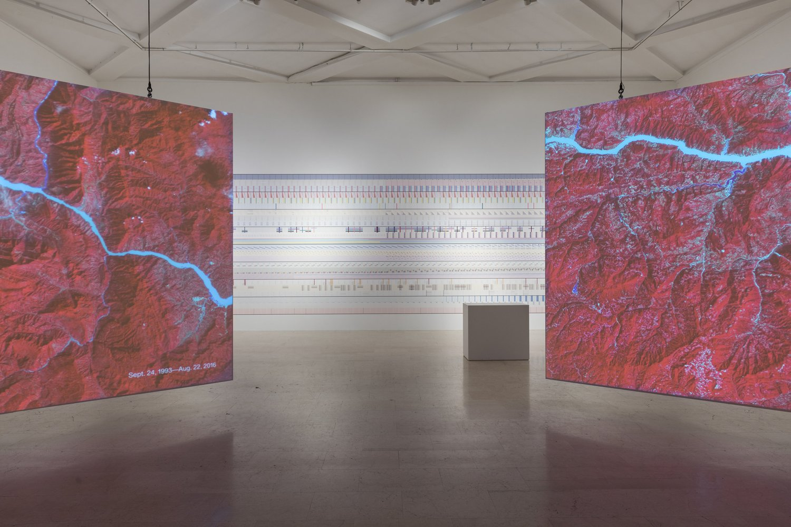
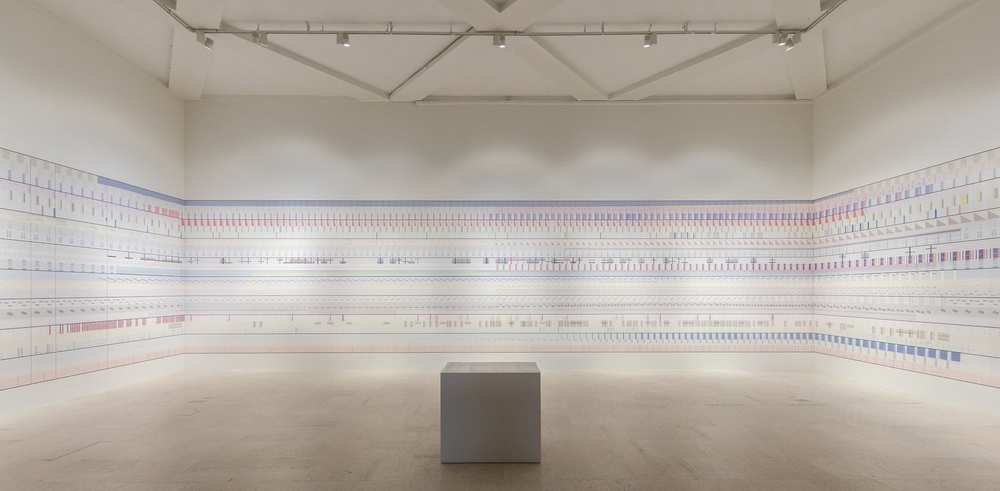
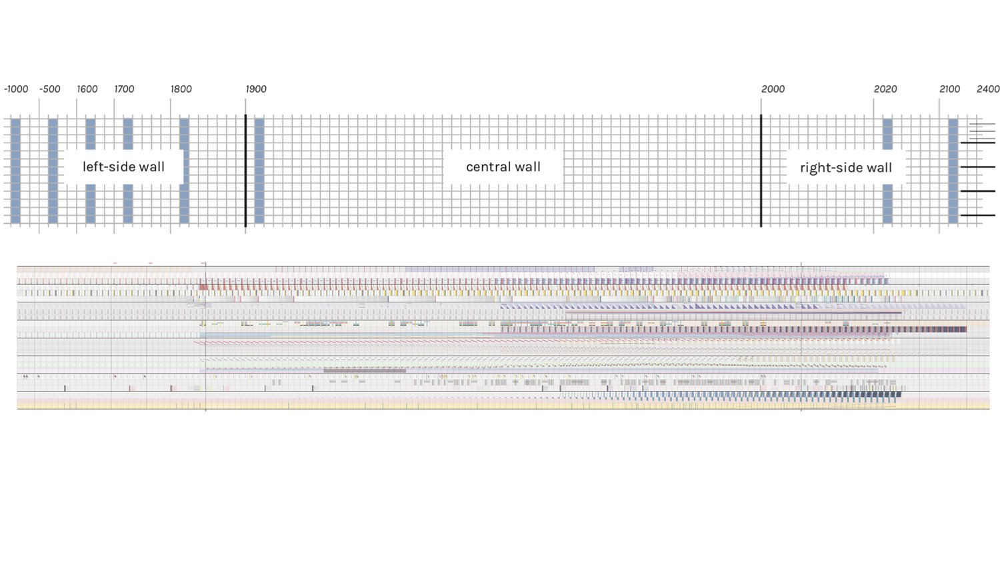
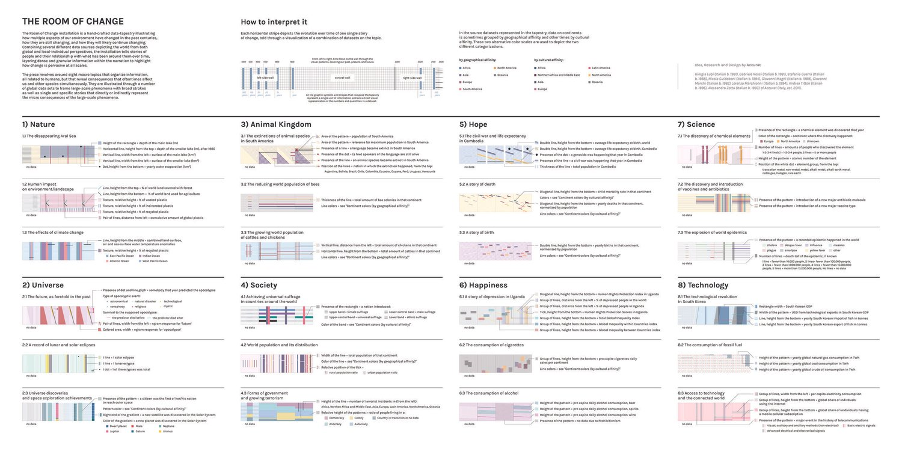
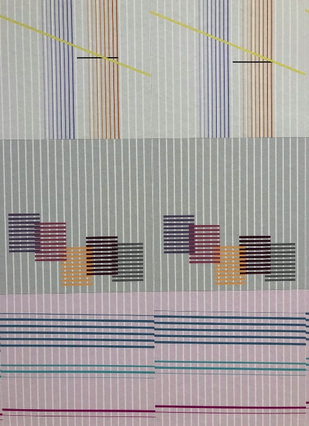

+++
author = "Yuichi Yazaki"
title = "Pattern from Afar, Data up Close: 3,400 Years on the Walls of The Room of Change"
slug = "the-room-of-change"
date = "2026-08-16"
lastmod = "2026-11-01"
description = "A hand-made wallpaper that reads as pattern from a distance and as data up close, placing change from 1000 BCE to 2400 CE in a single room. The NYT called the part running to 2400 a speculative future."
categories = [
    "consume"
]
tags = [
    "original visual transformation",
]
image = "images/cover.jpg"
series = ["speculative-design"]
series_weight = 1
seriesByline = "Giorgia Lupi / Accurat"
seriesTitle = "A Pattern from Afar, Data Up Close"
+++

*The Room of Change* is a room that sets a hand-made wallpaper running from 1000 BCE to 2400 CE beside the "twenty years seen from above" of NASA's satellite imagery. Lupi calls NASA's twenty years a "large scale," and writes that the wall complements it with a story of smaller, more everyday, more relatable and mundane change. The NYT called the part running to 2400 a speculative future, and Lupi wrote that change will *likely* continue. This wall, pattern from afar and data up close, can be read as turning distant change into a long present that can be read at the scale of the body, and as placing the future not as a firm forecast but as a conditional "if things continue as they are."

The maker is Accurat, the design firm co-founded by Giorgia Lupi. It was commissioned for the first room of the main exhibition of the 22nd Triennale Milano in 2019, *Broken Nature: Design Takes on Human Survival* (curator: Paola Antonelli). Following the official descriptions by Lupi and Accurat, the exhibition's official pages, and the press coverage of the time, this article reads the work in the order a visitor meets it after entering the room.

<!--more-->

## In the entrance room, twenty years seen from above

*Broken Nature* is an exhibition built around *restorative design*. It examines the threads connecting humans and the natural environment that have frayed or snapped. On the official checklist, this work is one of four special commissions. In the exhibition's own words, its role was to welcome visitors into the galleries and set the tone for the whole show.

On entering, one first sees two large screens straight ahead. They show NASA footage of the Earth over the past twenty years, taken from above. The NYT identifies it as NASA's *Images of Change*. Before/after pairs of the same place are lined up, such as the urban expansion of Shanghai (1984-2018).

© La Triennale di Milano — foto Gianluca Di Ioia

Lupi's explanation starts from one premise: most change can only be shown "from far away and from up high."

So Lupi calls NASA's twenty years the "large scale." With the tapestry on the wall, she writes, the room complements it with stories of smaller, more everyday, more relatable change. At the center of the room stands a pedestal carrying a legend for the entire wall. Lupi likened it to a map for looking at a mountain range.

## From a distance, it looks like wallpaper

Beside and behind the screens, a mural of about 30 meters wraps around three walls. It is described as a hand-made data tapestry, or data-driven wallpaper. The NYT wrote of a "100-foot wallpaper mural."

© La Triennale di Milano — foto Gianluca Di Ioia

What catches the eye first is not a chart. Lupi herself writes: at first glance one may not notice that data organizes the motifs; muted shapes, lines and patterns covering the history of the Anthropocene may not register on entering. Accurat's earlier case study repeats the same observation.

Accurat writes that a gentle complexity invites exploration. From this wording, the fact that it is hard to notice as data can be seen as part of a design meant to invite exploration. **It can be said that it is wallpaper first and data second.**

There is a reason for the handwork as well. Accurat explains that the materiality of handwork strengthens the lasting effects of human action and turns raw data into an emotional experience. Lupi describes her method as deliberately humanistic. Her position is that data is a snapshot of real life, and that numbers are always a stand-in for something else.

## Up close, horizontal is time and vertical is simultaneity

Move closer to the wall and the rules of the pattern become readable. The official way to read it is in two directions: left to right like a book, and at the same time vertically.

The horizontal direction is time. Left is the past, center is the present, right is the future. In a schematic from the production materials, the left wall is assigned 1000-1900 BCE, the front wall 1900-2000, and the right wall 2000-2400. The 100 years of the twentieth century take up a whole wall, and the 400 years beyond take one wall as well. From the diagram, it can be read that the width of the walls does not divide time evenly either.

Accurat / Giorgia Lupi

Each horizontal stripe is a story of its own. There are eight macro themes: Nature, Universe, Animal Kingdom, Society, Hope, Happiness, Science and Technology. Each theme contains one story tied to a specific region and two global subjects. Shape represents the theme, color the geographic or cultural place, and horizontal position the time.

| Macro theme | Region-specific story | Global subjects |
|---|---|---|
| Nature | The disappearance of the Aral Sea | Human environmental impact, climate change |
| Universe | Prophecies of the future (told in the past) | Records of lunar and solar eclipses, space exploration |
| Hope | Cambodia's civil war and life expectancy | Death by continent, life by continent |
| Technology | South Korea's technological revolution | Fossil fuel consumption, access to technology |

(Four of the eight themes, excerpted. The full set is in the central legend.)

Accurat / Giorgia Lupi

Global lines such as world population and average temperature frame the piece with a "broad brushstroke." Within that frame sit thin lines such as the Aral Sea and Cambodia. Lupi writes that layering colder, more sterile data with smaller, more relatable information makes for a more meaningful result. With global indicators alone it is unclear whose story the numbers tell, and a single local line can be read as bringing them back to a place.

Looking vertically gives a cross-section of a given year. Accurat writes that read horizontally it is eight chapters of human interaction, and seen vertically it is the entanglement of forces in a particular year. Population, temperature, disease, exports and happiness line up at the same position on the same wall. It can be read as a proposal: to repair one relationship, look at its interactions with everything it touches.

From the Giorgia Lupi official page (data-detail)

At this point the meaning of the central pedestal becomes clear. In the Nightingale interview, Lupi puts her reason for calling herself an information designer rather than an artist in the legend. It is about handing over access to the data, not only an experience. This is not a diagram a pilot uses to decide on a landing, so it is fair to ask for time to read it.

## What is the 2400 at the right edge saying?

The right edge of the wall is 2400. The NYT called this part a speculative future. Its first publication misprinted the year as 2040, later corrected to 2400.

Lupi's wording is careful. She writes about how change has occurred over past centuries, is occurring now, and will "likely" (*likely*) continue. The work does not call itself speculative. Even so, from the word *likely* and the wall running to 2400, the right edge can be read not as a firm forecast but as an extension of the current trajectory, that is, a conditional of the form "if things continue as they are."

The exhibition as a whole also asks for this long reach. Antonelli told the NYT that it is an exhibition for citizens. She hopes visitors will take away a sense of the long term, a sense that complexity is a friend and not an enemy, and a sense of what they can do in daily life. The NYT also quotes the conclusion of Antonelli's catalog: our only chance of survival is to design our own beautiful extinction.

The 400 years of the right wall can be read as showing that long term as the length of a wall. That the Universe chapter holds prophecies of the future told in the past as data also overlaps here. It can be read that the history of speculation itself lines up on the same wall as the speculative future.

Accurat writes that the room prepares visitors to see the works that follow as "possible solutions." The same exhibition also includes works of speculative design such as Dunne & Raby's *Foragers*. The entrance wall can be seen as a long present for receiving those "what ifs."

## How did third parties see this room?

Press coverage at the time looked less at the accuracy of the data than at whether the room worked as an entrance device. Here are three pieces with different points of focus.

| Outlet | What it looks at |
|---|---|
| *The New York Times* (2019-03-20) | The shock at the entrance, and long time |
| Il Post (2019-02-28) | Complexity and artistry together |
| Nightingale (2019-08-14) | The legend, and the form of weaving |

The NYT wrote that the show is intellectual but hits hard, and that human impact is hammered home in the first gallery. In front of the NASA before/afters is a wallpaper mural of color bands and symbols, which it summarizes as the flow of population, disease rates, energy consumption and average temperature. It stated explicitly that the data runs from 1000 BCE to the speculative future of 2400.

Italy's Il Post wrote that the exhibition's ambition is clear from the first work. It is an infographic more complex than anything seen before, but surely one of the most artistic, it said. This can be read as a review that took complexity not as a flaw but as the character of the work.

Nightingale is the publication of the Data Visualization Society. The interviewer, Jason Forrest, asked about the resemblance to Anni Albers, then on show at the Tate. Lupi answered that the decision to make a tapestry came first, though the overlap of warp and weft may have been an unconscious influence. A general newspaper wrote of the shock at the entrance, while a fellow visualization practitioner asked about the legend and the weaving. The evaluations divide that way.

## Takeaways

There are three things to take from this room into visualization work.

The first is to design the distant view and the close view separately. From far away it holds together as a pattern, and up close it can be read as data. Rather than trying to convey everything in the first few seconds, build a form that gets people to stay first. If a figure asks for reading time, design a place to spend that time alongside it.

The second is to put two views at different scales in the same place. The satellite's twenty years show large differences, and the wall's 3,400 years show stories close to daily life. Layer thin region-specific lines, one by one, over thick global lines. From this work, one can take that this lets the figure itself show whose story the numbers tell.

The third is to depict the future as a condition. In this work, the part running to 2400 and the past end-of-the-world prophecies of the Universe chapter line up on the same wall. Lupi writes in her own text that change will *likely* continue, and the NYT called this part a speculative future. From these facts, the extension to 2400 can be read as a "if things continue as they are" conjecture, not a prediction. Showing the speculative part as speculation can be considered part of the work of visualization too.

## References

**Primary sources**

- [The Room of Change — Giorgia Lupi](https://giorgialupi.com/the-room-of-change)
- [The room of change — Accurat](https://studio.accurat.it/work/the-room-of-change)
- [XXII Milan Design Triennale Commission — Accurat (earlier case study)](https://beta.accurat.it/work/broken-nature)
- [Accurat—The Room of Change — Broken Nature](http://www.brokennature.org/accurat-the-room-of-change/)
- [Broken Nature portrait #3: Accurat—The Room of Change](http://www.brokennature.org/broken-nature-portrait-3-accurat-the-room-of-change/)
- [Broken Nature Checklist](http://www.brokennature.org/checklist/)

**Secondary sources**

- *The New York Times*, [The End Is Nigh. Can Design Save Us?](https://www.nytimes.com/2019/03/20/arts/design/milan-triennial-restorative-design.html) (2019-03-20. Corrected to 2400.)
- Il Post, [“Broken Nature” e come il design potrebbe salvare il mondo](https://www.ilpost.it/2019/02/28/broken-nature-triennale/) (2019-02-28)
- Nightingale, [The Data We Do Not See: An Interview with Giorgia Lupi](https://medium.com/nightingale/https-medium-com-nightingale-the-data-we-do-not-see-an-interview-with-giorgia-lupi-2b29212d010e) (2019-08-14)
