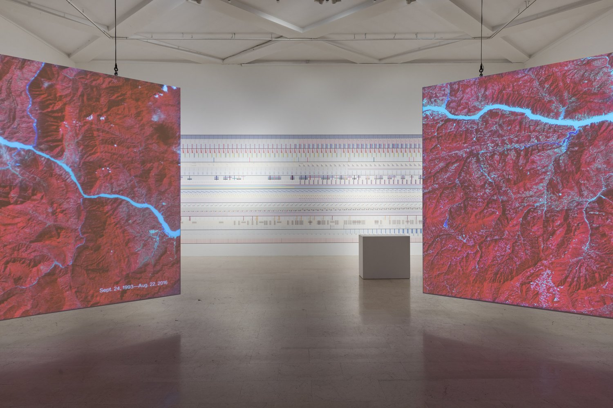
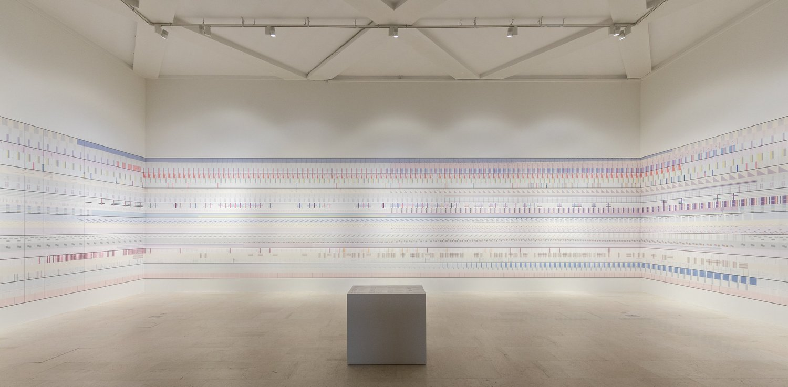
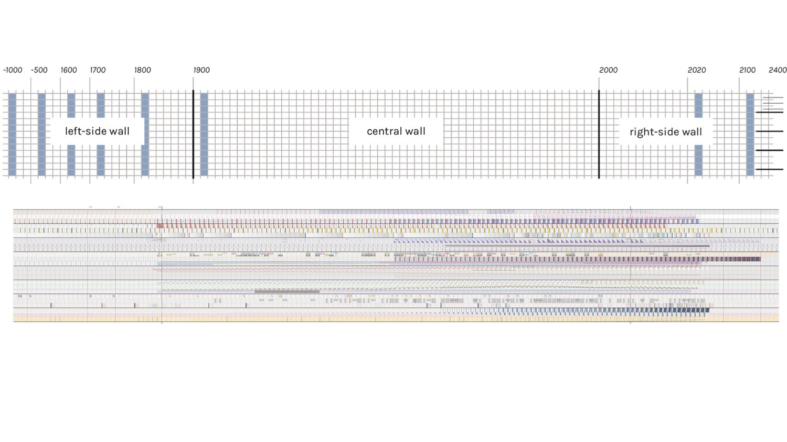
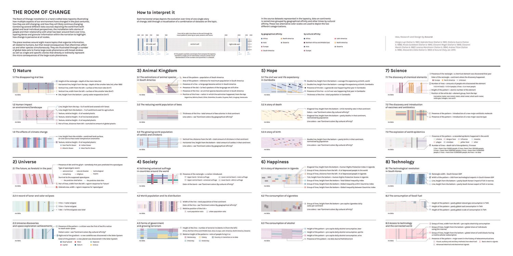
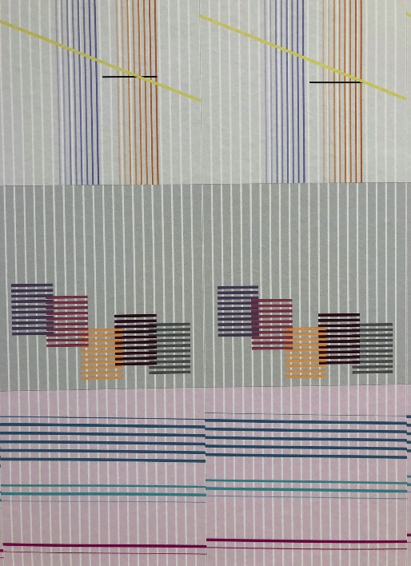

+++
author = "矢崎裕一"
title = "遠くからは模様、近づくとデータ──『The Room of Change』の壁が見せる3400年"
slug = "the-room-of-change"
date = "2026-08-16"
lastmod = "2026-11-01"
description = "NASA の衛星映像が見せる「上空からの20年」の隣に、紀元前1000年から西暦2400年までを手仕事の壁紙として置いた部屋。遠くからは模様、近づくとデータになり、2400年までの部分は確定予報ではなく「このままなら」という推測的な未来として示される。"
categories = [
    "consume"
]
tags = [
    "オリジナルのビジュアル変換",
]
image = "images/cover.jpg"
series = ["speculative-design"]
series_weight = 1
seriesByline = "Giorgia Lupi / Accurat"
seriesTitle = "遠くからは模様、近づくとデータ"
+++

『The Room of Change』は、NASA の衛星映像が見せる「上空からの20年」の隣に、紀元前1000年から西暦2400年までを手仕事の壁紙として置いた部屋です。遠くからは模様に見え、近づくとデータになります。遠い変化を、身体のスケールで読める長い現在として部屋に住まわせる。2400年までの部分は確定予報ではなく、「このままなら」という推測的な未来として示されています。

作者は Giorgia Lupi（ジョルジア・ルピ）が共同創業したデザイン会社 Accurat です。2019年の第22回トリエンナーレ・ミラノ本展 *Broken Nature: Design Takes on Human Survival*（キュレーター：Paola Antonelli）の、最初の部屋のために委嘱されました。以下は、Lupi と Accurat の公式説明、展覧会の公式ページ、当時の報道に沿って、鑑賞者が部屋に入ってからの順で読みます。

<!--more-->

## 入口の部屋で、上空の20年を見る

*Broken Nature* は *restorative design*（修復的デザイン）を掲げた展覧会です。人間と自然環境をつなぐ糸のうち、ほつれたものや切れたものを調べます。公式チェックリストでは、本作は4件の特別委嘱の一つです。展覧会側の言葉では、来館者をギャラリーへ迎え、展示全体のトーンを決める役割でした。

部屋に入ると、まず正面に大きな画面が2面あります。映っているのは NASA の *Images of Change* で、過去20年の地球を上空から撮った映像です。上海の都市拡大（1984〜2018年）のような、同じ場所の before/after が並びます。

© La Triennale di Milano — foto Gianluca Di Ioia

Lupi の説明は、一つの前提から始まります。変化のほとんどは「遠く、高いところから」しか見せられない、というものです。衛星映像は、その遠くて高い視点そのものです。地表の差ははっきり見えますが、自分の暮らしとの関係は見えにくい。

そこで Lupi は、NASA の20年を「大きなスケール」と呼びます。そして壁のタペストリーで、より小さく、日常と関係しやすい変化の物語を補う、と書いています。部屋の中央には台座があり、壁全体の凡例が置かれています。Lupi はこれを、山脈を眺めるときの案内図に喩えました。

## 遠くからは、壁紙に見える

画面の両脇と奥には、約30メートルの壁画が三面の壁を取り巻いています。手仕事の data tapestry、data-driven wallpaper と呼ばれるものです。NYT は「100フィートの壁紙壁画」と書きました。

© La Triennale di Milano — foto Gianluca Di Ioia

最初に目に入るのは、チャートではありません。Lupi 自身がこう書いています。一見しただけでは、モチーフを組織しているのがデータだとは気づかないかもしれない。muted な形と線とパターンが、人新世の歴史を覆っているとは、入室時には登録されないかもしれない、と。Accurat の旧ケーススタディも、同じ観察を繰り返しています。

これは見落としではなく、設計です。Accurat は、穏やかな複雑さが探索を誘う、と書いています。**壁紙であることが先で、データであることは後です。**

手仕事であることにも理由があります。Accurat は、手仕事の物質性が人間の行為の持続的な効果を強め、生データを感情的な体験に変える、と説明しています。Lupi は制作の方法を、意図的に人文的だと書きます。データは実生活のスナップショットであり、数字は常に何か別のものの代わりだ、という立場です。

## 近づくと、横が時間、縦が同時性になる

壁に近づくと、模様の規則が読めてきます。公式の読み方は、本のように左から右へ、同時に縦へ、の二方向です。

横方向は時間です。左が過去、中央が現在、右が未来です。制作資料の模式図では、左壁が紀元前1000〜1900年、正面が1900〜2000年、右壁が2000〜2400年に割り当てられています。20世紀の100年が正面の一壁を占め、その先の400年も一壁です。壁の幅は、時間を均等に割っていません。

Accurat / Giorgia Lupi

横縞は、それぞれ一つの物語です。Nature、Universe、Animal Kingdom、Society、Hope、Happiness、Science、Technology の8つのマクロ主題があり、各主題に地域を特定した物語が1本、グローバルな対象が2本入ります。形が主題を、色が地理的・文化的な場所を、横の位置が時間を表します。

| マクロ主題 | 地域を特定した物語 | グローバルな対象 |
|---|---|---|
| Nature | アラル海の消失 | 人間の環境影響、気候変動 |
| Universe | 過去に語られた未来の予言 | 月食・日食の記録、宇宙探査 |
| Hope | カンボジアの内戦と平均寿命 | 大陸別の死、大陸別の生 |
| Technology | 韓国の技術革命 | 化石燃料の消費、技術へのアクセス |

（8主題のうち4つを抜粋。全体は中央の凡例にある）

Accurat / Giorgia Lupi

世界人口や平均気温といったグローバルな線は「広い筆致」で枠をつくります。その中に、アラル海やカンボジアのような細い線が置かれます。冷たい指標だけでは、数字は誰の話でもありません。ローカルな一本が、数字を地点に戻します。

縦に見ると、ある年の断面になります。Accurat は、横に読めば人間の相互作用の8つの章、縦に見れば特定の年における力の絡み合いだ、と書いています。人口と気温と疾患と輸出と幸福が、同じ壁の同じ位置に並びます。一つの関係を修繕するには、触れるものすべてとの相互作用を見よ、という提案です。

Accurat / Giorgia Lupi

ここまで来ると、中央の台座の意味がわかります。Nightingale のインタビューで、Lupi は自分をアーティストではなく情報デザイナーと呼ぶ理由を、凡例に置いています。体験だけでなく、データへのアクセスを渡すこと。パイロットが着陸判断に使う図ではないから、読む時間を求めてよい、と。

## 右端の2400年は、何を言っているのか

壁の右端は2400年です。NYT はこの部分を speculative future（推測的な未来）と呼びました。初出では2040年と誤記され、のちに2400年へ訂正されています。

Lupi の書き方は慎重です。変化が過去何世紀かにどう起き、いまも起き、これからも「おそらく」（*likely*）続くか、と書いています。確定予報ではなく、いまの軌道が続いた場合の延長です。本作は自分を speculative とは名乗っていません。それでも、2400年まで壁を伸ばした時点で、未来は予測図ではなく「このままなら」という条件になります。

展覧会全体も、この長い射程を求めています。Antonelli は NYT に、市民のための展示だと語りました。長期の感覚と、複雑さは敵ではなく友だという感覚、日常で何ができるかの感覚を持ち帰ってほしい、と。カタログの結論として、生存の唯一のチャンスは美しい絶滅を自らデザインすることだ、とも書いています。

右壁の400年は、その長期を壁の長さとして見せる部分です。Universe の章が、過去に語られた終末の予言をデータとして持つことも、ここに重なります。推測そのものの歴史が、推測的な未来と同じ壁に並びます。

Accurat は、この部屋が、先の展示作品を「可能な解決」として見る準備をさせる、と書いています。同じ本展には、Dunne & Raby の *Foragers* のようなスペキュラティブ・デザインの作品も並びます。入口の壁は、それらの「もし」を受け取るための、長い現在として置かれています。

## 第三者はこの部屋をどう見たか

当時の報道は、正確さの検証より、入口の装置として成り立ったかを見ています。論点の違う3件を挙げます。

| 媒体 | 見ている点 |
|---|---|
| *The New York Times*（2019-03-20） | 入口で受ける衝撃と、長期の時間 |
| Il Post（2019-02-28） | 複雑さと芸術性の両立 |
| Nightingale（2019-08-14） | 凡例と、織物という形式 |

NYT は、展示は知的だが打撃は強い、人間の影響は最初のギャラリーで叩き込まれる、と書きました。NASA の before/after の手前に色帯と記号の壁紙壁画があり、人口・疾患率・エネルギー消費・平均気温の流れだと要約しています。データは紀元前1000年から推測的未来の2400年まで、と明記しました。

イタリアの Il Post は、展示の野心は最初の作品でわかると書きました。見たことのないほど複雑なインフォグラフィックだが、間違いなく最も芸術的なものの一つだ、という評です。複雑さを欠点ではなく、作品の性格として受け取っています。

Nightingale は、Data Visualization Society の媒体です。インタビュアーの Jason Forrest は、当時テートで展示中だった Anni Albers との類似を問いました。Lupi は、タペストリーにする判断は先にあった、ただ縦糸と横糸の重なりは無意識に影響されたかもしれない、と答えています。一般紙が入口の衝撃を書き、可視化の同業者が凡例と織りを問う。評価はそう分かれています。

## 使い道

この部屋から可視化の仕事に持ち帰れることは、三つあります。

一つ目は、遠景と近景を別々に設計することです。遠くからは模様として成り立ち、近づくとデータとして読める。最初の数秒で全部を伝えようとせず、先に滞在してもらう形をつくる。読む時間を求める図なら、その時間を過ごせる場所も一緒に設計します。

二つ目は、スケールの違う二つの見方を、同じ場所に置くことです。衛星の20年は大きな差を見せ、壁の3400年は日常に近い物語を見せます。グローバルな太い線に、地域を特定した細い線を一本ずつ重ねる。数字が誰の話かを、図の中で示せます。

三つ目は、未来を条件として描くことです。2400年までの延長は予測ではなく、「このままなら」の推測です。そう読めるように、過去の終末予言と同じ壁に並べ、*likely* という言葉で書く。推測の部分を推測として見せることも、可視化の仕事の一部です。

## 参考・出典

**一次情報**

- [The Room of Change — Giorgia Lupi](https://giorgialupi.com/the-room-of-change)
- [The room of change — Accurat](https://studio.accurat.it/work/the-room-of-change)
- [XXII Milan Design Triennale Commission — Accurat（旧ケーススタディ）](https://beta.accurat.it/work/broken-nature)
- [Accurat—The Room of Change — Broken Nature](http://www.brokennature.org/accurat-the-room-of-change/)
- [Broken Nature portrait #3: Accurat—The Room of Change](http://www.brokennature.org/broken-nature-portrait-3-accurat-the-room-of-change/)
- [Broken Nature Checklist](http://www.brokennature.org/checklist/)

**第三者評価**

- *The New York Times*, [The End Is Nigh. Can Design Save Us?](https://www.nytimes.com/2019/03/20/arts/design/milan-triennial-restorative-design.html)（2019-03-20。2400年への訂正あり）
- Il Post, [“Broken Nature” e come il design potrebbe salvare il mondo](https://www.ilpost.it/2019/02/28/broken-nature-triennale/)（2019-02-28）
- Nightingale, [The Data We Do Not See: An Interview with Giorgia Lupi](https://medium.com/nightingale/https-medium-com-nightingale-the-data-we-do-not-see-an-interview-with-giorgia-lupi-2b29212d010e)（2019-08-14）
