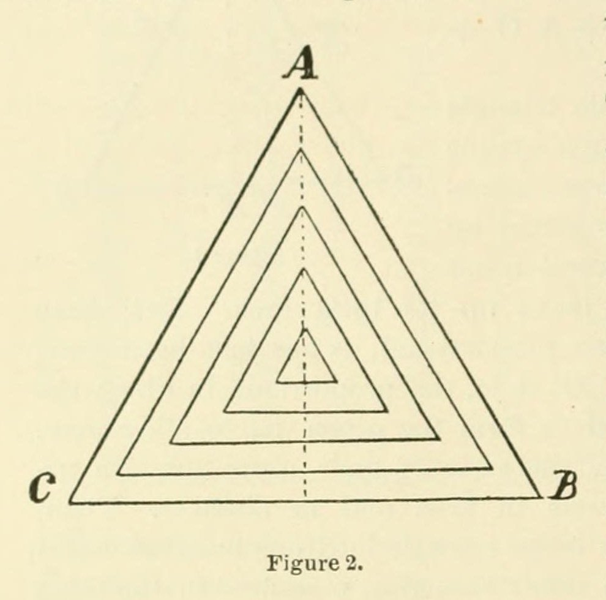
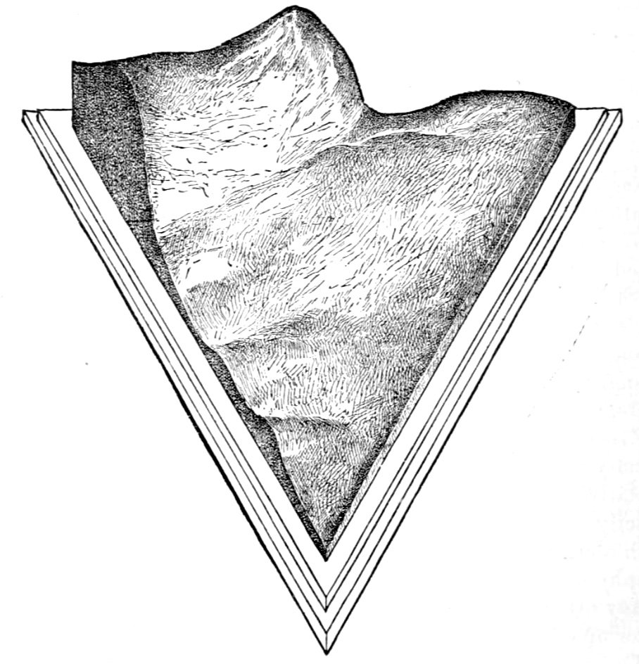
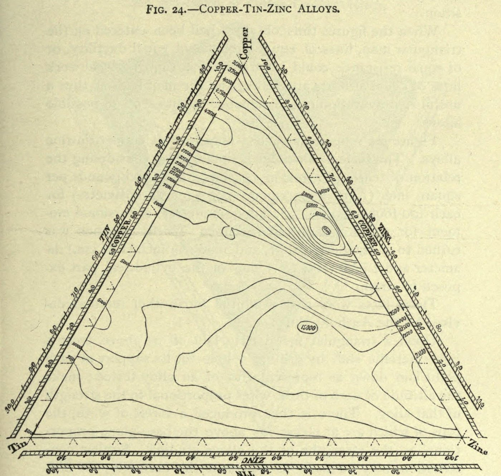
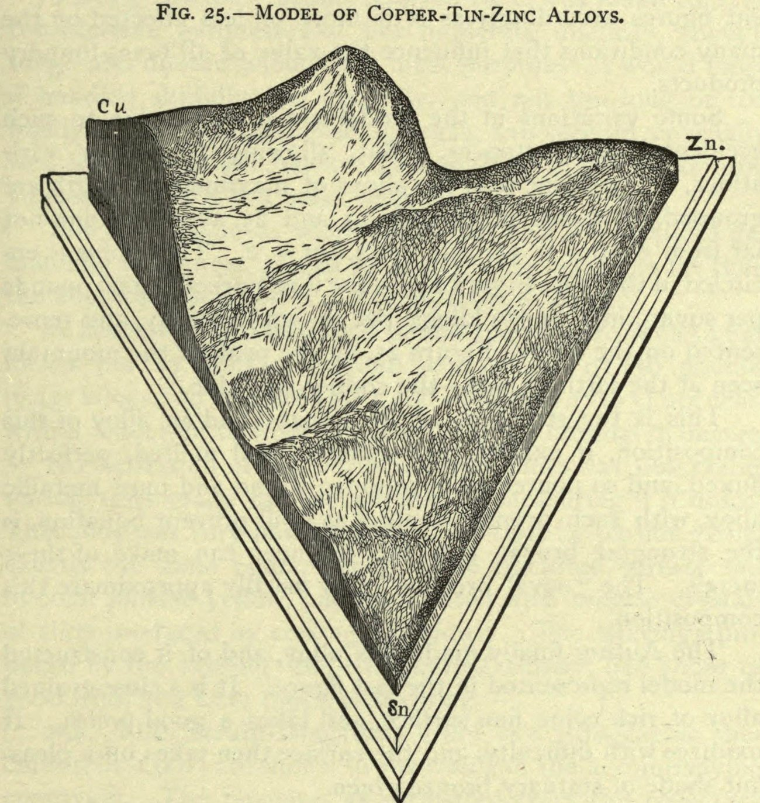

+++
author = "Yuichi Yazaki"
title = "Filling the Gaps Between 106 Measurements with Plaster: Thurston's Copper-Tin-Zinc Alloy Model"
slug = "thurston-alloy-model"
date = "2026-11-01"
description = "A model in which position on a triangle gives the proportions of copper, tin and zinc, and the height of a wire gives tensile strength. Plaster fills the gaps between 106 measured values to form a continuous surface."
categories = [
    "consume"
]
tags = [
    "data physicalization",
    "ternary diagram",
    "contour lines",
    "Robert H. Thurston"
]
image = "images/plaster-model-1877.jpg"
+++

Robert Henry Thurston's alloy model shows the proportions of copper, tin and zinc as a position on an equilateral triangle, and the tensile strength of the alloy at that position as the height of a brass wire standing there. The 106 values that were actually tested became the lengths of the wires, and plaster poured between the wires turned them into a single curved surface. On the finished surface, the tips of the wires show through as points.

The model was made by M. I. Coster during the alloy research (1875-78) carried out for the U.S. Board appointed to test metals. It was first published in Thurston's paper at the Nashville meeting of the American Association for the Advancement of Science (AAAS) in August 1877. This article reads along that paper, the Board's report dated June 1878, Part III of Thurston's textbook *Materials of Engineering*, and his 1898 paper "Graphic Diagrams and Glyptic Models."

<!--more-->

## 1875: The combinations of three metals are beyond counting

On March 25, 1875, the President appointed the U.S. Board to test iron, steel and other metals. Its first meeting was held on April 15 of the same year. A Committee on Alloys was set up within it, and Thurston served as its chairman.

Thurston was then a professor of mechanical engineering at the Stevens Institute of Technology in Hoboken, and the tests were carried out there. He later became the first president of the American Society of Mechanical Engineers (ASME).

The Committee on Alloys was charged with experimenting on the properties of alloys and investigating the laws of their combination. For an alloy of two metals, an ordinary flat graph with composition on the horizontal axis and strength on the vertical axis is enough. With three metals, in the words of the 1877 paper, there is an "infinite number of possible combinations." In 1899 Thurston recalled that no simple method had been found, and that ternary alloys had long been left untouched.

The 1877 paper states the goal of the research as follows.

> … any one studying the results of the work should be able to say, with confidence, what would be the precise character of any possible alloy of the three metals which he might propose to make.

In short, once the maximum and minimum points have been found, anyone should be able to say with confidence what properties any alloy they propose to make will have. The task of the model, as I read it, is to give an answer even for alloys that were never tested.

## Surveying the triangle as a territory

The title of the 1877 paper puts "planning researches" and "representing to the eye" side by side (Planning Researches / Representing to the Eye).

The method rests on an equilateral triangle. If you drop perpendiculars from a point inside the triangle to its three sides, the sum of the three lengths equals the height of the triangle at every point. Divide the height into 100 equal parts, and the lengths of the three perpendiculars become, as they are, the percentages of the three metals. The vertices are the pure metals, and points on a side are alloys of two metals.

Thurston treated this triangle as a piece of land to be surveyed.

> Its topography may be studied as systematically and completely as that of any other territory of which the exact boundaries have been determined and marked out.

That is, the topography of the triangle can be studied as systematically and completely as any other territory whose boundaries have been fixed.

Source: R. H. Thurston, Proceedings of the AAAS 26 (1878), p.118, Figure 2 / Internet Archive (public domain)

This figure also determines how the sample points are chosen. Figure 2 shows concentric triangles, each shifted inward by 10%. Taking points every 10% along their sides gives the list of ternary alloys to be tested. The combinations that contain at least 10% of each of the three metals number 36 in the paper's table.

According to *Materials of Engineering*, Part III, in the first series of 36 alloys at 10% steps, more than 5/6 of the alloys turned out to be "comparatively worthless." The following series narrowed down to the strong region, testing 24 alloys at 5% steps and 12 alloys at 2.5% steps.

The 1877 paper also gives the reason for making the steps finer.

> at sharp culminations, in points or lines, forming peaks or ridges in our topography, it would be necessary to take another set of points nearer together

Where the values change sharply, as at the summits and ridges of the terrain, the points have to be taken again at closer spacing. So the sample points are not spread evenly over the triangle; they become denser in the region of strong alloys, as I read it. **The triangle was a stage for drawing results, and at the same time a stage for deciding what to test next.**

## A forest of wires, filled in with plaster

The Board's report records the dimensions of the model. The base is an equilateral triangle with sides of 10 inches (about 25 cm), divided into 100 parts. At the vertices stand vertical rods that represent the tensile strength of pure copper, tin and zinc. The rods are brass wires, at a scale of 25,000 pounds per square inch (psi) per inch of length.

For example, 1 inch from the copper vertex stands the wire for gun metal, 90 copper and 10 tin. In the same way wires were set up at the points of bronzes, brasses and ternary alloys, and the number of points came to 106.

The 1877 paper describes the method of construction as a procedure. A triangle is drawn on a brass plate, and at the measured points wires cut to lengths proportional to the strength are fixed. A frame is built of boards, and plaster is poured in until the wires are covered. Once it has set, it is cut down from above, stopping just where the tips of the wires emerge.

Source: R. H. Thurston (model by M. I. Coster), Proceedings of the AAAS 26 (1878), p.119, Figure 3 / dataphys.org (original illustration in the public domain)

According to the paper, this engraving (Figure 3) was made from a photograph of Coster's model, and was included to illustrate the method.

*Materials of Engineering* describes the finished surface this way.

> the tops of all the wires are just visible, shining points in the now smooth surface of the model

The tips of the wires are just visible as shining points on the smoothed surface. In this model, the values that were actually measured (the shining points) and the values supplied by hand in between (the plaster surface) can be told apart on the same surface, as I read it.

The table below sets out how the data corresponds to the materials.

| Data | Physical property / material | Values and scale |
|---|---|---|
| Proportions of the three metals (% of copper, tin, zinc) | Position on the equilateral base. The lengths of the perpendiculars to the three sides are the % of each metal | Side of 10 inches, divided into 100. Vertices are pure metals |
| Alloys of two metals (copper-zinc, copper-tin, tin-zinc) | Position on a side of the triangle | Example: 1 inch from the copper vertex = 90 copper, 10 tin |
| Tensile strength of an alloy | Length (height) of a brass wire | 1 inch = 25,000 psi |
| Alloys actually measured | One wire each. After completion, the wire tip showing through the plaster surface | 106 points |
| Compositions not measured | The curved plaster surface filling the space between the wires | Poured in, then cut down to the wire tips |
| Compositions of equal strength | Contour lines from horizontal slices | 0.1-inch intervals = steps of 2,500 psi |
| Strongest alloy | Highest point of the surface | Around 55 copper, 43 zinc, 2 tin; inside the 65,000 psi contour |
| The strongest alloy itself | Material of the model cast later | Cast using the plaster mold as the pattern |

From the scale, the height of the 65,000 psi summit works out to about 2.6 inches (about 6.6 cm), a little under three tenths of the side of the base. This is not a dimension given in the sources; it is my own calculation.

## A contour map, and the alloy at the summit

According to the Board's report, slicing the model with horizontal planes at 0.1-inch intervals gives contour lines. From that map, the report says, the tensile strength of any alloy can be known to within 2,500 pounds. The map was attached to the report as "Plate I." The same kind of map appears in *Materials of Engineering* as Figure 24.

Source: R. H. Thurston, Materials of Engineering, Part III, p.425, Fig. 24 / Internet Archive (public domain)

In Figure 24, toward the right and near the copper-zinc side, the contour lines close into concentric rings. According to *Materials of Engineering*, however, the height scale of this map was converted by treating 100 foot-pounds in the torsion test as 25,000 psi in tension.

Thurston describes the location of the strong alloys as follows. The alloys of greatest strength cluster around a point near 55 copper, 43 zinc and 2 tin. On the map that point is enclosed by the 65,000 psi line, and on the model it appears as "the peak of the mountain seen at the farthest side — the copper-zinc side."

Source: R. H. Thurston, Materials of Engineering, Part III, p.427, Fig. 25 / Internet Archive (public domain)

Figure 25 shows a model in a different material. According to *Materials of Engineering*, this model was made using the plaster mold as the pattern and "cast in an alloy of maximum tenacity," that is, in the strongest alloy. Figure 25 was made from a photograph of that model. I could not confirm the year of the casting, or where the plaster mold and the casting are now held.

Thurston also noted the limits of the data. The alloys were made under the same conditions as in an ordinary foundry, without a deoxidizing flux, so the values scattered, and he admits "Some variations in the model are probably due to such accidental circumstances." In a later follow-up with pure metals and flux, he identified the strongest bronze as 57 copper, 42 zinc and 1 tin. The summit of the model also served as the starting point for the next round of tests, as I read it.

In 1898, in his ASME paper "Graphic Diagrams and Glyptic Models," Thurston named this method the "Glyptic System." The 1877 paper does not use the term. On the value of the method he writes:

> we are thus enabled to represent an infinite number of cases from the results of study of a few, and to find a minimum or a maximum, if it exists, whether it happens to be one of the cases selected or not

That is, from the results of studying a few cases one can represent an infinite number of cases, and find a minimum or a maximum whether or not it is among the cases chosen.

## How did third parties see this model?

Assessments diverge among contemporary reports, later metallurgy, and the history of diagrams.

T. T. S. Laidley, chairman of the Board, introduced the model in his report dated June 8, 1878, as follows.

> … is shown at a glance by a model ingeniously devised by Professor Thurston

That is, the tensile strength of all the alloys that can be made from two or three metals is seen at a glance in Thurston's model. The report records even the dimensions, the scale, the number of points and the accuracy of the contours. It treated the model as a summary of the research results, as I read it.

The metallurgist Samuel L. Hoyt, in his 1914 doctoral thesis at Columbia University, excluded Thurston's work, which deals mainly with mechanical properties, from his survey.

> … since it deals mainly with the mechanical properties, it (and other similar work) will not be considered here.

His judgment was that although Thurston's work also offers speculation on the structure (phases) of alloys, it deals mainly with mechanical properties and so is not taken up here. On the other hand, Hoyt cites Thurston's result that the strength rises sharply from 50,000 to 65,000 and then falls to 5,000 within a narrow range, as an indication of a phase boundary.

In the history of diagrams, the ternary diagram itself is said to be older than Thurston. Richard J. Howarth, in a 1996 paper, placed its origin in 18th-century studies of color mixing. Thurston's name does not appear in the published list of references. Thurston himself wrote that Gibbs proposed this principle in a different field in 1876. Yet in 1899 he wrote of the three-axis diagram, "I think, first employed by me." It is safest to read this "first" as limited to its use in planning alloy research.

## Takeaways

What this model offers is a way to show measured points and interpolated surface on the same surface, distinguishably. In Thurston's model, the shining wire tips are the measurements, and the plaster between them is the interpolation.

Next, the sample points were decided with a figure before any chart was drawn. A first look at the whole at 10% steps, then finer steps of 5% and 2.5% only in the strong region. The concentric triangles of Figure 2 were a test plan. The visualization is used as a tool for deciding what to measure next.

Finally, how precision is stated. The Board's report left behind the scale (1 inch = 25,000 psi) and the contour interval (2,500 psi). Thurston also admitted that scatter from the casting conditions shows in the model. Even when showing a solid form, add what can be read from it and to what precision. This model and its report can be read as an early example of that.

## References

**Primary sources**

- R. H. Thurston, "On a New Method of Planning Researches and of Representing to the Eye the Results of Combination of three or more Elements in Varying Proportions," *Proceedings of the American Association for the Advancement of Science*, 26th Meeting, Nashville, Aug. 1877 (Salem, 1878), pp.114-120. [Internet Archive](https://archive.org/details/summarizedprocee1877ameruoft/page/114)
- *Report of the United States Board appointed to test Iron, Steel and other Metals*, vol. I (Washington: GPO, 1881). Report dated June 8, 1878 by the chairman T. T. S. Laidley, pp.1-4. [Internet Archive](https://archive.org/details/reportunitedsta01smitgoog)
- R. H. Thurston, *Materials of Engineering*, Part III (A treatise on brasses, bronzes, and other alloys), 4th ed. revised, §§248-255, pp.416-432. [Internet Archive](https://archive.org/details/materialsofengin03thurrich)
- R. H. Thurston, "Graphic Diagrams and Glyptic Models," *Transactions of the American Society of Mechanical Engineers*, vol. XIX (1898), pp.514-550. [Internet Archive](https://archive.org/details/transactionsof19amer/page/514)
- R. H. Thurston, Discussion of the paper of Prof. Howe on the Use of the Tri-Axial Diagram and Triangular Pyramid (AIME, 1899). [OneMine](https://onemine.org/documents/atlantic-city-paper-discussion-of-the-paper-of-prof-howe-on-the-use-of-the-tri-axial-diagram-and-triangular-pyramid-for-graphical-illustration-see-p-346-)

**Secondary sources**

- Samuel L. Hoyt, *On the Copper Rich Kalchoids (Copper Tin Zinc Alloys)*, PhD thesis, Columbia University, 1914. [Internet Archive](https://archive.org/details/oncopperrichkalc00hoytrich)
- Richard J. Howarth, "Sources for a history of the ternary diagram," *The British Journal for the History of Science* 29(3), 1996, pp.337-356. doi:10.1017/S000708740003449X [Cambridge Core](https://www.cambridge.org/core/journals/british-journal-for-the-history-of-science/article/sources-for-a-history-of-the-ternary-diagram/E8DF73C8E8EB183E6F68B7119AE18F71)

**Other (image sources and confirmation of biographical details)**

- dataphys.org, "1875 - Robert Henry Thurston's Glyptic Models" (source of the Figure 3 image; registered by Pierre Dragicevic). [dataphys.org](https://dataphys.org/list/robert-henry-thurstons-glyptic-models/)
- Wikipedia, "Robert Henry Thurston" (for confirming biographical details). [Wikipedia](https://en.wikipedia.org/wiki/Robert_Henry_Thurston)
