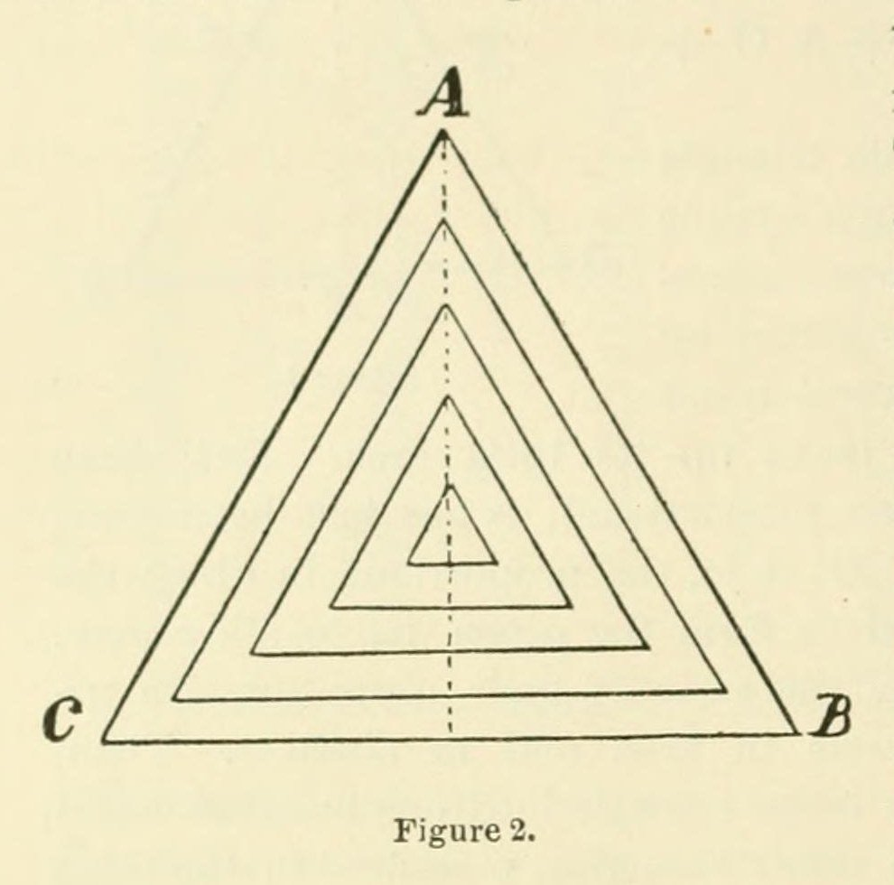
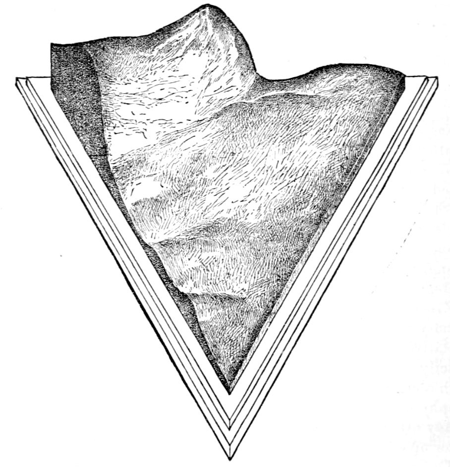
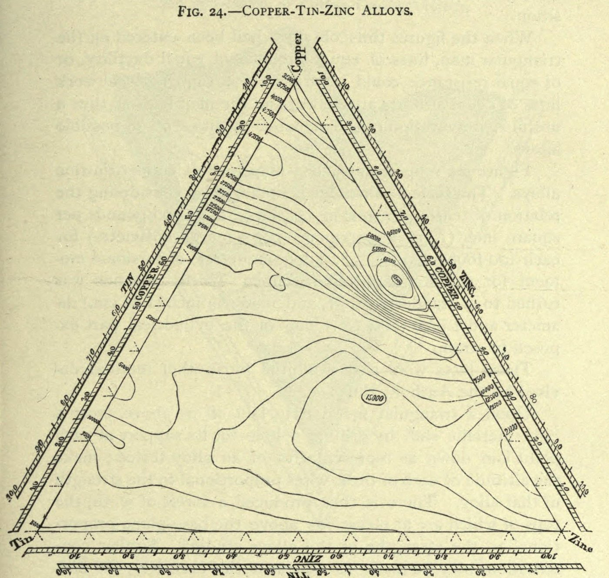
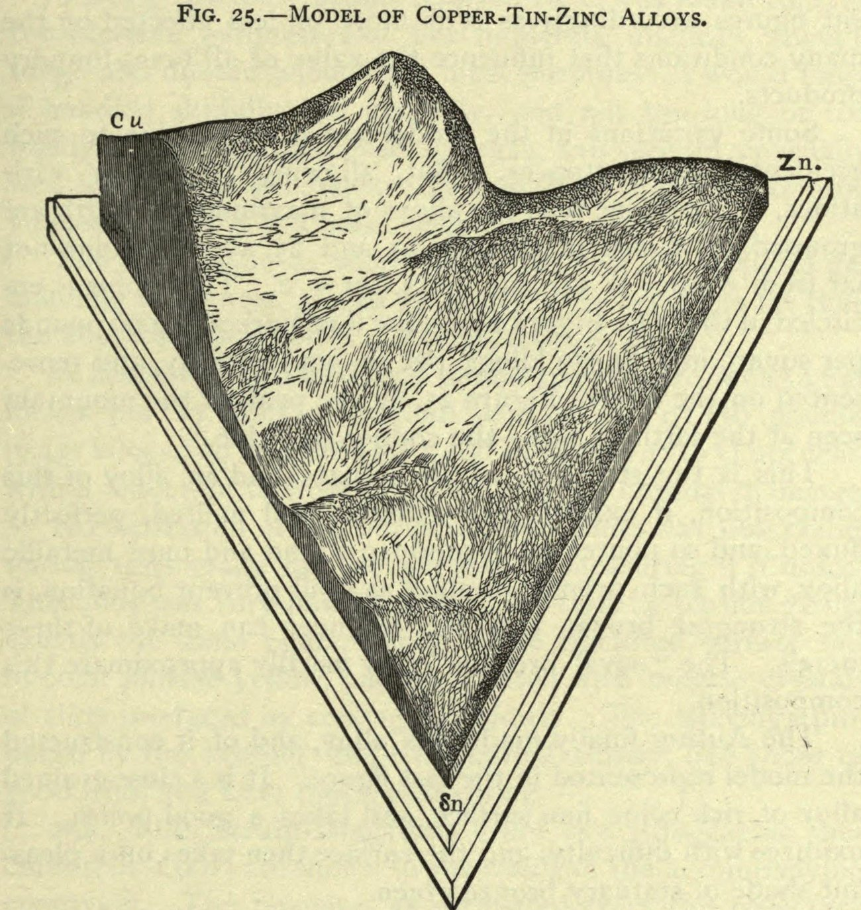

+++
author = "矢崎裕一"
title = "106点の実測値のあいだを石膏で埋める──Thurston の銅・スズ・亜鉛の合金模型"
slug = "thurston-alloy-model"
date = "2026-11-01"
description = "三角形の上の位置で銅・スズ・亜鉛の配合比を、針金の高さで引張強さを表した模型です。106点の実測値のあいだを石膏で埋めて曲面にしています。"
categories = [
    "consume"
]
tags = [
    "データ物質化",
    "三角図",
    "等高線",
    "Robert H. Thurston"
]
image = "images/plaster-model-1877.jpg"
series = ["data-physicalization"]
series_weight = 7
seriesByline = "Robert H. Thurston・M. I. Coster"
seriesTitle = "配合比を三角形に、強さを高さに──Thurston の合金模型"
+++

Robert Henry Thurston（ロバート・ヘンリー・サーストン）の合金模型は、正三角形の上の位置で銅・スズ・亜鉛の配合比を、そこに立てた真鍮の針金の高さで引張強さを表した模型です。実際に試験した106点の値を針金の長さにし、針金のあいだを石膏で埋めて、一枚の曲面にしています。完成した面には、針金の先端が点としてのぞいています。

模型は、米国の金属試験委員会のための合金研究（1875〜78年）の中で、M. I. Coster（コスター）が作りました。最初の公表は、1877年8月のアメリカ科学振興協会（AAAS）ナッシュビル大会での Thurston の論文です。以下は、その論文、1878年6月付の委員会報告、Thurston の教科書『Materials of Engineering』Part III、1898年の論文 "Graphic Diagrams and Glyptic Models" に沿って読みます。

<!--more-->

## 1875年、三つの金属の組み合わせは数えきれない

1875年3月25日、大統領が米国の金属試験委員会を任命しました。初会合は同年4月15日です。その中に合金委員会が置かれ、委員長を Thurston が務めました。

Thurston は当時、ホーボーケンの Stevens Institute of Technology の機械工学の教授で、試験もそこで行われました。のちの米国機械学会（ASME）初代会長です。

合金委員会の任務は、合金の性質を実験し、組み合わせの法則を調べることでした。2種類の金属の合金なら、横軸に配合、縦軸に強さをとった平面のグラフで済みます。3種類になると、1877年の論文の言葉では「infinite number of possible combinations」があります。Thurston は1899年に、単純な方法が見つからず、三元合金には長いあいだ手を付けられなかったと振り返っています。

1877年の論文は、研究の目標を次のように書きます。

> … any one studying the results of the work should be able to say, with confidence, what would be the precise character of any possible alloy of the three metals which he might propose to make.

最大と最小の点を突き止めたうえで、誰でも、作ろうとする任意の合金の性質を自信をもって言えるようにする、という目標です。試していない合金まで含めて答えを出す点に、模型の役目が書かれていると読めます。

## 三角形を「領地」として測量する

1877年の論文の題には、「研究を計画する」ことと「結果を目に見せる」ことが並んでいます（Planning Researches / Representing to the Eye）。

方法の土台は正三角形です。三角形の中の点から三辺へ垂線を下ろすと、3本の長さの合計は、どの点でも三角形の高さに等しくなります。高さを100等分すれば、3本の垂線の長さが、そのまま3つの金属の百分率になります。頂点は純粋な金属で、辺の上の点は2金属の合金です。

Thurston は、この三角形を測量すべき土地として扱いました。

> Its topography may be studied as systematically and completely as that of any other territory of which the exact boundaries have been determined and marked out.

境界の決まったほかの土地と同じように、三角形の地形を系統立てて、もれなく調べられる、という主張です。

R. H. Thurston, Proceedings of the AAAS 26 (1878), p.118, Figure 2／Internet Archive より引用（パブリックドメイン）

標本点の選び方も、この図で決まります。図2は、10%ずつ内側にずらした同心の三角形です。その辺の上に10%おきに点を取ると、試験する三元合金の一覧になります。3金属をすべて10%以上含む組み合わせは、論文の表で36通りです。

『Materials of Engineering』Part III によれば、10%刻みの36合金を試した系列で、5/6を超える合金が「comparatively worthless」と分かりました。続く系列では強い領域に絞り、5%刻みの24合金、2.5%刻みの12合金を試験しています。

1877年の論文には、刻みを細かくする理由も書かれています。

> at sharp culminations, in points or lines, forming peaks or ridges in our topography, it would be necessary to take another set of points nearer together

地形の頂や尾根のように値が鋭く変わる所では、点をもっと近づけて取り直す必要がある、という指示です。標本点は三角形に均等に並んでいるのではなく、強い合金の領域ほど密になっていると読めます。**三角形は結果を描く台であると同時に、次に何を試すかを決める台でした**。

## 針金の林を、石膏で埋める

委員会報告は、模型の寸法を書き残しています。底面は一辺10インチ（約25cm）の正三角形で、100等分されています。頂点には純粋な銅、スズ、亜鉛の引張強さを表す縦の棒を立てました。棒は真鍮の針金で、縮尺は長さ1インチあたり25,000ポンド毎平方インチ（psi）です。

例えば、銅の頂点から1インチの位置には、銅90・スズ10の砲金の強さを表す針金が立ちます。同じように青銅、真鍮、三元合金の点に針金を立て、点の数は106になりました。

1877年の論文は、作り方を手順として書いています。真鍮板に三角形を描き、測った点に、強さに比例した長さの針金を固定する。板で枠を作り、針金が隠れるまで石膏を流し込む。固まったら上から削り、針金の先端がちょうど出たところで止める。

R. H. Thurston（模型製作：M. I. Coster）, Proceedings of the AAAS 26 (1878), p.119, Figure 3／dataphys.org より引用（原図はパブリックドメイン）

論文によれば、この版画（図3）は Coster の模型の写真から起こしたもので、方法を示すために掲げた図です。

『Materials of Engineering』は、仕上がった面をこう書きます。

> the tops of all the wires are just visible, shining points in the now smooth surface of the model

針金の先端が、なめらかになった面の上に、光る点としてかろうじて見える、という描写です。この模型では、実際に測った値（光る点）と、そのあいだを手で補った値（石膏の面）が、同じ表面の上で見分けられると読めます。

データと素材の対応を表にします。

| データ | 物理的な性質・素材 | 具体値・縮尺 |
|---|---|---|
| 3金属の配合比（銅・スズ・亜鉛の%） | 正三角形の底面上の位置。三辺への垂線の長さが各金属の% | 一辺10インチ、100等分。頂点が純金属 |
| 2金属の合金（銅–亜鉛、銅–スズ、スズ–亜鉛） | 三角形の辺の上の位置 | 例：銅の頂点から1インチ＝銅90・スズ10 |
| 合金の引張強さ | 真鍮の針金の長さ（高さ） | 1インチ＝25,000 psi |
| 実測した合金 | 針金1本。完成後は石膏の面にのぞく針金の先端 | 106点 |
| 測っていない配合 | 針金のあいだを埋めた石膏の曲面 | 流し込んでから、針金の先まで削り下ろす |
| 強さの等しい配合 | 水平に切った等高線 | 0.1インチ間隔＝2,500 psi 刻み |
| 最も強い合金 | 曲面の最高点 | 銅55・亜鉛43・スズ2 前後、65,000 psi の等高線の内側 |
| 最強の合金そのもの | のちに鋳造した模型の素材 | 石膏型を原型にして鋳造 |

縮尺から計算すると、65,000 psi の頂の高さは約2.6インチ（約6.6cm）で、底面の一辺の3割弱です。出典にある寸法ではなく、筆者の計算です。

## 等高線の地図と、山の頂の合金

委員会報告によれば、模型を0.1インチ間隔の水平面で切ると等高線が得られます。その地図で、どの合金の引張強さも2,500ポンド以内の誤差で分かる、と報告は書きます。地図は「Plate I」として報告に添えられました。『Materials of Engineering』にも、同じ種類の地図が図24として載っています。

R. H. Thurston, Materials of Engineering, Part III, p.425, Fig. 24／Internet Archive より引用（パブリックドメイン）

図24の右寄り、銅と亜鉛の辺に近い所で、等高線が同心の輪になって閉じています。ただし『Materials of Engineering』によれば、この地図の高さの尺度は、ねじり試験の100フィートポンドを引張の25,000 psi とみなして換算したものです。

Thurston は、強い合金の位置をこう書きます。強さの最大の合金は、銅55・亜鉛43・スズ2 に近い点のまわりに集まる。その点は地図では65,000 psi の線に囲まれ、模型では「the peak of the mountain seen at the farthest side — the copper-zinc side」として現れる。

R. H. Thurston, Materials of Engineering, Part III, p.427, Fig. 25／Internet Archive より引用（パブリックドメイン）

図25は、別の素材の模型です。『Materials of Engineering』によれば、模型は石膏型を原型にして「cast in an alloy of maximum tenacity」、つまり最も強い合金で鋳造されました。図25は、その模型の写真から起こした図です。鋳造の年と、石膏型・鋳造品の現在の所蔵先は、確かめられませんでした。

Thurston は、データの限界も書いています。合金はふつうの鋳造所と同じ条件で、脱酸のフラックスを使わずに作ったため値がばらつき、「Some variations in the model are probably due to such accidental circumstances」と認めています。のちの追試では、純粋な金属とフラックスを使い、最も強い青銅を銅57・亜鉛42・スズ1 と同定しました。模型の頂は、次の試験の出発点にもなったと読めます。

1898年、Thurston は ASME の論文 "Graphic Diagrams and Glyptic Models" で、この方法を「Glyptic System」と名づけました。1877年の論文に、この語はありません。方法の価値については、こう書いています。

> we are thus enabled to represent an infinite number of cases from the results of study of a few, and to find a minimum or a maximum, if it exists, whether it happens to be one of the cases selected or not

少数の研究結果から無数の場合を表し、選んだ場合に含まれていてもいなくても、最小や最大を見つけられる、という主張です。

## 第三者はこの模型をどう見たか

評価は、同時代の報告、のちの金属学、図の歴史研究で論点が分かれます。

金属試験委員会の委員長 T. T. S. Laidley は、1878年6月8日付の報告で、模型を次のように紹介しました。

> … is shown at a glance by a model ingeniously devised by Professor Thurston

2種類か3種類の金属で作れる全合金の引張強さが、Thurston の模型で一目で分かる、という評価です。報告は寸法、縮尺、点の数、等高線の精度まで記録しています。模型を、研究成果の要約として扱っていたと読めます。

金属学者の Samuel L. Hoyt は、1914年の Columbia 大学の博士論文で、機械的性質を主に扱う Thurston の仕事を、検討の範囲から外しています。

> … since it deals mainly with the mechanical properties, it (and other similar work) will not be considered here.

Thurston の仕事は合金の構造（相）についても推測を述べているが、主に機械的性質を扱っているので、ここでは取り上げない、という判断です。一方で Hoyt は、強さが50,000から65,000へ急に上がり、狭い範囲で5,000まで落ちるという Thurston の結果を、相の境界を示すものとして引いています。

図の歴史では、三角図そのものは Thurston より古いとされます。Richard J. Howarth は1996年の論文で、その起源を18世紀の色の混合の研究に置きました。公開されている参考文献一覧に、Thurston の名は見当たりません。Thurston 自身も、Gibbs が1876年に別の分野でこの原理を提案したと書いています。一方で1899年には、三軸の図を「I think, first employed by me」と書きました。この「最初」は、合金の研究計画に使ったという意味に限って読むのが安全です。

## 使い道

この模型から持ち帰れるのは、測った点と補った面を、同じ表面の上で区別して見せることです。Thurston の模型では、光る針金の先端が実測で、そのあいだの石膏が補間です。

次に、図を描く前に、標本点の取り方を図で決めていることです。10%刻みで全体を見て、強い領域だけ5%、2.5%と刻みを細かくする。図2の同心三角形は、試験の計画表でした。可視化を、次に何を測るかを決める道具として使っています。

最後に、精度の書き方です。委員会報告は、縮尺（1インチ＝25,000 psi）と等高線の間隔（2,500 psi）を書き残しました。Thurston は、鋳造条件によるばらつきが模型に出ていることも認めています。立体を見せるときも、何をどの精度で読めるかを添える。この模型と報告は、その古い手本と読めます。

## 参考・出典

**一次情報**

- R. H. Thurston, "On a New Method of Planning Researches and of Representing to the Eye the Results of Combination of three or more Elements in Varying Proportions," *Proceedings of the American Association for the Advancement of Science*, 26th Meeting, Nashville, Aug. 1877 (Salem, 1878), pp.114–120. [Internet Archive](https://archive.org/details/summarizedprocee1877ameruoft/page/114)
- *Report of the United States Board appointed to test Iron, Steel and other Metals*, vol. I (Washington: GPO, 1881)。委員長 T. T. S. Laidley による1878年6月8日付の報告、pp.1–4. [Internet Archive](https://archive.org/details/reportunitedsta01smitgoog)
- R. H. Thurston, *Materials of Engineering*, Part III (A treatise on brasses, bronzes, and other alloys), 4th ed. revised, §§248–255, pp.416–432. [Internet Archive](https://archive.org/details/materialsofengin03thurrich)
- R. H. Thurston, "Graphic Diagrams and Glyptic Models," *Transactions of the American Society of Mechanical Engineers*, vol. XIX (1898), pp.514–550. [Internet Archive](https://archive.org/details/transactionsof19amer/page/514)
- R. H. Thurston, Discussion of the paper of Prof. Howe on the Use of the Tri-Axial Diagram and Triangular Pyramid (AIME, 1899). [OneMine](https://onemine.org/documents/atlantic-city-paper-discussion-of-the-paper-of-prof-howe-on-the-use-of-the-tri-axial-diagram-and-triangular-pyramid-for-graphical-illustration-see-p-346-)

**第三者評価**

- Samuel L. Hoyt, *On the Copper Rich Kalchoids (Copper Tin Zinc Alloys)*, PhD thesis, Columbia University, 1914. [Internet Archive](https://archive.org/details/oncopperrichkalc00hoytrich)
- Richard J. Howarth, "Sources for a history of the ternary diagram," *The British Journal for the History of Science* 29(3), 1996, pp.337–356. doi:10.1017/S000708740003449X [Cambridge Core](https://www.cambridge.org/core/journals/british-journal-for-the-history-of-science/article/sources-for-a-history-of-the-ternary-diagram/E8DF73C8E8EB183E6F68B7119AE18F71)

**そのほか（画像の掲載元・経歴の確認）**

- dataphys.org, "1875 – Robert Henry Thurston's Glyptic Models"（図3の画像の掲載元。登録：Pierre Dragicevic）. [dataphys.org](https://dataphys.org/list/robert-henry-thurstons-glyptic-models/)
- Wikipedia, "Robert Henry Thurston"（経歴の確認用）. [Wikipedia](https://en.wikipedia.org/wiki/Robert_Henry_Thurston)
