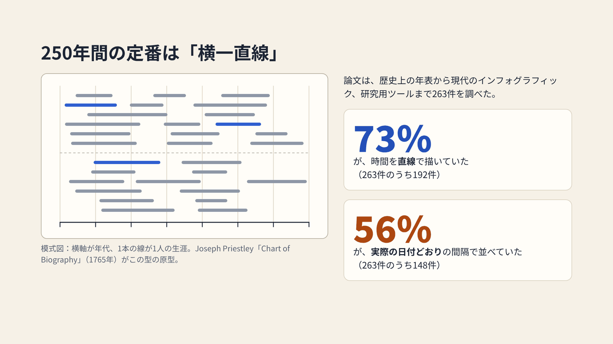
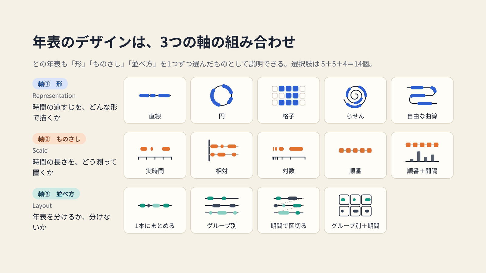
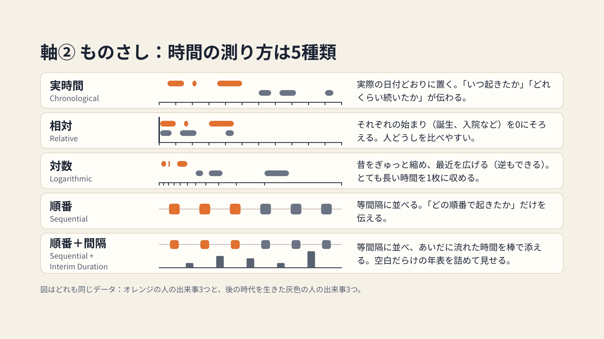
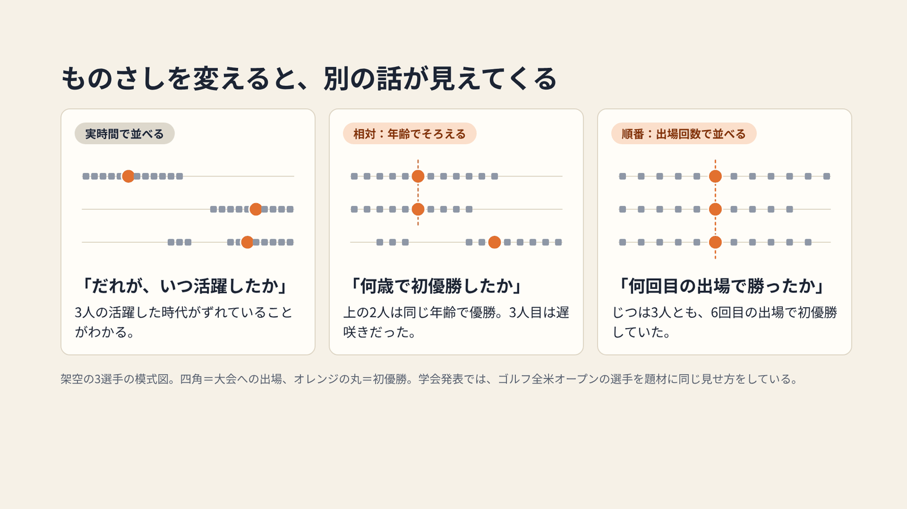
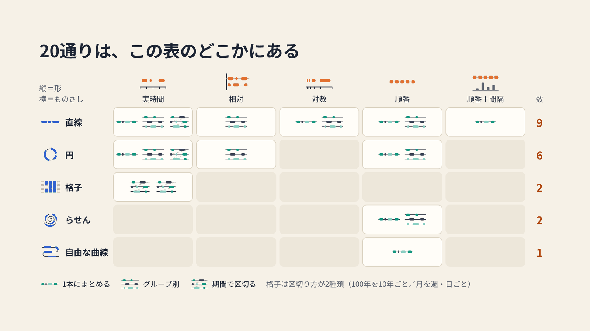
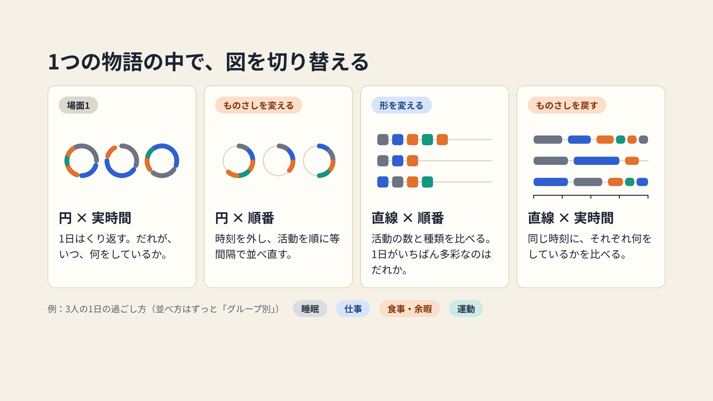
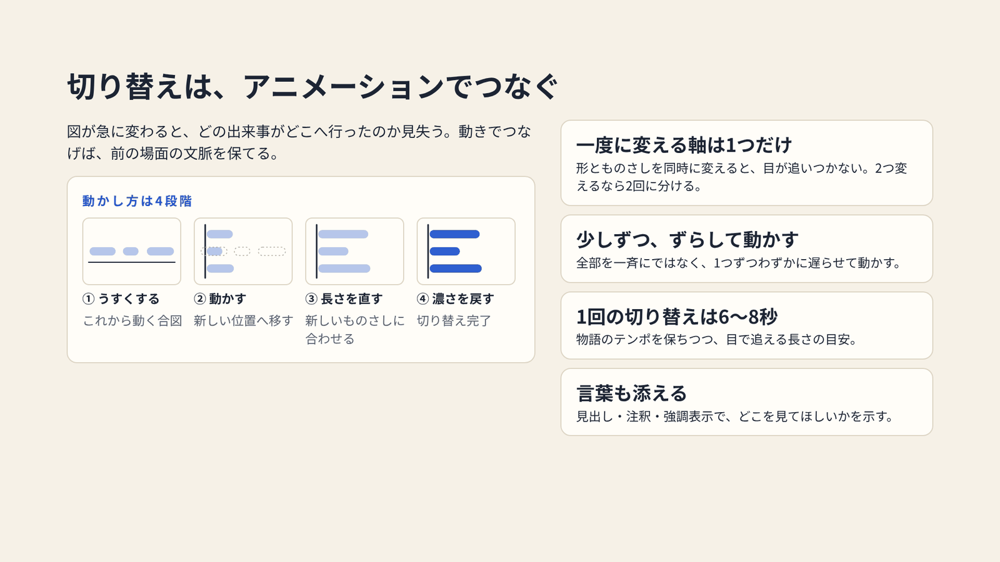

+++
author = "Yuichi Yazaki"
title = "Timelines for Exploring and Timelines for Telling Are Different Things: Timelines Revisited"
slug = "timelines-revisited"
date = "2026-11-21"
description = "A timeline for exploring data and a timeline for telling others are different things. For telling, you are not limited to a straight horizontal line: you can pick from 20 combinations of representation, scale and layout."
categories = [
    "principle"
]
tags = [
    "Matthew Brehmer",
    "timeline",
    "storytelling",
    "design space"
]
image = "images/cover-diagram.png"
+++

A timeline for exploring data and a timeline for telling others what you found are different things. For exploring, a straight horizontal line with events placed at their actual dates is strong. For telling, circles, spirals and evenly spaced arrangements also become options. But not unconditionally. Only designs that have a purpose, can be read, and still hold when the data changes qualify. That is how the paper "Timelines Revisited," by Matthew Brehmer and colleagues, sorts it out.

The source is a paper by five authors, Brehmer, Lee, Bach, Henry Riche and Munzner, published in *IEEE Transactions on Visualization and Computer Graphics*, volume 23, issue 9 (September 2017). They surveyed 263 timelines, divided the design choices into three dimensions, and selected 20 combinations they can recommend. What follows goes in the order of the paper. All figures are schematic diagrams I drew anew from the paper's content. Their labels are in Japanese.

<!--more-->

## Of 263 timelines collected, seven in ten were a straight horizontal line

The authors began by collecting timelines. First 145 of them: historical timelines, infographics, visualization tools from research, and timeline authoring tools. From these they found the dimensions of their classification, and then checked whether it held for another 118. The total is 263.

The result was lopsided. Of the 263, 192 (73%) drew time as a straight line. 148 (56%) placed events at intervals that match their actual dates. The prototype is the "Chart of Biography," a chart of people's lives made by Joseph Priestley in 1765. The horizontal axis is the years, and one line is one person's life. Nearly all of the research tools were of this type.

Drawn by the author from the survey results in Brehmer et al. (2017)

Here the paper separates two uses. One is exploratory data analysis. The analyst operates a tool and discovers something new. Thousands of events are handled, and reading them accurately comes first. The other is storytelling. The storyteller delivers what is already known, with events that have been selected. There may be more than one point to make.

> in a storytelling context, more expressiveness is desirable

When the aim is to tell, more expressive power is desirable. The research world has concentrated on the former. Makers of newspapers and infographics have drawn a great variety of timelines for the latter. **There is no guidance connecting the two.** That is where the paper starts.

Drawn by the author from the content of Brehmer et al. (2017)

## Dividing a timeline into representation, scale and layout

To explain the differences among the timelines they had collected, the authors set up three dimensions.

| Dimension | What it decides | Choices |
|---|---|---|
| Representation | The shape of the path that time takes | Linear, radial, grid, spiral, arbitrary |
| Scale | How lengths of time are measured and placed | Chronological, relative, logarithmic, sequential, sequential + interim duration |
| Layout | Whether the timeline is divided or not | Unified, faceted, segmented, faceted + segmented |

There are 14 choices in all. All 263 timelines could be described with these three dimensions.

Drawn by the author from the content of Fig. 1 in Brehmer et al. (2017)

Representation is the dimension that catches the eye first. A radial form suits time that repeats, such as a day or the seasons. A grid shows time along the divisions of a calendar. As an example of a grid, the paper cites Peabody's chronological charts from the 19th century. On this site they are covered in "[Painting 100 Years as 10×10 and One Year as 3×3](/en/peabody-chronological-history/)."

Scale is how distances in time are converted into distances on the display. A chronological scale places events at their dates. A relative scale aligns beginnings, such as a birth or a hospital admission, to zero. A logarithmic scale compresses one end of a long span. A sequential scale spaces events evenly and conveys only their order. The last one spaces events evenly and then adds bars for the time that elapsed between them.

Drawn by the author from the content of Brehmer et al. (2017)

Change the scale, and a different story comes out of the same data. In his talk at IEEE VIS 2017, Brehmer showed this with the careers of golfers who played in the U.S. Open. A chronological scale lets you compare the eras in which they were active. A relative scale aligned to birth lets you compare the ages at which they won. Order of appearance lets you compare on which attempt they won. The figure below draws the same idea with three fictional players.

A schematic with fictional data. Drawn by the author after the example in Brehmer's IEEE VIS 2017 talk

## Narrowing 100 combinations to 20 with three questions

5 × 5 × 4 gives 100 combinations. The authors did not assume that all of them are usable. For each combination they ask three things.

- **Is it purposeful?** Does it correspond to a point the storyteller wants to make?
- Is it interpretable? What perceptual task does it impose on the audience, and can they do it without strain?
- Is it generalizable? Does it hold when the number and distribution of events, the time span, and the number of categories change?

Twenty remained. Nine are linear, six radial, two grid, two spiral, and one arbitrary. Of the 263 timelines, 253 (96%) fit one of these 20. Two of the 20 are combinations that did not appear in the survey.

Drawn by the author from the content of Fig. 3 in Brehmer et al. (2017)

The remaining 80 fall into two groups. One is redundancy. A sequential scale, for example, does not use dates, so segmenting it by period means nothing. The other is unresolved combinations. On a spiral or an arbitrary curve, chronological lengths and intervals are hard to read. The logarithmic scale is, according to the paper, known to be difficult to interpret, and the survey found almost no example of it combined with anything but a line. The authors do not call these unusable. They leave them as topics for future research.

The paper also notes that, within the 20, more than one design can correspond to the same point. The overlap is intended. A line lets lengths and positions be read more accurately, but it lacks the visual appeal of a circle or a spiral. A storyteller can first show a figure that draws the eye, and then move to another figure where accurate reading is wanted. This, the authors write, is where the goals of analysts and storytellers part.

## Switching figures within a single story

The paper states that no single design can serve every point. So a single story comes to use more than one timeline.

As an example it gives a story about the daily routines of famous writers and artists. The first scene is radial, chronological and faceted. A day repeats, so it is drawn as a circle, divided by person, to compare who does what and when. Next the scale changes to sequential. Then the representation changes to linear. Here the number and variety of activities are compared across people. Finally the scale returns to chronological, and activities at the same time of day are compared side by side.

The story of Fig. 6 in Brehmer et al. (2017), simplified to three people and drawn by the author

Scenes are connected with animation. If a figure changes abruptly, the audience can no longer follow which event moved where. The authors implemented all 20 designs in a sandbox environment that runs in the browser, and tried out the transitions. The guidance they arrived at is as follows.

- Divide a transition into stages. First fade the events to signal the change, then move them, then adjust their lengths, then restore their opacity.
- Do not move all events at once. Stagger them slightly.
- **Change only one dimension at a time.** To change both representation and scale, do it in two steps.
- Six to eight seconds per transition is a good guide.
- Between a faceted and a segmented layout, insert a unified layout in between.

Drawn by the author from the content of Section 5.3 in Brehmer et al. (2017)

These are rules of thumb the authors gained through prototyping and production. The paper itself says that experiments comparing transitions are future work. The sandbox was checked with 28 datasets, and seven stories were made with it. They run from 90 seconds to five minutes. This environment became the precursor of Timeline Storyteller, a timeline authoring tool that Microsoft Research released in January 2017.

## How third parties have seen this classification

Here are three, each with a different point.

The first is an experiment. At CHI 2020, Sara Di Bartolomeo and colleagues measured how the shape of a timeline affects task performance. From the classification by Brehmer et al. they chose four shapes: a horizontal line, a vertical line, a circle and a spiral. There were 192 participants. The data were of three kinds: recurrent, non-recurrent and mixed. In its related-work section, that paper describes the state of things this way.

> evaluation of timelines is still in the early stages

Evaluation of timelines has only just begun. In the results, shape affected completion time, but no clear difference appeared in correctness. Lines were faster than the circle or the spiral in 6 of 12 conditions. The spiral was the slowest, or tied for slowest, in 7. The horizontal line was the one people preferred. The authors recommend using a line when people need to look things up quickly, and adding cues when a spiral is used. This experiment measured tasks on the exploring side. It did not measure whether a design draws the eye or stays in memory.

The second is a practitioner's voice. In 2017, in its announcement of Timeline Storyteller for Power BI, Microsoft quoted an endorsement from Alberto Cairo of the University of Miami. Of the many ways to show time, Cairo writes:

> some clear and straightforward —my preferred ones— others quirky and expressive

The clear and straightforward ones are his preference, and there are also quirky and expressive ones. In the same text Cairo also values the tool as a bridge for designers and journalists who cannot write code. It is an endorsement carried in an announcement, so it should be read with some discount. Even so, the attitude of welcoming a wider range of expression while choosing clarity can be read as overlapping with the paper's classification.

The third is its position within research. In a survey of 105 tools for narrative visualization, Qing Chen and colleagues divided tools into four levels by degree of automation. The paper by Brehmer et al. is placed at the first level, "design space." It is read, in other words, as a foundation for authoring tools and automatic generation tools.

## How to use it

Here are four things to take back to visualization work.

**First, decide whether the figure is for exploring or for telling.** If it is for exploring, starting from a straight horizontal line and a chronological scale is reasonable. The experiment by Di Bartolomeo et al. also shows that lines are fast for lookup tasks.

If it is for telling, write out the points you want to make as sentences. For each point, choose a representation, a scale and a layout. The table below narrows the paper's correspondences to representative ones.

| What you want to convey | Suitable choices |
|---|---|
| The order or flow of events | Linear × sequential (chronological if dates also matter) |
| Repetition or cycles | Radial, or grid |
| Comparison among people or groups | Faceted + relative scale |
| A very long span, unevenly distributed events | Logarithmic, or sequential + interim duration |
| Many events in one view | Spiral, or arbitrary |

When choosing anything other than a straight horizontal line, put the three questions to your own figure. What is its purpose? Can the audience read it? Does it hold when the data changes? Combinations for which you cannot answer are left open in the paper as well.

If there is more than one point, do not pack them into one figure. Switch figures. Change one dimension at a time. Whether in slides, in video, or when laying figures side by side on a page, I think this way of ordering can be used.

## References

**Primary sources**

- Matthew Brehmer, Bongshin Lee, Benjamin Bach, Nathalie Henry Riche, Tamara Munzner, "Timelines Revisited: A Design Space and Considerations for Expressive Storytelling," *IEEE Transactions on Visualization and Computer Graphics*, 23(9), 2017, pp. 2151–2164. [doi:10.1109/TVCG.2016.2614803](https://doi.org/10.1109/TVCG.2016.2614803)
- The paper's website (author preprint, figures, videos, and the list of the 263 surveyed items). [timelinesrevisited.github.io](https://timelinesrevisited.github.io/)
- Matthew Brehmer, "Timelines Revisited," slides for the IEEE VIS 2017 talk, 2017-10-03. [timelinesrevisited.github.io/ieeevis](https://timelinesrevisited.github.io/ieeevis/)
- Timeline Storyteller. [timelinestoryteller.com](https://timelinestoryteller.com) / [GitHub](https://github.com/microsoft/timelinestoryteller)
- Matthew Brehmer et al., "Timeline Storyteller: The Design & Deployment of an Interactive Authoring Tool for Expressive Timeline Narratives," 2019. [Microsoft Research](https://www.microsoft.com/en-us/research/?p=556122)

**Secondary sources**

- Sara Di Bartolomeo, Aditeya Pandey, Aristotelis Leventidis, David Saffo, Uzma Haque Syeda, Elin Carstensdottir, Magy Seif El-Nasr, Michelle A. Borkin, Cody Dunne, "Evaluating the Effect of Timeline Shape on Visualization Task Performance," *Proc. CHI 2020*. [doi:10.1145/3313831.3376237](https://doi.org/10.1145/3313831.3376237) / [arXiv:2005.06039](https://arxiv.org/abs/2005.06039)
- "What story does your timeline tell? Introducing the Timeline Storyteller custom visual for Microsoft Power BI," Microsoft Power BI Blog, 2017 (includes Alberto Cairo's endorsement). [Article](https://asia.powerbi.microsoft.com/en-ie/blog/what-story-does-your-timeline-tell-introducing-the-timeline-storyteller-custom-visual-for-microsoft-power-bi)
- Qing Chen, Shixiong Cao, Jiazhe Wang, Nan Cao, "How Does Automation Shape the Process of Narrative Visualization: A Survey of Tools," 2022. [arXiv:2206.12118](https://arxiv.org/abs/2206.12118)
