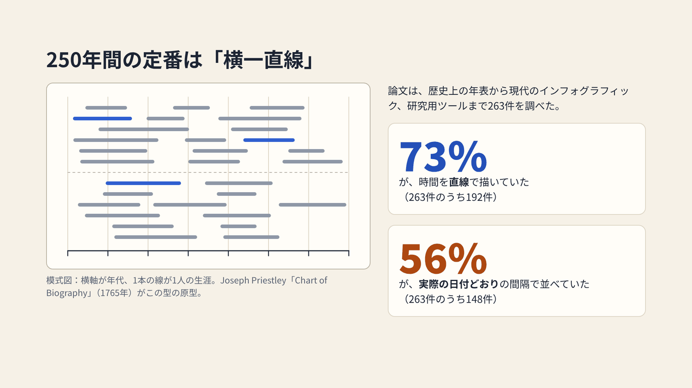
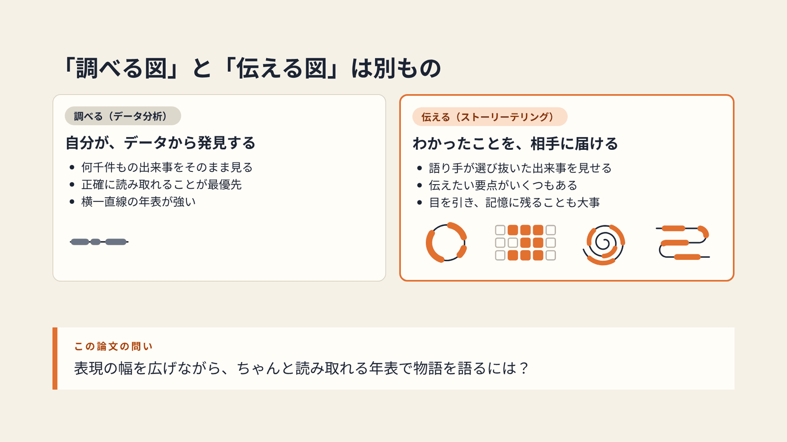
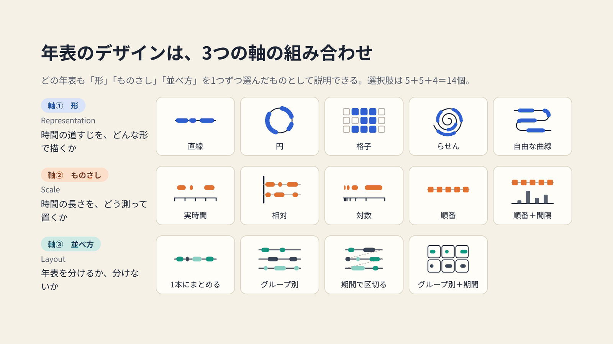
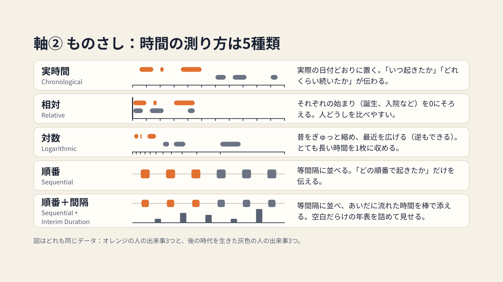
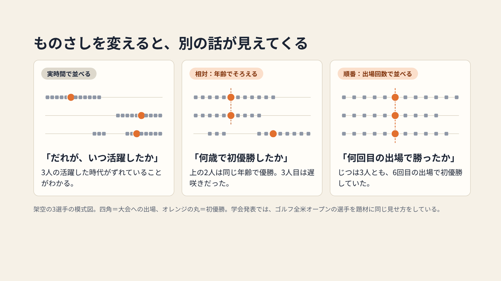
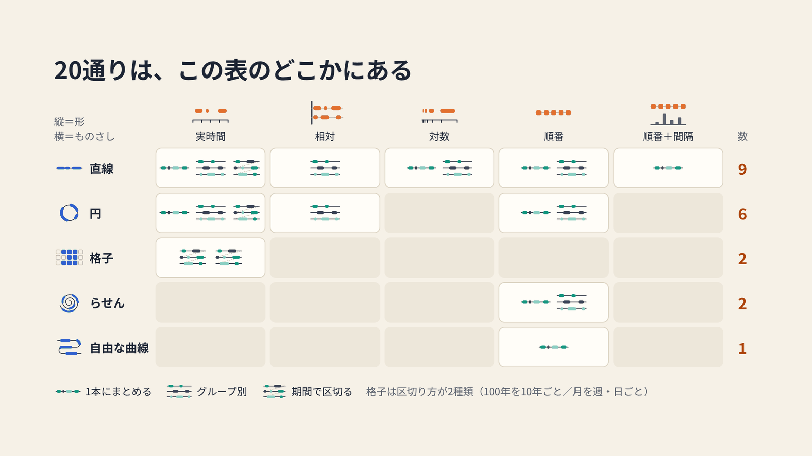
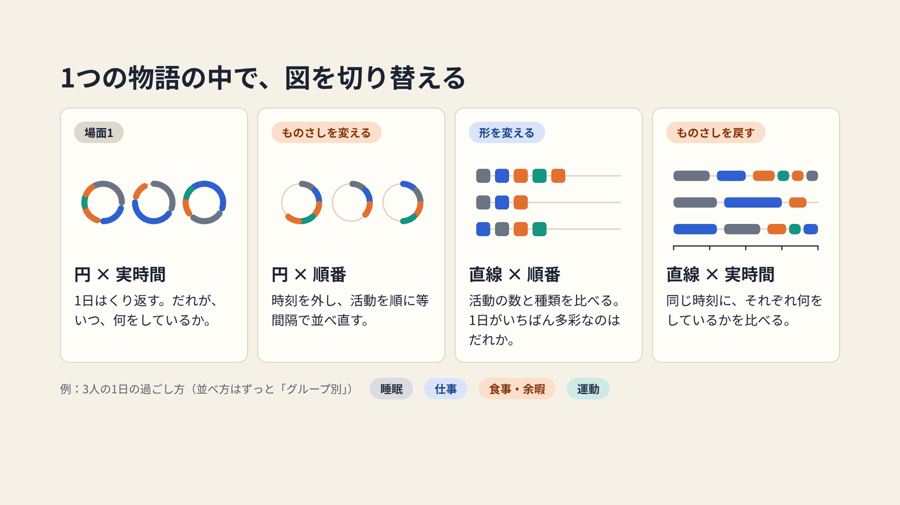
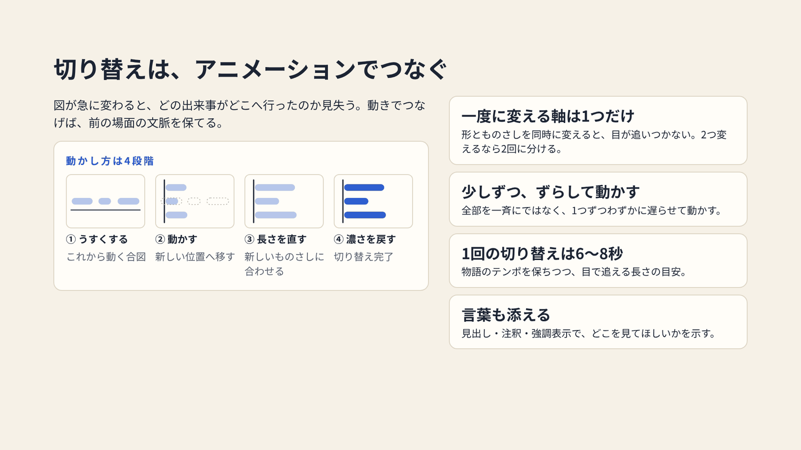

+++
author = "矢崎裕一"
title = "調べる年表と、伝える年表は別もの──Timelines Revisited"
slug = "timelines-revisited"
date = "2026-11-21"
description = "データを調べる年表と、人に伝える年表は別ものです。伝えるなら横一直線に限らず、形・ものさし・並べ方の組み合わせ20通りから、要点に合うものを選べます。"
categories = [
    "principle"
]
tags = [
    "Matthew Brehmer",
    "年表",
    "ストーリーテリング",
    "デザイン空間"
]
image = "images/cover-diagram.png"
+++

データを調べるための年表と、わかったことを人に伝えるための年表は、別ものです。調べるなら、横一直線に実際の日付で並べる年表が強い。伝えるなら、円やらせん、等間隔の並べ方も選択肢に入ります。ただし無条件ではありません。ねらいがあり、読み取れて、データが変わっても成り立つものに限る。Matthew Brehmer（マシュー・ブレーマー）らの論文 “Timelines Revisited” は、そう整理しました。

出典は Brehmer, Lee, Bach, Henry Riche, Munzner の5人による論文で、*IEEE Transactions on Visualization and Computer Graphics* の23巻9号（2017年9月）に載りました。263件の年表を調べ、デザインの選択肢を3つの軸に分け、すすめられる組み合わせを20通り選んでいます。以下は論文の順に沿います。図はすべて、論文の内容をもとに筆者が描き起こした模式図です。

<!--more-->

## 263件を集めたら、7割が横一直線だった

著者たちは、まず年表を集めました。最初に145件。歴史上の年表、インフォグラフィック、研究用の可視化ツール、年表の作成ツールです。ここから分類の軸を見つけ、別の118件でも通用するかを確かめました。合計は263件です。

結果は偏っていました。263件のうち192件（73%）が、時間を直線で描いていました。148件（56%）は、実際の日付どおりの間隔で出来事を置いていました。原型は Joseph Priestley（ジョゼフ・プリーストリー）が1765年に作った人物年表 “Chart of Biography” です。横軸が年代で、1本の線が1人の生涯を表します。研究用のツールは、ほぼすべてがこの型でした。

Brehmer ほか（2017）の調査結果をもとに筆者作成

論文は、ここで用途を二つに分けます。一つは探索的データ分析です。分析者が自分でツールを操作し、新しいことを見つける。何千件もの出来事を扱い、正確に読めることが最優先になります。もう一つはストーリーテリングです。語り手は、すでにわかっていることを、選び抜いた出来事で相手に届けます。伝えたい要点は一つとは限りません。

> in a storytelling context, more expressiveness is desirable

伝える場面では、より豊かな表現力が望ましい、という一文です。研究の世界は前者に集中してきた。新聞やインフォグラフィックの作り手は、後者のために多彩な年表を描いてきた。**その間をつなぐ指針がない**、というのが論文の出発点です。

Brehmer ほか（2017）の内容をもとに筆者作成

## 年表を、形・ものさし・並べ方に分ける

集めた年表の違いを説明するために、著者たちは3つの軸を立てました。訳語は筆者によるものです。

| 軸 | 原語 | 決めること | 選択肢 |
|---|---|---|---|
| 形 | Representation | 時間の道すじをどんな形で描くか | 直線、円、格子、らせん、自由な曲線 |
| ものさし | Scale | 時間の長さをどう測って置くか | 実時間、相対、対数、順番、順番＋間隔 |
| 並べ方 | Layout | 年表を分けるか、分けないか | 1本にまとめる、グループ別、期間で区切る、両方 |

選択肢は合わせて14個です。263件はすべて、この3軸で説明できました。

Brehmer ほか（2017）Fig. 1 の内容をもとに筆者作成

形は、いちばん目につく軸です。円は1日や季節のようにくり返す時間に向きます。格子はカレンダーのように、暦の区切りに沿って見せます。論文は格子の例として、19世紀の Peabody の年代図を挙げています。当サイトでは「[100年を10×10に、1年を3×3に塗り分ける](/peabody-chronological-history/)」で扱いました。

ものさしは、時間上の距離を画面上の距離にどう置きかえるかです。実時間は日付どおりに置きます。相対は、誕生や入院といった始まりを0にそろえます。対数は、長い時間の一方を縮めます。順番は等間隔に並べ、順序だけを伝えます。最後の一つは、等間隔に並べたうえで、出来事のあいだに流れた時間を棒で添えます。

Brehmer ほか（2017）の内容をもとに筆者作成

ものさしを変えると、同じデータから別の話が出てきます。著者の Brehmer は IEEE VIS 2017 の発表で、ゴルフの全米オープンに出場した選手たちの経歴を使ってこれを見せました。実時間では活躍した時代が、生年でそろえた相対では優勝した年齢が、出場順では何回目で勝ったかが比べられます。下の図は、同じ見せ方を架空の3選手で描いたものです。

架空のデータによる模式図。Brehmer の IEEE VIS 2017 発表の例をもとに筆者作成

## 100通りを、3つの問いで20通りに絞る

5×5×4で、組み合わせは100通りあります。著者たちは、そのすべてを使えるとは考えませんでした。組み合わせごとに、次の3つを問います。

- **ねらいがあるか**（purposeful）：伝えたい要点に対応しているか。
- 読み取れるか（interpretable）：見る人に課す知覚の作業は何か。それは無理なくできるか。
- 使い回せるか（generalizable）：出来事の数や分布、期間、種類の数が変わっても成り立つか。

残ったのは20通りです。直線が9、円が6、格子が2、らせんが2、自由な曲線が1。263件のうち253件（96%）は、この20通りのどれかに当てはまりました。20通りのうち2つは、調査では見つからなかった組み合わせです。

Brehmer ほか（2017）Fig. 3 の内容をもとに筆者作成

残りの80通りは、二つに分かれます。一つは重複です。たとえば「順番」のものさしは日付を使わないので、期間で区切っても意味がありません。もう一つは未解決の組み合わせです。らせんや自由な曲線の上では、実時間の長さや間隔を読みにくい。対数のものさしは、論文によれば解釈が難しいことで知られ、直線以外と組んだ例は調査でほぼ見つかりませんでした。著者たちはこれらを「使えない」とは書かず、今後の研究課題として残しています。

20通りの中に、同じ要点に対応するデザインが複数あることにも、論文は触れています。意図した重複です。直線は長さや位置をより正確に読めますが、円やらせんのような見た目の魅力は乏しい。語り手は、まず目を引く図を見せ、正確に読ませたい場面で別の図へ移ることができます。分析者と語り手の目的が分かれるのはここだ、と著者たちは書いています。

## 一つの物語の中で、図を切り替える

論文は、一つのデザインですべての要点をまかなうことはできない、と述べます。だから一つの物語が、複数の年表を使うことになります。

例として、著名な作家や芸術家の日課を扱った物語が載っています。最初の場面は、円・実時間・グループ別です。1日はくり返すので円で描き、人ごとに分けて、だれがいつ何をしているかを比べます。次に、ものさしを順番に変えます。続いて、形を直線に変えます。ここでは活動の数と多彩さを人どうしで比べます。最後にものさしを実時間へ戻し、同じ時刻の活動を横に見比べます。

Brehmer ほか（2017）Fig. 6 の物語を、3人に簡略化して筆者作成

場面と場面は、アニメーションでつなぎます。図が急に変わると、どの出来事がどこへ移ったのかを追えなくなるからです。著者たちは20通りすべてをブラウザで動く試作環境に実装し、切り替えを試しました。得られた指針は次のとおりです。

- 切り替えは段階に分ける。まず出来事を薄くして合図を出し、位置を動かし、長さを合わせ、濃さを戻す。
- 出来事は一斉に動かさず、少しずつずらす。
- **一度に変える軸は一つだけ**にする。形とものさしを両方変えるなら、2回に分ける。
- 1回の切り替えは6〜8秒が目安。
- グループ別と期間区切りのあいだは、いったん1本にまとめた状態を挟む。

Brehmer ほか（2017）5.3節の内容をもとに筆者作成

これらは、試作と制作を通じた著者たちの経験則です。論文自身が、切り替え方を比べる実験は今後の課題だと書いています。試作環境は28種類のデータで確かめられ、7本の物語が作られました。長さは90秒から5分です。この環境は、Microsoft Research が2017年1月に公開した年表づくりのツール Timeline Storyteller の前身になりました。

## 第三者はこの整理をどう見たか

論点の違う三つを挙げます。

一つ目は実験です。Sara Di Bartolomeo らは2020年の CHI で、年表の形が課題の成績に与える影響を測りました。Brehmer らの分類から、横の直線、縦の直線、円、らせんの4つを選んでいます。参加者は192人。データは、くり返しのあるもの、ないもの、混ざったものの3種類です。この論文は関連研究の節で、現状をこう書いています。

> evaluation of timelines is still in the early stages

年表の評価はまだ初期段階にある、という指摘です。結果として、形は所要時間に影響しましたが、正答率にははっきりした差が出ませんでした。直線は12条件のうち6条件で、円やらせんより速い。らせんは7条件で最も遅いか、それに並びました。好まれたのは横の直線です。著者たちは、素早く探させたいなら直線を使い、らせんを使うなら手がかりを添えるよう勧めています。この実験は「調べる」側の課題を測ったもので、目を引くか、記憶に残るかは測っていません。

二つ目は実務家の声です。Microsoft は2017年、Timeline Storyteller を Power BI に載せる告知の中で、マイアミ大学の Alberto Cairo（アルベルト・カイロ）の推薦文を引きました。Cairo は、時間を見せる多様な方法について次のように書いています。

> some clear and straightforward —my preferred ones— others quirky and expressive

明快でまっすぐなものが自分の好みで、ほかに風変わりで表現的なものもある、という言い方です。Cairo は同じ文章で、コードを書けないデザイナーや記者にとっての橋渡しになる、とも評価しています。告知に載った推薦文なので、割り引いて読む必要はあります。それでも、表現の幅を歓迎しつつ明快さを選ぶという態度は、論文の整理と重なると読めます。

三つ目は研究の中での位置づけです。Qing Chen らは、ナラティブ可視化のツール105件を調べたサーベイで、ツールを自動化の度合いで4段階に分けました。Brehmer らの論文は、その最初の段階「デザイン空間」に置かれています。作成ツールや自動生成ツールの土台として読まれている、ということです。

## 使い道

可視化の仕事に持ち帰れることを、四つ挙げます。

**最初に、調べるための図か、伝えるための図かを決めます**。調べるためなら、横一直線と実時間から始めるのが妥当です。Di Bartolomeo らの実験も、探す課題では直線が速いことを示しています。

伝えるためなら、伝えたい要点を文で書き出します。要点ごとに、形・ものさし・並べ方を選びます。論文の対応を、代表的なものに絞って表にします。

| 伝えたいこと | 向く選択 |
|---|---|
| 出来事の順番や流れ | 直線 × 順番（日付も大事なら実時間） |
| くり返しや周期 | 円、または格子 |
| 人やグループどうしの比較 | グループ別 ＋ 相対のものさし |
| とても長い時間、偏った出来事 | 対数、または順番＋間隔 |
| たくさんの出来事を1枚に | らせん、または自由な曲線 |

横一直線以外を選ぶときは、3つの問いを自分の図に当てます。ねらいは何か。見る人は読み取れるか。データが変わっても成り立つか。答えられない組み合わせは、論文でも保留になっています。

要点が複数あるなら、1枚に詰め込まず、図を切り替えます。変える軸は一度に一つ。スライドでも動画でも、紙面に図を並べる場合でも、この順序の考え方は使えると筆者は考えます。

## 参考・出典

**一次情報**

- Matthew Brehmer, Bongshin Lee, Benjamin Bach, Nathalie Henry Riche, Tamara Munzner, "Timelines Revisited: A Design Space and Considerations for Expressive Storytelling," *IEEE Transactions on Visualization and Computer Graphics*, 23(9), 2017, pp. 2151–2164. [doi:10.1109/TVCG.2016.2614803](https://doi.org/10.1109/TVCG.2016.2614803)
- 論文のサイト（著者版プレプリント、図、動画、調査した263件の一覧）。[timelinesrevisited.github.io](https://timelinesrevisited.github.io/)
- Matthew Brehmer, "Timelines Revisited," IEEE VIS 2017 発表スライド、2017-10-03. [timelinesrevisited.github.io/ieeevis](https://timelinesrevisited.github.io/ieeevis/)
- Timeline Storyteller. [timelinestoryteller.com](https://timelinestoryteller.com) / [GitHub](https://github.com/microsoft/timelinestoryteller)
- Matthew Brehmer ほか, "Timeline Storyteller: The Design & Deployment of an Interactive Authoring Tool for Expressive Timeline Narratives," 2019. [Microsoft Research](https://www.microsoft.com/en-us/research/?p=556122)

**第三者評価**

- Sara Di Bartolomeo, Aditeya Pandey, Aristotelis Leventidis, David Saffo, Uzma Haque Syeda, Elin Carstensdottir, Magy Seif El-Nasr, Michelle A. Borkin, Cody Dunne, "Evaluating the Effect of Timeline Shape on Visualization Task Performance," *Proc. CHI 2020*. [doi:10.1145/3313831.3376237](https://doi.org/10.1145/3313831.3376237) / [arXiv:2005.06039](https://arxiv.org/abs/2005.06039)
- "What story does your timeline tell? Introducing the Timeline Storyteller custom visual for Microsoft Power BI," Microsoft Power BI Blog, 2017（Alberto Cairo の推薦文を含む）. [記事](https://asia.powerbi.microsoft.com/en-ie/blog/what-story-does-your-timeline-tell-introducing-the-timeline-storyteller-custom-visual-for-microsoft-power-bi)
- Qing Chen, Shixiong Cao, Jiazhe Wang, Nan Cao, "How Does Automation Shape the Process of Narrative Visualization: A Survey of Tools," 2022. [arXiv:2206.12118](https://arxiv.org/abs/2206.12118)
