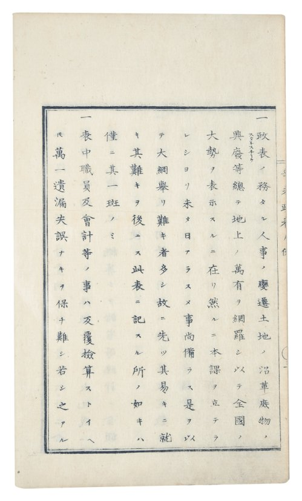
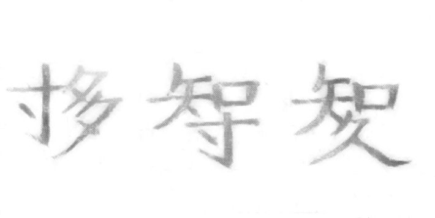

+++
author = "Yuichi Yazaki"
title = "What Was Statistics Translated As? Meiji Coinages and the 1889 Debate over the Character Rendering"
slug = "translate-statistics"
date = "2025-09-07"
description = "In Meiji Japan, \"statistics\" was rendered as 政表 seihyō, 表紀 hyōki, 統計 tōkei, and more. Sugi Kōji built characters that only transcribe the sound, and a debate broke out in 1889, but the word settled on 統計."
categories = [
    "principle"
]
tags = [
    "Sugi Kōji",
    "Mori Ōgai",
    "Imai Takeo",
    "Fukuzawa Yukichi",
    "History of statistics",
    "Translated terms"
]
image = "images/sugi-composite-kanji.jpg"
+++

In Meiji Japan, the English word "statistics" was rendered by several competing terms, among them 政表 *seihyō* ("government tables"), 表紀 *hyōki* ("table record"), and 統計 *tōkei* ("unified counting"). Sugi Kōji (杉亨二), who led the practical work of official statistics, refused to translate the word at all. He built three composite kanji that transcribe the sound of the original, スタチスチク *sutachisuchiku*, and used them as the title of a lecture record. In 1889, Mori Ōgai (森鷗外) and Imai Takeo (今井武夫) argued in magazines for about ten months over whether the rendering 統計 *tōkei* was justified. The debate ended in a stalemate, and the term settled on 統計 *tōkei*.

What follows draws on the Statistics Bureau's explanatory materials (the Statistics 150 Years special site and the Statistics Museum), 奥積雅彦, "Naze 'Statistics' wa 'tōkei' na no ka?" (Why Is "Statistics" "Tōkei"?; Tōkei Today No. 136, 2018), and Hozumi Nobushige (穂積陳重), *Hōsō yawa* (Night Talks of the Legal Profession, 1916). The titles and issue numbers of the debate pieces follow 奥積's chronology. I have not checked Ōgai's writings against the original *Ōgai zenshū* (Complete Works); I rely on passages that Sakai Hironori (酒井弘憲, 2014) quoted in modern orthography.

<!--more-->

## 1860: statistics arrived as *seihyō*

The first statistical book introduced to Japan was *Bankoku seihyō* (萬國政表, "Government Tables of All Nations"), published in 1860 (Man'en 1). 岡本博卿 translated the work of P. A. de Jong, and Fukuzawa Yukichi (福沢諭吉) reviewed it. Its original title was *Statistische tafel van alle landen der aarde*. It is a book of tables giving the population, area, cities, products, and finances of the countries of the world. The Statistics Bureau's explanation says: 「スタチスチックスに政表という訳語をつけたのは、本書が最初であった」 ("This book was the first to give statistics the translation 政表 *seihyō*").

On February 2, 1872 (Meiji 4, 12th month, 24th day), Sugi Kōji was appointed 大主記 *daishuki* (chief secretary) of the 政表課 *Seihyō-ka* (Government Tables Section) in the Dajōkan's Central Office (太政官正院). This is the post corresponding to today's Director-General of the Statistics Bureau in the Ministry of Internal Affairs and Communications. In April of the same year, the section issued *Shinbi seihyō* (辛未政表, "Government Tables for the Shinbi Year"). It is the oldest comprehensive government statistical compilation, and Sugi was its editor in charge. In the first line of the editorial notes, small ruby characters 「スタチスチック」 (*sutachisuchikku*) stand to the right of the two characters 「政表」 (*seihyō*).

Source: Dajōkan Shikyoku (ed.), *Shinbi seihyō* (1872), editorial notes, from the Statistics Bureau of Japan, Statistics 150 Years special site, "Historical materials: Shinbi seihyō". The original is in the public domain; the image is under 公共データ利用規約 第1.0版 (Public Data License, version 1.0)

What drew Sugi to this work was translation at the Kaiseijo (開成所, the Bureau for the Study of Western Books). His autobiography says: 「バイエルンの教育の事を書いたものが有た。それに、百人の中で讀み、書きの出來る者が何人、出來ぬ者が何人と云うことが書いてあつた」 ("There was a text on education in Bavaria. It stated how many out of a hundred could read and write, and how many could not."). Of a Dutch statistical book he also wrote: 「人が何分何厘とは妙な調べだと不思議になった」 ("I wondered at what a strange survey it was, counting people down to tenths and hundredths").

In 1875, Fukuzawa Yukichi, in *Bunmeiron no gairyaku* (文明論之概略, *An Outline of a Theory of Civilization*), called this discipline by its original word, 「スタチスチク」 *sutachisuchiku*. I quote from the hiragana-converted text in Statistics Library Column No. 0001.

> 凡そ土地人民の多少、物価賃銭の高低、婚する者、生るゝ者、病に罹る者、死する者等、一々其数を記して表を作り、此彼相比較するときは、世間の事情、これを探るに由なきものも、一目して瞭然たることあり

In English: when one records, item by item, the numbers for the size of land and population, the level of prices and wages, those who marry, those who are born, those who fall ill, those who die, and so on, makes tables of them, and compares this with that, then conditions of the world that could not be explored by any other means can become clear at a glance. Fukuzawa calls this whole procedure *sutachisuchiku*. It can be read as nearly the same thing we now say about the benefit of visualization.

## What each candidate word named

From the 1860s to the 1880s, many renderings stood side by side. Who used which, when, and where? The table below is compiled from the Statistics Bureau's explanatory materials, Tōkei Today No. 136, and *Hōsō yawa*. The rightmost column, "What the characters name," is my own organization.

| Term / notation | Who | When and where | What the characters name |
|---|---|---|---|
| 政表 *seihyō*, "government tables" | Translated by 岡本博卿, reviewed by Fukuzawa Yukichi; later the Dajōkan Seihyō-ka | *Bankoku seihyō*, 1860; *Shinbi seihyō*, 1872 | A table of the state |
| 会計学 *kaikeigaku*, "science of reckoning" | Kanda Takahira (神田孝平) | Preface to *Keizai shōgaku*, 1867 | Counting things together |
| 統計 *tōkei*, "unified counting" | Possibly Yanagawa Shunsan (柳河春三); no firm evidence | Around 1869. As an office name, Ministry of Finance Tōkei-shi (統計司), 1871 | Gathering under one head and counting |
| 国勢学 *kokuseigaku*, "science of national conditions" / 国務学 *kokumugaku*, "science of national affairs" | University regulations / Daigaku Nankō regulations | 1870 | The state of the nation / the duties of the nation |
| 国誌 *kokushi*, "national record"; 統計表 *tōkeihyō*, "statistical tables"; 国誌学 *kokushigaku*, "science of national records" | *Fuon sōzu Eiwa jii* (附音挿図 英和字彙) | 1873 | The record of the nation, and its tables |
| 統計学 *tōkeigaku*, "science of unified counting" | Translated by Mitsukuri Rinshō (箕作麟祥) | *Tōkeigaku: ichimei kokusei ryakuron*, Ministry of Education, 1874 | A science that gathers and counts |
| 表紀 *hyōki*, "table record" / 政表学 *seihyōgaku*, "science of government tables" | Translated by Tsuda Mamichi (津田真道) | *Hyōki teikō: ichimei seihyōgaku-ron*, Dajōkan Seihyō-ka, 1874 | The characters mean recording in tables. The definition is a science for knowing the state of the nation |
| スタチスチク *sutachisuchiku* (original word) | Fukuzawa Yukichi | *Bunmeiron no gairyaku*, 1875 | Does not translate |
| 表記 *hyōki*, "recording in tables" | Sugi Kōji and others | Hyōki Gakusha, 1876 | Recording in tables |
| 知国学 *chikokugaku*, "science of knowing the nation" | Possibly devised by Sugi Kōji (according to 世良太一) | For a time | A science of knowing the nation |
| Three composite kanji | Sugi Kōji | Lectures at the Kyōritsu Tōkei Gakkō, 1883-84 | The sound of the original word |

The origin of 統計 *tōkei* is not clear. By the testimony of 石橋重朝, around 1869 Yanagawa Shunsan compiled a small booklet at the Kaiseijo, either *Tōkei nyūmon* (統計入門, "Introduction to Tōkei") or *Tōkei benran* (統計便覧, "Handbook of Tōkei"). He is said to have used 統計 there and noted that it was imperfect but would stand for the time being. The booklet itself has not been found, and the Statistics Bureau says "no definitive evidence remains." Sakai (2014) also mentions a theory crediting Fukuchi Gen'ichirō (福地源一郎).

Hozumi Nobushige inferred the origin in *Hōsō yawa* as follows: 「この『統計』の二字は、恐らくは『英華字典』にスタチスチックに対して『統紀』という訳字を用いておったのに拠って案出したものであろう」 ("These two characters 統計 were probably devised on the basis of the Chinese–English dictionary's use of 統紀 as the rendering for statistics"). The first office to carry 統計 in its name was the Ministry of Finance's Tōkei-shi (統計司) on July 27, 1871 (Meiji 4); on August 10 of the same year it was renamed Tōkei-ryō (統計寮).

The Chinese compound 統計 of the time was a word with a different meaning. The enlarged and corrected edition of the *Eika jiten* (英華字典, English–Chinese dictionary) published in Japan in 1883 translates "Statistics" as 「国紀」 and 「国志」. 統計 appears there as one rendering of "Sum," meaning a combined number.

There are also cases where the title and the definition disagree. Tsuda Mamichi used 表紀 *hyōki* in the title, yet defined it in Part 1 this way: 「表紀ノ原語ヲスタチスチキト謂フ其義ヲ直譯スレハ邦國又ハ形勢ト謂フ事ナリ」 ("The original word of *hyōki* is called *statistiek*; translated literally, its meaning is the nation, or conditions"). He continues: 「實際ノ形勢ヲ知ル學術」 ("the science of knowing actual conditions"). The editorial notes of Mitsukuri's *Tōkeigaku* say: 「其説ク所ハ皆算數ヲ以テ國内百般ノ事ヲ表明シ」 ("What it expounds is all to make plain the many matters within the country by means of arithmetic").

Laid out in a table, the candidates can be read as falling into three groups: **words that name the finished table, words that name the operation of gathering and counting, and words that name the state of the nation one wants to know**. 政表 *seihyō* and 表記 *hyōki* correspond to the table; 会計学 *kaikeigaku* and 統計 *tōkei* to the operation; 国勢学 *kokuseigaku* and 知国学 *chikokugaku* to the state of the nation. As for 表紀 *hyōki*, its characters name the table, but Tsuda's definition is 「實際ノ形勢ヲ知ル學術」, so it can be read as a word that straddles both the table and the state of the nation. By this division, 統計 *tōkei*, the term that survived, can be read as the name of an operation.

## Sugi Kōji refused to translate

While leading the work of the 政表 *seihyō* office, Sugi took a different road on the question of the term. In February 1876 (Meiji 9), Sugi and some ten others founded the 表記学社 *Hyōki Gakusha* (Society for Recording in Tables). In 1878 it was renamed the スタチスチツク社 *Sutachisuchitsuku-sha* (Statistics Society), and in 1892 it became the 統計学社 *Tōkeigakusha*. *Hōsō yawa* writes that the name was chosen because the translated characters were 「区々」 (scattered, inconsistent) and it was better to keep the original word.

In September 1883, Sugi opened the Kyōritsu Tōkei Gakkō (共立統計学校, Joint Statistics School) with volunteers from the Statistics Office (統計院) and became its head instructor. The Statistics Museum's explanation continues: 「『統計学校』の『統計』という訳語が、スタチスチックの本来の意味を表現していないとしてよしとせず、自ら漢字を創作して使用した」 ("He did not accept that the rendering 統計 in 'Tōkei Gakkō' expressed the original meaning of statistics, and created and used characters of his own"). The characters are these three.

Source: Sugi Kōji's invented kanji, from the Statistics Bureau of Japan, Statistics Museum, "Sugi Kōji" (公共データ利用規約 第1.0版, Public Data License, version 1.0)

The first character combines 寸 and 多 for "スタ" (*suta*); the second puts 寸 under 知 for "チス" (*chisu*); the third puts 久 under 知 for "チク" (*chiku*). Each packs two sound-bearing kanji into one character, and the three together are read as 「スタチスチク」 (*sutachisuchiku*). *Hōsō yawa* says that Sugi "devised and created" these characters in order to "assign" them to the original word (「案出創造せられた」). The Statistics Bureau's "Naruhodo Tōkei Gakuen" also explains that Sugi argued the word should not be forced into a translation and that 「寸多知寸知久（スタチスチク）」 should be used instead.

In other words, these three characters are not a translation that replaces meaning with Japanese. They are **characters for copying the sound of the original word**. The notebook of Sugi's lectures at the Kyōritsu Tōkei Gakkō (1883-84), taken down by Yokoyama Masao (横山雅男), bears this composite kanji title. The Japan Statistical Association reprinted it in 1980. This means the composite kanji were in use before the 1889 debate.

In April 1886 (Meiji 19), the first issue of the Statistics Society's *Sutachisuchikku zasshi* (スタチスチック雑誌, *Statistics Journal*) appeared. In "Sutachisuchikku no hanashi" (スタチスチックの話, "A Talk on Statistics"), Sugi wrote: 「（杉が）知る所にても『スタチスチック』に統計なる意味のあることは未だ曾て見あたらず」 ("As far as he knows, he has never yet found that 'statistics' carries the meaning of 統計"). In 1947, Takano Iwasaburō (高野岩三郎) described Sugi as an advocate of "rejecting translated characters and adopting the original word."

The composite kanji did not take hold. The Statistics Bureau writes that the other candidates, including newly coined characters, "none took hold, and in time faded away." I have found no source that states why they did not take hold.

## 1889: Ōgai, Imai Takeo, and ten months of debate

In February 1889 (Meiji 22), *Igaku tōkeiron* (医学統計論, "On Medical Statistics"), by Oesterlen and translated by Kure Shūzō (呉秀三), was published. The army surgeon Mori Rintarō (森林太郎, Ōgai), then 27, wrote a 「題言」 (*daigen*, preface remarks) for the book at Kure's request. The preface also appeared in *Tōkyō Iji Shinshi* (東京医事新誌, *Tokyo Medical News*), No. 569. There Ōgai uses 統計 *tōkei* as the translated term.

An anonymous letter arrived at the editorial office of *Tōkyō Iji Shinshi*. It asked why 統計 *tōkei* was used rather than スタチスチック *sutachisuchikku*. The letter came from Imai Takeo, who belonged to Sugi Kōji's group. The stage was *Tōkyō Iji Shinshi*, edited by Ōgai, and the *Sutachisuchikku zasshi* of the Statistics Society.

| Date (Meiji 22 = 1889) | Author | Title | Journal and issue |
|---|---|---|---|
| March | Mori Rintarō | 統計ニ就テ (On Tōkei) | *Tōkyō Iji Shinshi*, No. 573 |
| May | Imai Takeo | 統計ニ就テ (On Tōkei) | *Sutachisuchikku zasshi*, No. 37 |
| June | Mori Rintarō | 統計ニ就テノ分疏 (A Defense of "On Tōkei") | *Tōkyō Iji Shinshi*, No. 584 |
| July | Imai Takeo | 再ビ統計ニ就テ (On Tōkei, Again) | *Sutachisuchikku zasshi*, No. 39 |
| August | Mori Rintarō (pen name Kojō Itsumin, 湖上逸民) | 統計三家論ヲ讀ム (Reading the Three Views on Tōkei) | *Tōkyō Iji Shinshi*, No. 593 |
| August | Mori Rintarō (pen name Ōgai Gyoshi, 鷗外漁史) | 答今井武夫君 (A Reply to Mr. Imai Takeo) | *Tōkyō Iji Shinshi*, No. 593 |
| September | Imai Takeo | 三タビ統計ニ就テ (On Tōkei, a Third Time) | *Sutachisuchikku zasshi*, No. 41 |
| October | Mori Rintarō (pen name Kojō Itsumin) | 讀第三駁義 (Reading the Third Rebuttal) | *Tōkyō Iji Shinshi*, No. 603 |
| October | Mori Rintarō (pen name Oshigaoka Shōkaku, 忍岡樵客) | 「三タビ統計ニ就テ」ヲ讀ム (Reading "On Tōkei, a Third Time") | *Tōkyō Iji Shinshi*, No. 604 |
| November | Mori Rintarō (pen name Kojō Itsumin) | 統計ノ訳字ハ其定義ニ負カズ (The Translated Term Tōkei Does Not Fall Short of Its Definition) | *Tōkyō Iji Shinshi*, No. 605 |
| December | Imai Takeo | 四タビ統計ニ就テ（未完）(On Tōkei, a Fourth Time; unfinished) | *Sutachisuchikku zasshi*, No. 44 |

Source: 奥積雅彦's chronology (Tōkei Today No. 136). The issue numbers and dates of the *Sutachisuchikku zasshi* also agree with the bibliographic records in NDL Search (National Diet Library)

Ōgai wrote seven pieces, using his real name and three pen names. Imai wrote four, and the last, "On Tōkei, a Fourth Time," is unfinished. 奥積 organizes the points of dispute into three.

| Point of dispute | Mori Ōgai | Imai Takeo |
|---|---|---|
| Is 統計 *tōkei* an appropriate rendering? | The rendering "to unify and count" (統べ計る) conveys the meaning | The Chinese word 統計 has no meaning beyond totaling |
| Is statistics a science or a method? | Not a science but a method | Not only a method that assists other sciences, but a science that studies the phenomena of human society |
| Can statistics uncover causes? | It cannot be used to find causes or know laws | Examining phenomena in relation to their factors, one can find causes and establish laws |

On the first point, Ōgai argued from the meaning of the characters in "統計ニ就テノ分疏." According to the passages that Sakai (2014) quotes in modern orthography, Ōgai cites the *Shuowen* (『説文』) on 計: 「"計"は"会也算也"」 ("計 is 'to bring together; to reckon'"). He then writes: 「今含率等物の義ある統字をもって計字の上に加うることはそのスタチスチックの意味を表出することは殆ど余蘊なきを見るなり」 ("Adding the character 統, which carries the sense of containing and governing things, above the character 計 conveys the meaning of statistics, I find, almost without remainder"). He closes with: 「誰か統計の字面を以ってスタチスチックの訳に充つべからずというや」 ("Who would say that the characters 統計 cannot serve as the translation of statistics?").

Imai's side replied that the Chinese word 統計 has no meaning beyond a total. It can be read as the same line that Sugi had taken in 1886. 奥積 describes the outcome of the debate this way: 「両者の見解は平行線をたどり、相交えることはなかったのです」 ("The two views ran in parallel lines and never met").

## How did third parties see the debate?

奥積 (2018) draws attention to the timing of the debate. The character 統計 had been spreading gradually: *Tōkeigaku* in 1874, the Statistics Office in 1881, the Kyōritsu Tōkei Gakkō in 1883. 奥積 writes: 「この訳字論争が行われたのは明治22年のことであり、逸機の感があります」 ("This debate over the translated term took place in Meiji 22, and one has the sense that the opportunity had already been missed"). At the head of "再ビ統計ニ就テ" in No. 39 of the *Sutachisuchikku zasshi* was an unusual note saying that this was Imai's personal view and not the journal's editorial position. 奥積 sees in this a "temperature gap" between Imai and Sugi's group. He concludes: 「今井が森鴎外に一歩も譲らなかったことを忘れてはならないのです」 ("We must not forget that Imai did not yield a single step to Mori Ōgai").

Nakazawa Satoshi (中澤聡, 2023) investigated the sources of Ōgai's view of statistics. He compares the 題言, "統計ニ就テ," and the "分疏" with a 1881 paper by Friedrich Martius. The English abstract reads:

> Mori's view of statistics, owing much to Martius's paper, can be characterised as a conditional approval à la Bernard that recognises the auxiliary significance of statistics only when the cause cannot be identified using experimental methods.

In short: Ōgai's view of statistics owes much to Martius. He grants statistics an auxiliary significance only when a cause cannot be identified experimentally, a conditional approval in the manner of Bernard. Ōgai's stance that "statistics is a method" can be read as coming from the European medical debates of the day.

The Center for Social Science Statistical Information at the Institute of Economic Research, Hitotsubashi University, points out the irony of the ending in an exhibition document. *Tōkei tsūron* (統計通論, "General Theory of Statistics"), written by Sugi's disciple Yokoyama Masao, first appeared in 1901 and went through more than forty editions. In the early 1900s, the word 統計 reached China through Yokoyama's statistics books. The exhibition document says it "may be an irony of history" that the word Sugi disliked enough to build composite kanji against "was spread as far as China by his disciple Yokoyama." However, the same document states flatly that 統計 was devised by Yanagawa Shunsan, which does not agree with the Statistics Bureau's view. Today the Chinese word is "统计," the Korean "통계," and the Vietnamese "thống kê."

Sugi himself wrote the following in 1899, in "Tōkei taii" (統計大意, "Outline of Statistics," *Tōkei shūshi* No. 223), in summary: the "irresponsible statistics" that takes statistics to be calculation and treats a mere lining up of the numbers of things as statistics is not to be permitted. Takano Iwasaburō in 1947 judged that this point "is one that our statisticians even now should take deeply to heart." It has not been confirmed whether Sugi touched on the translated term in this piece.

## Putting it to use

What this story lets us carry back to visualization work is the question of which part of the work a name points to.

The Meiji terms can be read as dividing into those that name the output, the table; those that name the operation of gathering and counting; and those that name the state of the nation one wants to know. What survived can be read as the name of an operation. Sugi's reason for objecting in 1886 was that he could find no sense of 統計 in "statistics." His 1899 warning against "merely lining up the numbers of things" and his 1886 objection to the term can be read as lying on the same line. I have not, however, been able to confirm any text in which Sugi himself linked the two.

Visualization work has the same gap. Requests often arrive under the name of an output: "please make a graph." The way of proceeding is described as an operation: "aggregate and draw." Yet, as Fukuzawa wrote, the purpose of making tables and comparing them was to know 「世間の事情」 (the conditions of the world) at a glance. When naming a project, check whether the name points to the output, the operation, or what we want to know. The table of candidate terms can serve as a model for doing so.

## References

**Primary sources**

- Hozumi Nobushige (穂積陳重), *Hōsō yawa* (法窓夜話, Night Talks of the Legal Profession), section 57 "Tōkeigaku" (統計学, Statistics), Yūhikaku, 1916 (Aozora Bunko, based on the Iwanami Bunko edition of 1980). [青空文庫](https://www.aozora.gr.jp/cards/000301/files/1872_53638.html)
- Statistics Bureau of Japan, Statistics 150 Years special site, "Tōkei no ijintachi: Mori Ōgai" (統計の偉人たち：森鴎外, Great Figures of Statistics: Mori Ōgai). [ijin04](https://www.stat.go.jp/museum/toukei150/ijin/ijin04.html)
- Statistics Bureau of Japan, Statistics 150 Years special site, "Tōkei no ijintachi: Sugi Kōji" (統計の偉人たち：杉亨二, Great Figures of Statistics: Sugi Kōji; includes the autobiography quotations). [ijin03](https://www.stat.go.jp/museum/toukei150/ijin/ijin03.html)
- Statistics Bureau of Japan, Statistics 150 Years special site, "Tōkei shiryō" (統計史料, Historical Materials): [*Bankoku seihyō*](https://www.stat.go.jp/museum/toukei150/shiryo/shiryo1.html) / [*Shinbi seihyō*](https://www.stat.go.jp/museum/toukei150/shiryo/shiryo3.html) / [*Tōkeigaku: ichimei kokusei ryakuron*](https://www.stat.go.jp/museum/toukei150/shiryo/shiryo8.html) / [*Hyōki teikō: ichimei seihyōgaku-ron*](https://www.stat.go.jp/museum/toukei150/shiryo/shiryo9.html) / [*Sutachisuchikku zasshi*](https://www.stat.go.jp/museum/toukei150/shiryo/shiryo26.html)
- Statistics Bureau of Japan, Statistics 150 Years special site, "Tōkei no rekishi torivia" (統計の歴史トリビア, Statistical History Trivia). [trivia03](https://www.stat.go.jp/museum/toukei150/trivia/trivia03.html)
- Statistics Bureau of Japan, Statistics Museum, "Sugi Kōji" (杉亨二; includes the image of the invented kanji). [sugi.html](https://www.stat.go.jp/museum/shiryo/sugi.html)
- Statistics Bureau of Japan, Naruhodo Tōkei Gakuen, "'Tōkei' to iu kotoba no kigen" (「統計」という言葉の起源, The Origin of the Word "Tōkei"). [toukei.html](https://www.stat.go.jp/naruhodo/15_episode/episode/toukei.html)
- Statistics Bureau of Japan, Naruhodo Tōkei Gakuen Kids, "Tōkei episōdo (1)" (統計エピソード（1）, Statistics Episode 1). [ep1.html](https://www.stat.go.jp/naruhodokids/episode/ep1.html)
- 奥積雅彦, "Naze 'Statistics' wa 'tōkei' na no ka? Tōkei no yakuji ga teichaku suru made no keii to Mori Ōgai" (なぜ『Statistics』は『統計』なのか？ー『統計』の訳字が定着するまでの経緯と森鴎外, Why Is "Statistics" "Tōkei"? How the Translated Term Took Hold, and Mori Ōgai), Tōkei Today No. 136, Statistics Bureau, 2018 (cites period dictionaries, Sugi Kōji's "Sutachisuchikku no hanashi," 1886, and "Tōkei taii," 1899). [HTML](https://www.stat.go.jp/info/today/136.html)／[PDF](https://www.stat.go.jp/info/today/pdf/136p0.pdf)
- Statistics Bureau of Japan, Statistics Library Column No. 0001 (Fukuzawa Yukichi). [PDF](https://www.stat.go.jp/library/pdf/column0001.pdf)
- Statistics Bureau of Japan, Statistics Library Column No. 0006 (Mori Ōgai and the course of the debate). [PDF](https://www.stat.go.jp/library/pdf/column0006.pdf)
- Sugi Kōji (lecturer) and Yokoyama Masao (note-taker), *[寸多][知寸][知久] Rekishi oyobi riron no bu* (History and Theory; 1980 reprint; the title is the author's composite kanji). [国立国会図書館サーチ](https://ndlsearch.ndl.go.jp/books/R100000001-I2911111055630)
- *Sutachisuchikku zasshi*, No. 1 (1886-04). [国立国会図書館サーチ](https://ndlsearch.ndl.go.jp/books/R100000002-I000000012683-d3556593)／No. 37 (1889-05). [国立国会図書館サーチ](https://ndlsearch.ndl.go.jp/books/R100000002-I000000012683-d3556627)／No. 44 (1889-12). [国立国会図書館サーチ](https://ndlsearch.ndl.go.jp/books/R100000002-I000000012683-d3556634)
- Oesterlen, trans. Kure Shūzō, *Igaku tōkeiron sōron* (医学統計論総論, General Introduction to Medical Statistics), Bunshōdō, 1889. [国立国会図書館サーチ](https://ndlsearch.ndl.go.jp/books/R100000002-I000000473379)
- Dajōkan Shikyoku (ed.), *Shinbi seihyō*, 1872. [国立国会図書館デジタルコレクション](https://dl.ndl.go.jp/pid/994348)
- Statistics Bureau of Japan, "Saito no riyō ni tsuite" (サイトの利用について, About Using This Site; 公共データ利用規約 第1.0版, Public Data License, version 1.0). [riyou.html](https://www.stat.go.jp/info/riyou.html)

**Secondary sources**

- Nakazawa Satoshi (中澤聡), "Mori Ōgai no tōkeiron no gensen: Furīdorihi Maruchiusu no igaku tōkeiron" (森鷗外の統計論の源泉――フリードリヒ・マルチウスの医学統計論, The Sources of Mori Ōgai's Theory of Statistics: Friedrich Martius's Medical Statistics), *Kagakushi kenkyū* (科学史研究, Journal of the History of Science, Japan) 61(304), 2023, pp. 318-331. [doi:10.34336/jhsj.61.304_318](https://doi.org/10.34336/jhsj.61.304_318)／[J-STAGE](https://www.jstage.jst.go.jp/article/jhsj/61/304/61_318/_article/-char/ja/)
- 奥積雅彦, "Naze 'Statistics' wa 'tōkei' na no ka?" Tōkei Today No. 136, 2018 (the evaluative parts). [HTML](https://www.stat.go.jp/info/today/136.html)
- Hitotsubashi University, Institute of Economic Research, Center for Social Science Statistical Information, exhibition document "Tōkei tsūron" (統計通論, General Theory of Statistics). [PDF](https://rcisss.ier.hit-u.ac.jp/Japanese/pdf/tenzi_tokeitsuron.pdf)
- Sakai Hironori (酒井弘憲), "Dai 2 kai: Tōkei no rūtsu o saguru" (第2回 統計のルーツを探る, Part 2: Exploring the Roots of Statistics), *Farumashia* 50(4), 2014, pp. 334-335 (includes passages from Ōgai's 題言 and "分疏" quoted in modern orthography). [J-STAGE](https://www.jstage.jst.go.jp/article/faruawpsj/50/4/50_334/_article/-char/ja/)
- 高木秀玄, "Mori Ōgai no tōkeigaku-kan: Imai Takeo to no ronsō o chūshin to shite" (森鴎外の統計学観：今井武夫との論争を中心として, Mori Ōgai's View of Statistics: Centering on the Debate with Imai Takeo), *Kansai Daigaku keizai ronshū* (關西大學經済論集) 19(3), 1969 (bibliographic record only checked). [CiNii Research](https://cir.nii.ac.jp/crid/1050001202911811072)
