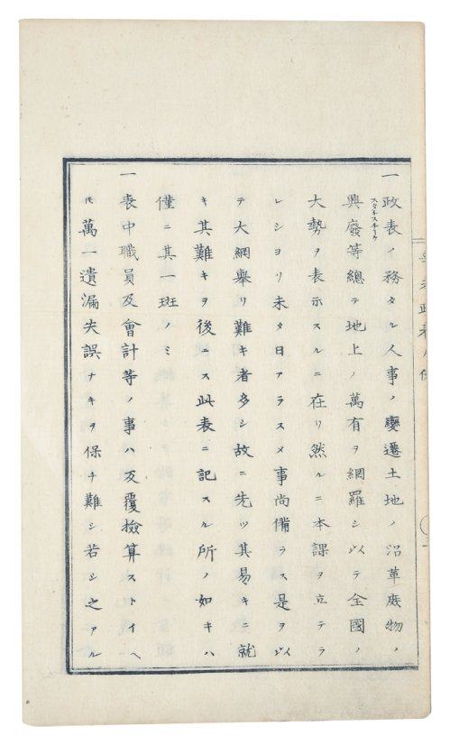
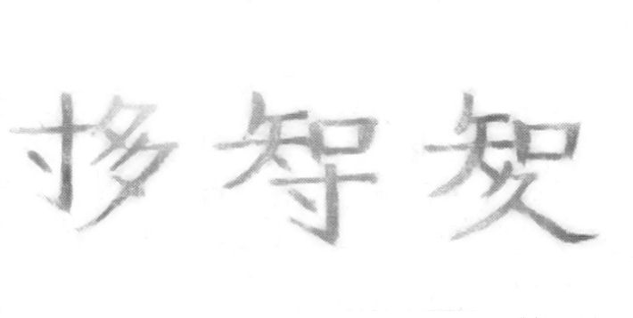

+++
author = "矢崎裕一"
title = "statistics は何と訳されたか──明治の訳語と1889年の訳字論争"
slug = "translate-statistics"
date = "2025-09-07"
description = "明治の statistics の訳語は「政表」「表紀」「統計」などに分かれました。杉亨二は音を写す漢字を作り、1889年には論争も起きましたが、訳語は「統計」に定まりました。"
categories = [
    "principle"
]
tags = [
    "杉亨二",
    "森鷗外",
    "今井武夫",
    "福沢諭吉",
    "統計史",
    "翻訳語"
]
image = "images/translate-statistics.png"
series = ["dataviz-classics"]
series_weight = 7
seriesByline = "杉亨二・森鷗外・今井武夫"
seriesTitle = "「統計」に定まるまで──明治の statistics 訳語論争"
+++

明治の日本では、英語の statistics の訳語が「政表」「表紀」「統計」などに分かれていました。統計の実務を率いた杉亨二は、訳すこと自体を拒みます。原語「スタチスチク」の音を写す合成漢字を3字作り、講義録の書名に使いました。1889年には森鷗外と今井武夫が、訳字「統計」の是非を雑誌の上で約10か月争います。論争は平行線のまま終わり、訳語は「統計」に定まりました。

以下は、総務省統計局の史料解説（統計150年特設サイト、統計資料館）、奥積雅彦「なぜ『Statistics』は『統計』なのか？」（統計Today No.136、2018）、穂積陳重『法窓夜話』（1916）に沿います。論争の題名と号数は、奥積の経緯表によります。鷗外の文章は原典の『鷗外全集』で確かめておらず、酒井弘憲（2014）が現代表記で引いた箇所を経由しています。

<!--more-->

## 1860年、statistics は「政表」として入ってきた

日本に紹介された最初の統計書は、1860年（万延元年）の『萬國政表』です。プ・ア・デ・ヨングの著書を岡本博卿が訳し、福沢諭吉が閲しました。原書名は Statistische tafel van alle landen der aarde。世界各国の人口、面積、都市名、産物、財政を表にした本です。統計局の史料解説は「スタチスチックスに政表という訳語をつけたのは、本書が最初であった」と書きます。

1872年2月2日（明治4年12月24日）、杉亨二は太政官正院政表課の大主記に任じられます。いまの総務省統計局長にあたる職です。同じ年の4月、政表課は『辛未政表』を出しました。政府の総合統計書として最古のもので、編集責任者は杉です。凡例の1行目、「政表」の2字の右に、小さく「スタチスチック」とルビが振ってあります。

太政官史局編『辛未政表』（1872）凡例／総務省統計局 統計150年特設サイト「統計史料：辛未政表」より引用。原本はパブリックドメイン、画像は公共データ利用規約 第1.0版

杉がこの仕事を志したきっかけは、開成所での翻訳でした。自叙伝にこうあります。「バイエルンの教育の事を書いたものが有た。それに、百人の中で讀み、書きの出來る者が何人、出來ぬ者が何人と云うことが書いてあつた」。オランダの統計書については「人が何分何厘とは妙な調べだと不思議になった」とも書いています。

1875年、福沢諭吉は『文明論之概略』で、この学問を原語のまま「スタチスチク」と呼びました。統計図書館コラム№0001 のひらがな化テキストから引きます。

> 凡そ土地人民の多少、物価賃銭の高低、婚する者、生るゝ者、病に罹る者、死する者等、一々其数を記して表を作り、此彼相比較するときは、世間の事情、これを探るに由なきものも、一目して瞭然たることあり

数を一つずつ記して表を作り、あれとこれを比べる。すると、ほかに探りようのない世の事情が一目で分かる。福沢は、この手続きの全体を「スタチスチク」と呼んでいます。いま可視化の効用として語られることと、ほぼ同じ内容だと読めます。

## 訳語の候補は、それぞれ何を名指していたか

1860年代から1880年代にかけて、訳語はいくつも並びました。誰が、いつ、どこで使ったか。下の表は、統計局の史料解説、統計Today No.136、『法窓夜話』からまとめたものです。右端の「字が名指すもの」は、筆者の整理です。

| 訳語・表記 | 誰が | いつ・どこで | 字が名指すもの |
|---|---|---|---|
| 政表 | 岡本博卿訳・福沢諭吉閲。のち太政官政表課 | 『萬國政表』1860、『辛未政表』1872 | 国の表 |
| 会計学 | 神田孝平 | 『経済小学』序、1867 | 数え合わせること |
| 統計 | 柳河春三か（確証なし） | 1869年ごろ。官署名は大蔵省統計司、1871 | 統べて計ること |
| 国勢学／国務学 | 大学規則／大学南校規則 | 1870 | 国の状態／国の務め |
| 国誌、統計表、国誌学 | 『附音挿図 英和字彙』 | 1873 | 国の記録と、その表 |
| 統計学 | 箕作麟祥訳 | 『統計学 一名国勢略論』文部省、1874 | 統べて計る学 |
| 表紀／政表学 | 津田真道訳 | 『表紀提綱 一名政表学論』太政官政表課、1874 | 字は表に記すこと。定義は国の形勢を知る学 |
| スタチスチク（原語） | 福沢諭吉 | 『文明論之概略』1875 | 訳さない |
| 表記 | 杉亨二ら | 表記学社、1876 | 表に記すこと |
| 知国学 | 杉亨二の案出か（世良太一の談） | 一時期 | 国を知る学 |
| 合成漢字3字 | 杉亨二 | 共立統計学校の講義、1883〜84 | 原語の音 |

「統計」の出どころは、はっきりしません。石橋重朝の証言では、1869年ごろ柳河春三が開成所で小冊子『統計入門』か『統計便覧』を編みました。そこで「統計」を使い、不完全だが仮にこうしておく、という趣旨を記したといいます。現物は見つかっておらず、統計局は「確定的な証拠は残っていない」としています。酒井（2014）は福地源一郎説も挙げます。

穂積陳重は『法窓夜話』で、出どころをこう推定しました。「この『統計』の二字は、恐らくは『英華字典』にスタチスチックに対して『統紀』という訳字を用いておったのに拠って案出したものであろう」。官署名に「統計」が付いた最初は、1871年（明治4年7月27日）の大蔵省統計司です。同年8月10日には統計寮と改めました。

当時の漢語「統計」は、別の意味の語でした。1883年に日本で出た『英華字典』の訂増版は、Statistics を「国紀」「国志」と訳しています。「統計」は、Sum の訳語の一つとして出てきます。合わせた数、という意味です。

書名と定義が食い違う例もあります。津田真道は書名に「表紀」を使いながら、第1編でこう定義しました。「表紀ノ原語ヲスタチスチキト謂フ其義ヲ直譯スレハ邦國又ハ形勢ト謂フ事ナリ」。続けて「實際ノ形勢ヲ知ル學術」と書きます。箕作の『統計学』の凡例は「其説ク所ハ皆算數ヲ以テ國内百般ノ事ヲ表明シ」です。

表を並べると、候補は三つに分けて読めます。**できあがる表を名指す語、集めて数える操作を名指す語、知りたい国の状態を名指す語**です。政表・表記は表、会計学・統計は操作、国勢学・知国学は国の状態にあたると読めます。表紀は、字は表を名指しますが、津田の定義は「實際ノ形勢ヲ知ル學術」です。表と国の状態の両方にまたがる語と読めます。この分け方でいえば、最後に残った「統計」は操作の名前だったと読めます。

## 杉亨二は、訳すことを拒んだ

杉は「政表」の仕事を率いながら、訳語の側では別の道を取りました。1876年（明治9年）2月、杉ら10余名は「表記学社」を作ります。1878年に「スタチスチツク社」と改め、1892年に「統計学社」となりました。『法窓夜話』は、訳字が「区々」だったので原語のままがよいとして、この名にしたと書いています。

1883年9月、杉は統計院の有志と共立統計学校を開き、教授長に就きます。統計資料館の解説はこう続けます。「『統計学校』の『統計』という訳語が、スタチスチックの本来の意味を表現していないとしてよしとせず、自ら漢字を創作して使用した」。その字が次の3字です。

杉亨二の創作漢字／総務省統計局 統計資料館「杉亨二」より引用（公共データ利用規約 第1.0版）

1字目は「寸」と「多」で「スタ」、2字目は「知」の下に「寸」で「チス」、3字目は「知」の下に「久」で「チク」です。音を表す漢字2字を1字に組み、3字で「スタチスチク」と読ませます。『法窓夜話』は、原語に「宛てるために」杉がこの字を「案出創造せられた」と書きます。統計局の「なるほど統計学園」も、杉は「無理に訳語を当てずに『寸多知寸知久（スタチスチク）』を用いるべきと主張しました」と説明しています。

つまり、この3字は意味を日本語に置き換える訳語ではありません。**原語の音を写すための字**です。杉の共立統計学校での講義（1883〜84）を横山雅男が筆記したノートは、書名がこの合成漢字です。1980年に日本統計協会が複刻しました。合成漢字は、1889年の論争より前から使われていたことになります。

1886年（明治19年）4月、スタチスチック社の『スタチスチック雑誌』第1号が出ます。杉は「スタチスチックの話」に、こう書きました。「（杉が）知る所にても『スタチスチック』に統計なる意味のあることは未だ曾て見あたらず」。高野岩三郎は1947年、杉を「訳字排斥・原語採用論者」と評しています。

合成漢字は定着しませんでした。統計局は、新造字を含む他の候補が「いずれも定着することなく、やがて消えていきました」と書きます。定着しなかった理由を述べた出典は、見つかっていません。

## 1889年、鷗外と今井武夫の10か月

1889年（明治22年）2月、エステルレン著・呉秀三訳『医学統計論』が出ます。陸軍軍医の森林太郎（鷗外）は、当時27歳でした。呉秀三の依頼で、この本に「題言」を書きます。題言は『東京医事新誌』第569号にも載りました。そこで鷗外は、訳字に「統計」を使っています。

『東京医事新誌』の編集部に、匿名の手紙が届きます。なぜ「スタチスチック」でなく「統計」を使うのか、という問いでした。手紙は今井武夫によるものです。今井は杉亨二のグループに属していました。舞台は、鷗外が主宰する『東京医事新誌』と、スタチスチック社の『スタチスチック雑誌』です。

| 年月（明治22年） | 筆者 | 題 | 掲載誌・号 |
|---|---|---|---|
| 3月 | 森林太郎 | 統計ニ就テ | 東京医事新誌 第573号 |
| 5月 | 今井武夫 | 統計ニ就テ | スタチスチック雑誌 第37号 |
| 6月 | 森林太郎 | 統計ニ就テノ分疏 | 東京医事新誌 第584号 |
| 7月 | 今井武夫 | 再ビ統計ニ就テ | スタチスチック雑誌 第39号 |
| 8月 | 森林太郎（湖上逸民） | 統計三家論ヲ讀ム | 東京医事新誌 第593号 |
| 8月 | 森林太郎（鷗外漁史） | 答今井武夫君 | 東京医事新誌 第593号 |
| 9月 | 今井武夫 | 三タビ統計ニ就テ | スタチスチック雑誌 第41号 |
| 10月 | 森林太郎（湖上逸民） | 讀第三駁義 | 東京医事新誌 第603号 |
| 10月 | 森林太郎（忍岡樵客） | 「三タビ統計ニ就テ」ヲ讀ム | 東京医事新誌 第604号 |
| 11月 | 森林太郎（湖上逸民） | 統計ノ訳字ハ其定義ニ負カズ | 東京医事新誌 第605号 |
| 12月 | 今井武夫 | 四タビ統計ニ就テ（未完） | スタチスチック雑誌 第44号 |

奥積雅彦の経緯表（統計Today No.136）による。スタチスチック雑誌の号と年月は、国立国会図書館サーチの書誌とも一致する

鷗外は本名のほか3つの筆名を使い、7本を書きました。今井は4本で、最後の「四タビ統計ニ就テ」は未完です。奥積は、争点を三つに整理しています。

| 争点 | 森鷗外 | 今井武夫 |
|---|---|---|
| 訳字は「統計」が適切か | 「統べ計る」という訳字で意味は通じる | 中国語の「統計」には合計の意味の外はない |
| 統計学は科学か、方法か | 科学でなく方法である | 他の科学を補助する方法のみでなく、人間社会の現象を研究する科学である |
| 統計で因果を探れるか | 原因を探り法則を知り得るものではない | 諸現象を要因との関係で探れば、原因を探り法則を定められる |

一つ目の争点について、鷗外は「統計ニ就テノ分疏」で字の意味から論じました。酒井（2014）が現代表記で引く箇所によれば、鷗外は『説文』の「"計"は"会也算也"」を引きます。そのうえで「今含率等物の義ある統字をもって計字の上に加うることはそのスタチスチックの意味を表出することは殆ど余蘊なきを見るなり」と書き、こう結びます。「誰か統計の字面を以ってスタチスチックの訳に充つべからずというや」。

今井の側は、「統計」という漢語に合計以上の意味はない、と返しました。杉が1886年に書いたことと同じ線だと読めます。論争の結末を、奥積は「両者の見解は平行線をたどり、相交えることはなかったのです」と書いています。

## 第三者はこの論争をどう見たか

奥積（2018）は、論争の時期に注目します。1874年の『統計学』、1881年の統計院、1883年の共立統計学校と、「統計」の字は徐々に浸透していました。奥積は「この訳字論争が行われたのは明治22年のことであり、逸機の感があります」と書きます。『スタチスチック雑誌』第39号の「再ビ統計ニ就テ」の冒頭には、今井個人の見解で社説ではない、という異例の注記が付きました。奥積はここに、今井と杉グループの「温度差」を見ます。そのうえで「今井が森鴎外に一歩も譲らなかったことを忘れてはならないのです」と結びます。

中澤聡（2023）は、鷗外の統計観の出どころを調べました。題言、「統計ニ就テ」、「分疏」を、フリードリヒ・マルチウスの1881年の論文と比べています。英文抄録はこう書きます。

> Mori's view of statistics, owing much to Martius's paper, can be characterised as a conditional approval à la Bernard that recognises the auxiliary significance of statistics only when the cause cannot be identified using experimental methods.

鷗外の統計観はマルチウスに多くを負っている。実験で原因を特定できないときに限り、統計に補助的な意義を認める。ベルナール流の条件付きの承認だ、という要旨です。「統計は方法である」という鷗外の立場は、当時のヨーロッパ医学の議論から来ていたと読めます。

一橋大学経済研究所の社会科学統計情報研究センターは、展示資料で結末の皮肉を指摘します。杉の弟子の横山雅男が書いた『統計通論』（1901年初版）は、40版以上を重ねました。1900年代の初め、「統計」の語は横山の統計書を通じて中国に伝わります。展示資料は、杉が合成漢字を作るほど嫌った語が「弟子の横山によって中国にまで流布したことは歴史の皮肉かもしれない」と書きます。ただし同資料は「統計」を柳河春三の考案と言い切っており、この点は統計局の見解と合いません。今日、中国語は「统计」、韓国語は「통계」、ベトナム語は「thống kê」です。

杉自身は1899年、「統計大意」（統計集誌第223号）で次の旨を書いています。統計を計算するものと心得て、物の数を並べさえすれば統計とする「無責任なる統計」は許されない。高野岩三郎は1947年、この主旨は「現時に在ても我統計家の深く服膺すべき點である」と評しました。杉がこの文で訳語に触れたかどうかは、確かめられていません。

## 使い道

この話から可視化の仕事に持ち帰れるのは、名前が仕事のどこを指すか、という問いです。

明治の訳語は、表という出力を名指すもの、集めて数える操作を名指すもの、知りたい国の状態を名指すものに分けて読めます。残ったのは操作の名前だったと読めます。杉が1886年に書いた反対の理由は、「スタチスチック」に統計なる意味のあることは見あたらない、というものでした。1899年の「物の数を並べさえすれば」という戒めと、1886年の訳語への反対は、同じ線上に置いて読めます。ただし杉自身が両者を結びつけて書いた文章は確認できていません。

可視化の仕事にも、同じずれがあります。依頼は「グラフを作ってほしい」と、出力の名前で来ることが多いものです。進め方は「集計して描く」という操作で語られます。けれども福沢が書いたとおり、表を作って比べる目的は「世間の事情」を一目で知ることでした。案件の名前を決めるとき、それが出力・操作・知りたいことのどれを指しているかを確かめておく。訳語の候補表は、そのための見本として使えます。

## 参考・出典

**一次情報**

- 穂積陳重『法窓夜話』五七「統計学」、有斐閣、1916（青空文庫、岩波文庫1980底本）. [青空文庫](https://www.aozora.gr.jp/cards/000301/files/1872_53638.html)
- 総務省統計局 統計150年特設サイト「統計の偉人たち：森鴎外」. [ijin04](https://www.stat.go.jp/museum/toukei150/ijin/ijin04.html)
- 総務省統計局 統計150年特設サイト「統計の偉人たち：杉亨二」（自叙伝の引用を含む）. [ijin03](https://www.stat.go.jp/museum/toukei150/ijin/ijin03.html)
- 総務省統計局 統計150年特設サイト「統計史料」：[萬國政表](https://www.stat.go.jp/museum/toukei150/shiryo/shiryo1.html)／[辛未政表](https://www.stat.go.jp/museum/toukei150/shiryo/shiryo3.html)／[統計学 一名国勢略論](https://www.stat.go.jp/museum/toukei150/shiryo/shiryo8.html)／[表紀提綱 一名政表学論](https://www.stat.go.jp/museum/toukei150/shiryo/shiryo9.html)／[スタチスチック雑誌](https://www.stat.go.jp/museum/toukei150/shiryo/shiryo26.html)
- 総務省統計局 統計150年特設サイト「統計の歴史トリビア」. [trivia03](https://www.stat.go.jp/museum/toukei150/trivia/trivia03.html)
- 総務省統計局 統計資料館「杉亨二」（創作漢字の画像を含む）. [sugi.html](https://www.stat.go.jp/museum/shiryo/sugi.html)
- 総務省統計局 なるほど統計学園「『統計』という言葉の起源」. [toukei.html](https://www.stat.go.jp/naruhodo/15_episode/episode/toukei.html)
- 総務省統計局 なるほど統計学園キッズ「統計エピソード（1）」. [ep1.html](https://www.stat.go.jp/naruhodokids/episode/ep1.html)
- 奥積雅彦「なぜ『Statistics』は『統計』なのか？ー『統計』の訳字が定着するまでの経緯と森鴎外」統計Today No.136、総務省統計局、2018（当時の辞書、杉亨二「スタチスチックの話」1886、「統計大意」1899 を引用）. [HTML](https://www.stat.go.jp/info/today/136.html)／[PDF](https://www.stat.go.jp/info/today/pdf/136p0.pdf)
- 総務省統計局 統計図書館コラム№0001（福沢諭吉）. [PDF](https://www.stat.go.jp/library/pdf/column0001.pdf)
- 総務省統計局 統計図書館コラム№0006（森鷗外と論争の経緯）. [PDF](https://www.stat.go.jp/library/pdf/column0006.pdf)
- 杉亨二講述・横山雅男記『[寸多][知寸][知久] 歴史及理論之部』（1980年複刻、書名は著者の合成漢字）. [国立国会図書館サーチ](https://ndlsearch.ndl.go.jp/books/R100000001-I2911111055630)
- 『スタチスチック雑誌』第1号（1886-04）. [国立国会図書館サーチ](https://ndlsearch.ndl.go.jp/books/R100000002-I000000012683-d3556593)／第37号（1889-05）. [国立国会図書館サーチ](https://ndlsearch.ndl.go.jp/books/R100000002-I000000012683-d3556627)／第44号（1889-12）. [国立国会図書館サーチ](https://ndlsearch.ndl.go.jp/books/R100000002-I000000012683-d3556634)
- エステルレン著・呉秀三訳『医学統計論総論』文昌堂、1889. [国立国会図書館サーチ](https://ndlsearch.ndl.go.jp/books/R100000002-I000000473379)
- 太政官史局編『辛未政表』1872. [国立国会図書館デジタルコレクション](https://dl.ndl.go.jp/pid/994348)
- 総務省統計局「サイトの利用について」（公共データ利用規約 第1.0版）. [riyou.html](https://www.stat.go.jp/info/riyou.html)

**第三者評価**

- 中澤聡「森鷗外の統計論の源泉――フリードリヒ・マルチウスの医学統計論」『科学史研究』61(304), 2023, pp. 318–331. [doi:10.34336/jhsj.61.304_318](https://doi.org/10.34336/jhsj.61.304_318)／[J-STAGE](https://www.jstage.jst.go.jp/article/jhsj/61/304/61_318/_article/-char/ja/)
- 奥積雅彦「なぜ『Statistics』は『統計』なのか？」統計Today No.136、2018（評価の部分）. [HTML](https://www.stat.go.jp/info/today/136.html)
- 一橋大学経済研究所 社会科学統計情報研究センター 展示資料「統計通論」. [PDF](https://rcisss.ier.hit-u.ac.jp/Japanese/pdf/tenzi_tokeitsuron.pdf)
- 酒井弘憲「第2回 統計のルーツを探る」『ファルマシア』50(4), 2014, pp. 334–335（鷗外の題言・「分疏」の現代表記による引用を含む）. [J-STAGE](https://www.jstage.jst.go.jp/article/faruawpsj/50/4/50_334/_article/-char/ja/)
- 高木秀玄「森鴎外の統計学観：今井武夫との論争を中心として」『關西大學經済論集』19(3), 1969（書誌のみ確認）. [CiNii Research](https://cir.nii.ac.jp/crid/1050001202911811072)
