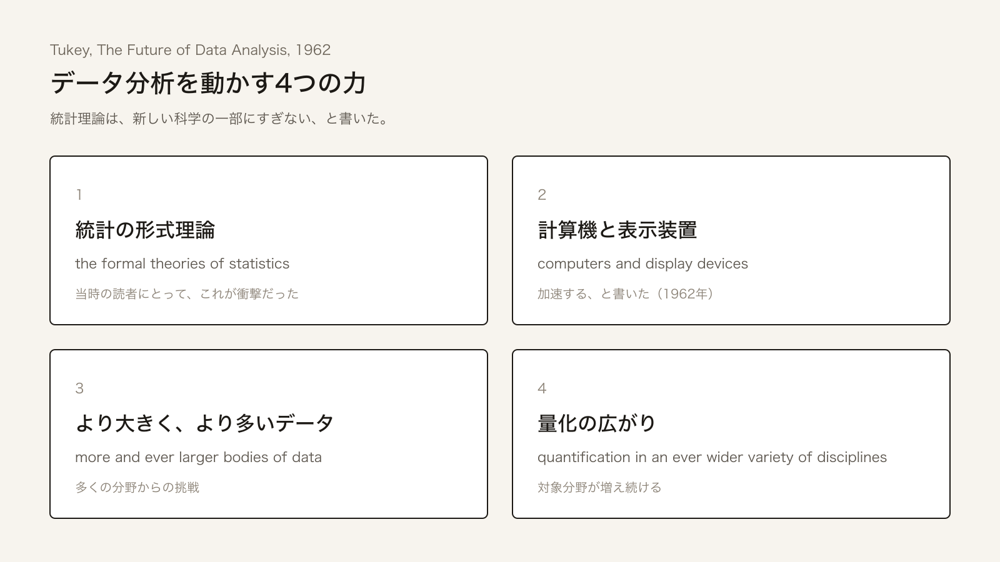

+++
author = "Yuichi Yazaki"
title = "Data Analysis Is a Science: What Tukey Wrote to Mathematical Statistics in 1962"
slug = "tukey-future-of-data-analysis"
date = "2026-08-23"
description = "In 1962, Tukey wrote in the central journal of mathematical statistics that data analysis is a science tested by experience. Half a century later, the paper is read as the starting point of data science."
categories = [
    "technology",
    "principle"
]
tags = [
    "Tukey",
    "data science"
]
image = "images/cover.png"
series = ["dataviz-classics"]
series_weight = 10
seriesByline = "John W. Tukey"
seriesTitle = "Data Analysis Is a Science: Tukey, 1962"
+++

In 1962, John W. Tukey published a 67-page paper in the central journal of mathematical statistics. Its title was "The Future of Data Analysis." It has no theorems and no proofs. In the opening he writes that he had long thought himself a statistician, but that his central interest is data analysis. His main argument is that data analysis is a science.

Half a century later, David Donoho rereads the paper as the starting point of a science that learns from data. David Hand calls Tukey "the first data scientist." When people today speak of "the beginning of data science," the event they point to is, first of all, this paper.

<!--more-->

## The paper itself

The bibliographic details are as follows. John W. Tukey, "The Future of Data Analysis," *The Annals of Mathematical Statistics*, Vol. 33, No. 1 (March 1962), pp. 1–67. DOI: [10.1214/aoms/1177704711](https://doi.org/10.1214/aoms/1177704711). The journal was then at the front line of mathematical statistics. The other papers in the same issue are lined with definitions, theorems and proofs. Donoho writes that a public confession was published among them.

The opening is two paragraphs that James R. Thompson called, in 2001, a "manifesto of an intellectual revolution."

> For a long time I have thought I was a statistician, interested in inferences from the particular to the general. But as I have watched mathematical statistics evolve, I have had cause to wonder and to doubt. [...] All in all, I have come to feel that my central interest is in data analysis, which I take to include, among other things: procedures for analyzing data, techniques for interpreting the results of such procedures, ways of planning the gathering of data to make its analysis easier, more precise or more accurate, and all the machinery and results of (mathematical) statistics which apply to analyzing data.

In short: he had long thought himself a statistician, interested in inference from the particular to the general. Watching mathematical statistics develop, he came to doubt. What lies at the center, he says, is data analysis, which includes (1) procedures for analyzing data, (2) techniques for interpreting their results, (3) plans for gathering data so that analysis is easier, more precise or more accurate, and (4) the machinery and results of mathematical statistics that apply to analyzing data.

He goes on to write that inference from a sample to a population is a large part but not the whole. Work that picks out signs invisible in the raw data, and work that decides how to allocate effort, are also only parts. "Data analysis is a larger and more varied field than inference, or allocation." He admits that he is stretching the term beyond its etymology. Peter Huber later judged that this stretching wrapped the whole of statistics inside it.

On page 3, he asks: "Is it not time to seek out novelty in data analysis?"

## Three conditions for a science

On pages 4–5, he lists three conditions for being a science. The passage below sets out that argument as he wrote it.

> There are diverse views as to what makes a science, but three constituents will be judged essential by most, viz: (a1) intellectual content, (a2) organization into an understandable form, (a3) reliance upon the test of experience as the ultimate standard of validity. By these tests, mathematics is not a science, since its ultimate standard of validity is an agreed-upon sort of logical consistency and provability. As I see it, data analysis passes all three tests, and I would regard it as a science, one defined by a ubiquitous problem rather than by a concrete subject.

Intellectual content. Organization into an understandable form. Reliance on the test of experience as the ultimate standard of validity. Data analysis meets all three. It is, in Tukey's words, a science defined by a ubiquitous problem rather than by a concrete subject. By the same three conditions, mathematics falls outside science, because its ultimate standard is logical consistency and provability. Where statistics stands depends on whether statisticians side with data analysis or with pure mathematics. He even writes that the two cannot both be the ultimate standard at once.

Standing on the side of science changes one's attitude as well. These are the points Michael Friendly cites.

- (b1) Seek scope and usefulness rather than security.
- (b2) Tolerate moderate error, to raise the chance that inadequate evidence will suggest the right answer.
- (b3) Use mathematical argument as a basis for judgment, not as a mark of proof or validity.

A famous sentence on page 13 compresses this attitude.

> Far better an approximate answer to the right question, which is often vague, than an exact answer to the wrong question, which can always be made precise.

An approximate answer to the right question is far better than an exact answer to the wrong question, which can always be made precise. Knowledge of data analysis is, at best, only an approximation as to what the problem is. So one has no choice but to proceed by approximation, he continues.

The driving forces number four. Donoho called the list "surprisingly modern."

The four influences listed in Tukey 1962, translated from the English as reproduced in Donoho 2017

1. The formal theory of statistics
2. Accelerating developments in computers and display devices
3. The challenge, in many fields, of more and ever larger bodies of data
4. The emphasis on quantification in a wider variety of disciplines

Item 1 was the shock, Donoho writes, because it implies that statistical theory is one part of the new science, not the whole. Tukey goes as far as to say that data analysis can be more complex than the physical, biological or behavioral sciences, and that demanding dense guidance from formal structure is excessive. "Data analysis can gain much from formal statistics, but only if the connection is kept adequately loose."

On figures, he writes on page 49 as follows. If one technique had to be named for its power to make many models clear to the mind, it would be the simple graph. It brings out signs of unexpected phenomena. With a single stimulus and a single response, much of the qualitative and a good deal of the quantitative can be put in a graph. Including indirect graphs, the point is that graphs are not a means of avoiding computation but a means of making the results of computation present. Friendly calls 1900–1950 the "modern dark ages" of visualization, and places this paper among the turning points of the 1950–1975 rebirth.

## Teaching it as a science

The paper's argument on education is not only about transmitting facts. It is about returning to the way a science is taught.

Statistics is taught as a part of mathematics (c1). When one studies statistics itself, attention to data analysis is limited (c2). Even in doctoral programs, there is less close contact with practitioners than in physics or mathematics (c3). So there is too little time to learn alongside people who are already analyzing. A science teaches not only facts and established structure but also that science's way of thinking and its current beliefs and practice. Data analysis is no different, is Tukey's demand.

What makes the difficulty worse, he also writes, is the view that "the only way to avoid cookbookery and to develop understanding is a mathematical treatment emphasizing proof." Cookbookery is not peculiar to data analysis. What is peculiar is concentrating the remedy on mathematics and proof. Biochemistry textbooks are written simply to put the facts in. He also proposes that experimental sampling lets a class check facts for itself.

Convey what is known, show current practice, learn beside real data, and verify by experiment. The value of mathematical rigor is limited here.

## How it came to be read as a starting point

Tukey's term is **data analysis**. Mosteller and Tukey titled their 1968 chapter "Data Analysis, Including Statistics." The name exploratory data analysis (EDA) spread with the preliminary editions around 1970 and the 1977 "orange book." Friendly places the origin of EDA in the 1962 paper, as a matter of convenience.

The name **data science** came after that. In 1997, in his inaugural lecture as Carver Professor at the University of Michigan, "Statistics = Data Science?," C. F. Jeff Wu argued that statistics should be renamed data science. In 2001, William S. Cleveland explicitly called the expanded field "data science" and proposed how universities should allocate resources. His criterion of value is how much a piece of work helps the learning of the data analyst. It is a text that translates Tukey's "develop in step with practice" into an organizational plan.

Reading the 1962 paper as the starting point of today's data science is a verdict of much later years.

- Donoho (2017; the talk for Tukey's 100th birthday was its prototype) writes that Tukey called for reform of academic statistics and pointed to the existence of an unrecognized science of learning from data. His reading is that Tukey foresaw today's data science moment.
- Hand (2023, IMS) calls the 67 pages a tour de force and concludes that Tukey "may be regarded as the first data scientist."
- Thompson (2001) judges it possibly Tukey's most important work, a call for a revolution in statistical thinking.
- Mallows (2006) writes that it redefined the subject and introduced data analysis as the name of what applied statisticians do.
- Huber (2010) writes that the influence was ultimately huge but was not recognized immediately, and that it took him several years as well. Donoho sees academic statistics as a whole as not having followed Tukey's path.

In Donoho's account of the history, Bell Labs colleagues (Chambers, Cleveland) found it easier than academic statistics to adopt Tukey's broad view. University statistics kept to the frame of theory. The observation that the 20% Cleveland allotted to theory held 100% of the work of departments at the time is the core of that account. Donoho also notes that its appearance in the Annals was itself anomalous, and was the decision of the editor, Hodges.

Hand picks up even the details of the body of the paper: iteration, new questions, multiple views of a summary, the warning against treating all data the same way, the rebuttal of automation, and the effect of computers as "important but not always fatal." The context that S, Python and R came decades later is also there. The 1962 paper is not only a manifesto but also a catalog of methods.

Friendly writes that it may have looked to the orthodoxy of the day like Luther's 95 theses. In the history of visualization, Friendly's placement is that it was a turn overturning half a century of neglect, the view that pictures cannot state facts to the decimal place. Stephen Stigler states that the direct effect of the EDA orange book itself was small. What had influence was the subject, spread by students and colleagues. We can assume the same structure for the 1962 paper. The manifesto came first, and implementation and education caught up later.

In Friendly's 2022 article, Huber also writes that today's data science is distracted by data too large to explore, and leaves exploration to blind batch processing. Reading the paper as a starting point and today's practice inheriting the paper's attitude are separate matters. Donoho himself sees today's university data science programs as a compromise between a statistics master's and a database master's rather than as Tukey's science.

## Takeaways

What this paper leaves for visualization work is not the precision of area. It is how to pose a question.

A figure is a device that brings out the unexpected, Tukey writes. Put a rough answer to the right question first. Put the precise wrong answer later. Mathematics is material for judgment, not a mark of validity. Education, too, means conveying what is known, showing current practice and letting students learn beside real data, rather than drilling proofs.

What 1962 has is a declaration that treats the activity of learning from data as a science. The paper itself places the work of drawing figures at the center of that science.

## References

**Primary sources**

- John W. Tukey, "The Future of Data Analysis," *The Annals of Mathematical Statistics*, 33(1), 1962, pp. 1–67. [doi:10.1214/aoms/1177704711](https://doi.org/10.1214/aoms/1177704711) / [Project Euclid](https://projecteuclid.org/journals/annals-of-mathematical-statistics/volume-33/issue-1/The-Future-of-Data-Analysis/10.1214/aoms/1177704711.full)
- Frederick Mosteller and John W. Tukey, "Data Analysis, Including Statistics," in *Handbook of Social Psychology*, 2nd ed., 1968.
- John W. Tukey, *Exploratory Data Analysis*, Addison-Wesley, 1977.

**Secondary sources**

- David Donoho, "50 Years of Data Science," *Journal of Computational and Graphical Statistics*, 26(4), 2017, pp. 745–766. [doi:10.1080/10618600.2017.1384734](https://doi.org/10.1080/10618600.2017.1384734) (open access)
- David J. Hand, "Hand Writing: John Tukey, the first data scientist?," *IMS Bulletin*, 2023-09-30. [IMS](https://imstat.org/2023/09/30/hand-writing-john-tukey-the-first-data-scientist/)
- James R. Thompson, "The Age of Tukey," *Technometrics*, 43(3), 2001, pp. 256–265. [Rice repository](https://repository.rice.edu/bitstreams/a72fddf7-014a-4186-ab3a-25c3d7d208b3/download)
- Colin Mallows, "Tukey's Paper After 40 Years," *Technometrics*, 48(3), 2006, pp. 319–325. [doi:10.1198/004017006000000219](https://doi.org/10.1198/004017006000000219)
- Peter J. Huber, *Data Analysis: What Can Be Learned From the Past 50 Years*, Wiley, 2010.
- William S. Cleveland, "Data Science: An Action Plan for Expanding the Technical Areas of the Field of Statistics," *International Statistical Review*, 69(1), 2001, pp. 21–26. [doi:10.1111/j.1751-5823.2001.tb00477.x](https://doi.org/10.1111/j.1751-5823.2001.tb00477.x)
- C. F. Jeff Wu, "Statistics = Data Science?," H. C. Carver Professor inaugural lecture, University of Michigan, 1997. [Slides](https://www2.isye.gatech.edu/~jeffwu/presentations/datascience.pdf)
- Michael Friendly, "Remembrances of Things EDA," *Nightingale*, 2022-06-16. [Article](https://nightingaledvs.com/remembrances-of-things-eda/)
- John M. Chambers, "Greater or Lesser Statistics: A Choice for Future Research," *Statistical Science*, 8(2), 1993, pp. 182–186.
