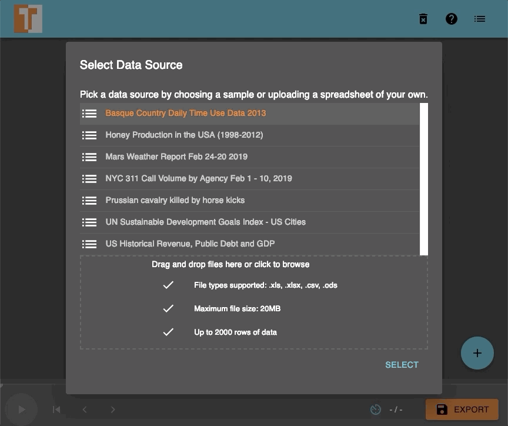
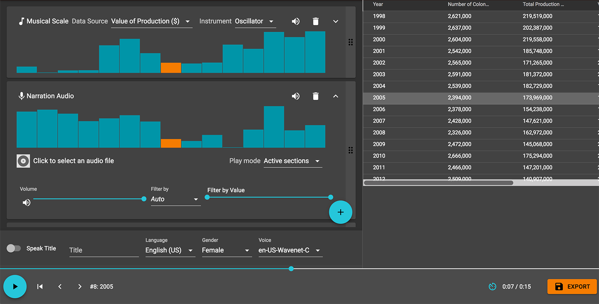
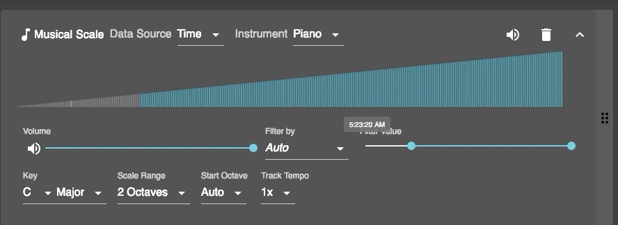

+++
author = "Yuichi Yazaki"
title = "Assign One Column to Rungs of a Musical Scale, Play One Row per Beat: TwoTone"
slug = "twotone-sonification"
date = "2026-11-06"
description = "TwoTone assigns one column of a table to rungs of a musical scale, from minimum to maximum, and plays each row as one beat. The data decides only the pitch and whether a note sounds or stays silent."
categories = [
    "technology"
]
tags = [
    "sonification",
    "data journalism",
    "open source"
]
image = "images/twotone-editor-honey.png"
+++

TwoTone is a tool that assigns one column of a table to rungs of a musical scale, from the minimum to the maximum value, and plays each row as one beat. The data decides only the pitch and whether a note sounds or stays silent. By default, values are rounded onto 15 rungs, two octaves of C major. Volume, instrument and key are chosen by the user for each track. For tempo, the user sets the overall BPM and a per-track multiplier. It is a free web app that runs in the browser and needs no code.

TwoTone was released on March 5, 2019. It was made by Datavized Technologies, a data design studio in New York, with support from the Google News Initiative (GNI). Sonify took over maintenance in December 2021, and development stopped in mid-2023. What follows draws on the GitHub repository (README and source code), the official site twotone.io, and articles published by people involved in its development.

<!--more-->

## March 2019: Released for the newsroom

TwoTone was commissioned by Simon Rogers, then data editor at Google News Lab. Alberto Cairo of the University of Miami served as adviser, and development was led by Datavized CEO Hugh McGrory. On the day of release, Rogers wrote:

> "Previously, to make data into music, you'd need to have expert coding skills. Now, anybody can do it."

In other words, turning data into music used to require advanced programming, and now anyone can do it.

The sources describe the developer differently.

| Source | How the developer is described |
|---|---|
| McGrory, "An Intro to TwoTone" (2019) | "imagined by Datavized with support from Google News Initiative" |
| Official site (twotone.io/about) | "originally made by Datavized Technologies with support from Google News Initiative and is now maintained by Sonify" |
| Current README (sonifydata/twotone) | "a Sonify project built with support from Google News Initiative", followed by "originally developed by Datavized Technologies" |

What followed is as below.

| Date | Event | Source |
|---|---|---|
| 2019-03-05 | Release. McGrory, Rogers and Cairo each publish an introductory article | Each article |
| 2021-12-10 | The repository moves from datavized/twotone to sonifydata/twotone | README of datavized/twotone |
| 2022-01-14 | MIDI output added | git log |
| 2023-10-12 | "As of mid-2023, development on TwoTone has been paused." added to the top of the README | README, git log |
| 2024-07-27 | Last commit (adds sample data) | git log |

Sonify is a US company co-founded by McGrory. As of November 6, 2026, the old app at datavized.github.io/twotone/ opened. sonify.io/twotone/, the address the README points to, did not resolve.

McGrory writes that the idea came from the 2016 TED talk by Wanda Diaz Merced, a blind astronomer. Granular synthesis worked, but it was dropped as "too complex for the beginner".

## Rounding one column onto 15 rungs of a scale

The user first loads a table. The accepted formats are .xls, .xlsx, .csv and .ods, with limits of 20MB and 2,000 rows. Data is processed only inside the browser and is not sent to a server.

Source: Datavized Technologies / Hugh McGrory, "An Intro to TwoTone" (Medium), one frame of a GIF animation. No license is stated for the image (MPL 2.0 is the license of the code, and the text does not say it applies to images).

Once data is loaded, TwoTone automatically creates one "Musical Scale" track. Checking the source code, a value becomes a note in two steps. First, the value is stretched to the range 0 to 1 using the column's minimum and maximum. Then it is multiplied by "number of rungs minus 1" and rounded, which gives the rung of the scale. The default number of rungs is 15, and a code comment calls this "two whole octaves (inclusive)". The README describes the two ends as follows.

> "The lowest and highest values will play the tonic note at either end of the given scale."

That is, the minimum and maximum play the tonic note at either end of the scale. With the default C major, the minimum is the lower C and the maximum is the C two octaves higher.

| Data | Sound | How it is decided | Source |
|---|---|---|---|
| Row order | Time | One row is one beat. The length of a beat is set by the overall tempo (BPM) | README "Track Tempo" |
| Values of the chosen column (numbers, dates) | Pitch | Min to max is mapped to 0 to 1, then rounded to a rung with `round(value × (number of rungs − 1))` | data.worker.js, scale/index.js |
| Text column | Pitch | The distinct values in the column are lined up, and their rank is mapped to 0 to 1 | data.worker.js |
| Blank cells, non-numeric values | Rest | No sound is played | scale/index.js |
| Range of another column (filter) | Sounds / silent | Rows outside the range are silenced | README "Filtering a Track" |

Source: Datavized Technologies / Hugh McGrory, "An Intro to TwoTone" (Medium). No license is stated for the image (MPL 2.0 is the license of the code, and the text does not say it applies to images).

The upper track on screen plays the "Value of Production ($)" column of the honey production data. The bar chart shows the value of each row, and the bar of the row being played is orange. As an aside, the README's example says that 100 rows at 60 bpm take "100 seconds, or 1:20", but 100 seconds is 1 minute 40 seconds.

Rungs are counted as steps of the scale, not as semitones. For that reason, **small differences between values can be heard only down to the number of rungs**, as I read it. The README says:

> "More octaves will result in finer-grained distinction between values. Fewer octaves will allow different tracks to represent different data at opposing ends of the scale, even using the same instrument, like playing left hand and right hand on a piano."

More octaves separate values more finely, and fewer octaves let different tracks occupy the upper and lower parts of the range.

## Another column decides sound or silence

Besides pitch, the data decides whether a note sounds. Every track has a filter; when the user picks a column and a range of values, rows outside the range become silent. The bar chart shows which parts will sound.

Source: Datavized Technologies / Hugh McGrory, "An Intro to TwoTone" (Medium), one frame of a GIF animation. No license is stated for the image (MPL 2.0 is the license of the code, and the text does not say it applies to images).

On screen, the Filter Value handle has moved to the right, and the left side of the bar chart is gray. Gray rows do not sound. On a "Narration Audio" track, which plays recorded speech, choosing Active sections plays the audio once at the start of each sounding section. This can be read as the data deciding when the audio is triggered.

There is also a feature that reads the title aloud with Google's Text-to-Speech API and places it before the music. McGrory adds a caveat about this feature.

> "Being pedantic, this means that Twotone can't really be described as 'sonification' since that word refers to 'the use of non-speech audio to convey information or perceptualize data'."

Since it uses spoken words, strictly speaking it cannot be called "sonification".

## Volume, instrument and key are chosen by people

The remaining track settings are chosen by people, not by the data. In the current source, the instruments are ten, including Piano, plus Midi Out. There are 12 keys and 11 modes, such as major, minor and dorian. The user also chooses the number of octaves, the starting octave, the tempo multiplier, the arpeggio (up, down, none) and the volume of each track.

Whether volume is tied to data is described differently in different sources.

| Source | What it says about volume |
|---|---|
| README "What is TwoTone's goal?" | "attaching … individual columns of data to variables in sound (pitch, volume)" |
| README "Volume Adjustment" | "Every track has a volume slider in the expanded view." |
| src/engine/AudioDataEngine.js | Passes the stored `track.volume` directly as the volume (gain) |
| src/engine/types/scale/index.js | What is decided from a row's value is only the pitch |

I checked the source on master as of November 6, 2026.

The makers divide its uses into two. One is understanding data.

> "If understanding the data is your goal, you may want to keep things simple and resist the urge to make too many layers or add too many effects."

If understanding is the goal, the advice is not to pile on layers or effects. The other use is making music, and McGrory writes that musicians like it because "it adds a randomness that sparks new ideas". This can be read as one tool housing both understanding data and making songs from chance.

Several examples appeared on the day of release. Cairo sonified US unemployment (2009 to 2018). Maarten Lambrechts played global temperature anomalies from 1880 to 2018 on a glockenspiel in C minor. Rogers invited readers to guess, from sound alone, when people in the Basque Country head out to work in the time-use data.

## How third parties saw the tool

Rogers and Cairo were the commissioner and the adviser, so here I look at those who were not involved in its development.

The first is its assessment as an entry point for journalism. In 2024, the RJI (Reynolds Journalism Institute), in an overview of sonification tools for journalism, listed TwoTone first.

> "Both playful and practical, it is an ideal way to explore turning data into audio."

It is playful and practical, and suited as an entry point to turning data into sound. The article says that as the price of honey rises, a rising arpeggio responds accordingly.

The second is use in teaching. A lesson from the Sherman Centre for Digital Scholarship at McMaster University gives steps for using TwoTone on data-breach data. It says to silence every track except the one to be emphasized. This can be read as an example showing that emphasis through volume is a human operation, not linked to the data.

The third is awards. In 2019 it was a finalist in the technical innovation category of the Online Journalism Awards and was longlisted at the Information is Beautiful Awards. I could not confirm the judges' comments for either. I did not find any academic evaluation devoted to TwoTone alone.

## Takeaways

There are three judgments you can take back to visualization work.

The first is to treat the number of rungs as the resolution. With the default 15 rungs, values become only 15 distinct pitches. To let differences be heard, increase the octaves; when layering columns, separate their ranges. This can be read as the same judgment as choosing how fine a scale's ticks are.

The second is the effect of stretching by minimum and maximum. Because the two ends become the tonic notes at either end of the scale, a single extreme outlier would, as I read it, crowd the remaining values into a few narrow rungs. It would be wise to look at the range of values before turning them into sound.

The third is to tell apart what the data decides and what people choose. In TwoTone, volume, instrument and key are not data. When presenting the sound, it is probably better to say up front, in the title or the description, what is data and what is staging.

From the same series, you can also read [Chemo Singing Bowl](/en/chemo-singing-bowl/), which turns blood pressure into the shape of a ringing bowl, and [Quotidian Record](/en/quotidian-record/), which turns a record of movement into a vinyl record.

## References

**Primary sources**

- sonifydata/twotone, README (retrieved 2026-11-06). [GitHub](https://github.com/sonifydata/twotone) / [raw](https://raw.githubusercontent.com/sonifydata/twotone/master/README.md)
- Source code of sonifydata/twotone (src/constants.js, src/util/data/data.worker.js, src/engine/types/scale/index.js, src/engine/types/scale/samplerInstruments.js, src/soundq/src/util/scales.js, src/engine/AudioDataEngine.js, src/engine/speech.js, LICENSE, git log). [GitHub](https://github.com/sonifydata/twotone)
- datavized/twotone (notice of the move). [GitHub](https://github.com/datavized/twotone)
- TwoTone official site. [Top](https://twotone.io/) / [About](https://twotone.io/about/) / [How it works](https://twotone.io/how-it-works/) / [Examples](https://twotone.io/examples/) / [Tutorials](https://twotone.io/tutorials/)
- Hugh McGrory, "An Intro to TwoTone," 2019-03-05. [Medium](https://medium.com/kinetek/an-intro-to-twotone-dd69305da9c3)
- Simon Rogers, "Sonification: make beautiful music with your data," 2019-03-05. [Medium](https://medium.com/@smfrogers/sonification-make-beautiful-music-with-your-data-d8fd59b84f3f)
- Alberto Cairo, "Sonifying data with TwoTone," *The Functional Art*, March 2019. [Blog](https://thefunctionalart.blogspot.com/2019/03/sonifying-data-with-twotone.html)
- Tutorial videos (embedded in Cairo's blog). [YouTube 1](https://www.youtube.com/embed/I0vL_g1DYmY) / [YouTube 2](https://www.youtube.com/embed/QDTTWHNUt1w)
- Sonify. [Top](https://www.sonify.io/) / [TwoTone](https://www.sonify.io/twotone/)
- Online Journalism Awards 2019, TwoTone entry page. [Page](https://awards.journalists.org/entries/twotone/)
- Information is Beautiful Awards 2019, TwoTone showcase page. [Page](https://www.informationisbeautifulawards.com/showcase/4497)
- TwoTone app. [Old app](https://datavized.github.io/twotone/) / [MIDI output beta](https://twotone-midiout-beta.netlify.app/)

**Secondary sources**

- Lamar, "Embracing data-driven audio as a storytelling method," RJI (Reynolds Journalism Institute), 2024-08-08. [Article](https://rjionline.org/news/embracing-data-driven-audio-as-a-storytelling-method/)
- Sherman Centre for Digital Scholarship, McMaster University, "Data Sonification," Lesson 4 (CC BY 4.0). [Lesson](https://learn.scds.ca/data-sonification/lessons/lesson4-sonifying-the-data.html)
