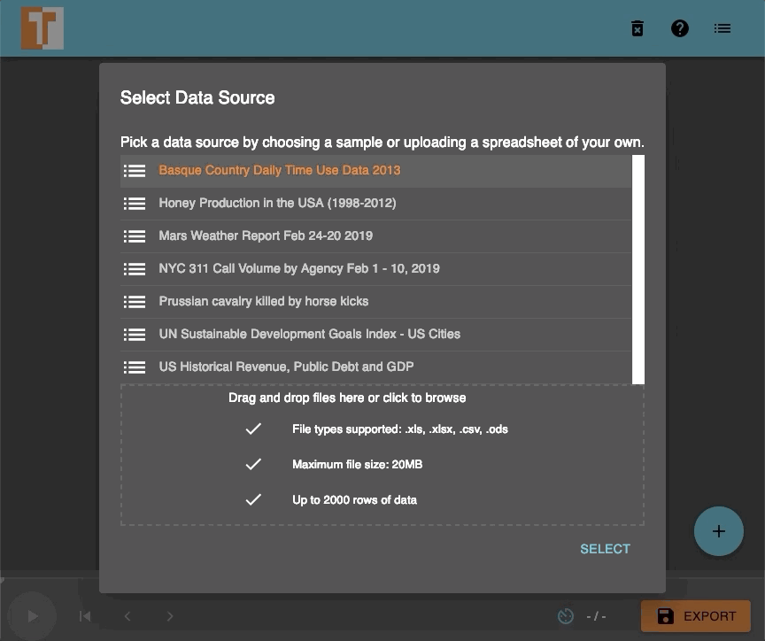
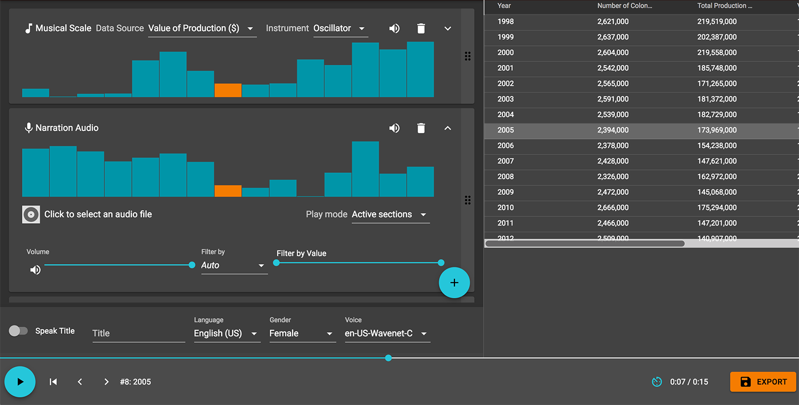
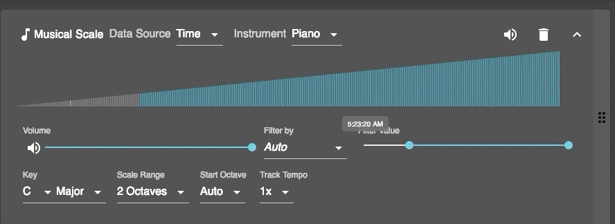

+++
author = "矢崎裕一"
title = "表の1列を音階の段に割り当て、1行を1拍で鳴らす──TwoTone"
slug = "twotone-sonification"
date = "2026-11-06"
description = "TwoTone は、表の1列を最小値から最大値まで音階の段に割り当て、1行を1拍として鳴らすツールです。データが決めるのは、音の高さと、鳴らすか黙るかだけです。"
categories = [
    "technology"
]
tags = [
    "ソニフィケーション",
    "データジャーナリズム",
    "オープンソース"
]
image = "images/twotone-editor-honey.png"
series = ["data-sonification"]
series_weight = 40
seriesByline = "Datavized Technologies／Sonify"
seriesTitle = "1列を音の高さにして、1行1拍で鳴らす──TwoTone"
+++

TwoTone（ツートーン）は、表の1列を、最小値から最大値まで音階の段に割り当て、1行を1拍として鳴らすツールです。データが決めるのは、音の高さと、鳴らすか黙るかだけです。初期設定では、値をハ長調の2オクターブ、15段に丸めます。音量・楽器・調は、使う人がトラックごとに選びます。テンポは、全体の BPM とトラックごとの倍率を人が決めます。ブラウザで動く無料のウェブアプリで、コードを書かずに使えます。

TwoTone は2019年3月5日に公開されました。作ったのはニューヨークのデータデザインスタジオ Datavized Technologies で、Google News Initiative（GNI）が支援しました。2021年12月からは Sonify が保守を引き継ぎ、2023年半ばに開発が止まっています。以下は、GitHub のリポジトリ（README とソースコード）、公式サイト twotone.io、開発に関わった人たちの公開記事に沿います。

<!--more-->

## 2019年3月、報道の現場に向けて公開される

TwoTone を依頼したのは、当時 Google News Lab のデータエディターだった Simon Rogersです。助言はマイアミ大学の Alberto Cairo（アルベルト・カイロ）が務め、開発は Datavized の CEO、Hugh McGroryが率いました。公開の日、Rogers はこう書いています。

> "Previously, to make data into music, you'd need to have expert coding skills. Now, anybody can do it."

データを音楽にするには高度なプログラミングが要ったが、今は誰にでもできる、という話です。

開発元の書き方は、資料によって違います。

| 資料 | 開発元の書き方 |
|---|---|
| McGrory「An Intro to TwoTone」（2019年） | 「imagined by Datavized with support from Google News Initiative」 |
| 公式サイト（twotone.io/about） | 「originally made by Datavized Technologies with support from Google News Initiative and is now maintained by Sonify」 |
| 現在の README（sonifydata/twotone） | 「a Sonify project built with support from Google News Initiative」。続けて「originally developed by Datavized Technologies」 |

その後の流れは、次のとおりです。

| 日付 | 出来事 | 出典 |
|---|---|---|
| 2019-03-05 | 公開。McGrory、Rogers、Cairo が紹介記事を出す | 各記事 |
| 2021-12-10 | リポジトリが datavized/twotone から sonifydata/twotone へ移る | datavized/twotone の README |
| 2022-01-14 | MIDI 出力を追加 | git log |
| 2023-10-12 | README の冒頭に「As of mid-2023, development on TwoTone has been paused.」を追記 | README、git log |
| 2024-07-27 | 最後のコミット（サンプルデータの追加） | git log |

Sonify は、McGrory が共同創業した米国の会社です。2026年11月6日の時点で、旧アプリの datavized.github.io/twotone/ は開けました。README が案内する sonify.io/twotone/ は、名前解決ができませんでした。

着想のもとは、全盲の天文学者 Wanda Diaz Mercedの2016年の TED トークだ、と McGrory は書いています。グラニュラー合成は動かせたものの、「too complex for the beginner」として外しました。

## 1列を、音階の15段に丸める

使う人は、まず表を読み込みます。形式は .xls、.xlsx、.csv、.ods で、上限は20MB・2,000行です。データはブラウザの中だけで処理し、サーバーには送りません。

Datavized Technologies／Hugh McGrory「An Intro to TwoTone」（Medium）より引用（GIF 動画の1コマ）。ライセンス表記なし（MPL 2.0 はコードのライセンスで、画像への適用は書かれていません）

読み込むと、TwoTone は「Musical Scale」トラックを1本、自動で作ります。ソースコードで確かめると、値は2段階で音になります。まず列の最小値と最大値で、値を0〜1に引き伸ばします。次に「段の数−1」を掛けて四捨五入し、音階の何段目かを決めます。段の数の初期値は15で、コードのコメントは「two whole octaves (inclusive)」です。README は両端をこう書きます。

> "The lowest and highest values will play the tonic note at either end of the given scale."

最小値と最大値は、音階の両端の主音を鳴らす、という説明です。初期設定のハ長調なら、最小値が下のド、最大値が2オクターブ上のドです。

| データ | 音 | 決め方 | 出典 |
|---|---|---|---|
| 行の順番 | 時間 | 1行＝1拍。拍の長さは全体のテンポ（BPM）で決まる | README「Track Tempo」 |
| 選んだ1列の値（数値・日時） | 音の高さ | 最小〜最大を0〜1にし、`round(値 × (段の数 − 1))` で段に丸める | data.worker.js、scale/index.js |
| 文字列の列 | 音の高さ | 列に出てくる値を並べ、その順位を0〜1にする | data.worker.js |
| 空欄・数値でない値 | 休符 | 音を出さない | scale/index.js |
| 別の列の値の範囲（フィルター） | 鳴る／黙る | 範囲外の行は無音にする | README「Filtering a Track」 |

Datavized Technologies／Hugh McGrory「An Intro to TwoTone」（Medium）より引用。ライセンス表記なし（MPL 2.0 はコードのライセンスで、画像への適用は書かれていません）

画面の上のトラックは、ハチミツ生産の「Value of Production ($)」の列を鳴らしています。棒グラフは行ごとの値で、再生中の行の棒がオレンジです。なお README の例は、100行を60bpm で鳴らすと「100秒、または1:20」と書きますが、100秒は1分40秒です。

段は半音ではなく、音階の段で数えます。そのため、**値の細かな差は、段の数までしか聞き分けられない**と読めます。README はこう書きます。

> "More octaves will result in finer-grained distinction between values. Fewer octaves will allow different tracks to represent different data at opposing ends of the scale, even using the same instrument, like playing left hand and right hand on a piano."

オクターブを増やせば値の違いが細かく分かれ、減らせば別のトラックを音域の上と下に分けられる、という説明です。

## 鳴らすか黙るかを、別の列で決める

高さのほかにデータで決まるのは、鳴るか黙るかです。どのトラックにもフィルターがあり、列と値の範囲を選ぶと、範囲外の行は無音になります。どこが鳴るかは、棒グラフで示されます。

Datavized Technologies／Hugh McGrory「An Intro to TwoTone」（Medium）より引用（GIF 動画の1コマ）。ライセンス表記なし（MPL 2.0 はコードのライセンスで、画像への適用は書かれていません）

画面では Filter Value のつまみが右へ動き、棒グラフの左側が灰色です。灰色の行は鳴りません。録音した音声を流す「Narration Audio」トラックでは、Active sections を選ぶと、鳴る区間の頭ごとに1回だけ流れます。データが音声のきっかけを決めると読めます。

題名を Google の Text-to-Speech API で読み上げ、音楽の前に置く機能もあります。McGrory は、この機能に断り書きを付けています。

> "Being pedantic, this means that Twotone can't really be described as 'sonification' since that word refers to 'the use of non-speech audio to convey information or perceptualize data'."

言葉の音声を使う以上、厳密には「ソニフィケーション」とは呼べない、という話です。

## 音量・楽器・調は、人が選ぶ

トラックの残りの設定は、データではなく人が選びます。楽器は、現在のソースでは Piano など10種と Midi Out です。調は12、旋法は major・minor・dorian など11です。オクターブの数、開始オクターブ、テンポの倍率、アルペジオ（上昇・下降・なし）、トラックごとの音量も選びます。

音量がデータに結びつくかは、資料で書き方が違います。

| 資料 | 音量についての記述 |
|---|---|
| README「What is TwoTone's goal?」 | 「attaching … individual columns of data to variables in sound (pitch, volume)」 |
| README「Volume Adjustment」 | 「Every track has a volume slider in the expanded view.」 |
| src/engine/AudioDataEngine.js | トラックに保存した `track.volume` を、そのまま音量（ゲイン）に入れる |
| src/engine/types/scale/index.js | 行の値から決めるのは、音の高さだけ |

ソースは、2026年11月6日時点の master で確かめました。

作り手は、使い道を二つに分けています。一つはデータの理解です。

> "If understanding the data is your goal, you may want to keep things simple and resist the urge to make too many layers or add too many effects."

理解が目的なら、層や効果を重ねすぎないこと、という助言です。もう一つは曲づくりで、McGrory は、音楽家が「it adds a randomness that sparks new ideas」と気に入っている、と書きます。データの理解と、偶然から曲を作ることを、一つの道具に同居させていると読めます。

公開の日には、例がいくつも出ました。Cairo は、米国の失業率（2009〜2018年）を音にしました。Maarten Lambrechtsは、1880〜2018年の世界の気温偏差を、グロッケンシュピールのハ短調で鳴らしました。Rogers は、バスク州の時間の使い方のデータについて、音だけで人が仕事に出る時刻を当ててみてほしい、と書いています。

## 第三者はこのツールをどう見たか

Rogers と Cairo は依頼者と助言者なので、ここでは開発に関わっていない側を見ます。

一つ目は、報道の入口としての評価です。RJI（Reynolds Journalism Institute）は2024年、報道向けのソニフィケーションの道具の紹介で、最初に TwoTone を取り上げました。

> "Both playful and practical, it is an ideal way to explore turning data into audio."

遊べて実用的で、データを音にする入口に向いている、という評価です。記事は、ハチミツの価格が上がるにつれ、上昇するアルペジオがそれに応じると書いています。

二つ目は、教育での使い方です。McMaster 大学 Sherman Centre for Digital Scholarship の教材は、データ漏えいのデータで TwoTone を使う手順を載せています。強調したいトラックのほかは静かにする、と書いています。音量での強調は人の操作で、データとの連動ではないことが分かる例と読めます。

三つ目は、賞の場です。2019年、Online Journalism Awards の技術革新部門でファイナリストに、Information is Beautiful Awards でロングリストに入りました。どちらの審査講評も、確かめられませんでした。TwoTone だけを扱った学術的な評価は、見つかりませんでした。

## 使い道

可視化の仕事に持ち帰れる判断は、三つあります。

一つ目は、段の数が分解能だと意識することです。初期設定の15段では、値は15通りの高さにしかなりません。差を聞かせたいならオクターブを増やし、列を重ねるなら音域を分ける。目盛りの細かさを決めるのと同じ判断と読めます。

二つ目は、最小値と最大値で引き伸ばすことの影響です。両端が音階の両端の主音になるので、大きく外れた値が一つあれば、残りの値は狭い段に集まると読めます。音にする前に、値の範囲を見ておくとよいと読めます。

三つ目は、データで決まるものと、人が選ぶものを分けて伝えることです。TwoTone では、音量・楽器・調はデータではありません。聞かせるときは、何がデータで何が演出かを、題名や説明で先に渡すとよいと読めます。

同じ特集では、血圧を鳴る鉢の形にした [Chemo Singing Bowl](/chemo-singing-bowl/) と、移動の記録をレコードにした [Quotidian Record](/quotidian-record/) も読めます。

## 参考・出典

**一次情報**

- sonifydata/twotone, README（2026-11-06 に取得）. [GitHub](https://github.com/sonifydata/twotone) / [raw](https://raw.githubusercontent.com/sonifydata/twotone/master/README.md)
- sonifydata/twotone のソースコード（src/constants.js、src/util/data/data.worker.js、src/engine/types/scale/index.js、src/engine/types/scale/samplerInstruments.js、src/soundq/src/util/scales.js、src/engine/AudioDataEngine.js、src/engine/speech.js、LICENSE、git log）. [GitHub](https://github.com/sonifydata/twotone)
- datavized/twotone（移管の告知）. [GitHub](https://github.com/datavized/twotone)
- TwoTone 公式サイト. [トップ](https://twotone.io/) / [About](https://twotone.io/about/) / [How it works](https://twotone.io/how-it-works/) / [Examples](https://twotone.io/examples/) / [Tutorials](https://twotone.io/tutorials/)
- Hugh McGrory, "An Intro to TwoTone," 2019-03-05. [Medium](https://medium.com/kinetek/an-intro-to-twotone-dd69305da9c3)
- Simon Rogers, "Sonification: make beautiful music with your data," 2019-03-05. [Medium](https://medium.com/@smfrogers/sonification-make-beautiful-music-with-your-data-d8fd59b84f3f)
- Alberto Cairo, "Sonifying data with TwoTone," *The Functional Art*, 2019年3月. [ブログ](https://thefunctionalart.blogspot.com/2019/03/sonifying-data-with-twotone.html)
- チュートリアル動画（Cairo のブログに埋め込み）. [YouTube 1](https://www.youtube.com/embed/I0vL_g1DYmY) / [YouTube 2](https://www.youtube.com/embed/QDTTWHNUt1w)
- Sonify. [トップ](https://www.sonify.io/) / [TwoTone](https://www.sonify.io/twotone/)
- Online Journalism Awards 2019, TwoTone の応募ページ. [ページ](https://awards.journalists.org/entries/twotone/)
- Information is Beautiful Awards 2019, TwoTone の掲載ページ. [ページ](https://www.informationisbeautifulawards.com/showcase/4497)
- TwoTone アプリ. [旧アプリ](https://datavized.github.io/twotone/) / [MIDI 出力ベータ](https://twotone-midiout-beta.netlify.app/)

**第三者評価**

- Lamar, "Embracing data-driven audio as a storytelling method," RJI（Reynolds Journalism Institute）, 2024-08-08. [記事](https://rjionline.org/news/embracing-data-driven-audio-as-a-storytelling-method/)
- Sherman Centre for Digital Scholarship, McMaster University, "Data Sonification," Lesson 4（CC BY 4.0）. [教材](https://learn.scds.ca/data-sonification/lessons/lesson4-sonifying-the-data.html)
