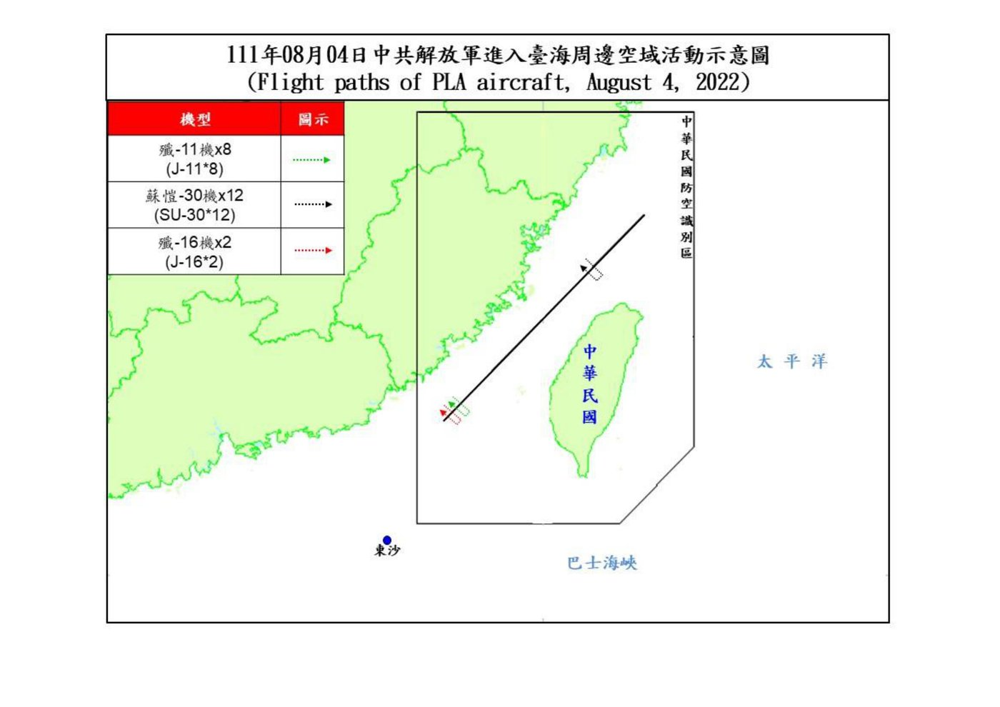
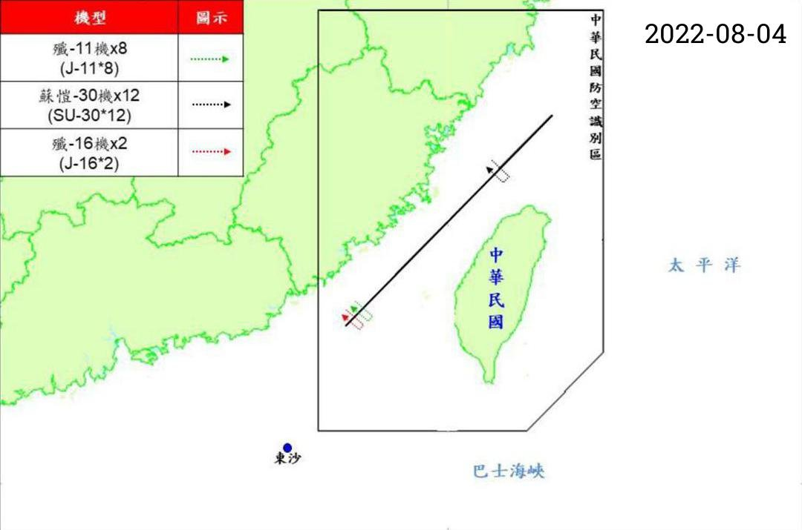
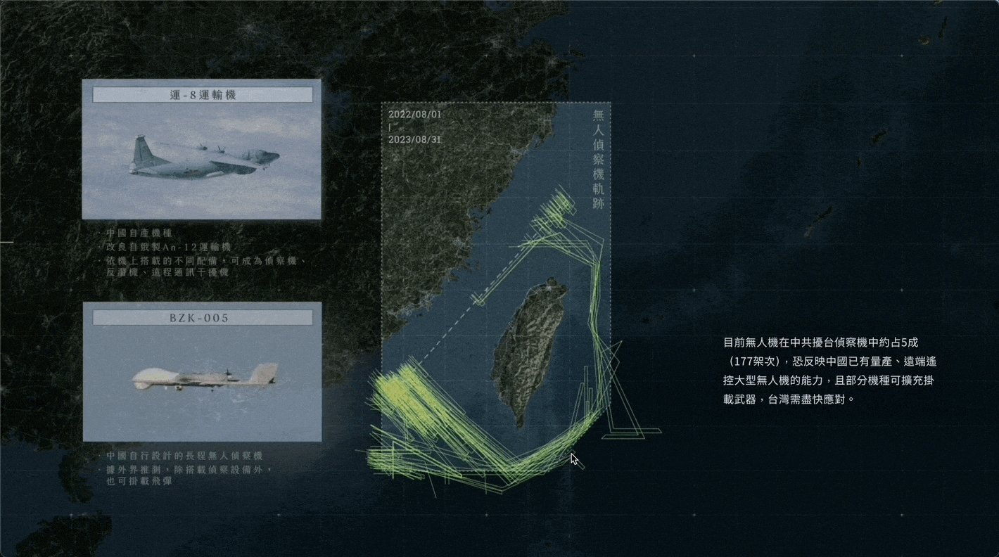
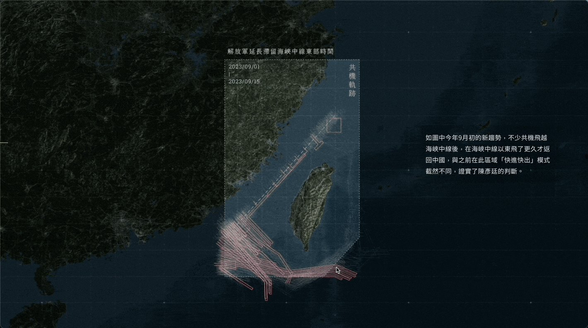
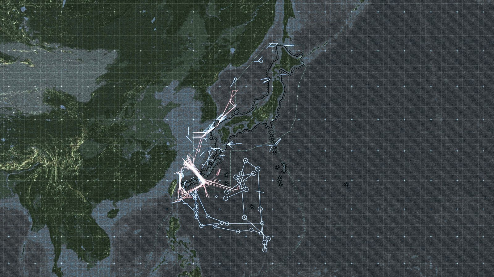

+++
author = "Yuichi Yazaki"
title = "Tracing Track Maps by Hand to Turn Images Back into Maps: The Reporter (報導者), 〈解放軍如何進逼第一島鏈〉 (China's War Drums to the First Island Chain)"
slug = "twreporter-first-island-chain"
date = "2026-11-04"
description = "The Reporter (報導者) traced by hand the track maps that Taiwan publishes as images and Japan as PDFs, turning them back into geodata (992 tracks for Taiwan), then layered them onto a map period by period inside scroll-driven videos."
categories = [
    "consume"
]
tags = [
    "data journalism",
    "Sigma Awards",
    "maps",
    "open data"
]
image = "images/og-tracks-map.jpg"
series = ["dataviz-journalism"]
series_weight = 6
seriesByline = "The Reporter"
seriesTitle = "Tracing Track Images Back into a Map: The First Island Chain"
+++

The Reporter (報導者) traced by hand the track maps that Taiwan publishes as images and Japan as PDFs, and turned them back into geodata (992 tracks for the Taiwan side). It then layered them onto a map, period by period, inside scroll-driven videos. The track maps show the movements of Chinese People's Liberation Army aircraft and ships, drawn by Taiwan's Ministry of National Defense and Japan's Ministry of Defense.

The piece is 〈【圖解】解放軍如何進逼第一島鏈：台海衝突下牽動的美日軍事布局〉 (China's War Drums to the First Island Chain), published on October 17, 2023 (Taiwan time). It won in the small newsroom category at the Sigma Awards 2024. Below, I read it in the order in which the data was made, following the article text and its appendix (the methodology notes), the dataset published on GitHub, and The Reporter's article on Medium.

<!--more-->

## Chinese Aircraft Routes, Published Every Morning at 9

The article opens with a daily routine of the Ministry of National Defense.

> 每天早上9點，國防部新聞官準時在媒體群組公布過去24小時的共機騷擾路徑…2022年8月至2023年8月一年間，國防部便監測到近6,000架次共機起飛，其中2,231架次繞行台灣周遭

In short: every morning at 9, a Ministry of National Defense spokesperson posts the routes of Chinese military aircraft from the past 24 hours to a media group. Over the year from August 2022 to August 2023, about 6,000 sorties of Chinese aircraft took off, and 2,231 of them circled Taiwan.

The track maps showing the routes are published as JPG images. The appendix states the premise of the work as follows.

> 台、日官方提供資料皆為JPG圖檔或PDF文件檔，團隊須先將圖檔轉換為地理圖資檔案，以便後續分析。

That is, the official materials from both Taiwan and Japan are JPG or PDF files, so before any analysis the team first had to convert the images into geospatial files.

Source: 中華民國國防部 (Ministry of National Defense, ROC) / data-reporter "PLA_Path_Database" (GitHub)

According to the README, maps from before August 5, 2022 were originally PDFs, which The Reporter converted to JPG.

The materials collected are as follows. The Ministry of National Defense issues a track map when military aircraft are "逾越海峽中線及西南空域", that is, when they cross the median line or enter the airspace to Taiwan's southwest. The Ministry does not routinely publish ship tracks, so all ship data comes from Japan's Ministry of Defense materials.

| Source | Format | Period | Volume (as described in the appendix) |
|---|---|---|---|
| Taiwan Ministry of National Defense, "即時軍事動態" (real-time military developments) | JPG images | 2022-08-01 to 2023-09-15 | 「共317份活動圖、992條軌跡資料（1份報告可能有數條軌跡）」 |
| Japan Ministry of Defense, Joint Staff Office press materials | PDF | 2022-08-01 to 2023-08-31 | 「共計22份共機資料、99份共艦資料」 |

Russian military tracks that appear in the Japanese materials are excluded from the analysis, while joint China-Russia exercises are included.

## Cutting the White Margins, Aligning the Four Corners, Tracing One Line at a Time

The appendix divides the Taiwan-side process into five steps.

1. Using image recognition, cut the white margins off every track map and unify the vertical and horizontal dimensions. Because the map extent is the same every time, once aligned the maps can be overlaid.
2. In the GIS software QGIS, georeference a map and obtain the coordinates of its four corners.
3. Load all the maps into Figma and draw each track by hand, one line at a time, on separate layers.
4. Attach the date, aircraft type, and number of aircraft, and export everything together as SVG.
5. In Python, using the four-corner coordinates as the reference, restore coordinates in EPSG:3857 (Web Mercator) and save them as latitude and longitude in EPSG:4326 (WGS84).

The third step is explicitly described as following another outlet's method.

> 參考《天下雜誌》，將所有圖檔匯入繪圖兼介面設計軟體Figma中，在各圖層中逐一人工描繪各段軌跡。

In short: following CommonWealth Magazine (《天下雜誌》), all the images were imported into the drawing and interface-design software Figma, and each segment of track was traced by hand, one by one, on its own layer.

Source: 報導者 Data Team (The Reporter) / PLA_Path_Database (GitHub, MIT License)

According to the README, the processed maps have their margins cut, the date added at upper right, and their dimensions unified.

For the Japan side, Python searches each PDF for the phrase "行動概要" (action summary) and turns the page containing the map into an image. Maps with the same extent are grouped together and converted to GeoJSON in the same way as the Taiwan maps. The remaining maps, whose extents differ, are aligned one by one using intersections of latitude and longitude lines or terrain points as references.

In both cases, the final step is to draw the GeoJSON in mapping software and compare it with the original map by eye to check for positional errors.

Looking at how the process is divided, it can be read that the machine took on aligning the images and computing coordinates, while picking out the lines was left to people. The appendix also says that this manual work affects accuracy.

> 由於軌跡是從官方圖檔復刻而來，各重繪環節都會使資料精準度打折，地圖相對適合從「宏觀」的小比例尺觀之，並不適合過度拉近為大比例尺進行解讀（位置可能會存在誤差）。

In short: because the tracks are reproduced from official images, every redrawing step reduces the accuracy of the data; the map is better suited to viewing at a "macro", small scale, and is not suited to zooming in too far and reading at a large scale (positions may contain errors). **This sentence can be read as telling readers up front to what scale they can trust the map.**

## Three Scroll-Driven Videos

The retraced tracks are shown inside "捲動式影片" (scroll-driven video). Zeng Wei-ting (曾偉婷), The Reporter's product manager, explains it as follows in the Medium article.

> 「捲動式影片」將瀏覽影片從點擊播放的行為，轉為使用者更為熟悉的網頁向下滑動的閱讀操作模式，而且影片「播放」速度由閱讀者自己掌控

In short: it turns watching a video from clicking to play into the more familiar reading action of scrolling down a web page, and the reader controls the "playback" speed.

Three videos are embedded in the article.

| Video | Main content | Last subtitle timestamp |
|---|---|---|
| Video 1 | The First Island Chain, U.S. overseas bases as of 2021, Self-Defense Force deployments in Okinawa, Ishigaki Island | 28.8 s |
| Video 2 | Tracks of military aircraft around Taiwan | 41.5 s |
| Video 3 | Tracks of military aircraft and ships around Japan, missile ranges | 28.7 s |

The embed code sets `secondsPer100vh: 1.2`, so scrolling by one screen height advances the video by 1.2 seconds. Subtitles appear tied to the video's time. By this setting, it can be read that getting through Video 2 to the end takes roughly 35 screen heights of scrolling.

Video 2 does not show the whole year at once. After the first subtitle, it splits the year as follows.

> 以3次解放軍發起大型軍演，軍機數量達最高峰的關鍵時間點做切分

In short: it splits at the key points in time when the PLA launched three large-scale exercises and the number of military aircraft peaked.

| Period | Event that marks the break |
|---|---|
| August to end of November 2022 | The first encirclement exercise on August 7, 2022, after U.S. House Speaker Nancy Pelosi's visit to Taiwan |
| December 2022 to end of March 2023 | Exercises after President Biden signed the National Defense Authorization Act on December 23, 2022 |
| April to August 2023 | Exercises after President Tsai Ing-wen returned from her U.S. visit, April 10, 2023 |

For each period, the subtitles describe how the routes widened from the southwest airspace to the Bashi Channel, and then to the east of Taiwan. By aircraft type, fighters account for 69% (1,541 sorties) and reconnaissance aircraft for 16% (357 sorties), with drones about half of reconnaissance (177 sorties). The video then pulls out, in turn, the tracks of reconnaissance aircraft, Y-8 anti-submarine patrol aircraft, and Ka-28 anti-submarine helicopters. The subtitles say the Ka-28 tracks cluster along the edge of the Taiwan Strait where the depth drops sharply from 100 m to 2,000 m.

Source: 報導者 The Reporter / Medium 〈捲動式影片2.0：最受歡迎的數位敘事模式再進化〉 (Scrollytelling Video 2.0: The Most Popular Digital Storytelling Format Evolves) (one frame from a GIF)

According to the description attached to this GIF, the subtitles on the right are a standardized component on the page side, while the illustrations of aircraft types on the left are drawn into the video itself.

Source: 報導者 The Reporter / Medium 〈捲動式影片2.0：最受歡迎的數位敘事模式再進化〉 (Scrollytelling Video 2.0: The Most Popular Digital Storytelling Format Evolves) (one frame from a GIF)

The table below summarizes the correspondence between data and visuals, as far as it can be verified. This article has not verified the correspondence between line colors and the legend.

| Data | Visual / material | Basis |
|---|---|---|
| One track (with date, aircraft type, number of aircraft) | A line on the map. One line may represent multiple aircraft or ships | Appendix, "三、資料呈現" (3. Data presentation) |
| Ship positions and activity areas | Circles | Note in the Video 3 subtitles |
| Period | Tracks are added for each of the three periods | Video 2 subtitles |
| Progress of time | The reader's scroll distance (1.2 seconds per screen) | Embed code setting |
| Aircraft type | The breakdown in the subtitles, and tracks pulled out by type. Illustrations of aircraft types are drawn into the video | Video 2 subtitles, Medium article |
| Missile range | Ranges drawn on the map | Video 3 subtitles |
| Device | Landscape 1920×1080 video (PC) and portrait 720×1080 video (width 767 px or less) | Embed code |

Source: 報導者 The Reporter / 〈【圖解】解放軍如何進逼第一島鏈〉 (China's War Drums to the First Island Chain) (the article page's share image)

In the article page's share image, in addition to the lines around Taiwan, a shape of connected circles can be seen in the Pacific from east to south of Taiwan. The note in Video 3 tells us that the lines and circles carry over the drawing conventions of the original government maps.

> 每一線段或圓點可能包含多架共機、艦，圓圈為共艦點位或活動範圍，部分軌跡同時包含俄軍資料（聯合軍演）。

In short: a single line or point may contain multiple aircraft or ships; circles are ship positions or activity areas; and some tracks also include Russian military data (joint exercises). The Japanese materials sometimes list the same track repeatedly, and The Reporter draws it only once.

## Two Numbers Left in the Dataset

The Reporter has published the retraced data on GitHub as "PLA_Path_Database" under the MIT License. The README is dated September 23, 2024, when data through July 31, 2024 was added.

The file used at the time of publication is `Taiwan/20220801-20230915_fixed.geojson`. The Taiwan README describes this data as "2024年9月修正錯誤" (errors corrected in September 2024). Its figures do not match those in the article.

| What was counted | Maps / days | Tracks |
|---|---|---|
| Article appendix and README | 317 maps | 992 tracks |
| Tally of the corrected GeoJSON (by date and feature) | 322 days | 995 tracks |

The article counts by number of maps, and the tally counts by number of dates. Neither the article nor the README explains the breakdown of the difference.

The Japan-side `Japan/jp_data_cleaned.csv` has 327 rows: 266 for ships and 61 for military aircraft. Each row records the shape of the original figure: arrow, double-headed arrow, ellipse, or group. The `version` column leaves the handling of duplicates to the user.

> 防衛省可能在新報告中，連帶標記日前公布過的軌跡，因此軌跡會重複描圖。如果欲去除重複，僅選擇new即可。

In short: the Ministry of Defense may include in a new report tracks it had published earlier, so tracks get traced twice; to remove duplicates, just select "new".

From January 16, 2024, the Ministry of National Defense's maps stopped showing tracks by aircraft type and switched to showing activity areas as polygons (README: "國防部不再公布各機型之航機，改以活動範圍多邊形註記"). Later data is stored as polygons.

## How Third Parties Saw the Work

According to the Sigma entry page, the work was a 2024 winner. The judges praised its storytelling.

> The project took dry military data and turned it into a compelling visual narrative to highlight the dangers of a war breaking out at one of the world's key flashpoints. It made the risks of a confrontation clearer to an audience that may not have been focusing on the issues.

In short: it turned dry military data into a compelling visual narrative that shows the danger of war breaking out at one of the world's flashpoints, and made the risk of confrontation clearer to an audience that may not have been paying attention to the issue. According to The Reporter's announcement, it was one of 10 chosen from 591 entries from 322 organizations in 78 countries, and the only Chinese-language winner that year.

At the SOPA Awards 2024, it received an Award for Excellence in the Chinese-language category of Excellence in Infographics.

> This piece adeptly demystified a highly intricate subject matter, successfully condensing an immense volume of data and information into a comprehensible and accessible format. The visual style maintains a consistent and elegant aesthetic, and the incorporation of animation further assists readers in grasping the narrative.

In short: it untangled a highly intricate subject and condensed an immense volume of data and information into an accessible form; the visual style is consistent and elegant, and the animation helps readers follow the narrative. The Honorable Mention in the same category went to CommonWealth Magazine's (《天下雜誌》) 《2023 台北都更地圖》 (2023 Taipei Urban Renewal Map).

In Taiwan, the Central News Agency reported that it received the Innovation in News Narrative (不分媒體類新聞敘事創新獎) award at the 23rd Excellence in Journalism Awards (第23屆卓越新聞獎) on November 19, 2024.

The entry form self-reports that The Reporter worked with The Washington Post (《華盛頓郵報》), providing the dataset and translating the track analysis into English. I have not been able to read the contents of the English version.

All three evaluations focus on presentation: the narrative, the animation, and innovation in storytelling. The process of turning images back into geodata does not appear in their wording, and it can be read as remaining on the side of the appendix and the dataset.

## How to Use This

What can be taken from this work is that even materials the government publishes only as images can be turned back into data if you follow the steps.

If the map extent is the same every time, cutting the margins and aligning the images lets you overlay them. Once you have the four-corner coordinates, you can convert the traced lines back to latitude and longitude. For maps whose extents differ, align them one by one using latitude and longitude intersections or terrain points as references.

Attach the limits to the data you restore. In the appendix, The Reporter wrote that the map should be viewed at a small scale and not zoomed in to be read. It also carries over, in notes, the convention of the original maps that one line can represent multiple aircraft. It hands the handling of duplicates to the user through a column in the dataset.

In presentation, it places the time breaks on events and leaves the progress of time to the reader's scrolling. By adding tracks in three periods, it can be read as making the widening of the range easy to follow in sequence. Both the effort of restoring the data and the effort of showing it step by step make up the substance of this work.

## References

**Primary sources**

- 報導者 The Reporter, 〈【圖解】解放軍如何進逼第一島鏈：台海衝突下牽動的美日軍事布局〉 (China's War Drums to the First Island Chain), October 17, 2023 (article text, video subtitles, appendix "《報導者》團隊如何收集及呈現共軍軌跡資料", data sources). [twreporter.org](https://www.twreporter.org/a/taiwanyuji-first-island-chain-military-movement-multimedia)
- 報導者 The Reporter, 《中國虎視下的島鏈──沖繩如何成為台海危機的熱點？》 (the special feature it belongs to). [twreporter.org](https://www.twreporter.org/topics/taiwanyuji-first-island-chain-japan-okinawa)
- Sigma Awards 2024 entry form (entry page; original and machine translation). [sigma-awards.data-visualization.jp](https://sigma-awards.data-visualization.jp/entries/2024-s-0004/)
- data-reporter "PLA_Path_Database" (README, Taiwan/README, Japan/README, LICENSE, GeoJSON, CSV), MIT License. [GitHub](https://github.com/data-reporter/PLA_Path_Database)
- data-reporter "PLA_Path_Database", exploration map for the Japan side. [GitHub Pages](https://data-reporter.github.io/PLA_Path_Database/Japan/JP_Map/interactive_map.html)
- 曾偉婷, 〈捲動式影片2.0：最受歡迎的數位敘事模式再進化〉 (Scrollytelling Video 2.0: The Most Popular Digital Storytelling Format Evolves), 報導者 The Reporter (Medium), September 12, 2024. [Medium](https://medium.com/twreporter/%E6%8D%B2%E5%8B%95%E5%BC%8F%E5%BD%B1%E7%89%872-0-%E6%9C%80%E5%8F%97%E6%AD%A1%E8%BF%8E%E7%9A%84%E6%95%B8%E4%BD%8D%E6%95%98%E4%BA%8B%E6%A8%A1%E5%BC%8F%E5%86%8D%E9%80%B2%E5%8C%96-10aeac90cd4c) (the text was read via [Medium's RSS](https://medium.com/feed/twreporter))
- 報導者 The Reporter, summary of its 2024 awards. [twreporter.org](https://www.twreporter.org/a/awards-2024)
- 報導者 The Reporter, 〈AI、Python與手工業，我們如何處理台灣+日本超過400張共軍軌跡圖？〉 (AI, Python, and Handicraft: How We Processed Over 400 PLA Track Maps from Taiwan and Japan; the making-of article that the README points to for methodology details. I could not check its text for this article). [Medium](https://medium.com/twreporter/13b10f9a1c81)

**Secondary sources**

- Sigma Awards 2024 judges' comment. [sigma-awards.data-visualization.jp](https://sigma-awards.data-visualization.jp/entries/2024-s-0004/)
- SOPA 2024 Awards Winner List (p.24, Excellence in Infographics, Chinese-language category). [PDF](https://sopawards.com/wp-content/uploads/2024/06/SOPA-2024-Awards-Winner-List-v1.pdf)
- Central News Agency, "第23屆卓越新聞獎" (23rd Excellence in Journalism Awards), November 19, 2024. [cna.com.tw](https://www.cna.com.tw/news/ahel/202411190317.aspx)
- The Washington Post, November 13, 2023 (the article the entry form names as a collaboration; not read for this article). [washingtonpost.com](https://www.washingtonpost.com/world/2023/11/13/china-biden-xi-meeting-apec-taiwan/)
