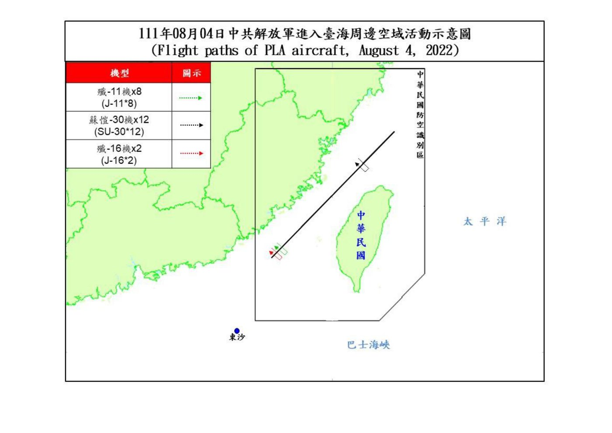
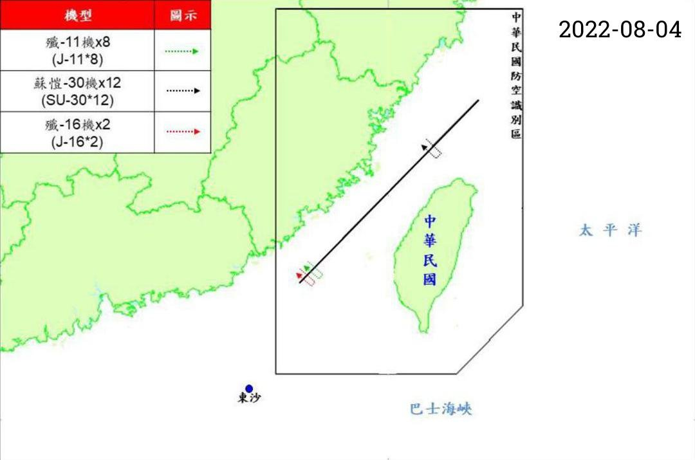
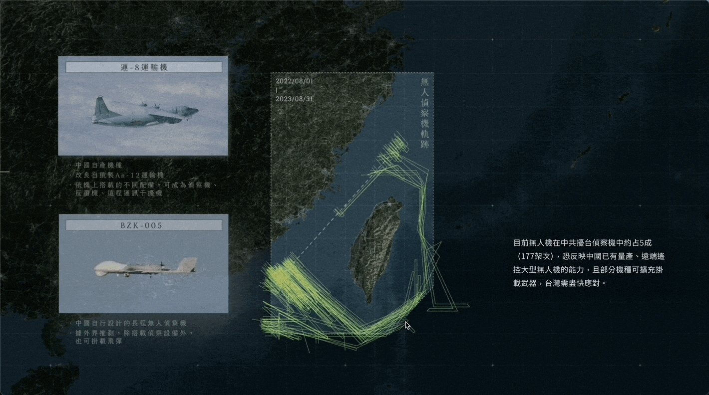
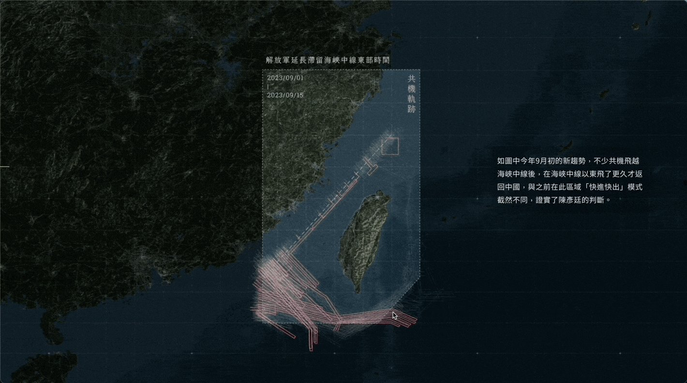
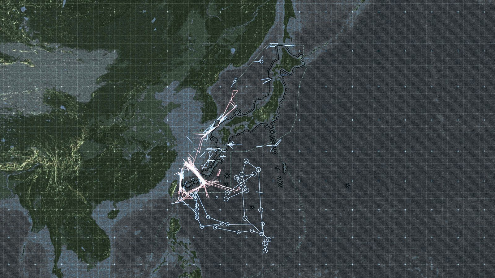

+++
author = "矢崎裕一"
title = "画像でしか出ない航跡図を、手でなぞって地図に戻す──報導者「解放軍如何進逼第一島鏈」"
slug = "twreporter-first-island-chain"
date = "2026-11-04"
description = "報導者は、台湾が画像で、日本が PDF で公表している航跡図を手でなぞって地理データに戻し（台湾分は992本）、スクロールで進む動画の中で、時期ごとに地図へ重ねました。"
categories = [
    "consume"
]
tags = [
    "データジャーナリズム",
    "Sigma Awards",
    "地図",
    "オープンデータ"
]
image = "images/og-tracks-map.jpg"
series = ["dataviz-journalism"]
series_weight = 6
seriesByline = "報導者 The Reporter"
seriesTitle = "航跡図を手でなぞって地図に戻す──解放軍如何進逼第一島鏈"
+++

報導者（The Reporter）は、台湾が画像で、日本が PDF で公表している航跡図を手でなぞって、地理データに戻しました（台湾分は992本）。それを、スクロールで進む動画の中で、時期ごとに地図へ重ねています。航跡図は、中国人民解放軍の軍用機と艦艇の動きを、台湾の国防部と日本の防衛省が描いたものです。

作品は〈【圖解】解放軍如何進逼第一島鏈：台海衝突下牽動的美日軍事布局〉で、公開は2023年10月17日（台湾時間）です。Sigma Awards 2024 では、小規模ニュースルームの区分で受賞しました。以下は、記事の本文と附錄（方法論の付録）、GitHub で公開されたデータセット、報導者の Medium の記事に沿って、データが作られた順に読みます。

<!--more-->

## 毎朝9時に公表される、共機の経路

記事は、国防部の日課から始まります。

> 每天早上9點，國防部新聞官準時在媒體群組公布過去24小時的共機騷擾路徑…2022年8月至2023年8月一年間，國防部便監測到近6,000架次共機起飛，其中2,231架次繞行台灣周遭

毎朝9時、国防部の報道官が、過去24時間の中国軍機の経路をメディアのグループに流す。2022年8月から1年で延べ約6,000機が飛び立ち、うち延べ2,231機が台湾の周りを回った、という要旨です。

経路を示す航跡図は、JPG 画像で公表されます。附錄は、作業の前提をこう書いています。

> 台、日官方提供資料皆為JPG圖檔或PDF文件檔，團隊須先將圖檔轉換為地理圖資檔案，以便後續分析。

台湾と日本の公式資料はどちらも JPG か PDF で、分析の前に、まず図を地理データに変えなければならない、という意味です。

中華民國國防部／data-reporter「PLA_Path_Database」（GitHub）より引用

README によると、2022年8月5日より前の図は元は PDF で、報導者が JPG に変換しています。

集めた資料は次のとおりです。国防部が航跡図を出すのは、軍用機が「逾越海峽中線及西南空域」の場合、つまり中間線を越えたときと、台湾の西南の空域に入ったときです。国防部は艦艇の航跡を定例では出さないので、艦艇はすべて日本の防衛省の資料によります。

| 出どころ | 形式 | 期間 | 量（附錄の記述） |
|---|---|---|---|
| 台湾国防部「即時軍事動態」 | JPG 画像 | 2022-08-01〜2023-09-15 | 「共317份活動圖、992條軌跡資料（1份報告可能有數條軌跡）」 |
| 日本の防衛省統合幕僚監部の報道資料 | PDF | 2022-08-01〜2023-08-31 | 「共計22份共機資料、99份共艦資料」 |

日本側の資料に載るロシア軍の航跡は分析から外し、中露の共同演習は含めています。

## 白い縁を切り、四隅を合わせ、1本ずつなぞる

附錄に書かれた台湾側の工程は、5つの段に分かれます。

1. 画像認識で、すべての航跡図の白い縁を切り、縦横の寸法をそろえる。地図の範囲が毎回同じなので、そろえれば重ねられる。
2. 地理情報ソフト QGIS でジオリファレンスを行い、地図の四隅の座標を取る。
3. 全部の図を Figma に読み込み、レイヤーごとに航跡を1本ずつ手で描く。
4. 日付・機種・機数を付け、SVG でまとめて書き出す。
5. Python で、四隅の座標を基準に EPSG:3857（Web メルカトル）で座標を戻し、EPSG:4326（WGS84）の緯度経度で保存する。

3番目の段は、他社のやり方を参考にしたと明記されています。

> 參考《天下雜誌》，將所有圖檔匯入繪圖兼介面設計軟體Figma中，在各圖層中逐一人工描繪各段軌跡。

《天下雜誌》を参考に、すべての図を Figma に入れ、各レイヤーで一本ずつ人の手で航跡を描いた、という要旨です。

報導者 Data Team／PLA_Path_Database（GitHub、MIT License）より引用

README によると、加工した図は縁を切り、右上に日付を入れ、寸法をそろえたものです。

日本側は、Python で PDF から「行動概要」という語を探し、地図のあるページを画像にします。範囲が同じ地図は一つのグループにまとめ、台湾と同じ方法で GeoJSON にします。範囲がそろわない残りの図は、1枚ずつ経緯線の交点や地形の点を基準にして合わせます。

どちらも、最後は GeoJSON を地図ソフトに描き、元の図と人の目で見比べて、位置のずれを確かめています。

工程の分け方からは、機械に任せたのは図をそろえる作業と座標の計算で、線を拾う作業は人が受け持った、と読めます。附錄は、その手作業が精度に響くことも書いています。

> 由於軌跡是從官方圖檔復刻而來，各重繪環節都會使資料精準度打折，地圖相對適合從「宏觀」的小比例尺觀之，並不適合過度拉近為大比例尺進行解讀（位置可能會存在誤差）。

航跡は公式の図から描き直したもので、描き直すたびに精度が落ちる。地図は小縮尺で全体を見るのに向き、拡大して読むのには向かない、という要旨です。**この一文は、地図をどの縮尺まで信じてよいかを、読者に先に渡している**と読めます。

## スクロールで進む3本の動画

戻した航跡は、「捲動式影片」（スクロール式の動画）の中で見せています。報導者のプロダクトマネージャー曾偉婷は、Medium の記事でこう説明しています。

> 「捲動式影片」將瀏覽影片從點擊播放的行為，轉為使用者更為熟悉的網頁向下滑動的閱讀操作模式，而且影片「播放」速度由閱讀者自己掌控

動画を見る操作を、クリックで再生するものから、ページを下へ送る読み方に変え、再生の速さは読者が決める、という要旨です。

記事に埋め込まれた動画は3本です。

| 動画 | 主な中身 | 字幕の最後の秒数 |
|---|---|---|
| 動画1 | 第一列島線、2021年時点の米軍の海外基地、沖縄の自衛隊の配備、石垣島 | 28.8秒 |
| 動画2 | 台湾周辺の軍用機の航跡 | 41.5秒 |
| 動画3 | 日本周辺の軍用機と艦艇の航跡、ミサイルの射程 | 28.7秒 |

埋め込みコードの設定は `secondsPer100vh: 1.2` で、画面の高さ1つ分のスクロールで動画が1.2秒進みます。字幕は動画の秒数に結びつけて出ます。動画2を最後まで送るには、画面の高さ約35枚分のスクロールが要る計算になる、と読めます。

動画2は、1年分を一度には見せません。最初の字幕のあと、こう区切ります。

> 以3次解放軍發起大型軍演，軍機數量達最高峰的關鍵時間點做切分

解放軍の3回の大規模演習で、軍用機の数が最も多くなった時点を区切りにする、という意味です。

| 時期 | 区切りになった出来事 |
|---|---|
| 2022年8月〜11月末 | ペロシ（Nancy Pelosi）米下院議長の訪台後、2022年8月7日の初の包囲演習 |
| 2022年12月〜2023年3月末 | 2022年12月23日、バイデン大統領が国防権限法に署名したあとの演習 |
| 2023年4月〜8月 | 2023年4月10日、蔡英文総統の訪米からの帰国後の演習 |

字幕は時期ごとに、西南の空域から巴士海峡（バシー海峡）へ、さらに台湾の東側へと経路が広がったことを述べます。機種の内訳は、戦闘機が69%（延べ1,541機）、偵察機が16%（延べ357機）で、無人機は偵察機の約5割（延べ177機）です。偵察機、運-8 対潜哨戒機、卡-28 対潜ヘリの航跡を順に取り出します。卡-28 の航跡は、水深が100mから2,000mへ急に落ちる台湾海峡の境目に集まる、と字幕は書いています。

報導者 The Reporter／Medium〈捲動式影片2.0：最受歡迎的數位敘事模式再進化〉より引用（GIF の1コマ）

この GIF に付いた説明によると、右側の字幕は決まった体裁のページ側の部品で、左側の機種を説明する絵は動画の中に描き込まれています。

報導者 The Reporter／Medium〈捲動式影片2.0：最受歡迎的數位敘事模式再進化〉より引用（GIF の1コマ）

データと見た目の対応を、確かめられる範囲でまとめます。線の色や凡例の対応は、本稿では確かめていません。

| データ | 見た目・素材 | 根拠 |
|---|---|---|
| 1本の航跡（日付・機種・機数つき） | 地図上の線。1本が複数の機体や艦艇を表すことがある | 附錄「三、資料呈現」 |
| 艦艇の位置・活動範囲 | 円 | 動画3の字幕の注記 |
| 時期 | 3つの時期ごとに航跡を描き足す | 動画2の字幕 |
| 時間の進み | 読者のスクロール量（画面1つ分で1.2秒） | 埋め込みコードの設定 |
| 機種 | 字幕の内訳と、機種ごとに取り出した航跡。機種の説明図は動画に描き込み | 動画2の字幕、Medium の記事 |
| ミサイルの射程 | 地図に描いた射程 | 動画3の字幕 |
| 端末 | 横長1920×1080（PC）と縦長720×1080（幅767px以下）の動画 | 埋め込みコード |

報導者 The Reporter／〈【圖解】解放軍如何進逼第一島鏈〉より引用（記事ページの共有用画像）

記事ページの共有用画像には、台湾の周りの線に加えて、台湾の東から南の太平洋に円をつないだ形が見えます。動画3の注記は、線と円が元の政府の図の描き方を引き継いでいることを伝えています。

> 每一線段或圓點可能包含多架共機、艦，圓圈為共艦點位或活動範圍，部分軌跡同時包含俄軍資料（聯合軍演）。

1本の線や1つの点が複数の機体や艦艇を含むことがある。円は艦艇の位置か活動範囲で、一部の航跡には共同演習のロシア軍も含まれる、という要旨です。日本側の資料は同じ航跡を何度も載せることがあり、報導者は1回だけ描いています。

## データセットに残った、二つの数

報導者は、戻したデータを GitHub で「PLA_Path_Database」として、MIT License で公開しています。README の日付は2024年9月23日で、このとき2024年7月31日までのデータを足しています。

記事の公開時に使ったファイルは `Taiwan/20220801-20230915_fixed.geojson` です。Taiwan の README は、このデータを「2024年9月修正錯誤」と説明しています。その数は、記事の数と合いません。

| 数えたもの | 図・日 | 航跡 |
|---|---|---|
| 記事の附錄と README の記述 | 317図 | 992本 |
| 修正版 GeoJSON の集計（日付とフィーチャ） | 322日分 | 995本 |

記事は図の枚数で、集計は日付の数で数えています。差の内訳は、記事にも README にも書かれていません。

日本側の `Japan/jp_data_cleaned.csv` は327行で、艦艇が266行、軍用機が61行です。各行には、矢印・両方向の矢印・楕円・グループという、元の図の形の区別が入っています。`version` の列は、重複の扱いを利用者に委ねています。

> 防衛省可能在新報告中，連帶標記日前公布過的軌跡，因此軌跡會重複描圖。如果欲去除重複，僅選擇new即可。

防衛省は新しい報告に、以前出した航跡もあわせて載せることがあるので、航跡が重複する。重複を除くなら new だけを選べばよい、という要旨です。

国防部の図は2024年1月16日から、機種ごとの航跡をやめ、活動範囲を多角形で示す形に変わりました（README「國防部不再公布各機型之航機，改以活動範圍多邊形註記」）。以後のデータは多角形で収めています。

## 第三者はこの作品をどう見たか

Sigma の作品ページによると、この作品は2024年の受賞作です。審査員は、語り方を評価しています。

> The project took dry military data and turned it into a compelling visual narrative to highlight the dangers of a war breaking out at one of the world's key flashpoints. It made the risks of a confrontation clearer to an audience that may not have been focusing on the issues.

無味乾燥な軍事データを説得力のある視覚的な物語に変え、世界の火種の一つで戦争が起きる危険を示した。この問題に目を向けていなかった人にも、衝突のリスクを分かりやすくした、という要旨です。報導者の発表では、78か国・322組織の591件から選ばれた10件の一つで、中国語媒体ではこの回で唯一の受賞でした。

SOPA Awards 2024 では、Excellence in Infographics の華文部門で Award for Excellence を受けています。

> This piece adeptly demystified a highly intricate subject matter, successfully condensing an immense volume of data and information into a comprehensible and accessible format. The visual style maintains a consistent and elegant aesthetic, and the incorporation of animation further assists readers in grasping the narrative.

込み入った題材を解きほぐし、膨大なデータと情報を分かりやすい形に圧縮した。見た目は一貫して上品で、アニメーションが物語の理解を助けている、という要旨です。同じ部門の Honorable Mention は、《天下雜誌》の《2023 台北都更地圖》でした。

台湾では、2024年11月19日に第23屆卓越新聞獎の「不分媒體類新聞敘事創新獎」を受けたと、中央社が報じています。

応募書類は、《華盛頓郵報》（The Washington Post）と協力し、航跡の分析を英語にしてデータセットを提供したと自己申告しています。英語版の中身は、本稿では読めていません。

3件の評価はどれも、物語やアニメーション、語り方の革新といった見せ方に向いています。画像を地理データに戻す工程は評の言葉に出てこず、附錄とデータセットの側に残されている、と読めます。

## 使い道

この作品から持ち帰れることは、政府が画像でしか出さない資料も、手順を踏めばデータに戻せるということです。

範囲が毎回同じ地図なら、縁を切ってそろえれば重ねられます。四隅の座標を取れば、なぞった線を緯度経度に戻せます。範囲がそろわない地図は、経緯線の交点や地形の点を基準に1枚ずつ合わせます。

戻したデータには、限界を添えます。報導者は附錄に、小縮尺で見て、拡大して読まないよう書きました。1本の線が複数の機体を表すという元の図の約束も、注記で引き継いでいます。重複の扱いは、データセットの列で利用者に渡しています。

見せ方では、時間の区切りを出来事に置き、時間の進みを読者のスクロールに任せています。3つの時期に分けて描き足すことで、範囲の広がりを順に追える形になっている、と読めます。データを戻す手間と、それを順に見せる手間の両方が、この作品の中身です。

## 参考・出典

**一次情報**

- 報導者 The Reporter〈【圖解】解放軍如何進逼第一島鏈：台海衝突下牽動的美日軍事布局〉2023年10月17日（本文、動画の字幕、附錄「《報導者》團隊如何收集及呈現共軍軌跡資料」、資料來源）. [twreporter.org](https://www.twreporter.org/a/taiwanyuji-first-island-chain-military-movement-multimedia)
- 報導者 The Reporter《中國虎視下的島鏈──沖繩如何成為台海危機的熱點？》（所属する特集）. [twreporter.org](https://www.twreporter.org/topics/taiwanyuji-first-island-chain-japan-okinawa)
- Sigma Awards 2024 の応募書類（作品ページ。原文と機械翻訳）. [sigma-awards.data-visualization.jp](https://sigma-awards.data-visualization.jp/entries/2024-s-0004/)
- data-reporter「PLA_Path_Database」（README、Taiwan/README、Japan/README、LICENSE、GeoJSON、CSV）MIT License. [GitHub](https://github.com/data-reporter/PLA_Path_Database)
- data-reporter「PLA_Path_Database」日本側の探索用地図. [GitHub Pages](https://data-reporter.github.io/PLA_Path_Database/Japan/JP_Map/interactive_map.html)
- 曾偉婷〈捲動式影片2.0：最受歡迎的數位敘事模式再進化〉報導者 The Reporter（Medium）2024年9月12日. [Medium](https://medium.com/twreporter/%E6%8D%B2%E5%8B%95%E5%BC%8F%E5%BD%B1%E7%89%872-0-%E6%9C%80%E5%8F%97%E6%AD%A1%E8%BF%8E%E7%9A%84%E6%95%B8%E4%BD%8D%E6%95%98%E4%BA%8B%E6%A8%A1%E5%BC%8F%E5%86%8D%E9%80%B2%E5%8C%96-10aeac90cd4c)（本文は [Medium の RSS](https://medium.com/feed/twreporter) で読んだ）
- 報導者 The Reporter、2024年の受賞のまとめ. [twreporter.org](https://www.twreporter.org/a/awards-2024)
- 報導者 The Reporter〈AI、Python與手工業，我們如何處理台灣+日本超過400張共軍軌跡圖？〉（README が方法論の詳細として案内するメイキング記事。本稿では本文を確認できていない）. [Medium](https://medium.com/twreporter/13b10f9a1c81)

**第三者評価**

- Sigma Awards 2024 の審査コメント. [sigma-awards.data-visualization.jp](https://sigma-awards.data-visualization.jp/entries/2024-s-0004/)
- SOPA 2024 Awards Winner List（p.24、Excellence in Infographics・華文部門）. [PDF](https://sopawards.com/wp-content/uploads/2024/06/SOPA-2024-Awards-Winner-List-v1.pdf)
- 中央社「第23屆卓越新聞獎」2024年11月19日. [cna.com.tw](https://www.cna.com.tw/news/ahel/202411190317.aspx)
- The Washington Post, 2023年11月13日（応募書類が協力先として挙げる記事。本稿では読めていない）. [washingtonpost.com](https://www.washingtonpost.com/world/2023/11/13/china-biden-xi-meeting-apec-taiwan/)
