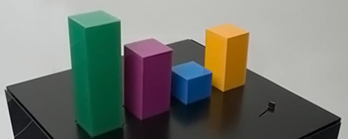
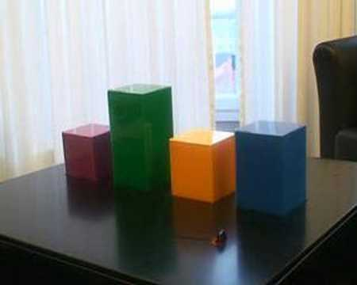

+++
author = "Yuichi Yazaki"
title = "Showing Web Activity with Four Bars That Rise and Fall on a Table: Wable"
slug = "wable-physical-bar-chart"
date = "2026-11-03"
description = "Wable was a prototype table that showed activity on web services through the height of bars that raise and lower automatically. Activity was pulled in via RSS; it was built in 2007 and made public in 2008."
categories = [
    "consume"
]
tags = [
    "data physicalization",
    "bar chart"
]
image = "images/wable-table-four-bars.jpg"
series = ["data-physicalization"]
series_weight = 16
seriesByline = "Physical Interaction Lab"
seriesTitle = "Web Activity as Four Rising and Falling Bars: Wable"
+++

Wable was a prototype table that showed activity on web services through the height of bars that raise and lower automatically. There are four bars, and they move up and down according to activity on services such as Plazes, Flickr and Last.fm. The activity is pulled in through RSS feeds. According to infosthetics, the display can be configured in a web application. It was made by Physical Interaction Lab, built in 2007 and made public in February 2008.

The project's official page no longer loads. What follows relies on the text of the official site as quoted by the data physicalization catalog dataphys.org and others, on the press coverage of February 2008 (infosthetics, Core77, Engadget, GeekAlerts), and on the research paper "Physecology" (2022). I have found no source that describes the mechanism, the dimensions, or the scale of the bars. This article does not go into those either.

<!--more-->

## February 2008: reported as a bar chart in a coffee table

The first to report on it was the visualization blog information aesthetics (infosthetics). Its article of February 1, 2008, filed under "aesthetic / physical", introduced it in one sentence:

> "a physical bar graph integrated in a coffee table, which visualizes the changes of one's web identity over time, & creates a physical link between your virtual & real identity."

Summary: a physical bar graph built into a coffee table that shows how one's web identity changes over time and physically links the virtual and real identities.

On the same day, the design magazine Core77 covered it as a coffee-table piece, "via infosthetics". On February 2, Engadget ran a post "Via Core77", and GeekAlerts also published an article.

Source: Physical Interaction Lab / GeekAlerts, "Wable – Cool Interactive Table"

In the photo, the green bar is the tallest and the blue one the shortest.

The year it was made is 2007 according to dataphys.org. The same photo is also reproduced on EduTech Wiki (University of Geneva) as "Wable, version 1 prototype". The EXIF data of that image file records a digitization date of November 7, 2007 and a file modification date of December 30, 2007. It can be read as consistent with the press dates if the table was photographed and built between autumn and the end of 2007 and made public in early February 2008.

## The makers' words: change over time, and a physical link

The makers' own text was on the official site of Physical Interaction Lab. Four sources (dataphys.org, Core77, GeekAlerts and EduTech Wiki) quote the same passage.

> "The personal feeds from webapplications like Plazes, Flickr, and Last.fm tell much about the activity of an individual on the internet. In this project we aim to explore how you can visualize the changes of your web identity over time and create a physical link between your virtual and real identity. The interface consists of both a physical table and a web application. This direct feedback from your web identity is customizable and can be connected to any RSS feed."

Summary: Personal feeds from web applications such as Plazes, Flickr and Last.fm say a lot about what a person does online. The project explores how to show the changes of a web identity over time and how to link the virtual and real identities physically. The interface has two parts, a physical table and a web application. The display is customizable and can be connected to any RSS feed.

Plazes was a location-sharing service of the time, Flickr a photo service, and Last.fm a service for music listening history. Two aims are stated. One is to show **how activity on the web changes over time**. The other is to link the virtual and real identities physically.

The official site also carried a note:

> "Update: What you see is the first prototype version of Wable. We are currently building version 2 so keep an eye on our blog or sign up below to find out when it's released and ready for sale."

Summary: What you see is the first prototype of Wable. Version 2 is being built, and the blog or the sign-up form will announce when it is released and ready for sale.

What was shown publicly was the first prototype. Version 2 was under construction, with a sale in view. I have found no source saying whether version 2 ever appeared.

Little is known about the makers. dataphys.org gives the source as "Physical Interaction Lab (2007). Wable." and quotes the official text as "From the company's website", so it treats the Lab as a company. The video "Wable" on YouTube was uploaded by David Kjelkerud. The paper Physecology also lists the work in its references as "David Kjelkerud. 2007. Wable." What role he had in the Lab, who else was involved, and where the Lab was located are not known.

The official page (physicalinteractionlab.com/projects/wable) no longer loads. In a 2018 update, GeekAlerts added a note that it had removed the link because the page was no longer public.

## What was mapped to which bar

The correspondence between data and appearance is summarized in a table.

| Data | Appearance / material | What is known | What is not known |
|---|---|---|---|
| A person's web services | Number and arrangement of bars. I read one bar as corresponding to one service | There are four bars (Engadget). The services named are Plazes, Flickr and Last.fm (official text) | Which service each of the four bars stands for |
| Activity on each service | Height of the bar. It rises and falls automatically with the data | "raise and lower automatically based on the activity" (Engadget). Physecology gives it as an example of countable data (online activity) | The scale of the heights, units, maximum, update interval |
| Color of the bars | Material color, which does not change | Physecology gives it as an example of "fixed optical properties, such as material color". In the photo: green, purple, blue and orange | Whether color was used to tell the series apart is not known. I read it as distinguishing the series. The mapping between colors and services is also unknown |
| Time | A slider. Past activity is seen through the bars | "explore personal online activity over time through a slider button" (Physecology) | The position of the slider, how far back it could go |
| Data source and settings | A web application (screen) | Can be connected to any RSS feed (official text). infosthetics writes "a customizable web application" | What the settings screen contained, how feeds are assigned to bars |

dataphys.org classifies this work as an "Active physical visualization". Its tags are extruded 2d, online community data, personal information management, pragmatic and self-actuated. Extruded 2d means a two-dimensional chart extruded in the height direction, and self-actuated means that the device moves by itself.

A small component is visible at the front right of the tabletop in the photo. No source says whether it is the slider.

Source: David Kjelkerud / YouTube, "Wable" (video thumbnail)

In the video thumbnail, four prisms stand on a table in front of a window. The shooting angle and the combination of heights differ from the photo above, and the blue bar looks clearly taller than in the photo above. The difference in heights between the two images can be read as consistent with the reports that the bars move up and down. The video is available on the YouTube page for ["Wable"](https://www.youtube.com/watch?v=e6G5YlICVRg).

From here on, these are my own readings. In that quantity is shown by length (height) and series by position and color, the encoding can be read as a textbook bar chart. Making it physical adds two things. The bars move by themselves, so change over time is seen as motion. And the bars sit inside a piece of furniture, so they **catch the eye without opening a screen**, as I read it.

## How third parties saw this table

Contemporary press, blog readers and later research each looked at a different aspect.

Darren Murph of Engadget kept his distance in his article of February 2, 2008. The headline, "Wable graphically represents web activity, ain't much of a table", means that it is not much of a table.

> "This unique "table," as it were, sports four bars that raise and lower automatically based on the activity from web applications such as Plazes, Flickr and Last.fm. Beyond that, it doesn't seem to add too much more value to one's life, but if it's the simple things that keep you smiling, check out a remarkably unremarkable video of it after the jump."

Summary: This "table" has four bars that rise and fall automatically with activity from Plazes, Flickr and Last.fm. It does not seem to add much value to one's life, but if simple things make you smile, watch the remarkably unremarkable video.

In the opening of the article, he writes that he is not sure anyone really wants what the makers advertise, a physical link between the virtual and real identities.

The infosthetics article has three reader comments. The first says "Wow. Beautiful." and points out that the music in the video is by Kraftwerk. The next comment is negative:

> "Ugh ... ridiculous ... too BIG ... I mean, where are you going to put it?"

Summary: Too big. Where would you even put it?

The third comment is a rebuttal to this one. Readers' opinions are not expert evaluations, but they can be read as showing that making the chart physical raised questions a screen visualization does not face: its size and where to put it.

On the research side, the paper "Physecology" by Kim Sauvé, Miriam Sturdee and Steven Houben (ACM TOCHI, 2022) discusses Wable. The paper analyzes 60 physicalization examples, and Wable is third in its list. For data type, it gives "Wable [56] (online activity)" as an example of countable data. For data subject, it is an example of personal data. It cites color as an example of the fixed color of a material rather than of a dynamic display. For interaction, it gives the following as an example of exploring data:

> "Example physicalizations are Wable [56] in which you can explore personal online activity over time through a slider button"

Summary: An example physicalization is Wable, in which personal online activity can be explored over time with a slider button.

What the press saw as a "moving table", this paper organizes along design dimensions: the relations among data type, interaction, and input and output.

There is one more early record. The paper "Embodiment in data sculpture" by Jack Zhao and Andrew Vande Moere (DIMEA 2008) cites the official Wable page in its references, with an access date of May 2008. I have not been able to confirm how the body of the paper treats it, but it means that within a few months of its release, Wable was in the references of a paper on data sculpture.

## Takeaways for practice

I read three things from this work that can be carried back into visualization work.

- Separate the data source from the display. Wable's entry point is RSS feeds, and the official text says it can be connected to any feed. infosthetics writes that the display can be configured in a web application ("a customizable web application"). I read it as a design in which the thing displayed stays four bars while its content can be swapped.
- Treat how readable the mapping is as separate from how new the work is. A mapping that shows quantity by height is understood at a glance. Yet Engadget called the video "remarkably unremarkable". If you make a bar chart physical, I read it that **the value has to lie in the motion and the placement, not in a novel encoding**.
- Treat placement as part of the design. For a screen visualization, size is settled inside the screen. A bar chart on a table takes up space in a room. The infosthetics reader's "where are you going to put it?" can be read as showing that, in physicalization, where to put it is itself in question.

## References

**Primary sources**

- Physical Interaction Lab, "Wable" official page (link dead): http://www.physicalinteractionlab.com/projects/wable / Wayback Machine snapshot (2019-06-09): http://web.archive.org/web/20190609053241/http://www.physicalinteractionlab.com/projects/wable
- Pierre Dragicevic, Yvonne Jansen, "2007 – Wable: Web Behavior Shown with a Dynamic Bar Chart", List of Physical Visualizations (quotes the official site's text): https://dataphys.org/list/wable-visualize-web-behavior-as-a-physical-bar-chart/
- David Kjelkerud, "Wable", YouTube: https://www.youtube.com/watch?v=e6G5YlICVRg (uploader confirmed at: https://www.youtube.com/oembed?url=https://www.youtube.com/watch?v=e6G5YlICVRg&format=json )

**Secondary sources**

- Darren Murph, "Wable graphically represents web activity, ain't much of a table", Engadget, 2008-02-02: https://www.engadget.com/2008-02-02-wable-graphically-represents-web-activity-aint-much-of-a-table.html
- infosthetics, "physical bar graph table", information aesthetics, 2008-02-01 (includes the statement "the Wable interface consists of both a physical table & a customizable web application" and three reader comments): https://infosthetics.com/archives/2008/02/physical_bar_graph_table_visualization.html
- squirrelbait, "Wable physical web activity visualization table", Core77, 2008-02-01: https://www.core77.com/posts/8843/Wable-physical-web-activity-visualization-table
- Robert Birming, "Wable – Cool Interactive Table", GeekAlerts, 2008-02-02 (updated 2018): https://www.geekalerts.com/wable-cool-interactive-table/
- Kim Sauvé, Miriam Sturdee, Steven Houben, "Physecology: A Conceptual Framework to describe Data Physicalizations in their Real-World Context", ACM TOCHI 29(3), 2022: https://eprints.lancs.ac.uk/id/eprint/161277/1/TOCHI_Physecology.pdf (https://dl.acm.org/doi/10.1145/3505590 )
- Jack Zhao, Andrew Vande Moere, "Embodiment in data sculpture: a model of the physical visualization of information", DIMEA 2008: https://dl.acm.org/doi/10.1145/1413634.1413696 (the citation of Wable was confirmed in Crossref's reference data: https://api.crossref.org/works/10.1145/1413634.1413696 )
- EduTech Wiki, "Physical visualization": https://edutechwiki.unige.ch/en/Physical_visualization / image file page: https://edutechwiki.unige.ch/en/File:Wable.jpg
