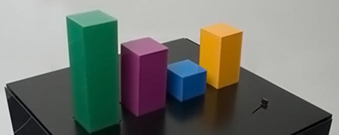
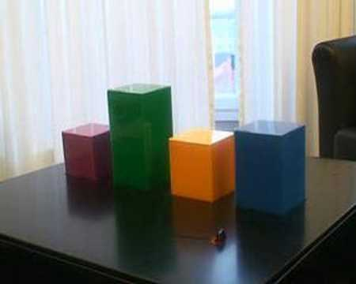

+++
author = "矢崎裕一"
title = "Web サービスでの活動量を、机の上で上下する4本の棒で示す──Wable"
slug = "wable-physical-bar-chart"
date = "2026-11-03"
description = "Wable は、Web サービスでの活動量を、自動で上下する棒の高さで示す机型の試作でした。活動量は RSS で取り込み、2007年に作られ、2008年に公開されました。"
categories = [
    "consume"
]
tags = [
    "データ物質化",
    "棒グラフ"
]
image = "images/wable-table-four-bars.jpg"
series = ["data-physicalization"]
series_weight = 16
seriesByline = "Physical Interaction Lab"
seriesTitle = "Web の活動量を、上下する4本の棒で──Wable"
+++

Wable は、Web サービスでの活動量を、自動で上下する棒の高さで示す机型の試作でした。棒は4本で、Plazes、Flickr、Last.fm などのサービスでの活動量に応じて上下します。活動量は RSS フィードで取り込みます。表示は Web アプリケーションで設定できると、infosthetics は書いています。制作は Physical Interaction Lab です。2007年に作られ、2008年2月に公開されました。

作品の公式ページは、いまはつながりません。以下は、データ物理化の目録 dataphys.org などが引用した公式サイトの文章と、2008年2月の報道（infosthetics、Core77、Engadget、GeekAlerts）、研究論文「Physecology」（2022）に沿います。機構や寸法、棒の目盛りを書いた資料は見つかっていません。この記事も、そこには踏み込みません。

<!--more-->

## 2008年2月、コーヒーテーブルの棒グラフとして報じられる

最初に報じたのは、可視化のブログ information aesthetics（infosthetics）でした。2008年2月1日の記事は、分類を「aesthetic / physical」とし、次の一文で紹介しています。

> "a physical bar graph integrated in a coffee table, which visualizes the changes of one's web identity over time, & creates a physical link between your virtual & real identity."

要旨：コーヒーテーブルに組み込まれた物理の棒グラフで、Web 上のアイデンティティの時間による変化を見せ、仮想と現実のアイデンティティを物理的につなぐ。

同じ日に、デザイン誌 Core77 が「via infosthetics」として、コーヒーテーブルの作品として取り上げました。翌2月2日には、Engadget が「Via Core77」として、GeekAlerts も紹介記事を載せました。

Physical Interaction Lab／GeekAlerts「Wable – Cool Interactive Table」より引用

写真では、緑の棒がいちばん高く、青がいちばん低く写っています。

作られた年は、dataphys.org の表記では2007年です。同じ写真は EduTech Wiki（ジュネーヴ大学）にも「Wable, version 1 prototype」として転載されています。その画像ファイルの EXIF には、デジタル化の日付が2007年11月7日、ファイルの変更日が2007年12月30日と記録されています。2007年の秋から年末に撮影・制作され、2008年2月初めに公開された、と考えると、報道の日付と矛盾しないと読めます。

## 作者側の言葉：時間の変化と、物理的なつながり

作者側の文章は、Physical Interaction Lab の公式サイトにありました。dataphys.org、Core77、GeekAlerts、EduTech Wiki の4か所が、同じ文を引用しています。

> "The personal feeds from webapplications like Plazes, Flickr, and Last.fm tell much about the activity of an individual on the internet. In this project we aim to explore how you can visualize the changes of your web identity over time and create a physical link between your virtual and real identity. The interface consists of both a physical table and a web application. This direct feedback from your web identity is customizable and can be connected to any RSS feed."

要旨：Plazes、Flickr、Last.fm といった Web アプリケーションの個人フィードは、その人のネット上の活動を多く語る。このプロジェクトでは、Web アイデンティティの時間による変化を見せる方法と、仮想と現実のアイデンティティを物理的につなぐ方法を探る。インターフェースは、物理のテーブルと Web アプリケーションの二つでできている。表示は設定でき、どの RSS フィードにもつなげられる。

Plazes は当時の位置情報サービスで、Flickr は写真の、Last.fm は音楽の再生履歴のサービスです。狙いは二つ書かれています。一つは、Web 上の活動が**時間とともにどう変わるか**を見せること。もう一つは、仮想と現実のアイデンティティを、物理的につなぐことです。

公式サイトには、次の追記もありました。

> "Update: What you see is the first prototype version of Wable. We are currently building version 2 so keep an eye on our blog or sign up below to find out when it's released and ready for sale."

要旨：いま見ているのは Wable の最初の試作版である。第2版を作っているところで、発売の準備ができたらブログや登録で知らせる。

公開されたのは試作の第1版です。第2版を作っているところで、販売を目指すと書かれていました。第2版が出たかどうかを書いた資料は見つかっていません。

制作者について分かることは、多くありません。dataphys.org は出典を「Physical Interaction Lab (2007). Wable.」と記し、公式文を「From the company's website」として引いています。会社として扱っているわけです。YouTube に上がっている動画「Wable」の投稿者は、David Kjelkerud です。論文 Physecology も、文献欄で作品を「David Kjelkerud. 2007. Wable.」としています。この人が Lab でどんな役割だったか、ほかに誰が関わったか、Lab がどこにあったかは分かっていません。

公式ページ（physicalinteractionlab.com/projects/wable）は、いまはつながりません。GeekAlerts は2018年の更新で、ページがもう公開されていないのでリンクを外した、と追記しています。

## 何を、どの棒に対応させたか

データと見た目の対応を、表にまとめます。

| データ | 見た目・素材 | 分かっていること | 分かっていないこと |
|---|---|---|---|
| 個人の Web サービス | 棒の本数と並び。棒1本が1つのサービスに当たると筆者は読む | 棒は4本（Engadget）。名前が出ているサービスは Plazes、Flickr、Last.fm（公式文） | 4本がそれぞれどのサービスに当たるか |
| 各サービスでの活動量 | 棒の高さ。データに応じて自動で上下する | 「raise and lower automatically based on the activity」（Engadget）。Physecology は、数えられる量のデータ（online activity）の例に挙げている | 高さの目盛り、単位、最大値、更新の間隔 |
| 棒の色 | 素材の色で、変化しない | Physecology は「fixed optical properties, such as material color」の例に挙げている。写真では緑・紫・青・橙 | 系列の区別に使われたかは分かっていない。筆者は系列の区別だと読む。色とサービスの対応も不明 |
| 時間 | スライダー。過去の活動を棒で見る | 「explore personal online activity over time through a slider button」（Physecology） | スライダーの位置、さかのぼれる期間 |
| データ源と設定 | Web アプリケーション（画面） | どの RSS フィードにもつなげられる（公式文）。infosthetics は「a customizable web application」と書いている | 設定画面の中身、フィードと棒の割り当て方 |

dataphys.org は、この作品を「Active physical visualization」に分類しています。タグは extruded 2d、online community data、personal information management、pragmatic、self-actuated です。extruded 2d は、2次元の図を高さ方向に押し出した形、self-actuated は、装置がひとりでに動くことを指します。

写真の天板の右手前には、小さな部品が写っています。これがスライダーなのかどうかを書いた資料はありません。

David Kjelkerud／YouTube「Wable」より引用（動画のサムネイル画像）

動画のサムネイルでは、窓の前のテーブルに4本の角柱が立っています。上の写真とは撮った向きも高さの組み合わせも違い、青い棒は上の写真よりはっきり高く写っています。2枚の高さの違いは、棒が上下するという報道と矛盾しない、と読めます。動画は YouTube の[「Wable」のページ](https://www.youtube.com/watch?v=e6G5YlICVRg)で公開されています。

ここからは筆者の読みです。量を長さ（高さ）で、系列を位置と色で表すという点で、エンコーディングは教科書どおりの棒グラフだと読めます。物理にしたことで新しく加わったのは、二つです。棒がひとりでに動き、時間の変化が動きとして見えること。そして、棒が家具の中にあり、**画面を開かなくても目に入ること**だと読めます。

## 第三者はこの机をどう見たか

当時の報道、ブログの読者、のちの研究は、それぞれ違うところを見ています。

Engadget の Darren Murph（ダレン・マーフ）は、2008年2月2日の記事で距離を置きました。見出しは「Wable graphically represents web activity, ain't much of a table」で、テーブルとしてはたいしたことがない、という意味です。

> "This unique "table," as it were, sports four bars that raise and lower automatically based on the activity from web applications such as Plazes, Flickr and Last.fm. Beyond that, it doesn't seem to add too much more value to one's life, but if it's the simple things that keep you smiling, check out a remarkably unremarkable video of it after the jump."

要旨：この「テーブル」には、Plazes、Flickr、Last.fm での活動に応じて自動で上下する4本の棒がある。それ以上に暮らしの価値を足すものには見えないが、ささやかなものが好きなら、驚くほど驚きのない動画を見てほしい。

記事の書き出しでは、作者側が掲げた「仮想と現実のアイデンティティを物理的につなぐ」ことを本当に望むかは分からない、と書いています。

infosthetics の記事には、読者のコメントが3件付いています。最初のコメントは「Wow. Beautiful.」で、動画の音楽は Kraftwerk（クラフトワーク）だと指摘しています。次のコメントは否定的です。

> "Ugh ... ridiculous ... too BIG ... I mean, where are you going to put it?"

要旨：大きすぎる。いったいどこに置くのか。

3件目は、このコメントへの反論です。読者の意見は専門家の評価ではありませんが、物理にしたことで、大きさと置き場所という、画面の可視化にはないことが問われた、と読めます。

研究の側では、Kim Sauvé（キム・ソーヴェ）、Miriam Sturdee（ミリアム・スターディー）、Steven Houben（スティーヴン・ハウベン）の論文「Physecology」（ACM TOCHI、2022）が Wable を取り上げています。60件の物理化の事例を分析した論文で、Wable は一覧の3番目に載っています。データの型では、数えられる量のデータの例として「Wable [56] (online activity)」を挙げています。データの主題では、個人のデータの例です。色は、動的な表示ではなく素材の固定の色の例として挙げています。操作では、データを探る（exploration）例として、次のように書いています。

> "Example physicalizations are Wable [56] in which you can explore personal online activity over time through a slider button"

要旨：物理化の例として、スライダーのボタンで個人のオンライン活動を時間に沿って探れる Wable がある。

報道が「動く机」として見たものを、この論文は、データの型・操作・入出力の関係という設計の次元で整理しています。

もう一つ、早い時期の記録があります。Jack Zhao（ジャック・ジャオ）と Andrew Vande Moere（アンドリュー・ヴァンデ・ムーア）の論文「Embodiment in data sculpture」（DIMEA 2008）は、文献欄で Wable の公式ページを引いています。閲覧日は2008年5月です。本文での扱いは確かめられていませんが、公開から数か月で、データ彫刻を論じる論文の文献に入っていたことになります。

## 使い道

この作品から、可視化の仕事に持ち帰れることは三つあると読めます。

- データ源と表示を分ける。Wable の入口は RSS フィードで、どのフィードにもつなげられると公式文は書いています。表示は Web アプリケーションで設定できると、infosthetics は書いています（"a customizable web application"）。表示する物は4本の棒のまま、中身を差し替えられる設計だと読めます。
- 対応の分かりやすさと、作品の新しさは別に考える。高さで量を示す対応は、見ればすぐ分かります。その一方で、Engadget は動画を「remarkably unremarkable」と書きました。棒グラフを物理にするなら、**価値はエンコーディングの新しさではなく、動きや置き場所のほうに置く必要がある**と読めます。
- 置き場所を、設計の一部として考える。画面の可視化なら、大きさは画面の中で決まります。机の上の棒グラフは、部屋の中に場所を取ります。infosthetics の読者の「where are you going to put it?」は、物理化では置き場所そのものが問われることを示している、と読めます。

## 参考・出典

**一次情報**

- Physical Interaction Lab「Wable」公式ページ（リンク切れ）：http://www.physicalinteractionlab.com/projects/wable ／ Wayback Machine のスナップショット（2019-06-09）：http://web.archive.org/web/20190609053241/http://www.physicalinteractionlab.com/projects/wable
- Pierre Dragicevic, Yvonne Jansen「2007 – Wable: Web Behavior Shown with a Dynamic Bar Chart」List of Physical Visualizations（公式サイトの文章を引用）：https://dataphys.org/list/wable-visualize-web-behavior-as-a-physical-bar-chart/
- David Kjelkerud「Wable」YouTube：https://www.youtube.com/watch?v=e6G5YlICVRg （投稿者の確認：https://www.youtube.com/oembed?url=https://www.youtube.com/watch?v=e6G5YlICVRg&format=json ）

**第三者評価**

- Darren Murph「Wable graphically represents web activity, ain't much of a table」Engadget, 2008-02-02：https://www.engadget.com/2008-02-02-wable-graphically-represents-web-activity-aint-much-of-a-table.html
- infosthetics「physical bar graph table」information aesthetics, 2008-02-01（「the Wable interface consists of both a physical table & a customizable web application」の記述と、読者コメント3件を含む）：https://infosthetics.com/archives/2008/02/physical_bar_graph_table_visualization.html
- squirrelbait「Wable physical web activity visualization table」Core77, 2008-02-01：https://www.core77.com/posts/8843/Wable-physical-web-activity-visualization-table
- Robert Birming「Wable – Cool Interactive Table」GeekAlerts, 2008-02-02（2018年更新）：https://www.geekalerts.com/wable-cool-interactive-table/
- Kim Sauvé, Miriam Sturdee, Steven Houben「Physecology: A Conceptual Framework to describe Data Physicalizations in their Real-World Context」ACM TOCHI 29(3), 2022：https://eprints.lancs.ac.uk/id/eprint/161277/1/TOCHI_Physecology.pdf （https://dl.acm.org/doi/10.1145/3505590 ）
- Jack Zhao, Andrew Vande Moere「Embodiment in data sculpture: a model of the physical visualization of information」DIMEA 2008：https://dl.acm.org/doi/10.1145/1413634.1413696 （Wable の引用は Crossref の参照データで確認：https://api.crossref.org/works/10.1145/1413634.1413696 ）
- EduTech Wiki「Physical visualization」：https://edutechwiki.unige.ch/en/Physical_visualization ／ 画像ファイルのページ：https://edutechwiki.unige.ch/en/File:Wable.jpg
