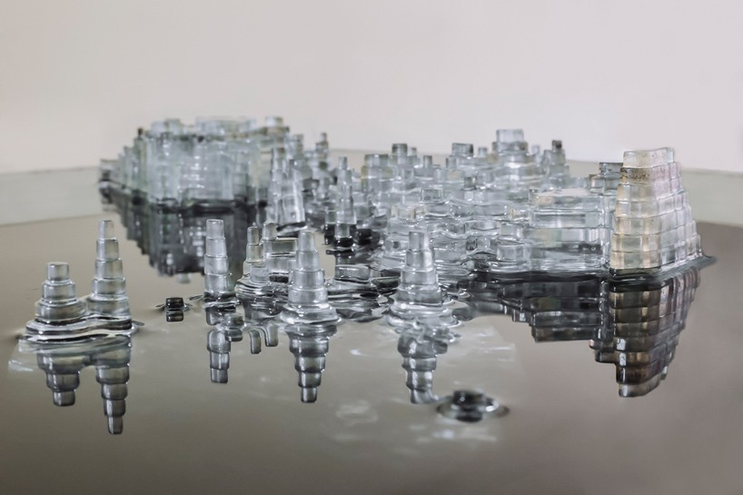
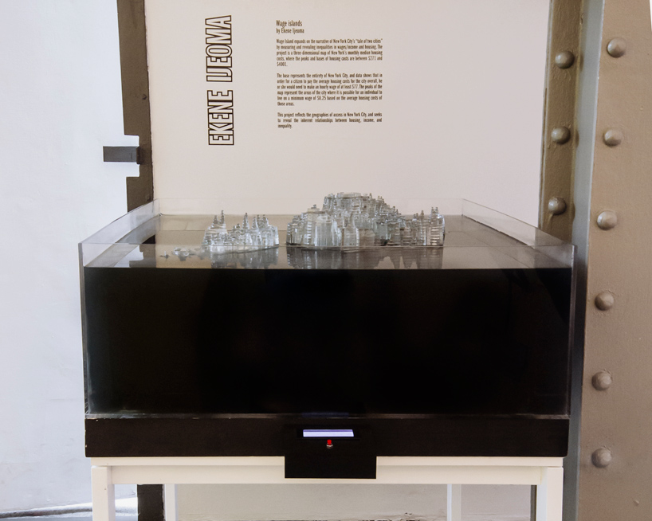
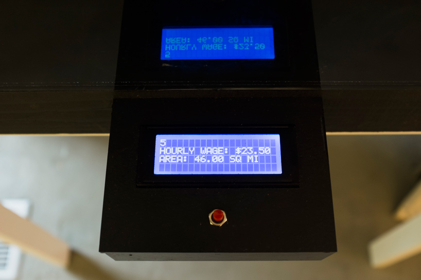
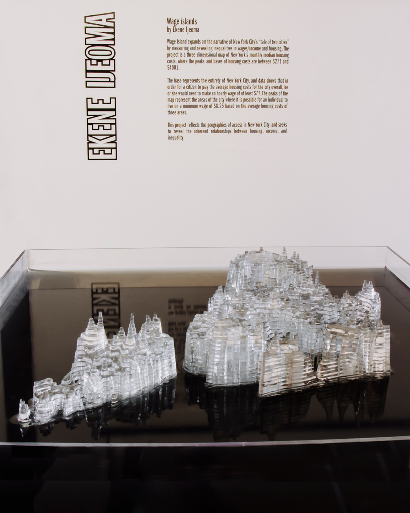

+++
author = "Yuichi Yazaki"
title = "Turning Housing Costs Upside Down and Sinking Them in Water: Ekene Ijeoma's Wage Islands"
slug = "wage-islands"
date = "2026-11-05"
description = "A map of New York City in which the cheaper the housing, the higher the terrain, sunk in water. The part above the surface is the area a given wage can afford, and a button raises the wage and lifts the map."
categories = [
    "consume"
]
tags = [
    "data physicalization",
    "map"
]
image = "images/peaks-as-islands.jpg"
+++

Ekene Ijeoma's *Wage Islands* is a map of New York City sunk in water, with elevation set so that the cheaper the housing, the higher the ground. The part that rises above the water surface, which stands for a wage, shows the area where housing is within reach at that wage. Press a button and the wage rises, lifting the map out of the water.

The work was shown in 2015 in the group exhibition "Measure" at the Storefront for Art and Architecture in SoHo, New York. What follows draws on the introductions in Domus and designboom and on what Ijeoma said in an interview with Vice. The artist's own description of the work was on his old official site, which would not open for me, so I could only check it through a reposted copy. I also could not confirm the source of the data used for the map (the survey name, the year, the geographic unit).

<!--more-->

## From a minimum-wage campaign to a question about where you can live

It began at Re3Storyhack, a hackathon on social issues. In an interview with Vice (The Creators Project, September 8, 2015), Ijeoma says:

> At Re3Storyhack I worked with Fast Food Forward who have been fighting to raise minimum wages for fast food workers to 15 dollars an hour. I thought, what if the fight was framed around access not just wages?

He teamed up with Fast Food Forward, which was campaigning to raise the minimum wage for fast food workers to $15 an hour, and wondered whether the fight could be framed as a matter of "access" and not only of wages. He goes on to recall the cover of New York magazine after Hurricane Sandy, with Manhattan in the dark, and says he wanted to produce that intuitive feeling in a work based on data.

The artist's description appears to have been on his old official site, studioijeoma.com, but I could not open it. The passage below is from a repost on the "artresearch" board at scrapbox.io.

> We wanted to see how their access to the city would change based on housing costs. What would the city look like if its' islands were based on wages? How much would it take for them to have access to all of the city?

These are the questions: how does the part of the city people can live in change with housing costs? What would the city look like if its islands were determined by wages? How much would it take to reach the whole city? The same reposted text also says the work was commissioned for the "Measure" exhibition.

## Making housing costs elevation, cheapest highest

The Domus introduction (September 15, 2015) describes how the map works:

> At the base is the full city where an hourly wage of $77 is needed for monthly housing costs of $4001. At the peaks are only parts of the city where an hourly wage of $8.75 is needed for monthly housing costs of $271.

The base is the whole city, at an hourly wage of $77, corresponding to monthly housing costs of $4,001. The top is the level at $8.75 an hour, corresponding to $271 a month, and it covers only part of the city. The source of the elevation is "median monthly housing costs," and the range runs from $271 to $4,001 (Domus, designboom). The reposted text by the artist sums this up in one line: **"The higher the level the lower the wages."**

The $8.75 an hour matches the minimum wage in New York State at the time. The state's general minimum wage became $8.75 on December 31, 2014, and rose to $9.00 on December 31, 2015 (New York State Department of Labor).

The correspondences the sources let me establish are as follows.

| Data | Appearance / material | Value | Source |
|---|---|---|---|
| Geography of New York City | Planar shape of a terrain model made of stacked transparent acrylic | 500+ laser-cut parts | Vice, Domus, repost of the artist's text |
| Median monthly housing costs | Elevation (inverted): cheaper areas are higher | $271 at the top, $4,001 at the base | Domus, designboom |
| Hourly wage corresponding to housing costs | Scale of the elevation | $8.75 at the top, $77 at the base | Domus |
| Current wage (set by the viewer) | Height of the map relative to the water surface | From $8.75 to $77 | Domus, Vice, repost of the artist's text |
| Areas where housing is affordable at that wage | The part above the water surface (islands) | At minimum wage, only the peaks | Domus |
| Areas that are out of reach | The part hidden under the dark water | — | designboom, Vice, repost of the artist's text |
| Wage and area figures | LCD display | — | Domus, Vice |

On an ordinary topographic map, high ground is read as "more." This work reverses the direction and makes the cheaper areas higher. This can be read as a way of making everything above the water surface mean "within reach."

Courtesy of Ekene Ijeoma. From designboom, "wage islands installation by ekene ijeoma highlights new york's salary disparity"

I could not confirm how the correspondences between $271 and $8.75, and between $4,001 and $77, were decided. What follows is my own calculation. Assume 40 hours a week for 52 weeks (2,080 hours) and 30% of income going to housing. Then $77 an hour gives about $4,004 a month, which nearly matches the $4,001 at the base. The same formula gives about $455 a month for $8.75, which does not match the $271 at the top. This can be read as the top end being set by a different method.

The source of the data is also unknown. "Median monthly housing costs" is the same as the name of a table in the American Community Survey (ACS), but I found no statement that ACS was used. In Vice, Ijeoma says Richard Dunks and Juan Francisco Saldarriaga helped with the modeling of the geographic data.

## Press the button and the map rises from the water

The work consists of a tank filled with dark water and a box with a button in front of it. designboom calls the water "black water," and the artist's reposted text calls it "dark blue water."

Courtesy of Ekene Ijeoma. From designboom, "wage islands installation by ekene ijeoma highlights new york's salary disparity"

What moves is not the water but the map. Vice writes, "A button moves the physical map up and down in the water." The reposted text by the artist explains the mechanism as follows.

> Inside was a lift and outside was an display with a button. Holding down on the button slowly raised the wages shown on the display and lifted the map to show the areas of access to housing above the water. When let go it lowered the map to the bottom showing only minimum wage.

There is a lift inside the tank and a display with a button outside. Holding the button slowly raises the wage on the display and lifts the map, so the areas where housing is within reach come out above the water. Letting go lowers the map back to the minimum-wage state.

Courtesy of Ekene Ijeoma. From designboom, "wage islands installation by ekene ijeoma highlights new york's salary disparity"

The LCD in this photo shows an hourly wage of $23.50 and an area of 46.00 square miles. Domus says the display shows the wage and the area. The height of the map alone does not let you read the numbers, so the display takes on that part. That can be read as the division of labor here.

On the making, Ijeoma told Vice that he glued together about 500 laser-cut parts himself, and that the hardest part was keeping water from leaking into the motor. A video of the work is on Vimeo (https://vimeo.com/138549946), but I could not open it and have not checked its contents.

On how it looks, Ijeoma says (Vice):

> There's something about seeing the clear abstracted forms of the city coming out of the dark clouded water, and feeling the concreteness of the message

Seeing the clear, abstracted forms of the city come out of dark, clouded water, he says, makes the message feel concrete. The areas that are out of reach are not erased but sunk under the water. This can be read as using hiding itself as the means of display.

Courtesy of Ekene Ijeoma. From designboom, "wage islands installation by ekene ijeoma highlights new york's salary disparity"

designboom captions this photo "as the wages increase the terrain emerges from the water."

## Other editions, and a book chapter

*Wage Islands: Immigrants* (2017) appears in "Imagining Data," a virtual exhibition at the Museum of Craft and Design in San Francisco. Its materials are acrylic, ink, and water, and it measures 18 × 3 × 18 inches. According to the museum's description, it is based on data about low-wage immigrant workers, and the peaks above the water show where they can live.

In print, there is a chapter in *Making with Data: Physical Design and Craft in a Data-Driven World* (edited by Samuel Huron, Till Nagel, Lora Oehlberg, and Wesley Willett, CRC Press). It is section 3.2, "Wage Islands," in Part 3, "Digital Production." The author is Ijeoma, the pages are 199–210, and the DOI is 10.1201/9781003264903-12. I have not been able to read the text of the chapter.

The abstract listed in OpenAlex as publisher metadata describes the work as "a series of data-driven sculptures." It also says the data source, the number of map layers, the dimensions, and the mechanism of operation differ from edition to edition. This suggests that *Wage Islands* is treated as a series built on the same method.

## How third parties saw the work

dataphys.org, a list of physical visualizations by data physicalization researchers (run by Pierre Dragicevic and Yvonne Jansen), introduces the work this way:

> The "Wage Islands" installation by Ekene Ijeoma makes clever use of water as a data query device.

It says the work makes clever use of water as a data query device. It is classified as "Active physical visualization." This is a remark that sees the water not as a material but as an operation that filters by a condition.

Marina Garcia-Vasquez of Vice sees it as a tool for civic debate.

> The exhibit is thus a heady display of information turned into a healthy experiment in visualizing complex civic issues.

It is a healthy experiment in visualizing complex civic issues. The same article adds that the production process itself, built with many collaborators, can be seen as "a physical collective bargaining."

The Museum of Craft and Design's description (guest curator: c2-curatorsquared) sees it as an entry point to the subject.

> By transforming the impersonal data into interactive sculptural form, Ijeoma is creating an alluring entry point for deeper discussion.

By turning impersonal data into a form you can touch, the work creates an entry point to discussion.

ArchDaily (January 24, 2016) presented it as a city that sinks, under the title "Watch New York City Sink…". The biography on the artist's current site also says "submerged in water at rising rent costs." The mechanism lifts the map, yet the way it is talked about leans toward "sinking." That is how it can be read.

## Uses

There are three things to take away from this work.

First, it turned filtering by a threshold into a single physical movement. Showing only what meets a condition, which on a screen would be a filter, becomes raising and lowering a map. The dataphys.org remark about a "query device" can be read as pointing to this.

Second, it chose the direction of the scale to suit what it wants to show. Making cheaper areas higher means that everything above the water is "within reach." But because this reverses how an ordinary topographic map is read, it needs an explanation.

Third, it leaves the source of the data with the work. In this case, neither the name of the housing-cost survey nor how the $271 and $8.75 were matched could be confirmed from public materials. A physical work is hard to re-check for its numbers afterward. It is worth writing the source and the method of calculation into the description of the work.

## References

**Primary sources**

- dataphys.org, "Wage Islands" (entry in the List of Physical Visualizations): https://dataphys.org/list/wage-islands/
- Ekene Ijeoma, "Wage Islands" (old official page; I could not connect and have not checked it): https://studioijeoma.com/Wage-Islands
- Ekene Ijeoma official site (biography, CV): https://ekeneijeoma.com/about
- Repost of the artist's description (scrapbox.io "artresearch"; original not checked): https://scrapbox.io/artresearch/Wage_Islands
- Marina Garcia-Vasquez, "Turning New York's Salary Gap into an Interactive Sculpture," Vice / The Creators Project, 2015-09-08 (interview with the artist): https://www.vice.com/en/article/turning-new-yorks-salary-gap-into-an-interactive-sculpture/
- Domus, "Wage Islands," 2015-09-15: https://www.domusweb.it/en/news/2015/09/15/ekene_ijeoma_wage_islands.html
- Philip Stevens, "wage islands installation by ekene ijeoma highlights new york's salary disparity," designboom, 2015-11-03: https://www.designboom.com/architecture/ekene-ijeoma-wage-islands-storefront-for-art-and-architecture-chicago-architecture-biennial-11-03-2015/
- "Wage Islands: Ekene Ijeoma," WNW Magazine, 2015-09-15: https://wnwblog.squarespace.com/magazine/2015/9/15/g89og36ne7cxoacofbu8nl9zxtneah
- Press release for Storefront for Art and Architecture's "Measure" (repost by World Architecture Community): https://worldarchitecture.org/architecture-news/ccemz/storefront-for-art-and-architecture-presents-measure-opening-august-13th.html
- Museum of Craft and Design, "Ekene Ijeoma" (Wage Islands: Immigrants): https://sfmcd.org/project/ekene-ijeoma/ / exhibition "Imagining Data": https://sfmcd.org/exhibitions/imagining-data/
- Ekene Ijeoma, "Wage Islands," in Samuel Huron, Till Nagel, Lora Oehlberg, Wesley Willett (eds.), *Making with Data: Physical Design and Craft in a Data-Driven World*, CRC Press, pp. 199–210. doi:10.1201/9781003264903-12 / book page: https://www.routledge.com/Making-with-Data-Physical-Design-and-Craft-in-a-Data-Driven-World/Huron-Nagel-Oehlberg-Willett/p/book/9781032182223 / table of contents: https://makingwithdata.org/press / https://makingwithdata.org/about
- Chapter metadata and abstract: https://api.crossref.org/works/10.1201/9781003264903-12 / https://api.openalex.org/works/doi:10.1201/9781003264903-12 / chapter page (not checked): https://www.taylorfrancis.com/chapters/edit/10.1201/9781003264903-12/wage-islands-ekene-ijeoma
- New York State Department of Labor, "History of the Minimum Wage in New York State": https://dol.ny.gov/history-minimum-wage-new-york-state
- Video of the work (Vimeo; not checked): https://vimeo.com/138549946

**Secondary sources**

- dataphys.org, "Wage Islands" (added by Cedric Honnet, contributed by Cheng Xu): https://dataphys.org/list/wage-islands/
- Marina Garcia-Vasquez, Vice / The Creators Project, 2015-09-08: https://www.vice.com/en/article/turning-new-yorks-salary-gap-into-an-interactive-sculpture/
- Museum of Craft and Design, "Imagining Data" (c2-curatorsquared): https://sfmcd.org/project/ekene-ijeoma/
- Sabrina Santos, "Watch New York City Sink in This Commentary on Affordable Housing," ArchDaily, 2016-01-24: https://www.archdaily.com/780344/watch-new-york-city-sink-in-this-commentary-on-affordable-housing
