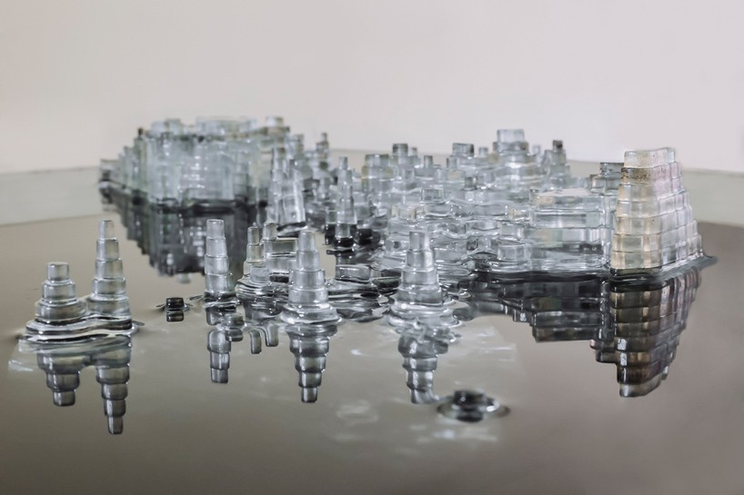
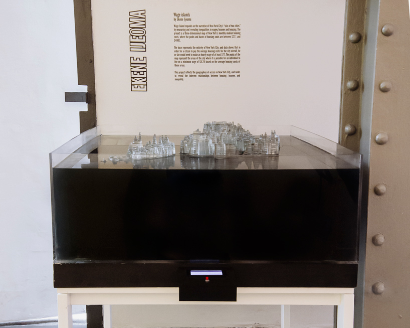
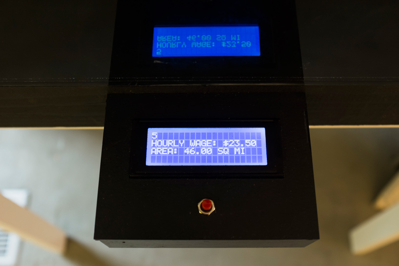
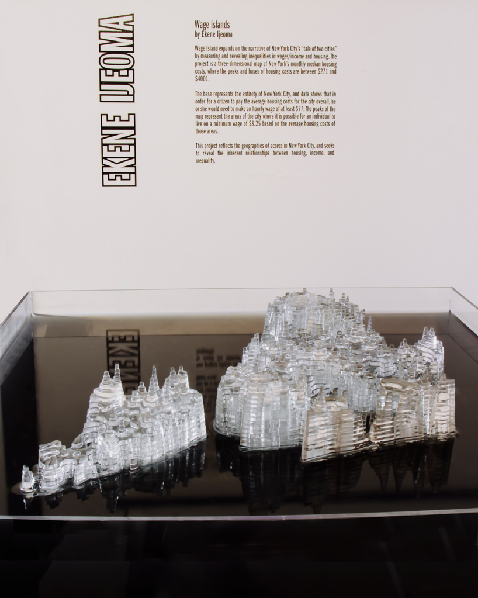

+++
author = "矢崎裕一"
title = "住宅費を逆さの標高にして水に沈める──Ekene Ijeoma『Wage Islands』"
slug = "wage-islands"
date = "2026-11-05"
description = "住宅費が安い地域ほど高くしたニューヨーク市の地図を、水に沈めた作品です。水面から出た部分がその賃金で住宅に手が届く範囲で、ボタンで賃金を上げると地図が持ち上がります。"
categories = [
    "consume"
]
tags = [
    "データ物質化",
    "地図"
]
image = "images/peaks-as-islands.jpg"
series = ["data-physicalization"]
series_weight = 28
seriesByline = "Ekene Ijeoma"
seriesTitle = "安い地域ほど高い地図を水に沈める──Wage Islands"
+++

Ekene Ijeoma（エケネ・イジェオマ）の『Wage Islands』は、住宅費を「安いほど高い」標高にしたニューヨーク市の地図を、水に沈めた作品です。賃金を表す水面から出た部分が、その賃金で住宅に手が届く範囲を示します。ボタンを押すと賃金が上がり、地図が水から持ち上がります。

作品は2015年、ニューヨーク・ソーホーの Storefront for Art and Architecture のグループ展「Measure」で発表されました。以下は、Domus と designboom の紹介記事、Vice のインタビューで Ijeoma が語った言葉に沿います。作者自身の作品解説は、旧公式サイトが開けず、転載でしか確かめられていません。地図に使ったデータの出典（調査名・年・地理の単位）も、確かめられていません。

<!--more-->

## 最低賃金の運動から、「住める範囲」の問いへ

きっかけは、社会課題に取り組むハッカソン「Re3Storyhack」でした。Vice（The Creators Project、2015年9月8日）のインタビューで、Ijeoma はこう話しています。

> At Re3Storyhack I worked with Fast Food Forward who have been fighting to raise minimum wages for fast food workers to 15 dollars an hour. I thought, what if the fight was framed around access not just wages?

ファストフード店員の最低賃金を時給15ドルに上げる運動をしていた Fast Food Forward と組んだ。賃金だけでなく「アクセス」の問題として捉えたらどうか、と考えた、という話です。続けて、ハリケーン・サンディ後の New York 誌の表紙のマンハッタンを思い出し、あの直感的な感覚を、データにもとづく作品で出したかったと語ります。

作者の作品解説は旧公式サイト studioijeoma.com にあったとみられますが、筆者は開けませんでした。以下は、scrapbox.io の「artresearch」に転載された文です。

> We wanted to see how their access to the city would change based on housing costs. What would the city look like if its' islands were based on wages? How much would it take for them to have access to all of the city?

住宅費によって、彼らが住める街の範囲はどう変わるか。島が賃金で決まるとしたら、街はどう見えるか。街全体に手が届くには、いくら必要か、という問いです。同じ転載文は、作品が「Measure」展のために委嘱されたとも書いています。

## 住宅費を「安いほど高い」標高にする

Domus（2015年9月15日）の紹介文は、地図の仕組みを次のように書いています。

> At the base is the full city where an hourly wage of $77 is needed for monthly housing costs of $4001. At the peaks are only parts of the city where an hourly wage of $8.75 is needed for monthly housing costs of $271.

底面は市の全体で、月の住宅費4,001ドルに対応する時給77ドルの面。山頂は月271ドルに対応する時給8.75ドルの面で、市の一部しかない、という説明です。標高のもとは「median monthly housing costs」（月額住宅費の中央値）で、範囲は271〜4,001ドルです（Domus、designboom）。転載された作者の文は、これを **"The higher the level the lower the wages."** と一言で書いています。

時給8.75ドルは、当時のニューヨーク州の最低賃金と一致します。州の一般最低賃金は、2014年12月31日に8.75ドルになり、2015年12月31日に9.00ドルへ上がりました（ニューヨーク州労働局）。

資料から分かる対応は、次のとおりです。

| データ | 見た目・素材 | 値 | 出典 |
|---|---|---|---|
| ニューヨーク市の地理 | 透明アクリルを積み重ねた地形模型の平面形 | 500点以上のレーザーカット部品 | Vice、Domus、作者文の転載 |
| 月額住宅費の中央値 | 標高（逆向き）。安い地域ほど高い | 山頂271ドル、底面4,001ドル | Domus、designboom |
| 住宅費に対応する時給 | 標高の目盛り | 山頂8.75ドル、底面77ドル | Domus |
| 現在の賃金（閲覧者が操作） | 水面に対する地図の高さ | 8.75ドルから77ドルまで | Domus、Vice、作者文の転載 |
| その賃金で住宅に手が届く地域 | 水面から出た部分（島） | 最低賃金では山頂だけ | Domus |
| 手が届かない地域 | 暗い水の下に隠れた部分 | — | designboom、Vice、作者文の転載 |
| 賃金と面積の数値 | 液晶ディスプレイ | — | Domus、Vice |

ふつうの地形図では、高いところは「多い」と読まれます。この作品は向きを逆にし、安い地域ほど高くしています。水面より上を「手が届く」にそろえるためだ、と読めます。

Ekene Ijeoma 提供／designboom「wage islands installation by ekene ijeoma highlights new york's salary disparity」より引用

271ドルと8.75ドル、4,001ドルと77ドルの対応が、どう決められたかは確かめられませんでした。以下は筆者の計算です。週40時間・年52週（2,080時間）働き、収入の30%を住宅費にあてるとすると、77ドルでは月約4,004ドルで、底面の4,001ドルとほぼ合います。同じ式で8.75ドルは月約455ドルになり、山頂の271ドルとは合いません。山頂側は別の決め方をしている、と読めます。

データの出典も分かっていません。「median monthly housing costs」は米国コミュニティ調査（ACS）の表の名前と同じですが、ACS を使ったという記述は見つけていません。Vice で Ijeoma は、地理データのモデリングを Richard Dunks と Juan Francisco Saldarriaga が手伝ったと話しています。

## ボタンを押すと、地図が水から上がる

作品は、暗い水を張った水槽と、その前のボタン付きの箱でできています。水の色は、designboom は「black water」、転載された作者の文は「dark blue water」と書いています。

Ekene Ijeoma 提供／designboom「wage islands installation by ekene ijeoma highlights new york's salary disparity」より引用

動かすのは水ではなく、地図のほうです。Vice は「A button moves the physical map up and down in the water」と書いています。転載された作者の文は、仕組みをこう説明します。

> Inside was a lift and outside was an display with a button. Holding down on the button slowly raised the wages shown on the display and lifted the map to show the areas of access to housing above the water. When let go it lowered the map to the bottom showing only minimum wage.

水槽の中にリフトがあり、外にボタン付きの表示部がある。ボタンを押し続けると表示の賃金がゆっくり上がり、地図が持ち上がって、住宅に手が届く地域が水の上に出る。離すと地図は下がり、最低賃金の状態に戻る、という説明です。

Ekene Ijeoma 提供／designboom「wage islands installation by ekene ijeoma highlights new york's salary disparity」より引用

この写真の液晶には、時給23.50ドルと面積46.00平方マイルが出ています。Domus は、表示部が賃金と面積を示すと書いています。地図の高さだけでは数値が読めないので、その分を表示部が受け持っている、と読めます。

制作について、Ijeoma は Vice にこう話しています。500点ほどのレーザーカット部品を自分で貼り合わせた。いちばん難しかったのは、モーターに水が漏れないようにすることだった。作品の動画は Vimeo にありますが（https://vimeo.com/138549946 ）、筆者は開けず、中身を確かめていません。

見え方について、Ijeoma は次のように語っています（Vice）。

> There's something about seeing the clear abstracted forms of the city coming out of the dark clouded water, and feeling the concreteness of the message

濁った暗い水から、透明に抽象化された街の形が出てくるのを見ると、メッセージの具体性を感じる、という言葉です。手が届かない地域は、消されるのではなく、水の下に沈んでいます。隠すことを、表示の手段にしていると読めます。

Ekene Ijeoma 提供／designboom「wage islands installation by ekene ijeoma highlights new york's salary disparity」より引用

designboom は、この写真に「as the wages increase the terrain emerges from the water」と添えています。

## 別のエディションと、書籍の章

サンフランシスコの Museum of Craft and Design のバーチャル展「Imagining Data」には、『Wage Islands: Immigrants』（2017）が出ています。素材はアクリル、インク、水で、18 × 3 × 18インチです。同館の解説によれば、低賃金の移民労働者のデータにもとづき、水面から出た山が住める場所を示します。

書籍では、『Making with Data: Physical Design and Craft in a Data-Driven World』（Samuel Huron、Till Nagel、Lora Oehlberg、Wesley Willett 編、CRC Press）に章があります。第3部「Digital Production」の3.2「Wage Islands」で、著者は Ijeoma、pp. 199–210、DOI は 10.1201/9781003264903-12 です。筆者は章の本文を読めていません。

出版社のメタデータとして OpenAlex に載っている抄録は、作品を「a series of data-driven sculptures」と書いています。エディションごとに、データ源、地図の段数、寸法、操作の仕組みが違うとも書いています。『Wage Islands』は、同じ方式のシリーズとして扱われている、と読めます。

## 第三者はこの作品をどう見たか

データ物理化の研究者による一覧 dataphys.org（Pierre Dragicevic と Yvonne Jansen が運営）は、この作品を次のように紹介しています。

> The "Wage Islands" installation by Ekene Ijeoma makes clever use of water as a data query device.

水を「データのクエリ装置」として巧みに使っている、という評です。分類は「Active physical visualization」（動く物理可視化）です。水を素材としてではなく、条件で絞り込む操作として見ている評だと読めます。

Vice の Marina Garcia-Vasquez は、市民の議論の道具として見ています。

> The exhibit is thus a heady display of information turned into a healthy experiment in visualizing complex civic issues.

複雑な市民の課題を可視化する、健全な実験だ、という評です。同じ記事は、多くの協力者と作った制作の過程そのものを「a physical collective bargaining」（物理的な団体交渉）と見ることもできる、と書いています。

Museum of Craft and Design の解説（ゲストキュレーターは c2-curatorsquared）は、主題への入口として見ています。

> By transforming the impersonal data into interactive sculptural form, Ijeoma is creating an alluring entry point for deeper discussion.

非人称的なデータを、触れられる造形にすることで、議論への入口を作っている、という評です。

ArchDaily（2016年1月24日）は「Watch New York City Sink…」と、沈む街として紹介しました。作者の現行サイトの略歴も「submerged in water at rising rent costs」と書きます。仕組みは地図を持ち上げる方式ですが、語られ方は「沈む」に寄っている、と読めます。

## 使い道

この作品から持ち帰れることは、三つあります。

一つ目は、しきい値で絞り込む操作を、一つの物理的な動きにしたことです。条件に合うものだけを見せるという、画面ではフィルタにあたる操作が、地図の上げ下げになっています。dataphys.org の「クエリ装置」という評は、この点を指していると読めます。

二つ目は、尺度の向きを、見せたいものに合わせて決めたことです。安い地域ほど高くすれば、水面の上が「手が届く」になります。ただし、ふつうの地形図とは逆の読み方になるので、説明が要ります。

三つ目は、データの出典を作品と一緒に残すことです。この作品では、住宅費の調査名も、271ドルと8.75ドルの対応の決め方も、公開資料からは確かめられませんでした。物理的な作品は、あとから数値を確かめ直しにくいものです。出典と計算の仕方を、作品の説明に書いておく価値があります。

## 参考・出典

**一次情報**

- dataphys.org, "Wage Islands"（List of Physical Visualizations の項目）：https://dataphys.org/list/wage-islands/
- Ekene Ijeoma, "Wage Islands"（旧公式ページ。筆者は接続できず未確認）：https://studioijeoma.com/Wage-Islands
- Ekene Ijeoma 公式サイト（略歴・CV）：https://ekeneijeoma.com/about
- 作者の作品解説の転載（scrapbox.io「artresearch」。原典は未確認）：https://scrapbox.io/artresearch/Wage_Islands
- Marina Garcia-Vasquez, "Turning New York's Salary Gap into an Interactive Sculpture," Vice / The Creators Project, 2015-09-08（作者インタビュー）：https://www.vice.com/en/article/turning-new-yorks-salary-gap-into-an-interactive-sculpture/
- Domus, "Wage Islands," 2015-09-15：https://www.domusweb.it/en/news/2015/09/15/ekene_ijeoma_wage_islands.html
- Philip Stevens, "wage islands installation by ekene ijeoma highlights new york's salary disparity," designboom, 2015-11-03：https://www.designboom.com/architecture/ekene-ijeoma-wage-islands-storefront-for-art-and-architecture-chicago-architecture-biennial-11-03-2015/
- "Wage Islands: Ekene Ijeoma," WNW Magazine, 2015-09-15：https://wnwblog.squarespace.com/magazine/2015/9/15/g89og36ne7cxoacofbu8nl9zxtneah
- Storefront for Art and Architecture「Measure」のプレスリリース転載（World Architecture Community）：https://worldarchitecture.org/architecture-news/ccemz/storefront-for-art-and-architecture-presents-measure-opening-august-13th.html
- Museum of Craft and Design, "Ekene Ijeoma"（Wage Islands: Immigrants）：https://sfmcd.org/project/ekene-ijeoma/ ／展覧会「Imagining Data」：https://sfmcd.org/exhibitions/imagining-data/
- Ekene Ijeoma, "Wage Islands," in Samuel Huron, Till Nagel, Lora Oehlberg, Wesley Willett (eds.), *Making with Data: Physical Design and Craft in a Data-Driven World*, CRC Press, pp. 199–210. doi:10.1201/9781003264903-12 ／書籍ページ：https://www.routledge.com/Making-with-Data-Physical-Design-and-Craft-in-a-Data-Driven-World/Huron-Nagel-Oehlberg-Willett/p/book/9781032182223 ／目次：https://makingwithdata.org/press ／https://makingwithdata.org/about
- 章のメタデータと抄録：https://api.crossref.org/works/10.1201/9781003264903-12 ／https://api.openalex.org/works/doi:10.1201/9781003264903-12 ／章ページ（未確認）：https://www.taylorfrancis.com/chapters/edit/10.1201/9781003264903-12/wage-islands-ekene-ijeoma
- New York State Department of Labor, "History of the Minimum Wage in New York State"：https://dol.ny.gov/history-minimum-wage-new-york-state
- 作品の動画（Vimeo。筆者は未確認）：https://vimeo.com/138549946

**第三者評価**

- dataphys.org, "Wage Islands"（追加 Cedric Honnet、提供 Cheng Xu）：https://dataphys.org/list/wage-islands/
- Marina Garcia-Vasquez, Vice / The Creators Project, 2015-09-08：https://www.vice.com/en/article/turning-new-yorks-salary-gap-into-an-interactive-sculpture/
- Museum of Craft and Design「Imagining Data」（c2-curatorsquared）：https://sfmcd.org/project/ekene-ijeoma/
- Sabrina Santos, "Watch New York City Sink in This Commentary on Affordable Housing," ArchDaily, 2016-01-24：https://www.archdaily.com/780344/watch-new-york-city-sink-in-this-commentary-on-affordable-housing
