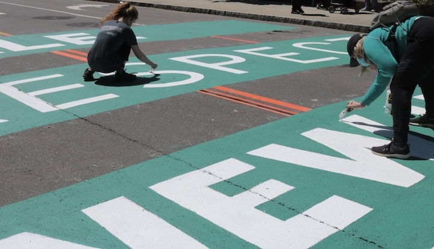
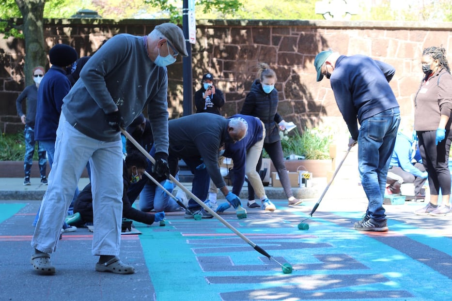
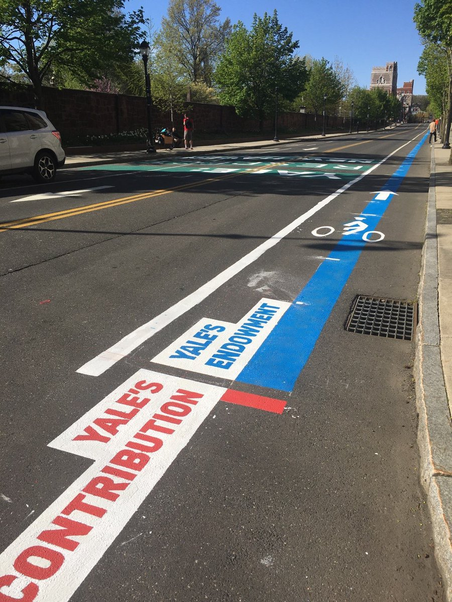
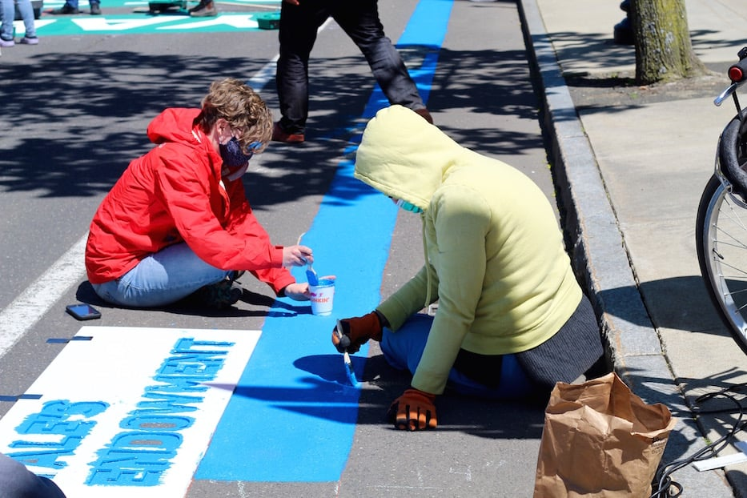

+++
author = "Yuichi Yazaki"
title = "A 204 m Blue Band and an 8 cm Red Rectangle: The Walkable Bar Chart on Prospect Street"
slug = "walkable-bar-chart"
date = "2026-11-01"
description = "Going by the dimensions reported in the press, a blue band about 204 m long and a red rectangle about 8 cm long are two bars drawn at the same scale, differing by a factor of roughly 2,400. It is too long to take in from one spot."
categories = [
    "consume"
]
tags = [
    "data physicalization",
    "bar chart"
]
image = "images/red-and-blue-bars-start.jpg"
+++

On May 1, 2021, two bars were painted on Prospect Street in New Haven, Connecticut. One was a blue band 670 feet (about 204 m) long, representing Yale University's $31.2 billion endowment. The other was a red rectangle 3 1/4 inches (about 8 cm) long, representing Yale's $13 million annual voluntary contribution to the city. Calculating from the reported dimensions, the two bars are drawn at the same scale, and the difference between them is about 2,400 times. This work can be read as taking that difference out of the realm of something compared by eye on paper and turning it into a distance you walk along a street to check.

There are three sources: two local news reports (the New Haven Independent on the day, the Arts Paper two days later) and one entry in a catalog of data physicalization. The reports are Sophie Sonnenfeld's article in the New Haven Independent (NHI) (May 1, 2021) and Lucy Gellman's article in the New Haven Arts Paper (May 3). The catalog is "List of Physical Visualizations" by researchers Pierre Dragicevic and Yvonne Jansen, which is where the name "Walkable Bar Chart" came from. Only the Arts Paper gives the dimensions, and the ratios are my own calculation. No report says that participants actually walked along the band to compare the two bars.

<!--more-->

## May 1, 2021: The street in front of the president's office

It was a Saturday. In front of the office of Yale President Peter Salovey on Prospect Street, about 150 people gathered, including union members, students, university staff, and residents. The organizers were a group called New Haven Rising and Unite Here Local 34, the union of Yale's clerical and technical employees.

The words painted on the street were "YALE: RESPECT NEW HAVEN." According to the Arts Paper, participants painted with brushes and rollers in blue and teal paint, music played, and children joined in.

Source: Sophie Sonnenfeld / New Haven Independent

There were three demands: increase the voluntary contribution to the city, hire local residents, and sign a fair labor contract with Local 34 (NHI). The day was positioned as a lead-up to a rally on May 5. Manuel Camacho, 16, who leads the Ice The Beef Latino Caucus, and others delivered a petition addressed to the president that day.

The Arts Paper also gives the background figures. Yale University and Yale New Haven Health own more than 40% of the city's tax-exempt property. By Local 34's estimate, the tax exemption is worth more than $157 million a year. The city projected a $66 million deficit, while Yale reported a $203 million surplus.

Source: Lucy Gellman / New Haven Arts Paper

## Measuring the blue band and the red rectangle with the same ruler

The Arts Paper is the only report that links dimensions to amounts.

> "Along one side of Prospect Street, a three and one-quarter inch red rectangle depicted Yale's current $13 million voluntary contribution to the city. Beside it, a 670-foot contiguous blue stripe represented the university's $31.2 billion endowment. By 10 a.m., it stretched all the way to Trumbull Street like a long, lolling blue tongue."

Summary: Along one side of the street, a 3 1/4-inch red rectangle represented the $13 million annual voluntary contribution to the city. Next to it, an unbroken 670-foot blue stripe represented the $31.2 billion endowment, and by 10 a.m. it reached Trumbull Street.

The table below summarizes how the data maps to the visual form.

| Data | Value | Visual form / material | Dimension |
|---|---|---|---|
| Yale University's endowment (balance at a point in time) | $31.2 billion (Arts Paper, the university's official figure) | Length of the blue band painted on the road | 670 feet (about 204 m) |
| Yale's voluntary contribution to the city (annual amount) | $13 million | Length of the red rectangle painted on the road | 3 1/4 inches (about 8 cm) |
| Distinguishing the two quantities | — | Color (blue and red) and labels on a white ground | — |
| Common baseline | — | The two bars placed side by side along one side of the street | — |

The endowment figure varies slightly between reports. The Arts Paper says $31.2 billion, NHI says $30 billion, and the tweet discussed below says $32 billion. According to the university's announcement, the endowment was $31.2 billion as of June 30, 2020.

From here on, the calculations are mine. Dividing $31.2 billion by 670 feet gives about $46.6 million per foot. Drawing $13 million at this scale would give about 3.35 inches, which differs from the reported 3.25 inches by about 3%. Taking the endowment as $30 billion gives about 3.48 inches, and $32 billion gives about 3.27 inches, so every value falls between 3 and 3.5 inches. It is reasonable to conclude that **the two bars were drawn at the same scale**.

The ratio of the amounts is $31.2 billion ÷ $13 million, or about 2,400. The ratio of the lengths is 670 feet (8,040 inches) ÷ 3.25 inches, or about 2,470. The two ratios nearly match.

Source: photo from Davarian L. Baldwin's tweet (photographer unknown) / List of Physical Visualizations (dataphys.org)

In the photo, the labels "YALE'S CONTRIBUTION" and "YALE'S ENDOWMENT" sit side by side at the starting point of the two bars, and only the blue band continues down the street.

## 204 m cannot be seen from one spot

In a bar chart drawn to scale, the smaller quantity becomes hard to see. By my calculation, if you draw the same ratio on A4 paper and make the blue bar the full 29.7 cm of the long edge, the red bar is about 0.12 mm, which is almost indistinguishable to the naked eye. NHI describes the red on the street as "a tiny red stripe."

On the street, this relationship works in the opposite direction. The red rectangle is about 8 cm, a size you can see when you stand at it. In exchange, the blue band becomes about 204 m.

About 204 m is not a length from which you can stand in one spot and compare the two ends. At a walking pace of 80 m per minute, it takes about two and a half minutes to walk from one end to the other (my calculation). The name dataphys.org gave it was "Walkable Bar Chart." The catalog's description, however, is just this one sentence:

> "A bar chart conveying two quantities, one of which is clearly larger."

Summary: A bar chart conveying two quantities, one of which is clearly larger.

The "Walkable" in the name can be read as referring to this length. On paper, the difference between the two bars can be compared with a single movement of the eye. On the street, you have to carry your body from beside the red rectangle to the tip of the blue band to check the difference. It can be read as **the difference that you compare by sight being replaced by a distance you check on foot**.

I want to separate claims carefully here. No report says that participants walked along the band and compared its two ends. What the reports do describe is that the act of painting itself progressed along the street. Anita Dunn and Kuli Baro were painting the section of the band next to the engineering building. Scott Marks, head of New Haven Rising, pointed down the whole street as he explained it to a film crew.

Source: Lucy Gellman / New Haven Arts Paper

According to the Arts Paper caption, the photo shows the starting point of the band. From here it continues for 204 m.

There is one more thing to watch for: the kinds of quantities being compared. The endowment is a balance at a point in time, while the contribution is a payment made each year. What the organizers took issue with was the tax exemption. The endowment seems to have been placed there as a gauge of the university's capacity to pay. This point should be kept in mind separately from the size of the difference.

## The placement determines who the graph is addressed to

This graph was painted on a public road in front of the president's office. NHI also captions a photo as the painting in front of the president's office. It can be read that the president was imagined as the graph's first reader.

Camacho states the role of the painting plainly.

> "This petition represents a deep consensus from New Haven. If leaders at Yale do not get the message from this petition, they will now have this street painting to remind them that our community demands respect."

Summary: The petition represents a broad consensus in New Haven. If Yale's leaders do not get the message from the petition, the street painting will now remind them that the community demands respect.

Of the blue band, Marks said:

> "I would want him to look at this line and feel shame,"

Summary: He wants the president to look at this line and feel shame.

The main speaker at the rally was Professor Davarian Baldwin of Trinity College. The next day, Baldwin tweeted with a photo (as quoted by dataphys.org):

> "The activists and artists at the Respect New Haven rally yesterday offered this stunning graphic to visualize Yale's $32 Billion endowment compared to its paltry $13 million contribution to the city of New Haven...a FRACTION of the taxes it would pay if properly assessed."

Summary: At yesterday's rally, activists and artists created a stunning graphic comparing Yale's $32 billion endowment with its paltry $13 million contribution to New Haven, which is only a fraction of the taxes it would pay if properly assessed.

For people who are not on the street, the graph reaches them as a photograph. In the photo, only the near end of the band is visible, and the whole does not fit in one frame.

On the university's side, spokesperson Karen Peart sent NHI a statement. It described the university's cooperation with the unions since 2004 and its employment measures during the pandemic. It ended with a line about exploring "creative solutions" ahead of the contract renewal in 2022.

The statement mentions neither the painting nor the comparison between the endowment and the contribution. It can be read that the university did not rebut the bar chart's comparison with numbers, and instead responded by shifting the topic to labor relations.

Six months later, on November 17, 2021, Yale and the city agreed to increase the voluntary contribution. On top of the $13 million a year, Yale will add $10 million a year for five years and $2 million in the sixth year. The total over the six years is about $135.4 million (Yale News). However, I could not find any source showing that the painting led to the agreement. All that can be said is the order in time.

## How did third parties see this painting?

Researchers, art reporters, and readers of political news each look at different things.

First, the researchers' classification. It was registered in Dragicevic and Jansen's catalog on May 3, 2021, the day after the tweet. It was recommended by Benjamin Bach, and its category is "Passive physical visualization."

The walkable tag also includes "Walkable Age Pyramid" (2013), "Walkable Collaboration Network" (2016), and "Planetenweg Uetliberg: The Solar System as a Hiking Path" (1979), among others. It can be read that the catalog classified it not as a protest slogan but as **a member of the same family of "read by walking" works as the one that turned the solar system into a mountain trail**.

Next, local art reporting. Gellman of the Arts Paper treated it as a mural. The headline is "Mural With A Message Lands On Prospect Street." Most of the article is about a staff member painting while dancing with her niece and a child painting with his grandfather and father. The emphasis is on the graph having been made together.

Finally, local political reporting and its readers. NHI's article reported the day within the flow of labor negotiations and the city's finances, and also carried the university's statement. In the comments section, criticism of using a public road for a political message stands out. One comment (EngagedCitizen, 2021-05-02) says they are angry that the city allowed it.

> "Is New Haven going to let every group graffiti the streets with their own political messaging?" (baker, 2021-05-02)

Summary: Will the city let every group graffiti the streets with its own political messaging?

On the other hand, some comments criticize Yale's tax breaks and support the painting. Both are readers' opinions, not the city's official position. I have also been unable to confirm any official record showing that the city permitted it.

## Takeaways

There are four things from this graph that you can take back into visualization work.

- Keep the scale, or favor legibility. If you draw a 2,400-fold difference on paper, the smaller bar comes to 0.12 mm. If you compensate with a logarithmic axis or an enlarged inset, the size of the difference becomes harder to convey. This graph can be read as having first fixed the size at which the smaller bar is visible (about 8 cm) and then extended the larger bar out of the field of view. It is **one way to solve the problem** of making both visible without bending the scale.
- Align the starting points and place labels. When a long bar runs out of view, the cue for comparing is the shared starting point. As the photo shows, labels were placed side by side at the starting point of the two bars.
- State what kinds of quantities are being compared. When you place quantities of different kinds side by side, such as a balance and an annual amount, only the size of the difference travels on its own. The caption or explanation should record what was compared with what.
- Choose the placement as the addressee. By painting in front of the president's office, they settled who the graph's first reader would be. Where you place a graph is a choice about whom you want to read it.

Pay attention to how it is recorded as well. The photos show only the near end of the band, and the whole does not fit in one frame. The reason this work's scale can be checked afterward is that the Arts Paper wrote down the dimensions and amounts in its text.

## References

**Primary sources**

- Sophie Sonnenfeld, "Labor Paints Prospect Street With "Respect" Message," *New Haven Independent*, 2021-05-01 (text, Yale's statement, photos). https://www.newhavenindependent.org/2021/05/01/yale_respect_new_haven_paints_/
- Lucy Gellman, "Mural With A Message Lands On Prospect Street," *New Haven Arts Paper*, 2021-05-03 (correspondence of dimensions and amounts, photos). https://www.newhavenarts.org/arts-paper/articles/mural-with-a-message-lands-on-prospect-street
- Tweet by Davarian L. Baldwin (the day after the rally; text as quoted by dataphys.org). https://twitter.com/DavarianBaldwin/status/1388840756895526912
- Yale News, "Investment return of 6.8% brings Yale endowment value to $31.2 billion," 2020-09-24. https://news.yale.edu/2020/09/24/investment-return-68-brings-yale-endowment-value-312-billion
- Yale News, "With new $140+ million Yale pledge, Yale, New Haven promote growth, economy," 2021-11-17. https://news.yale.edu/2021/11/17/new-140-million-yale-pledge-yale-new-haven-promote-growth-economy

**Secondary sources**

- Pierre Dragicevic & Yvonne Jansen, "2021 – Walkable Bar Chart," *List of Physical Visualizations* (dataphys.org), 2021-05-03 (photo, description, classification). https://dataphys.org/list/walkable-bar-chart/
- The walkable tag in the same catalog. https://dataphys.org/list/tags/walkable/
- Comments section of the same *New Haven Independent* article (EngagedCitizen, baker, and others, 2021-05-02). https://www.newhavenindependent.org/2021/05/01/yale_respect_new_haven_paints_/
