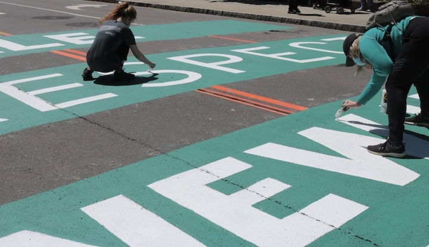
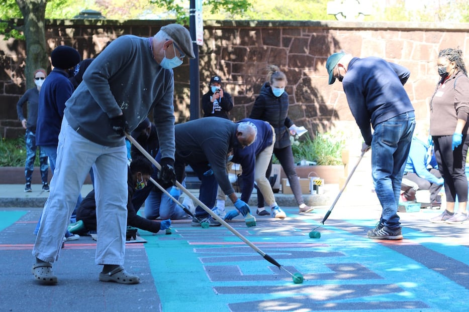
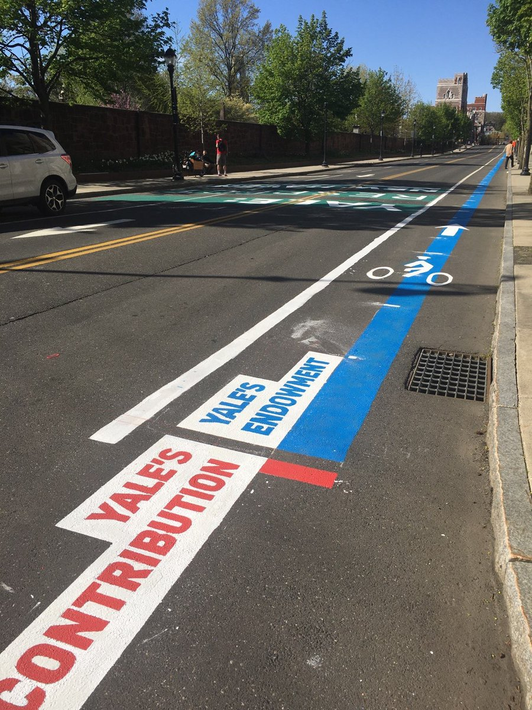
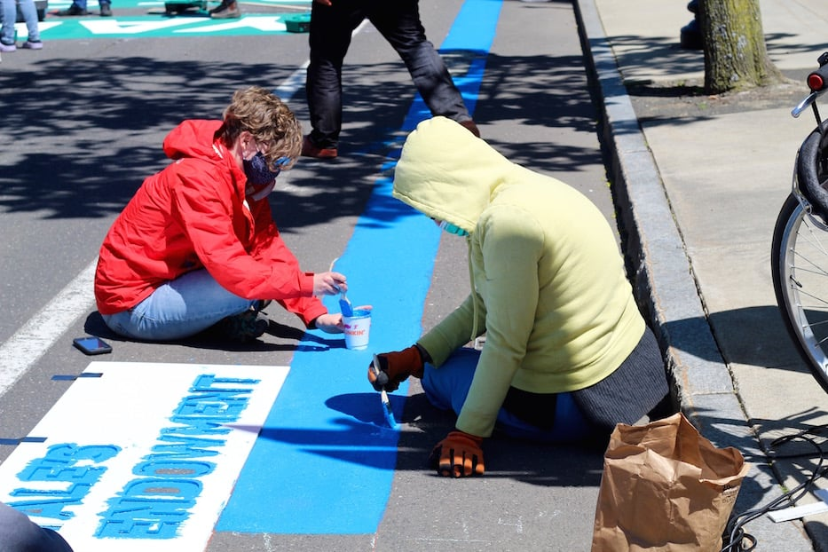

+++
author = "矢崎裕一"
title = "204mの青い帯と8cmの赤い長方形──プロスペクト通りの Walkable Bar Chart"
slug = "walkable-bar-chart"
date = "2026-11-01"
description = "約204mの青い帯と約8cmの赤い長方形は、報道の寸法から計算すると同じ縮尺の2本の棒で、差は約2,400倍です。一か所からは全体を見渡せない長さです。"
categories = [
    "consume"
]
tags = [
    "データ物質化",
    "棒グラフ"
]
image = "images/red-and-blue-bars-start.jpg"
series = ["data-physicalization"]
series_weight = 45
seriesByline = "Respect New Haven"
seriesTitle = "204mの帯と8cmの赤──Walkable Bar Chart"
+++

2021年5月1日、米コネチカット州ニューヘイブンのプロスペクト通りに、2本の棒が描かれました。イェール大学の基金312億ドルを表す長さ670フィート（約204m）の青い帯と、市への年1,300万ドルの任意拠出金を表す3と1/4インチ（約8cm）の赤い長方形です。報道された寸法から計算すると、2本は同じ縮尺で描かれていて、差は約2,400倍になります。この作品は、その差を紙の上で見て比べるものから、通りを歩いて確かめる距離に変えた、と読めます。

出典は、地元報道2本（New Haven Independent は当日、Arts Paper は2日後）と、データ物理化の目録の1項目です。New Haven Independent（NHI）のソフィー・ソネンフェルド（Sophie Sonnenfeld）の記事（2021年5月1日）と、New Haven Arts Paper のルーシー・ゲルマン（Lucy Gellman）の記事（同5月3日）。目録は、研究者ピエール・ドラギチェヴィック（Pierre Dragicevic）とイヴォンヌ・ヤンセン（Yvonne Jansen）の「List of Physical Visualizations」で、「Walkable Bar Chart」の名はここで付きました。寸法を書いているのは Arts Paper だけで、倍率は筆者の計算です。参加者が実際に帯に沿って歩いて比べた、という報道はありません。

<!--more-->

## 2021年5月1日、総長室の前の通りで

その日は土曜日でした。プロスペクト通りの、イェール大学のピーター・サロヴェイ（Peter Salovey）総長の執務室の前に、組合員や学生、大学職員、住民など、およそ150人が集まりました。主催は New Haven Rising という団体と、イェールの事務・技術職員の労働組合 Unite Here Local 34 でした。

通りに描いた言葉は「YALE: RESPECT NEW HAVEN」です。Arts Paper によれば、参加者は青とティールの塗料を刷毛とローラーで塗り、音楽の流れるなか子どもも加わりました。

Sophie Sonnenfeld／New Haven Independent より引用

要求は3つでした。市への任意拠出金を増やすこと、地元の住民を雇うこと、Local 34 と公正な労働協約を結ぶことです（NHI）。この日は、5月5日の集会の前段として位置づけられていました。16歳で Ice The Beef Latino Caucus 代表のマヌエル・カマチョ（Manuel Camacho）らは、この日、総長宛ての請願を届けています。

Arts Paper は、背景の数字も書いています。市内の非課税不動産の40%以上を、イェール大学とイェール・ニューヘイブン・ヘルスが所有している。Local 34 の見積もりでは、その税の減免は年1億5,700万ドルを超える。市は6,600万ドルの赤字を見込み、イェールは2億300万ドルの黒字を報告していた。

Lucy Gellman／New Haven Arts Paper より引用

## 青い帯と赤い長方形を、同じ物差しで測る

寸法と金額の対応を書いた報道は、Arts Paper だけです。

> "Along one side of Prospect Street, a three and one-quarter inch red rectangle depicted Yale's current $13 million voluntary contribution to the city. Beside it, a 670-foot contiguous blue stripe represented the university's $31.2 billion endowment. By 10 a.m., it stretched all the way to Trumbull Street like a long, lolling blue tongue."

要旨：通りの片側に、市への年1,300万ドルの任意拠出金を表す3と1/4インチの赤い長方形が描かれた。その横に、312億ドルの基金を表す670フィートの途切れない青い帯が描かれ、午前10時にはトランブル通りまで延びていた。

データと見た目の対応を、表にまとめます。

| データ | 値 | 見た目・素材 | 寸法 |
|---|---|---|---|
| イェール大学の基金（ある時点の残高） | 312億ドル（Arts Paper、大学の公式値） | 路面に塗った青い帯の長さ | 670フィート（約204m） |
| イェールから市への任意拠出金（年額） | 1,300万ドル | 路面に塗った赤い長方形の長さ | 3と1/4インチ（約8cm） |
| 2つの量の区別 | — | 色（青と赤）と白地のラベル | — |
| 共通の基準 | — | 通りの片側に、2本を並べて置く | — |

基金の額は、報道によって少しずつ違います。Arts Paper は312億ドル、NHI は300億ドル、後で触れるツイートは320億ドルです。大学の発表では、2020年6月30日時点の基金は312億ドルでした。

ここから先は筆者の計算です。312億ドルを670フィートで割ると、1フィートあたり約4,660万ドルになります。この縮尺で1,300万ドルを描くと、約3.35インチ。報道の3.25インチとの差は約3%です。基金を300億ドルとしても約3.48インチ、320億ドルでも約3.27インチで、どの値でも3〜3.5インチに収まります。**2本は同じ縮尺で描かれている**と見てよいでしょう。

金額の比は、312億ドル÷1,300万ドルで約2,400倍です。長さの比は、670フィート（8,040インチ）÷3.25インチで約2,470倍。2つの比はほぼ一致します。

Davarian L. Baldwin のツイートの写真（撮影者不明）／List of Physical Visualizations（dataphys.org）より引用

写真では、2本の起点に「YALE'S CONTRIBUTION」「YALE'S ENDOWMENT」のラベルが並び、青い帯だけが通りの奥へ続いています。

## 204mは、一か所からは見渡せない

縮尺を守った棒グラフでは、小さいほうの量が見えにくくなります。筆者の計算で、同じ比率をA4用紙に描いてみます。青い棒を用紙の長辺いっぱいの29.7cmにすると、赤い棒は約0.12mmで、肉眼ではほとんど見分けられません。NHI は、通りの上の赤を「a tiny red stripe」と書いています。

通りでは、この関係が反対の向きに働きます。赤い長方形は約8cmで、足元に立てば見える大きさです。そのかわり、青い帯が約204mになります。

約204mは、一か所に立って両端を見比べられる長さではありません。分速80mで歩くとして、端から端まで約2分半かかります（筆者の計算）。dataphys.org が付けた名前は「Walkable Bar Chart」でした。ただし、目録の説明文は次の一文だけです。

> "A bar chart conveying two quantities, one of which is clearly larger."

要旨：2つの量を伝える棒グラフで、一方がはっきり大きい。

名前の「Walkable」は、この長さを指していると読めます。紙の上なら、2本の差は目の動き一つで比べられます。通りの上では、赤い長方形の横から青い帯の先端まで、体を運ばないと差が確かめられません。**見て比べる差が、歩いて確かめる距離に置き換わっている**と読めます。

ここは慎重に書き分けておきます。参加者が帯に沿って歩き、両端を比べた、という報道はありません。報道にあるのは、塗る作業そのものが通りに沿って進んだことです。アニタ・ダン（Anita Dunn）とクリ・バロ（Kuli Baro）は、帯のうち工学系の建物の横の区間を塗っていました。New Haven Rising 代表のスコット・マークス（Scott Marks）は、撮影クルーに向かって通り全体を指さして説明しています。

Lucy Gellman／New Haven Arts Paper より引用

Arts Paper のキャプションによれば、写っているのは帯の起点です。ここから先が204m続きます。

もう一つ、比べている量の種類にも注意が要ります。基金はある時点の残高で、拠出金は年ごとの支払いです。主催者が問題にしたのは税の減免でした。基金は、大学に支払う力があることを示す目安として置かれている、と読めます。この点は、差の大きさとは別に押さえておくべきです。

## 置き場所が、グラフの宛先になる

このグラフは、総長室の前の公道に描かれました。NHI も、写真に総長室の前のペイントだと説明を付けています。グラフの最初の読み手として、総長が想定されていたと読めます。

カマチョは、ペイントの役割をはっきり語っています。

> "This petition represents a deep consensus from New Haven. If leaders at Yale do not get the message from this petition, they will now have this street painting to remind them that our community demands respect."

要旨：請願は町の総意を表している。イェールの指導者が請願から伝言を受け取らないなら、今後はこのストリートペインティングが、町が敬意を求めていることを思い出させる。

マークスは青い帯について、こう言いました。

> "I would want him to look at this line and feel shame,"

要旨：彼（総長）にこの線を見て、恥じてほしい。

集会の主な講演者は、トリニティ・カレッジのダヴァリアン・ボールドウィン（Davarian Baldwin）教授でした。翌日、ボールドウィンは写真付きでこうツイートしています（dataphys.org の引用による）。

> "The activists and artists at the Respect New Haven rally yesterday offered this stunning graphic to visualize Yale's $32 Billion endowment compared to its paltry $13 million contribution to the city of New Haven...a FRACTION of the taxes it would pay if properly assessed."

要旨：昨日の集会で、活動家とアーティストが見事なグラフを描いた。320億ドルの基金と、市へのわずか1,300万ドルの拠出金を比べている。拠出金は、適正に課税された場合の税のごく一部にすぎない。

通りにいない人にとって、グラフは写真で届きます。写真では、帯の手前の部分だけが見え、全体は一枚に収まりません。

大学の側は、NHI に広報担当カレン・ピアート（Karen Peart）の声明を寄せています。内容は、2004年からの組合との協力関係と、コロナ禍での雇用対策の説明でした。結びは、2022年の協約更新に向けて「creative solutions」を探る、という一文です。

声明は、ペイントにも、基金と拠出金の比較にも触れていません。大学は棒グラフの比較に数字で反論せず、話題を労使関係のほうに移して応じた、と読めます。

半年後の2021年11月17日、イェールと市は任意拠出金の増額で合意しました。年1,300万ドルに、5年間は毎年1,000万ドル、6年目に200万ドルを上乗せします。6年間の総額は約1億3,540万ドルです（Yale News）。ただ、このペイントが合意を導いたと示す資料は見つかりませんでした。言えるのは、時間の前後関係だけです。

## 第三者はこのペイントをどう見たか

研究者、アート報道、政治報道の読者は、それぞれ違うところを見ています。

研究者による分類から見ます。ドラギチェヴィックとヤンセンの目録に、2021年5月3日に登録されました。ツイートの翌日です。ベンジャミン・バック（Benjamin Bach）の推薦で、カテゴリは「Passive physical visualization」です。

walkable タグには、ほかに「Walkable Age Pyramid」（2013）、「Walkable Collaboration Network」（2016）、「Planetenweg Uetliberg: The Solar System as a Hiking Path」（1979）などが並びます。抗議のスローガンとしてではなく、**太陽系を山道にした作品と同じ「歩いて読む」表現の仲間**として分類した、と読めます。

次に、地元のアート報道です。Arts Paper のゲルマンは、これを壁画として扱いました。見出しは「Mural With A Message Lands On Prospect Street」です。記事の大半は、姪と踊りながら塗る職員や、祖父と父と一緒に塗る子どもの話です。グラフが共同で作られたことに重心があります。

最後に、地元の政治報道とその読者です。NHI の記事は、労使交渉と市の財政の流れのなかでこの日を報じ、大学の声明も載せました。コメント欄では、公道を政治的主張に使ったことへの批判が目立ちます。市がこれを許したことに腹が立つ、という書き込み（EngagedCitizen、2021-05-02）もあります。

> "Is New Haven going to let every group graffiti the streets with their own political messaging?"（baker、2021-05-02）

要旨：市は、どの団体にも路面へ政治的な落書きをさせるのか。

一方で、イェールの税の優遇を批判し、ペイントを支持する書き込みもあります。どちらも読者の意見で、市の公式見解ではありません。市が許可したことを示す公式の記録も、筆者は確認できていません。

## 使い道

このグラフから、可視化の仕事に持ち帰れることは4つあります。

- 縮尺を守るか、見やすさを取るか。2,400倍の差を紙に描くと、小さいほうは0.12mmになります。対数軸や拡大図で補うと、差の大きさは伝わりにくくなります。このグラフは、小さいほうが見える大きさ（約8cm）を先に決め、大きいほうを視野の外まで延ばした、と読めます。縮尺を曲げずに、両方を見える形にする、**一つの解き方**です。
- 起点をそろえ、ラベルを置く。長い棒が視野からはみ出すとき、比べる手がかりは共通の起点です。写真のとおり、2本の起点にはラベルが並んでいました。
- 比べる量の種類を書いておく。残高と年額のように種類の違う量を並べると、差の大きさだけが独り歩きします。キャプションや説明に、何と何を比べたかを残しておくべきです。
- 置き場所を、宛先として選ぶ。総長室の前に描いたことで、グラフの最初の読み手が決まりました。どこに置くかは、誰に読ませるかの選択です。

記録の仕方にも注意が要ります。写真には帯の手前しか写らず、全体は一枚に収まりません。この作品の縮尺を後から検算できるのは、Arts Paper が寸法と金額を文章で書き残したからです。

## 参考・出典

**一次情報**

- Sophie Sonnenfeld, "Labor Paints Prospect Street With "Respect" Message," *New Haven Independent*, 2021-05-01（本文、イェール広報の声明、写真）. https://www.newhavenindependent.org/2021/05/01/yale_respect_new_haven_paints_/
- Lucy Gellman, "Mural With A Message Lands On Prospect Street," *New Haven Arts Paper*, 2021-05-03（寸法と金額の対応、写真）. https://www.newhavenarts.org/arts-paper/articles/mural-with-a-message-lands-on-prospect-street
- Davarian L. Baldwin のツイート（集会の翌日。文面は dataphys.org の引用による）. https://twitter.com/DavarianBaldwin/status/1388840756895526912
- Yale News, "Investment return of 6.8% brings Yale endowment value to $31.2 billion," 2020-09-24. https://news.yale.edu/2020/09/24/investment-return-68-brings-yale-endowment-value-312-billion
- Yale News, "With new $140+ million Yale pledge, Yale, New Haven promote growth, economy," 2021-11-17. https://news.yale.edu/2021/11/17/new-140-million-yale-pledge-yale-new-haven-promote-growth-economy

**第三者評価**

- Pierre Dragicevic & Yvonne Jansen, "2021 – Walkable Bar Chart," *List of Physical Visualizations*（dataphys.org）, 2021-05-03（写真、説明文、分類）. https://dataphys.org/list/walkable-bar-chart/
- 同目録の walkable タグ. https://dataphys.org/list/tags/walkable/
- *New Haven Independent* 同記事のコメント欄（EngagedCitizen、baker ほか、2021-05-02）. https://www.newhavenindependent.org/2021/05/01/yale_respect_new_haven_paints_/
