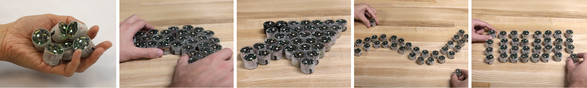
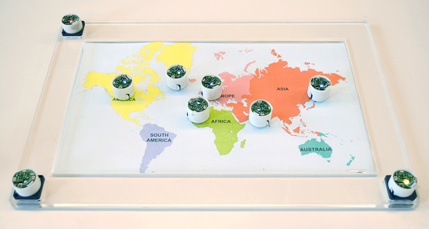

+++
author = "Yuichi Yazaki"
title = "One Data Point, One Robot: Zooids"
slug = "zooids-swarm-physicalization"
date = "2026-11-05"
description = "Zooids assigns each data point to one tiny robot and builds scatterplots and maps from the robots' positions. The axes are made of robots too, and you can pick up and move any point by hand."
categories = [
    "consume"
]
tags = [
    "data physicalization",
    "scatter plot",
    "map"
]
image = "images/collaborative-exploration.png"
series = ["data-physicalization"]
series_weight = 35
seriesByline = "Mathieu Le Goc et al."
seriesTitle = "One Point, One Robot, Picked Up by Hand: Zooids"
+++

Zooids assigns each data point to one tiny robot and builds scatterplots and maps from the robots' positions. The axes are made of robots too, and you can pick up and move any point by hand. Each robot is 26 mm in diameter, 21 mm tall and weighs about 12 g, and runs on two wheels across a flat table.

It was developed by the Shape Lab at Stanford University (Sean Follmer) and the Aviz team at Inria (Jean-Daniel Fekete, Pierre Dragicevic). The foundational paper was presented at UIST in 2016, and a second paper, presented at IEEE VIS in 2018 and published in the January 2019 issue of IEEE TVCG, summarizes the application to data visualization. The author lists of the two papers differ slightly. What follows draws on the full text of the UIST 2016 paper, the abstract of the TVCG paper and the Shape Lab page, and the source code the authors published on GitHub. I have not been able to read the full text of the TVCG paper, so details of the 2018 encodings are written as things read off the source code.

<!--more-->

## 2016: A swarm of robots that fit in the palm of your hand

The first paper is "Zooids: Building Blocks for Swarm User Interfaces." It was presented at UIST '16 in Tokyo in October 2016 (pp. 97–109). The name comes from the biological term zooid: each of the individual animals that make up a colony.

As starting points, the authors cite Ivan Sutherland's "Ultimate Display" and Hiroshi Ishii's "Radical Atoms." The former is the idea of a room in which a computer controls the existence of matter.

> Swarm user interfaces can be seen as a coarse-grained version of Sutherland's and Ishii's futuristic visions of user interfaces based on programmable matter.

That is, interfaces built from a swarm of robots (swarm UIs) are positioned as a coarse-grained version of the vision of programmable matter. The authors also write about how this differs from earlier tangible UIs.

> We are interested in user interfaces where the tangibles are used not only as controllers, but also as representations of digital content.

The point is that graspable objects should serve not only as tools for input but also as representations of digital content.

From Mathieu Le Goc et al. (Shape Lab, Stanford / Inria Aviz), GitHub "ShapeLab/SwarmUI" (CC BY-SA 4.0)

Each robot finds its position by reading a Gray-code pattern projected from above with photodiodes on its upper side. The resolution is about 1.1 mm. Electrodes wrapped around the body sense touch, and a color LED sits on top. Parts and assembly cost about $50 per robot, and the paper says that a swarm beyond 30 to 40 robots would be too expensive outside of research.

## One robot per point, in line charts and scatterplots alike

The UIST 2016 paper presents several example applications. Two of them are visualizations.

One is a line chart of time-series data. It shows a computer's CPU usage as the heights of a row of robots along the top. Each time new data arrives, the line appears to flow to the left. The axes and labels do not move, so they are printed on paper. Two robots at the bottom are the two handles of a range slider and change the time range displayed. One more robot switches between CPU and memory.

The other is an example with several scatterplots side by side. Each scatterplot is assigned a different pair of variables. If you pick up one robot by hand and place it in another scatterplot, you can see that point along different dimensions.

> As each zooid embodies a specific data point, moving it into a different chart allows users to probe different dimensions.

Because each robot embodies one data point, moving it to another chart lets you examine a different dimension. Placing a robot on a tablet or similar device brings up detailed information about that point. Robots for display and robots for control are told apart by the color of their LEDs. The authors themselves write that this color assignment is arbitrary and presumes a user who is used to the system.

The paper's "design principles" section starts from the difference from screen pixels. Pixels are fixed to a grid, and only their color can change. Zooids' elements can be placed anywhere, but there are few of them. The authors write that, just as designers in the 1980s thought about how to use each pixel, we should think about how to use each robot.

> in systems where each zooid has a stable meaning (e.g., a visualization system where a zooid represent a data point), swapping zooids can produce confusing or misleading animations.

In a system where one robot stands for a data point, swapping robots can produce confusing or misleading movement. From this the authors conclude that the designer should think about which elements can be made interchangeable and which should be given a fixed identity. This can be read as saying that **the promise of one robot per point also determines how the movement is read**.

The authors also list limitations: the robots can move only on a flat surface, they lose their position when a hand blocks the light, and charging has to be done by hand, one robot at a time. The section on future work contains a sentence calling information visualization "an exciting area."

## 2018: The axes are made of robots too

The paper two years later is "Dynamic Composite Data Physicalization Using Wheeled Micro-Robots." It was presented at IEEE VIS 2018 and published in IEEE TVCG vol. 25, no. 1 (January 2019, pp. 737–747). The authors changed as follows.

| Paper | Authors |
|---|---|
| UIST 2016 "Zooids: Building Blocks for Swarm User Interfaces" | Mathieu Le Goc, Lawrence H. Kim, Ali Parsaei, Jean-Daniel Fekete, Pierre Dragicevic, Sean Follmer |
| IEEE TVCG 2019 "Dynamic Composite Data Physicalization Using Wheeled Micro-Robots" | Mathieu Le Goc, Charles Perin, Sean Follmer, Jean-Daniel Fekete, Pierre Dragicevic |

Charles Perin appears only on the TVCG paper. His affiliations are the University of Victoria and City, University of London. The abstract reads as follows.

> This paper introduces dynamic composite physicalizations, a new class of physical visualizations that use collections of self-propelled objects to represent data.

It proposes a new class of physical visualization that represents data with a collection of objects that move on their own. The Shape Lab page presents two scenarios. In one, four faculty members choose participants for a summer school. "Each Zooid embodies an applicant." One robot is one applicant.

From Le Goc, Perin, Follmer, Fekete, Dragicevic / Shape Lab, "Dynamic composite data physicalization using wheeled micro-robots"

The description of the other scenario is about a scatterplot turning into a map.

> By placing Lattitude and Longitude magnets in the sandbox, the scatterplot become a map, showing the city of origin of applicants.

Placing latitude and longitude "magnets" in the sandbox (the frame of the scatterplot) turns the scatterplot into a map that shows the applicants' cities of origin.

From Le Goc, Perin, Follmer, Fekete, Dragicevic / Shape Lab, "Dynamic composite data physicalization using wheeled micro-robots"

From here on, what I describe is read not from the paper's text but from the source code of ShapeLab/ZooidsCompositePhysicalizations on GitHub (the files under `Zooid_Vis/src`). The dataset is a fictional "Genius University dataset" of 306 rows, and it displays up to 24 applicants who meet the grade conditions. In the code, applicant robots are called Dust and robots that represent variables are called Magnet.

| Data | Physical property | Where I checked |
|---|---|---|
| One applicant | One robot | Shape Lab page, code |
| A variable (grades in English, science and math, recommendation rating, age, etc.) | Another robot serves as a magnet. The magnet pulls applicant robots toward it according to their values | Code |
| Strength of the magnet | The angle to which the magnet robot is turned by hand (180° maps to 0–20) | Code |
| Strength of the magnet (visual) | Brightness of the magnet's LED | Code |
| Type of variable | Hue of the LED (English = red, science = blue, math = green, etc.) | Code |
| Value of that variable when touching the magnet | Intensity of the applicant robot's LED | Code |
| Axes of the scatterplot | Three robots are placed at a right angle. If the two end robots are magnets, their variables become the x and y axes | Code |
| Latitude and longitude of the city of origin | The x and y positions in the scatterplot (fixed ranges: longitude −180 to 180, latitude −90 to 90) | Shape Lab page, code |
| Details of an applicant | Shown on the tablet screen when a robot is touched | Code |
| Removing / excluding | Placed on the strip at the edge of the table, a magnet disappears and applicants are no longer moved | Code |

The terms and numbers used in the paper's text may differ from those in the code. The other scenario, a family looking for a holiday destination, has only empty dummy data in the public code, so I could not check its contents.

In its related-work section, the UIST 2016 paper cited Dust & Magnet (Yi et al., 2005) and Microsoft SandDance as visualizations that swarm robots could physicalize. The 2018 code is built around the names Dust and Magnet. This can be read as the TVCG paper actually physicalizing a technique that the UIST paper cited. However, I have not confirmed whether the TVCG text explains it that way.

The work appears in the book *Making with Data: Physical Design and Craft in a Data-Driven World* (edited by Samuel Huron, Till Nagel, Lora Oehlberg and Wesley Willett, A K Peters/CRC Press, 2022), in Part 4, "Actuation," as chapter 4.5, "Zooids" (pp. 299–309, doi:10.1201/9781003264903-20). The authors are the same five as on the TVCG paper. I have not been able to read the text of the chapter, so I do not cover its contents here.

## How outsiders saw it

From the visualization research side, Djavaherpour et al. discuss it in their survey paper at EuroVis 2021, "Data to Physicalization." Comparing it with devices that build static physicalizations with robot arms, they write about Zooids as follows.

> zooids is a truly active physicalization system capable of showing many different data sets and types

This is an assessment that it is a truly active physicalization that can show many kinds of data and that people can pick up and move. The same paper also names a problem of scale as a weakness of active physicalizations: they usually need one actuator per data point.

From the HCI side, ShapeBots by Suzuki et al. (UIST 2019) is a follow-up. It points out that a swarm UI can change shape only by rearranging units of roughly the same form. It then argues that if each unit could change its own shape, it could do the following.

> support representations that are not limited to moving points, but also lines, and other shapes on a 2D surface

The claim is that it can represent not only moving points but also lines and other shapes. This can be read as an assessment that, from the other direction, points out a limit of Zooids: its representation is confined to the positions of points and the colors of LEDs.

General-audience coverage looked elsewhere. Silicon Republic (November 2016) introduced it as "dozens of miniature, robotic helpers," and Hackaday (February 2017) picked up the scene in which the swarm brings you a smartphone. The data visualization side, it seems, barely came across in the coverage.

## How to use this

The first is that if you assign one object to each point, you should keep its identity. As the UIST paper writes, if the robot representing a data point gets swapped midway, the movement misleads. For animations on screen too, it turns out that whether to keep track of which point is the same one is a design decision.

The second is how to narrow down when the number of elements is limited. The paper gives 30 to 40 robots as a rough upper limit, and the 2018 code narrows applicants by conditions to at most 24. With physicalization, you need to decide how many items to show before you display anything.

The third is to make axes and legends objects that can be manipulated, too. In UIST 2016 the axes were printed on paper, but in the 2018 code the axes are robots as well, and how they are placed determines the variables. Switching variables becomes a hand motion of placing, turning and removing robots.

The fourth is to know the range of what can be expressed. The expressions in Zooids can be read as centered on the position and color of points. ShapeBots argues that to express lines and shapes, the elements themselves have to change. Before choosing a chart, you can check what the material is able to express.

## References

**Primary sources**

- Mathieu Le Goc, Lawrence H. Kim, Ali Parsaei, Jean-Daniel Fekete, Pierre Dragicevic, Sean Follmer, "Zooids: Building Blocks for Swarm User Interfaces," *UIST '16*, pp. 97–109, 2016. https://doi.org/10.1145/2984511.2984547 / PDF: https://shape.stanford.edu/research/swarm/SwarmUIs_no_copyright.pdf / HAL: https://inria.hal.science/hal-01391281
- Shape Lab, "Zooids: Building Block for Swarm User Interface": https://shape.stanford.edu/research/swarm/
- Mathieu Le Goc, Charles Perin, Sean Follmer, Jean-Daniel Fekete, Pierre Dragicevic, "Dynamic Composite Data Physicalization Using Wheeled Micro-Robots," *IEEE TVCG* 25(1), pp. 737–747, 2019. https://doi.org/10.1109/TVCG.2018.2865159 / Abstract (PubMed): https://pubmed.ncbi.nlm.nih.gov/30136993 / HAL (full text not checked): https://inria.hal.science/hal-01848436
- Shape Lab, "Dynamic composite data physicalization using wheeled micro-robots": https://shape.stanford.edu/research/dynamicCompositePhysicalizations/
- GitHub, ShapeLab/SwarmUI (CC BY-SA 4.0): https://github.com/ShapeLab/SwarmUI
- GitHub, ShapeLab/ZooidsCompositePhysicalizations (MIT License. Files consulted: `Zooid_Vis/src/ofApp.cpp`, `Sandbox.cpp`, `Magnet.cpp`, `parameters.h`, `Zooid_Vis/bin/data/student-dataset.csv`, `zooids-students-app/js/constants.js`): https://github.com/ShapeLab/ZooidsCompositePhysicalizations
- Le Goc, Perin, Follmer, Fekete, Dragicevic, "Zooids," in Huron, Nagel, Oehlberg, Willett (eds.), *Making with Data*, A K Peters/CRC Press, 2022, ch. 4.5, pp. 299–309. https://doi.org/10.1201/9781003264903-20 / HAL (abstract only checked): https://api.archives-ouvertes.fr/search/?q=halId_s:hal-03978632&fl=* / Book page: https://www.routledge.com/Making-with-Data-Physical-Design-and-Craft-in-a-Data-Driven-World/Huron-Nagel-Oehlberg-Willett/p/book/9781032182223
- Mathieu Le Goc, "Supporting Versatility in Tangible User Interfaces Using Collections of Small Actuated Objects," PhD thesis, Université Paris-Saclay, 2016 (bibliographic record only): https://theses.fr/2016SACLS563
- Videos (YouTube, posted by Mathieu Le Goc): UIST version https://www.youtube.com/watch?v=ZVdAfDMP3m0 / TVCG version https://www.youtube.com/watch?v=2GmWR617YeI

**Secondary sources**

- H. Djavaherpour, F. Samavati, A. Mahdavi-Amiri, F. Yazdanbakhsh, S. Huron, R. Levy, Y. Jansen, L. Oehlberg, "Data to Physicalization: A Survey of the Physical Rendering Process," *Computer Graphics Forum* 40(3) (EuroVis 2021 STAR): https://arxiv.org/pdf/2102.11175
- Ryo Suzuki et al., "ShapeBots: Shape-changing Swarm Robots," *UIST '19*: https://arxiv.org/pdf/1909.03372
- Gordon Hunt, "Swarms of tiny robots could soon be at our beck and call," *Silicon Republic*, 2016-11-29: https://www.siliconrepublic.com/machines/swarm-robots-zooids-robotics
- Pedro Umbelino, "Zooids — Swarm User Interface," *Hackaday*, 2017-02-17: https://hackaday.com/2017/02/17/zooids-swarm-user-interface/
