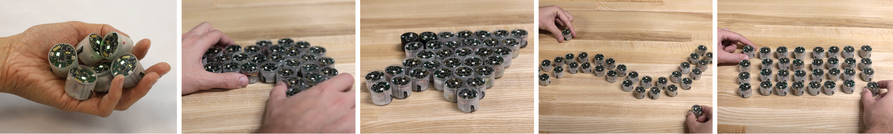
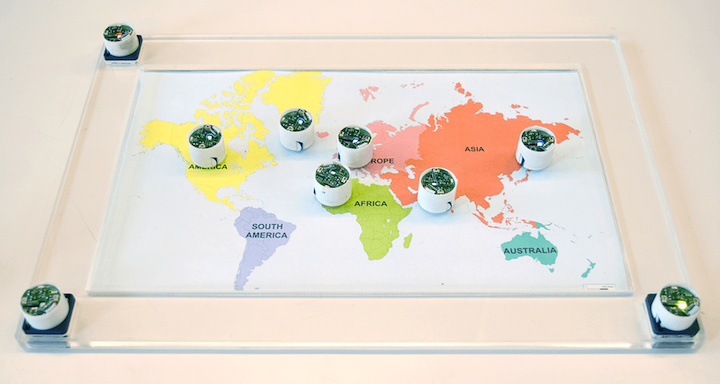

+++
author = "矢崎裕一"
title = "データ点1件を、ロボット1台にする──Zooids"
slug = "zooids-swarm-physicalization"
date = "2026-11-05"
description = "Zooids は、データ点1件を小さなロボット1台に割り当て、ロボットの位置で散布図や地図をつくります。軸もロボットでつくり、点は手でつまんで動かせます。"
categories = [
    "consume"
]
tags = [
    "データ物質化",
    "散布図",
    "地図"
]
image = "images/collaborative-exploration.png"
series = ["data-physicalization"]
series_weight = 32
seriesByline = "Mathieu Le Goc ほか"
seriesTitle = "1点を1台にして、手でつまむ──Zooids"
+++

Zooids（ズーイド）は、データ点1件を小さなロボット1台に割り当て、ロボットの位置で散布図や地図をつくります。軸もロボットでつくり、点は手でつまんで動かせます。ロボットは直径26 mm、高さ21 mm、重さ約12 g で、平らな台の上を2つの車輪で走ります。

開発したのは、Stanford 大学の Shape Lab（Sean Follmer）と、Inria の Aviz チーム（Jean-Daniel Fekete、Pierre Dragicevic）です。2016年に UIST で基盤の論文を発表し、2018年の IEEE VIS で発表し、IEEE TVCG の2019年1月号に載った論文で、データ可視化への応用をまとめました。2本の論文は、著者の顔ぶれが少し違います。以下は、UIST 2016 の論文本文、TVCG 論文の要旨と Shape Lab のページ、著者が GitHub に公開したソースコードに沿います。TVCG 論文の本文は読めていないため、2018年版のエンコーディングの細部は、ソースコードから読み取ったものとして書きます。

<!--more-->

## 2016年、手のひらに載るロボットの群れ

最初の論文は "Zooids: Building Blocks for Swarm User Interfaces" です。2016年10月に東京で開かれた UIST '16 で発表されました（pp. 97–109）。名前は生物学の zooid（個虫）から取っています。群体をつくる、一つひとつの動物のことです。

作者は出発点として、Ivan Sutherland（アイヴァン・サザランド）の「Ultimate Display」と、石井裕の「Radical Atoms」を挙げています。前者は、コンピュータが物質の存在を制御できる部屋という構想です。

> Swarm user interfaces can be seen as a coarse-grained version of Sutherland's and Ishii's futuristic visions of user interfaces based on programmable matter.

群ロボットによるインターフェース（swarm UI）は、プログラムできる物質という未来像の、粒の粗い版だ、という位置づけです。作者は、これまでのタンジブル UI との違いも書いています。

> We are interested in user interfaces where the tangibles are used not only as controllers, but also as representations of digital content.

手に取れる物を、操作の道具としてだけでなく、デジタルな内容を表すものとしても使いたい、という一文です。

Mathieu Le Goc ほか（Shape Lab, Stanford・Inria Aviz）／GitHub「ShapeLab/SwarmUI」より引用（CC BY-SA 4.0）

位置は、上から投影したグレイコードの模様を、ロボット上部のフォトダイオードが読んで知ります。分解能は約 1.1 mm です。周りにはタッチを感じる電極を巻き、頂部にはカラー LED があります。部品と組立の費用は1台あたり約50ドルで、論文は30〜40台を超える群れは研究以外では費用的に厳しい、と書いています。

## 折れ線の点も、散布図の点も、1台ずつ

UIST 2016 の論文は、いくつかの応用例を示しています。可視化の例は2つです。

一つは、時系列データの折れ線グラフです。コンピュータの CPU 使用率を、上側に並んだロボットの高さで表します。新しいデータが入るたびに、折れ線が左へ流れて見えます。軸やラベルは動かないので、紙に印刷してあります。下側の2台は範囲スライダーの2つのつまみで、表示する時間範囲を変えます。もう1台で、CPU とメモリを切り替えます。

もう一つは、複数の散布図を並べる例です。散布図ごとに違う2変数を割り当てます。ロボット1台を手でつまみ上げて別の散布図へ置くと、その点を別の次元で見られます。

> As each zooid embodies a specific data point, moving it into a different chart allows users to probe different dimensions.

1台が1つのデータ点を体現しているので、別のグラフへ移すと別の次元を調べられる、という説明です。タブレットなどの上に置くと、その点の詳しい情報が出ます。表示用のロボットと操作用のロボットは、LED の色で見分けます。作者自身は、この色の割り当ては恣意的で、使い慣れた人を前提にしていると書いています。

論文の「デザイン原則」の節は、画面のピクセルとの違いから始まります。ピクセルは格子に固定され、変えられるのは色だけです。Zooids の要素はどこにでも置けますが、数が少ない。作者は、80年代のデザイナーが1ピクセルずつ使い道を考えたように、1台ずつの使い方を考えるべきだと書いています。

> in systems where each zooid has a stable meaning (e.g., a visualization system where a zooid represent a data point), swapping zooids can produce confusing or misleading animations.

1台がデータ点を表すような仕組みでは、ロボットを入れ替えると、混乱や誤解を招く動きになりうる、という指摘です。作者はここから、どの要素を入れ替え可能にし、どの要素に固定の身元を与えるかを、設計者が考えるべきだとしています。**1点を1台に割り当てるという約束が、動きの読み方まで決める**と読めます。

作者は限界も挙げています。平らな面の上しか動けないこと、手で光が遮られると位置を失うこと、充電を1台ずつ手で行うことなどです。今後の課題の節には、情報可視化は "an exciting area" だという一文があります。

## 2018年、軸もロボットでつくる

2年後の論文が "Dynamic Composite Data Physicalization Using Wheeled Micro-Robots" です。IEEE VIS 2018 で発表され、IEEE TVCG 25巻1号（2019年1月、pp. 737–747）に載りました。著者は次のように入れ替わっています。

| 論文 | 著者 |
|---|---|
| UIST 2016 "Zooids: Building Blocks for Swarm User Interfaces" | Mathieu Le Goc、Lawrence H. Kim、Ali Parsaei、Jean-Daniel Fekete、Pierre Dragicevic、Sean Follmer |
| IEEE TVCG 2019 "Dynamic Composite Data Physicalization Using Wheeled Micro-Robots" | Mathieu Le Goc、Charles Perin、Sean Follmer、Jean-Daniel Fekete、Pierre Dragicevic |

Charles Perin（シャルル・ペラン）は、TVCG 側にだけ入っています。所属は University of Victoria と City, University of London です。要旨は次のとおりです。

> This paper introduces dynamic composite physicalizations, a new class of physical visualizations that use collections of self-propelled objects to represent data.

自分で動く物の集まりでデータを表す、新しい種類の物理的な可視化を提案する、という一文です。Shape Lab のページは、2つのシナリオを示しています。一つは、4人の教員がサマースクールの受講生を選ぶ場面です。"Each Zooid embodies an applicant." とあり、ロボット1台が応募者1人です。

Le Goc, Perin, Follmer, Fekete, Dragicevic／Shape Lab「Dynamic composite data physicalization using wheeled micro-robots」より引用

もう一つの場面の説明は、散布図が地図に変わるところです。

> By placing Lattitude and Longitude magnets in the sandbox, the scatterplot become a map, showing the city of origin of applicants.

sandbox（散布図の枠）に緯度と経度の「磁石」を置くと、散布図が地図になり、応募者の出身都市が分かる、という説明です。

Le Goc, Perin, Follmer, Fekete, Dragicevic／Shape Lab「Dynamic composite data physicalization using wheeled micro-robots」より引用

ここから先は、論文本文ではなく、GitHub の ShapeLab/ZooidsCompositePhysicalizations のソースコード（`Zooid_Vis/src` の各ファイル）から読み取ったことです。データセットは架空の「Genius University dataset」で306行あり、成績の条件を満たす応募者を最大24人まで表示します。コードの中で、応募者のロボットは Dust（塵）、変数を表すロボットは Magnet（磁石）と呼ばれています。

| データ | 物理的な性質 | 確かめた先 |
|---|---|---|
| 応募者1人 | ロボット1台 | Shape Lab のページ、コード |
| 変数（英語・理科・数学の成績、推薦状の評価、年齢など） | 別のロボット1台を磁石にする。磁石は、値に応じて応募者のロボットを引き寄せる | コード |
| 磁石の強さ | 磁石のロボットを手で回す角度（180°を0〜20に対応） | コード |
| 磁石の強さ（見た目） | 磁石の LED の明るさ | コード |
| 変数の種類 | LED の色相（英語＝赤、理科＝青、数学＝緑など） | コード |
| 磁石に触れたときの、その変数の値 | 応募者ロボットの LED の濃さ | コード |
| 散布図の軸 | 3台のロボットを直角に置く。端の2台が磁石なら、その変数が x 軸・y 軸になる | コード |
| 出身都市の緯度・経度 | 散布図の x・y の位置（経度−180〜180、緯度−90〜90 の固定の範囲） | Shape Lab のページ、コード |
| 応募者の詳細 | ロボットに触れると、タブレットの画面に出る | コード |
| 外す・除く | 台の端の帯に置くと、磁石は消え、応募者は動かされなくなる | コード |

論文本文での呼び方や数値は、コードと違う可能性があります。もう一つのシナリオ、家族で休暇の行き先を探す場面は、公開コードではデータが空のダミーで、中身は確かめられていません。

UIST 2016 の論文は、関連研究の節で、群ロボットで物理化できる可視化として Dust & Magnet（Yi ほか、2005）と Microsoft SandDance を文献に挙げていました。2018年のコードは Dust と Magnet という名前で組まれています。UIST で挙げた技法を、TVCG で実際に物理化したと読めます。ただし、TVCG の本文がそう説明しているかは確かめていません。

この作品は、書籍『Making with Data: Physical Design and Craft in a Data-Driven World』（Samuel Huron、Till Nagel、Lora Oehlberg、Wesley Willett 編、A K Peters/CRC Press、2022）の第4部「Actuation」に、4.5章「Zooids」（pp. 299–309、doi:10.1201/9781003264903-20）として載っています。著者は TVCG 論文と同じ5人です。章の本文は読めていないので、中身はここでは扱いません。

## 第三者はどう見たか

可視化研究の側からは、Djavaherpour ほかが EuroVis 2021 の概観論文 "Data to Physicalization" で取り上げています。ロボットアームで動かない物理化を作る装置と比べ、Zooids を次のように書きます。

> zooids is a truly active physicalization system capable of showing many different data sets and types

いろいろなデータを表示でき、人が持ち上げたり動かしたりできる、本当に能動的な物理化だ、という評価です。同じ論文は、能動的な物理化の弱点として、ふつうはデータ点1件ごとにアクチュエータが1つ要るという規模の問題も挙げています。

HCI の側からは、Suzuki ほかの ShapeBots（UIST 2019）が後続の研究です。swarm UI は、ほぼ同じ形の単位を並べ替えることでしか形を変えられない、と指摘します。その上で、1台ずつが形を変えられれば、次のことができると主張します。

> support representations that are not limited to moving points, but also lines, and other shapes on a 2D surface

動く点に限らず、線やほかの形も表せる、という主張です。Zooids の表現は点の位置と LED の色に限られる、という限界を裏から指摘した評価と読めます。

一般向けの報道は、別のところを見ています。Silicon Republic（2016年11月）は「dozens of miniature, robotic helpers」と紹介し、Hackaday（2017年2月）は群れがスマートフォンを運んでくる場面を取り上げました。データ可視化としての面は、報道ではほとんど伝わらなかったと読めます。

## 使い道

一つ目は、1点を1つの物に割り当てるなら、その身元を保つことです。UIST の論文が書くとおり、データ点を表すロボットが途中で入れ替わると、動きが誤解を招きます。画面のアニメーションでも、どの点が同じものかを保つかどうかは、設計で決めることだと分かります。

二つ目は、要素の数が限られるときの絞り方です。論文は30〜40台を上限の目安とし、2018年のコードは応募者を条件で絞って最大24人にしています。物理化では、何件を見せるかを、表示の前に決める必要があります。

三つ目は、軸や凡例も操作できる物にすることです。UIST 2016 では軸は紙に印刷されていましたが、2018年のコードでは軸もロボットで、置き方で変数が決まります。変数を替える操作が、ロボットを置く・回す・外すという手の動きになっています。

四つ目は、表せるものの範囲を知っておくことです。Zooids の表現は点の位置と色が中心だと読めます。ShapeBots は、線や形を表すには要素そのものを変える必要がある、と主張しています。チャートを選ぶ前に、素材が何を表せるかを確かめておけます。

## 参考・出典

**一次情報**

- Mathieu Le Goc, Lawrence H. Kim, Ali Parsaei, Jean-Daniel Fekete, Pierre Dragicevic, Sean Follmer, "Zooids: Building Blocks for Swarm User Interfaces," *UIST '16*, pp. 97–109, 2016. https://doi.org/10.1145/2984511.2984547 ／ PDF：https://shape.stanford.edu/research/swarm/SwarmUIs_no_copyright.pdf ／ HAL：https://inria.hal.science/hal-01391281
- Shape Lab, "Zooids: Building Block for Swarm User Interface"：https://shape.stanford.edu/research/swarm/
- Mathieu Le Goc, Charles Perin, Sean Follmer, Jean-Daniel Fekete, Pierre Dragicevic, "Dynamic Composite Data Physicalization Using Wheeled Micro-Robots," *IEEE TVCG* 25(1), pp. 737–747, 2019. https://doi.org/10.1109/TVCG.2018.2865159 ／ 要旨（PubMed）：https://pubmed.ncbi.nlm.nih.gov/30136993 ／ HAL（本文は未確認）：https://inria.hal.science/hal-01848436
- Shape Lab, "Dynamic composite data physicalization using wheeled micro-robots"：https://shape.stanford.edu/research/dynamicCompositePhysicalizations/
- GitHub, ShapeLab/SwarmUI（CC BY-SA 4.0）：https://github.com/ShapeLab/SwarmUI
- GitHub, ShapeLab/ZooidsCompositePhysicalizations（MIT License。`Zooid_Vis/src/ofApp.cpp`、`Sandbox.cpp`、`Magnet.cpp`、`parameters.h`、`Zooid_Vis/bin/data/student-dataset.csv`、`zooids-students-app/js/constants.js` を参照）：https://github.com/ShapeLab/ZooidsCompositePhysicalizations
- Le Goc, Perin, Follmer, Fekete, Dragicevic, "Zooids," in Huron, Nagel, Oehlberg, Willett (eds.), *Making with Data*, A K Peters/CRC Press, 2022, ch. 4.5, pp. 299–309. https://doi.org/10.1201/9781003264903-20 ／ HAL（要旨のみ確認）：https://api.archives-ouvertes.fr/search/?q=halId_s:hal-03978632&fl=* ／ 書籍ページ：https://www.routledge.com/Making-with-Data-Physical-Design-and-Craft-in-a-Data-Driven-World/Huron-Nagel-Oehlberg-Willett/p/book/9781032182223
- Mathieu Le Goc, "Supporting Versatility in Tangible User Interfaces Using Collections of Small Actuated Objects," 博士論文, Université Paris-Saclay, 2016（書誌のみ）：https://theses.fr/2016SACLS563
- 動画（YouTube、投稿者 Mathieu Le Goc）：UIST 版 https://www.youtube.com/watch?v=ZVdAfDMP3m0 ／ TVCG 版 https://www.youtube.com/watch?v=2GmWR617YeI

**第三者評価**

- H. Djavaherpour, F. Samavati, A. Mahdavi-Amiri, F. Yazdanbakhsh, S. Huron, R. Levy, Y. Jansen, L. Oehlberg, "Data to Physicalization: A Survey of the Physical Rendering Process," *Computer Graphics Forum* 40(3)（EuroVis 2021 STAR）：https://arxiv.org/pdf/2102.11175
- Ryo Suzuki ほか, "ShapeBots: Shape-changing Swarm Robots," *UIST '19*：https://arxiv.org/pdf/1909.03372
- Gordon Hunt, "Swarms of tiny robots could soon be at our beck and call," *Silicon Republic*, 2016-11-29：https://www.siliconrepublic.com/machines/swarm-robots-zooids-robotics
- Pedro Umbelino, "Zooids — Swarm User Interface," *Hackaday*, 2017-02-17：https://hackaday.com/2017/02/17/zooids-swarm-user-interface/
